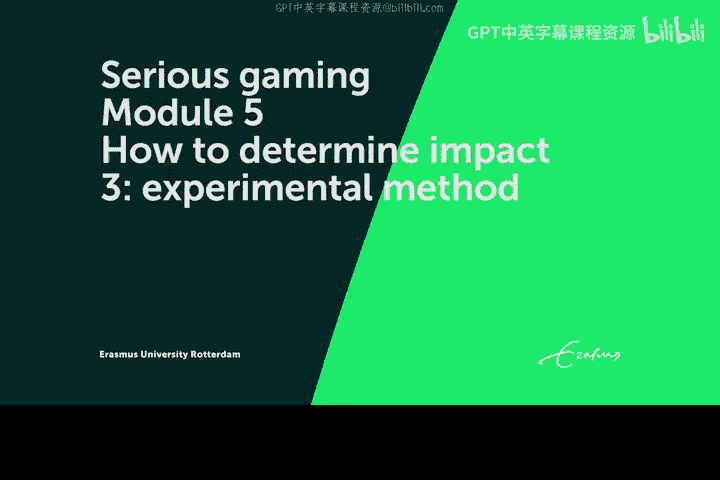

# 严肃游戏研究方法：P24：实验研究方法的利弊分析 🧪

在本节课中，我们将要学习实验研究方法，这是评估严肃游戏影响力的核心工具之一。我们将详细探讨如何在游戏实验室和调查研究中应用这一方法，并通过具体案例来理解其优势与局限。

## 概述

上一节我们介绍了前测-后测设计和调查研究中控制组的使用。本节中，我们将深入探讨实验研究方法的具体应用。实验方法通过对比实验组和对照组，并控制外部变量，旨在更精确地确定游戏对玩家的影响。

## 游戏实验室中的实验方法

游戏实验室为进行影响力研究提供了一个绝佳的工具，因为它使我们能够测试严肃游戏的许多不同方面。

以下是游戏实验室实验的三个主要特征：

**1. 受控环境**
游戏实验室的第一个定义性特征是它是一个受控环境。这意味着研究从邀请人们到大学里一个安静、良好的房间玩游戏开始。他们玩一段固定的时间，例如15到45分钟。实验室里没有干扰，观察玩家可以确保他们在玩游戏时不会查看YouTube或Facebook，也不会通过耳机听音乐。

**2. 变量操纵**
第二个特征是实验室允许进行操纵。这听起来可能有些奇怪，但在实践中相当直接。这种操纵相当于在我们称之为**自变量**的因素上创造系统性变化，以确定其对**因变量**的影响。例如，自变量可以是使用了Laherra模型中的哪些说服属性。我们可以测试两个关于难民危机的说服游戏版本，每个版本突出一个不同的说服属性。因变量则是游戏后态度改变的程度。在这个设计中，我们试图确定，例如，叙事说服的效果是否强于程序说服的效果。当然，我们需要前测和后测设计来确定玩家在玩那个特定游戏之前对难民危机的态度是什么。

**3. 控制组**
实验室实验通常甚至更复杂一些，这就引出了第三个特征：**控制组**。当玩家进入游戏实验室时，他们被分配到实验组或对照组。在我们的例子中，实验组玩难民游戏，而对照组则接触另一种信息，例如关于该主题的纪录片。

## 实验室实验案例

既然我们已经描述了在游戏实验室中应用的实验方法，现在可以讨论一个使用此方法的最新研究案例。

Kathleen Gererling和她的同事使用游戏实验室实验来研究玩一款名为《生日派对》的关于身体残疾的游戏如何影响对残疾人的态度。他们的实验设计是操纵玩家的界面：一组使用普通游戏控制器玩《生日派对》，而另一组则坐在为此特定目的设计的轮椅式控制器上玩。结果显示，与使用游戏控制器的人相比，使用轮椅界面的玩家对残疾人所面临挑战的认识更高。

## 调查研究中的实验方法

我们在本模块中多次提到，严肃游戏的影响力研究是一个年轻的领域。因此，迄今为止，只有少数符合说服游戏适当影响力研究标准的实验室研究发表。实验方法更频繁地用于严肃游戏影响力的调查研究中。这可能是由于实际问题的考虑。对于游戏研究者来说，找到愿意在家完成在线问卷的人，比找到愿意付出努力来大学参与游戏实验室实验的人更容易。这使研究者面临一个艰难的权衡：她是投入额外的时间和金钱进行实验室实验，以确定游戏对因变量的影响，而不必担心外部因素的干扰？还是接受在游戏过程中可能因查看社交媒体而产生的干扰，如果这能使她接触到远更多的受访者？轮椅实验表明，有时选择一种方法还有其他根本性的原因。显然，轮椅游戏控制器的操纵需要一个实验室环境，因为不可能在家里进行。

## 调查研究中的实验案例

现在我们来讨论几个调查项目的例子，这些项目使用实验方法来确定严肃游戏的影响力。我的同事Ru Jacobs将介绍关于《我的棉花采摘生活》的影响力研究。《达富尔正在消亡》在本MOOC的第一个模块中已经讨论过，并在后面的模块中也出现过几次。这突显了该游戏作为最著名的说服游戏范例之一的地位。Weieng、Mira Lee和Carrie Heer在他们的在线调查中使用了这个游戏进行实验设计。结果显示，与阅读文本或观看游戏片段相比，玩游戏对玩家帮助达富尔局势的意愿有更显著的影响。通过将实验组的游戏玩法与控制组的观看游戏录像分开，这些研究者证明了游戏的互动性导致了角色代入感的增强，而不是其声音和视觉效果等其他说服元素。虽然作者没有得出这个结论，但可以说程序修辞是所发现效果的原因，因为这个元素依赖于说服对象在体验中拥有能动性。

我们的第二个案例是Dana Rojiro关于《SP》影响力的研究。她调查了超过5000名青少年玩家对无家可归者的态度，这很可能是迄今为止关于说服游戏的最大规模的影响力研究。在接触后立即测试，玩游戏的实验组与对照组之间没有发现显著差异。然而，当参与者在三周后再次接受测试时，那些玩过游戏的人比那些没有玩过的人对无家可归者持有更积极的态度。因此，该游戏具有我们在研究中称之为“睡眠者效应”的效果。很可能随着时间的推移对游戏的反思导致了态度的改变。

## 伊拉斯姆斯大学的研究案例

实验方法也在伊拉斯姆斯大学的研究中得到应用。在我们最近的一项研究中，我们将玩说服游戏《我的棉花采摘生活》与观看涵盖同一主题的动员性YouTube视频片段进行了比较。该研究包括前测和后测，以及两种媒体条件（即玩游戏或观看视频片段）。结果显示，与观看视频片段的人相比，玩过游戏的人在关于采摘50公斤棉花有多辛苦的态度上表现出更大的增长。对游戏的享受程度以及对游戏意图的认识也增加了从前测到后测的态度改变。我们发现这些结果有趣且有希望，因为《我的棉花采摘生活》是一个非常基础的说服游戏，正如你可能从我们在模块4中包含的游戏录像中记得的那样。显然，这种数字小册子是有影响力的。

在伊拉斯姆斯医学中心，Mary Dunnkba研究了《ABCD E SIM》在培训急诊医学的年轻医生中的影响力。她的实验设计相当于比较玩游戏的医生与通过教科书或电子学习接受急诊室指导的医生。结果突出了游戏玩法的激励性影响，例如，这表现在玩家投入的学习时间远多于其他组。对游戏和电子学习的严格比较显示，游戏和电子学习在提高技能水平方面有相似的影响，但《ABCD E SIM》在提升医生练习技能的动机方面更胜一筹。如今，《ABCD E SIM》被嵌入伊拉斯姆斯医学中心的一个三步培训计划中：第一步是电子学习计划，包括学习技能所需的背景知识；第二步是玩《ABCD E SIM》来练习技能；最后一步是面对面的培训课程，在那里必须执行这些技能，并由训练有素的指导员进行评估。这个案例显示了游戏玩法背景对游戏影响力的重要性，这显然最适用于学习和培训环境。

## 总结

本节课中我们一起学习了实验研究方法。总而言之，实验方法包括一个实验组和一个控制组，并使用前测-后测研究设计。我们的案例表明，这种研究方法提供了一个实用的工具来确定严肃游戏的短期和长期影响。实验研究最适合研究少数明确定义的自变量对一个或少数几个因变量的影响。这可能会缩小我们可以研究的影响力范围，但幸运的是，游戏研究者也可以采用其他方法，例如深度访谈，以更深入地挖掘玩家的主观体验。当实验或调查产生难以解释的结果时，这可能是有必要的。