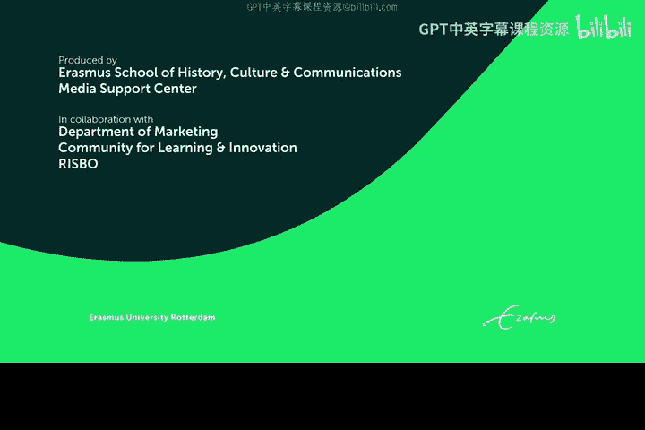

# 鹿特丹伊拉斯姆斯大学《严肃游戏｜Serious Gaming》中英字幕 - P25：24_建立系统性认知框架.zh_en - GPT中英字幕课程资源 - BV1axeUzbE3D

好。

Yeah。Definitions， characteristics， persuasive properties， impact issues。

 after five weeks of lectures， discussions， assignments， and case studies。

 this is the last level of our course on serious games。So far。

 you've trained your knowledge and athletictic capabilities。

 and hopefully you've also been able to improve your own gaming skills by playing some of the games we introduce to you。

Above all， we hope that you have enjoyed your learning experience。

Maybe you followed all weeks of this book， maybe you have cherry picked your own topics to watch and review in both cases。

 it might be useful to take a step back and review the different contributions thiscourse had in store for you。

In this last week， we'll introduce you to some technologies that might influence the development of series games in the future。

 But first， let's connect the dots。😊，Yone has joined me in the studio so we can go over the lessons learned together。

Yon， we started this moocC by asking everybody to write their own definition of series games on a piece of paper。

 Do you still remember that？ Yes， I do。 It generated many interesting answers on our discussion forum。

 some even more poetic than our own。😊，Many learners underline the teaching aspect of serious games。

 and I think that is indeed one of the most important elements that sets them apart from regular games。

It's the design purpose of the game that is different by playing the game you are supposed to learn something that was also an element in our own definition。

 we said that series games are games that use computer game and simulation approaches and or technologies for primarily non entertainment purposes。

But why is it important that everybody has a similar definition at the start of a course like this？

We wanted to make sure that everyone had a clear understanding of what serious games are and what they are not。

By also adding the five characteristics of games， we know that learners can， for example。

 make a distinction between an ordinary simulation and a simulation game。It also helps to understand。

 for example， why series games are supposed to achieve a better learning outcome than watching videos or reading books。

The competition element of games is one explanation here。

 people are challenged to take further steps in their learning process and understanding and also deceive direct feedback on what they are doing。

The learning process by means of a game is therefore much more engaging than just reading a textbook。

 So that had a clear purpose。 Everybody had the same knowledge level。

 It seems like a good starting point to increase the difficulty level because after the first module。

 things got a little bit more theoretical。 Indeed， we diveed into the definition of play and how play is part of shaping culture。

😊，Concepts such as Homouddentance and the theories like the Use in gratification theory and self determinationmination theory were explained to give more insights into the reasons why playing games is so attractive for so many people。

And why we want to keep on playing， even if we， for instance。

 become frustrated because we get stuck in a certain level。

 I certainly see how this knowledge is helpful when you're analyzing a certain game or playing it yourself。

 but how is theory helpful on a more practical level， for example。

 if you're in the process of designing a game yourself。

 Theory here points to essential elements that should be included in a game if you want to keep your paras engaged。

And when they keep on playing your game， it will be more likely that you get your message across。

This was practically demonstrated by serious game company Or that showed their mobility game from five to four。

Fols from organicgan also explained that the game should be challenging。

 but always doable for the players。Especially in the beginning。

 because players will be demotivated if the game is too easy or too hard。

A good game gives the players a feeling of competence of being able to achieve something and conquer the challenge Indeed from five to4 was a great case study because it tied theory and practice together and also show that sometimes working with different definitions can also be useful。

 I remember that phones working for a game company had a very different idea about play than philosophy professorfes Yos dem The case studies in this course are indeed important moments because as a learner you can relate your knowledge to real life examples。

😊，The case studies had different purposes， though， In week 1 and 2。

 they were used to illustrate certain definitions or characteristics。 In week 3。

 they were used to show that serious games are not a genre in itself。

 but can consist of many different types of games in many different professional contexts。

 Simulations can be used to train complex behavior。

You saw how simulations work to train behavior in the harbor of Rotterdam and in the hospital emergency room。

Gamification implies a different approach， but it still falls under the serious games umbrella。

 So halfway of course， we already covered quite some ground。In week four。

 we concentrated on a specific feature that many series games tried to incorporate persuasiveness。

A serious game needs to have certain properties if a game designer wants to influence how a person thinks or feels about a certain topic。

 this was a difficult week。Difficult， yes， but also important。Also by week four。

 we know that many learners are ready to go to the next level of theoretical difficulty。

 the basic knowledge is there， that's why we addressed rhetoric。

 the classical art of persuasion and the more psychological process of persuasion。

Theories like the elaboration likelihoodli model and the Laherra's conceptual model of persuasive dimensions not only inform you about how you can motivate people to play。

 but also how you can use game elements to provide information， create awareness。

 or even nudge people to change their attitude towards something。

So theres also more practical lesson here。 If you want to develop a serious game that is persuasive。

 you can choose various roads to achieve that。 You can provide a person with information。

 but packaging your message in a playful and attractive way。

 is maybe an equally important aspect of it。 Even when you do not want to design your own game。

 I think it is important to understand that we can all be persuaded by the way something is designed or present it。

😊，Think about when you want to buy a new phone or even when you are voting for a political candidate。

 the same holds true for playing games。 and it's interesting to see how this plays out when you play a game。

 Design is， of course， important， but we can judge a book completely by its cover。

 It's not clear cut than a beautifully designed game will have more impact than a game that looks less polished。

😊，The gameplay and other persuasive aspects need to be on par with its aesthetics。Sure。

That is why week five was dedicated to impact。 This is an important issue to address from an academic point of view。

 because we would like to know the effectiveness of games as a learning vehicle。

From a more practical perspective， it might even be more important。

Because most serious games require a substantial investment and cannot simply be returned to the developer if they do not achieve the desired outcome。

 thinking about the impact is crucial。That way， as an organization。

 you can make an evidence based decision whether or not to invest in a gaming project。

For game designers， it is important to understand which elements they need to take into account when they want to achieve as much impact as possible with their game。

 Unfortunately， the issue of impact is not easy。 Game researchers understand the impact that series games can have in a complex way。

 They try to determine the effects games can have on the ideas， intentions or behavior of players。

 both immediately after playing， but also after a longer period of time。

And they use various research methods to analyze these forms of impact。During this module。

 you have gained more insights in these methods and their pros and cons。

 how valuable it is a methodological input for non academics。

I strongly believe that also for professionals and students。

 it's important to at least understand the basics of research principles。

When you want to form an opinion about something or have to make a decision， for example。

 to invest in a series game， it is good if you can critically evaluate the research you read。

It is useful， for example， if you can see the difference between the longterm and short termm impact of a game or to understand when an experimental study does not have a control group。

 it is less reliable， or when a study is based on a questionnaire。

 it often can only tell you something about self-reported behavior。

The roundtable discussion we organized in week five gave a good summary of these issues。

Having three experts at the table was useful because they all have their own field of expertise and have shed light on different subjects。

And if you have to give one last advice to the learners in this course。

 before they move on to the last topics we discuss， what would that be？Theory。

 methods and practical examples were the three pillars that supported this course。

 We have gathered essential information that is very handy If you want to analyze series games or consider using a series game。

 or even if you set out to create your own series game。

I do hope that you will continue your search for knowledge further。

 This course offers you a basic starting point。 Keep on studying this topic。

 The field is changing fast， Intering， new developments are always just around the corner。

 I hope you are inspired to learn more。 And if in the future。

 you start working on interesting game related projects yourself。 Let us know。 Thank you，😊。

And it's not game over for this course yet， in this final week， we dare to step into the future。

This is a real challenge because the gaming landscape is very dynamic and it changes quickly。

 We'll discuss two technological developments that will probably impact the future of serious games。

 virtual reality and augmented reality。😊，Enjoy。

