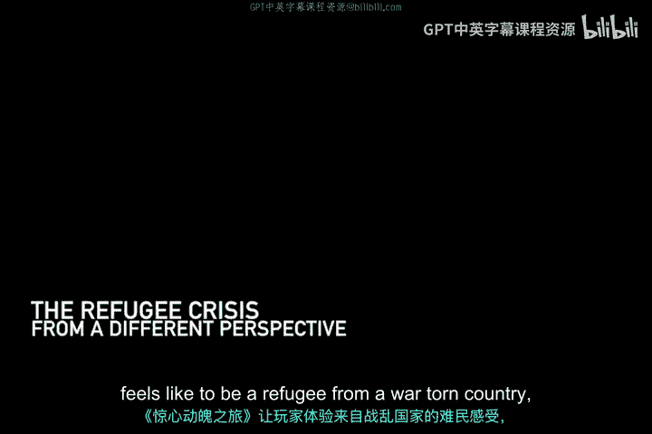

# 鹿特丹伊拉斯姆斯大学《严肃游戏｜Serious Gaming》中英字幕 - P26：25_虚拟现实技术的应用.zh_en - GPT中英字幕课程资源 - BV1axeUzbE3D

If you've seen the science fiction movie， the Matrix。

 created by the Weowski Sisters and released as part one of the Matri strategy in 1999。

 you probably have an idea of what virtual reality is。

For the people who do not know about the matrix， let me give you a short recap。

 the matrix tells the story of Neo， a hacker who's recruited to fight an army of self-ware machines that have created a simulation。

 an artificial reality in which they keep human minds captive while living off their bodies。

Most of the humans， Neo is one of them in the beginning。

 don't even know that their reality as they perceive it is fake。In a movie。

 Li will take up the fight to free humans from the dominance of the machines。

Just like many other technologies， development of virtual reality or in short VR is inspired by science fiction。

Many scifi stories play with the idea of alternate realities。

 You could even argue that all fiction stories in a way present us with a virtual reality。😊，Still。

 when we're reading a book， watching a TV show or a movie。

 we're still aware that we're actually consuming something and that we're sitting on our real life couch or in the cinema。

VR tries to take this immersive experience a step further in VR。

 we're not just experiencing the story， we're living it。😊。

VR technology immerses its users in an experience that is responsive and feels real。

 but does not exist in our analog world， in a book about the myths and realities about VR。

 Arnaldi Gitten and Morro state that the objective of VR is and I quote。

 to allow a user to virtually execute a task while believing that they are executing it in the real world end of quote。

VR technology itself was developed around 1965 when computer scientists and Internet pioneer Ivan Sutherland had a clear vision of what VR could be。

 He called it the ultimate display， a window to step into Alice's Woland。

It took a while before VR technology was actually available for the general public。

 it was not until 2016 that VR headsets were available in stores on a larger scale and for a reasonable consumer price。

VR is used in many different areas， from art projects to industrial design and film。

 to training and healthcare， and also in the area of series games， VR technology holds many promises。

According to Sherman and Craig， who published a book about Understanding VR in 2018。

 the VR experience consists of five elements。One， the virtual world， two immersion， three。

 interactivity for the creator， and five the person who is in the virtual world。As you might notice。

 many of these elements are also present in the games that we have discussed so far。

 but whereas a serious game on your mobile phone， tablet or computer presents the gameplay on a flat surface。

 virtual reality lets you experience the gameplay in 360 degrees and three dimensions。

Scrreens are this still used， but they're usually integrated in some sort of helmet or glasses。

 Sometimes players are also wearing special gloves or use equipment that is connected to the VR experience。

😊，By adding sensors， the software calculates where in the game world the player is and how he or she moves through it。

The player can also manipulate objects in the game environment。

All these characteristics make the experience even more immersive as compared to a serious game you play on a flat screen。

 It feels like you're actually there。😊，To summarize。

 what sets VR apart from a series game displayed on a regular screen is that VR blocks out the real world。

 it presents virtual world objects in life size， which may result in an even more convincing illusion of immersion。

There are many examples of VR games that are directed at the entertainment market。

 You can explore space， fight wars with aliens and solve puzzles。

 But what does VR bring to the market for serious games。😊。

Let's look at two examples of how VR is used there。The VR experience called a breathtaking Joney。

 provides an excellent example of what VR can amount to。

It's been developed a moreine Cour and its fellow game designers at the Technical University of Einho。

 the Netherlands。😊，A breathtaking journey wants players to experience what it feels like to be a refugee from a war torn country。

 secretly crossing the border in the back of a truck。

The VR physically recreates the truck， including the tangerines。The playful elements are。

 for example， concerned with hiding yourself as good as possible and controlling your breathing when customs inspect a truck。

Corrus and the persuasive gaming and context team have researched the impact of this playful interaction on the empathy for refugees。

As you can imagine， this kind of VR requires quite a deal of equipment。

The second example takes us to the medical domain。Here。

 the added value of games for patients is explored in many different areas。

 VR games are used to help train doctors， Rehabilitate patients。

 or help them manage their pain or anxiety disorders。

 And you understand the more immersive the game is， the better it will do its job。😊。

Although not all medical VR experience are games， many of them are just providing training or experiences。

 some also integrate game elements。I'm sure you can imagine the ABC D E SimM we discussed earlier as a VR experience。

 It will be even more immersive for doctors that are training to work in the emergency room。😊。

The Dutch Hospital St Martin's Clinic， specialized in movement。

 leads a European project to develop VR for rehabilitating patients。

One of their project is Hands aroundund the World， a VR experience with game elements that trains the hand function of children who have trouble moving their hands because of brain damage。

The goal of the project is to develop a VR experience that children can use at home。

A last development I would like to discuss with you related to VR is brain control of gameplay。

 also called brainin computer interface games。😊，Instead of using special gloves and equipment to move around and manipulate objects。

 you can do all that by thinking about it。😊，One interesting prototype is Mind the sheep。

 developed and studied by Hewrittentan Gek and his colleagues at the University of Tine。

 the Netherlandslands。😊，The aim of the game is to fence in a bunch of freeroaming sheep by herding them with dogs。

The dog is controlled by a brain computer interface that wants the players to focus their vision on the flickering circle representing the dog。

This produces a brain response that becomes stronger， the more the player pays attention。

The ordinary cursor is used to direct the dog once the focus has been established。

The results from this pioneering research show that players felt immersed because of their strong cognitive involvement。

😊，A breathtaking journey， hands around the world and mind the sheep。

 illustrate that this type of gaming or playful interaction moves away from ordinary computer tablets or phones。

 but still results in a situation where the game is played in a confined space。

Augmented reality gaming is the next technology we will discuss。

 It takes the player out into the real world。😊，When you start the next video。

 you will hear more about this particular technology。

