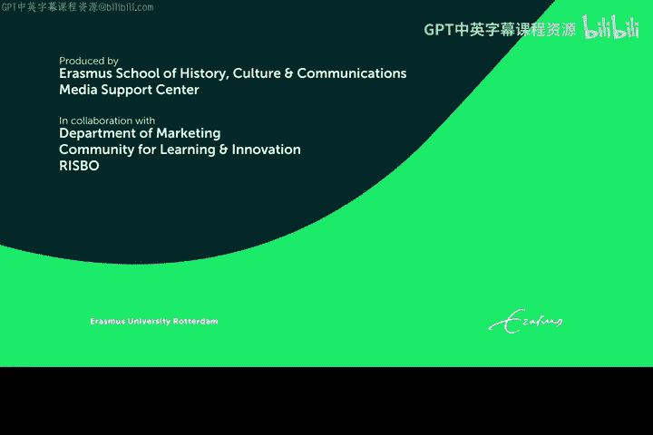

# 鹿特丹伊拉斯姆斯大学《严肃游戏｜Serious Gaming》中英字幕 - P27：26_增强现实技术的演进.zh_en - GPT中英字幕课程资源 - BV1axeUzbE3D

Have you ever played Pokemon Go。Maybe you've heard about it。

The game was developed by Nante in 2016 and caused the Pokemon go grace all over the world that same summer。

The smartphone game app uses GPS and augmented reality technology to project virtual creatures。

 Pokemon in the player's real world environment。The player then needs to capture them。

According to the Washington Post， Pokemon Go was one of the first real success stories of augmented reality technology by blending the real world with the virtual one。

Millions of people went outside to the most unusual places for their quest。

Jenkins and colleagues define augmented reality as a virtual overlay of data and experience onto a real life context。

This is somewhat different from the virtual reality technology that we just in the previous video。

The most striking difference between virtual and augmented reality is that VR technology completely blocks out the real world。

 All surroundings and objects are generated by a computer。

While augmented reality or AR uses the real world as a setting to build upon。Or in other words。

 in virtual reality， a real world object， the player is placed in a virtual world。In oed reality。

 virtual objects are placed in real world。Most apps that use augmented reality use the camera on a smartphone or tablet to show the real life environment and combine this with an extra layer。

In his book， Understanding Aed Real， Concepts and App。

 Ellan Gake states that the core idea of the AR experience not only is that digital information is placed in the physical world。

 but that you also can interact with it。Arnaldi Giton Emorro。

 the authors of the book on VR and AR that we already introduced in the previous video。

 described the goal of AR as follows。The goal of AR is to enrich the perception and knowledge of a real environment by adding digital information relating to this environment。

Most of the time， this digital information is visual and sometimes it's auditory。

Although human beings have always had the desire to change their surroundings。

 it wasn't until digitization and advanced computer technology that these changes could be made virtually。

With AR technology， it's possible to actually create a relationship between a geographical location and digital information。

Greg formulates four key features of augmented reality。One。

 the physical world is augmented by digital information， for example。

 images or sounds that are superimd on a view of the physical world。Two。

 the information is displayed in alignment with the physical world。Three。

 the information displayed is dependent on the location in the real world and the physical perspective of the person in that location。

Four， the augmented reality experience is interactive。

AR applications can be found in many different domains。

One often used application of augmented reality is immobility。

While fighter pilots already used AR to navigate the airspace for quite some time。

 cars nowadays display additional information on the driver side of the windshield to help them drive the safest way possible。

Also， tourism is an area in which AR has already proven its efficiency。

Think about an app that provides you with additional information of all statues in public space when you do a city tour。

Or in retail， when a furniture store lets you see in your own living room how that couch would fit with the furniture that you already have。

Or imagine that shoe brand that lets you experience their newest pair of sneakers on your own feet。

The possibilities are endless。In the game industry。

 AR has opened up the door for location based gaming。

 such as Pokemon Go example I gave at the beginning of this video。

Location based games unfold in the ordinary real world using the GPS and wireless access on mobile phones。

Researchcher Cb Las from Lening University the Netherlands argues that location based gaming changes the meaning of the urban landscape as ordinary streets。

 benches or ramps become sites for playful social interaction。Consequently。

 the digital maps on the phone also get an extra layer of meaning being redefined as the source for playfulness。

Of course。There's also debate on these types of games。For example。

 when Pokemon go players venture out in the real world to places that might be dangerous。

 such as railway tracks and roads or morally debatable， such as war memorials。

Serious game developers also use augmented reality to add to the experience of players。

 let me give you two examples here。The first serious AR game I would like to discuss here was developed in 2016 by En Ranch and partnersner for Dutch Super。

The game featured a little robot， tackie， and was meant to inspire children to know more about the technology and take their first steps into coding。

By doing groceries in the supermarket， cards could people collected it that will provide the children with the building blocks to coat their own robot in the app and teach it specific moves。

By playing with the different code blocks， the robot would come to life virtually at the children's homes。

By combining the codes， kids could for example， make the robot dance。

They could personalize their robot and send videos and pictures to friends and family。

As you might understand， this game is not only educational。

 but also a clever example of an ad for game。A second example can be found in the health domain with the fitness app。

 Zs Run。This game couples your location to a fiction story of zombies invading Earth。

 you need to run to the last remaining safe place for humans while you're running。

 you hear the zombies getting closer and closer。The real world experience of running is augmented by the sounds of zombies chasing you。

 which general results in an increase of the time spent on this healthy exercise。

Instead of a visual overlay， this augmented reality app thus uses audio as digital information。

Predicting the future is something that academics are usually wary of。 We do not have a crystal ball。

We can， however， state with quite a lot of confidence that VR and AR are not the only technologies that will impact the development of series games in the future。

Think， for example， about face recognition and 3D scanning technologies， it will be easier to。

 for example， have an avatar in a game that looks precisely like you。

You might be able to play games by using your voice or brain control。

Gestster control will be further developed。Graphics also keep on improving。

 making the games even more realistic。A tendency is feasible。

Serious games seem to be partially and slowly moving away from gaming on fixed screens。

 extending the way in which you can interact with the gaming technology。As a result。

 the boundaries between players， game， real worlds， and virtual worlds become blurry。

And this will raise many more interesting questions for researchers to answer， for example。

 if we can sustain the distinction between the real world and the virtual worlds in the future。

We will be there keeping an eye out for new and interesting ways to experience serious games。

 and we hope we've also inspired you to stay interested。

