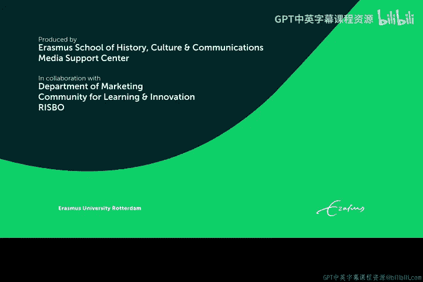

# 鹿特丹伊拉斯姆斯大学《严肃游戏｜Serious Gaming》中英字幕 - P28：27_第5周 问卷调查研究方法的利弊探讨.zh_en - GPT中英字幕课程资源 - BV1axeUzbE3D

Yeah。Welcome to our lecture on the survey method。 This research method may be familiar to you as we're often asked to fill out a questionnaireer。

 Maybe you even have completed multiple ones。 Chances are that you liked some but hated others。

 You may even have stopped answering the questions if you found the questioner too long or the questions too boring。

This common experience catches a possible fate of survey research。

 distributing a survey among respondents is a very efficient research tool once game researchers have constructed a survey。

 they can invite hundreds or even thousands of players to participate。

 but once it has been sent out they cannot change anything。

 so developing a high quality questionnaire is the major challenge of survey research。

For me and many other game researchers， the benefits of the survey method are far larger than its possible disadvantages。

 Let me tell you why。Because the survey method is an efficient tool to gather answers from a large number of people。

 it is relatively easy to compare the impact across different groups。For example。

 differentiating between respondents with different levels of political interest or differentiating between respondents educational level。

This is the first advantage。A second advantage is that the survey method enables researchers to test theoretical assumptions by including proper measures in the questionnaire。

In our present case， this is about measures that are required to find out what determines the impact of a serious game。

The game's impact is hardly ever tangible in the sense that you can touch or grasp bit。For example。

 the attitude chain targeted by my cotton picking life is about how someone thinks or feels about child labor and possibly what he plans to do about it。

In research， attitudes belong to the family of concepts。Intenddent outcomes， like， for example。

 empathy or motivation， are also concepts。In game research。

 we build upon a long tradition in social psychology of measuring the concept's attitudes。

 empathy or motivation。This is how it usually works。

We ask players to answer a few questions that each cover a different aspect of the concept。

 then we use statistics to construct scales on the basis of their answers。

In our own research on persuasive games， we often include attitude scales to measure how strong the player's attitude is。

 but also whether the attitude is positive or negative。

A third advantage is that it is easy for respondents to contribute All my surveys can be completed anywhere the respondent likes。

 and paper and pencil surveys are often distributed in places where the respondent already is。

 for example， at work or in school。There are also some drawbacks to doing survey research。

 the large scale nature of this method generally results in a lot of practical work。

 in particular when the answers on paper and pencil questionnaires need to be type into the computer for statistical analysis。

Nowadays， many researchers can save that hard work by using an online survey tool。However。

 it should be noted that cheating is easier in online surveys compared to paper and pencil distribution。

It is possible that a 16 year old young man presents himself in the online survey as a woman of 38。

It might also be a challenge to reach the target group。

 sometimes the intended audience is located in a school or company。

 but often the researchers seek to include a more diverse general audience。

Then they have to put in extra effort to direct attention to their survey， for example。

 by using social media or advertisements in traditional media。

We now turn to the actual application of the survey method in research about the impact of serious games。

 My colleague Joyce Nes will be our guide。In this lecture。

 I will present two survey projects about the impact of serious games we conducted at Erasmus University。

In retrospect， the first one was a kind of pioneering work in addressing the impact of online games conveying a political message。

 We used the web based survey tool that enabled us to invite respondents to choose one game out of the four games we offered。

 Darfur is dying。😊，Airport Security， McDonald's game and September the 12th。Next。

 we questioned our respondents about their knowledge about the topic of the game， for example。

 about the crisis in Darfur。This was our pret testest。

 then our respondents played the game and once they were ready the survey tool administeristered our post test measurement to establish the immediate impact of the game。

The results showed a slight increase in knowledge， we also found that playing the game inspired many respondents to talk about the topic and the game itself。

 we labeled this kind of impact， social facilitation as playing the game facilitated social interaction with peerce about the game and its topic。

Our second survey project was about Ping。 That is poverty is not a game。

 The persuasive game that was already discussed briefly in moduledule 4。

 This large project was conducted in Flanders and the Netherlands in collaboration with our Flemish colleagues。

 Fredederch dehova and Yon Fonloy。 Ping was developed by the European Union in relation to the European campaign against Poverty and Social Icclusion。

😊，The game aims to raise awareness and to discuss the complex mechanisms underlying poverty。

 especially among youth。Using a pretest post as design。

 we questioned players immediately after playing the game and again after three months had passed。

 as we expected， intended behavior， for example， intending to become a member of an interest group measured immediately after playing scored higher。

 then actual behavior after three months， in other words。

 players did not become a member of such an interest group。

 even though they thought they would do so when they just played the game。Interestingly。

 about one thirdd of the players indicated to be significantly more politically interested after the three months period。

 this is a surprising result， as this group indicated to be not that politically interested at the time of the first measurement our investigation of this particular group showed that again。

 social facilitation or civic talk was important the respondents in this group indicated to have talked with their family and peers about the subject of poverty the most when compared to the other participants in this study。

Playing p can then be regarded as the instigator， while talking might have been at least partly facilitated an increase in political interest。

Our ping research presents a good case to reflect on the possible influence of external factors。

 we found that playing ping had impact， but we cannot rule out the possibility that the increase in political interest was also caused by an external factor。

 for example， the changing political situation in Belgium and Netherlands at that time。

Our next lecture is about turning the survey method into a true experimental method that aims to minimize and control for these external influences in most studies about the impact of serious games。

 this has been done by including a second group that is not exposed to the game。

 the so-called control group， we will use examples from previous research including our own to show what the experimental method has to offer and what is possible drawbacks are。

