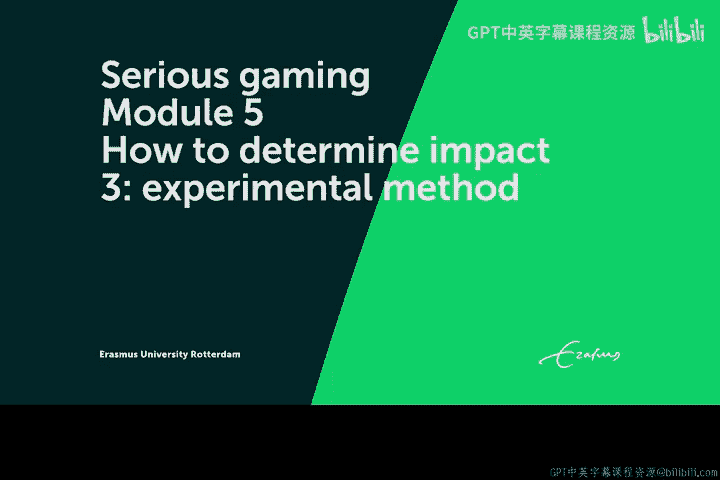

# 鹿特丹伊拉斯姆斯大学《严肃游戏｜Serious Gaming》中英字幕 - P29：28_5.3c 单元慕课：严肃游戏模块5-影响力评估之实验研究方法.zh_en - GPT中英字幕课程资源 - BV1axeUzbE3D

。

This is our third and final lecture about research methods that are used to determine the impact of series games in the previous lecture we presented the pretest post test design in survey research and we also introduced a key feature of the experimental method that is using a control group in addition to the experimental group。

Now we will go into more detail about this experimental method。

We will discuss how it is used in the game laboratory and in conducting survey research。

The Game Lab provides an excellent tool for conducting impact research because it enables us to test many different aspects of a series game。

The first defining characteristic of a game lab is that it is a controlled environment。

What does this mean？Well， it begins with inviting people to play a game in a nice and quiet room at our university。

 they play for a fixed amount of time say between 15 and 45 minutes。

There are no distractions in the lab and observing the players ensures that they are not checking YouTube or Facebook or listening to music over earphones while playing。

The second characteristic is that the labos for manipulation。This may sound odd。

 but it is pretty straightforward in practice。 The manipulation amounts to creating a systematic variation in what we call the independent variable to establish the effects on the dependent variable。

For example， the independent variable could be which persuasive properties from de Lahira's model are used。

Here we will test two versions of a persuasive game about the refugee crisis。

 each highlighting one persuasive property。The dependent variable then is the amount of attitude change after playing。

In this design we try to establish， for example， whether the effect of narrative persuasion is stronger than the effect of procedural persuasion。

Of course， we would need to pret and post test design to determine what the player's attitudes regarding the refugee crisis was before playing that particular game。

Lab experiments are usually even a little more complex， which takes us to the third characteristic。

The control group。Players are allocated to an experimental group or control group when they enter the game lamp。

The experimental group in our example plays the refugee game and the control group is exposed to a different kind of information。

 for example， a documentary about the topic。Now that we characterize the experimental method as it is applied in the game lab。

 we can discuss an example of a recent study using this method。

Kathleen Gererling and her colleagues used a game lab experiment to study how playing a game about physical disabilities calledBday party influenced attitudes towards people who are disabled。

Their experimental design was the manipulation of the player' interface。

 one group played birthday party using an ordinary game controller。

 while the other group played by sitting in a wheelchair based controller designed for this particular purpose。

The results showed that the awareness for challenges that disabled people face was higher among the players using the wheelchair interface compared to people using the game controller。

We mentioned a few times in this module that research on the impact of serious games is a young field。

Consequently， only a few laboratory studies meeting the criteria for appropriate impact research on persuasive games have been published until now。

The experimental method has been used more frequently in survey research on the impact of serious games。

 This may be due to practical issues。It is easier for a game researcher to find people who are willing to complete an online questionnaire at home。

Then it is to find people who will put in the effort of coming to the university to participate in an experiment in the game labb。

This confronts the researcher with a difficult trade off。

Does she invest extra time and money in a lab experiment to determine the game's impact on a dependent variable without having to fear distraction by external factors？

Or does she accept the possible disturbance of checking social media during play if that enables her to reach a far larger number of respondents？

The wheelchair experiment shows that sometimes that there are other fundamental reasons to favor one method。

It is obvious that the wheelchair game controller manipulation requires a lab setting as it would not have been possible to perform at home。

It is time to discuss a few examples of survey projects where the experimental method was used to determine the impact of serious games。

My colleague Ru Jacobs will present impact research on my cottonton Pick life。

 spent the ABcD scene and therefore his dying。Darfur's dyinging was already discussed in the first module of this MO and appeared a few times in later modules as well。

This underlines the game's status as one of the most famous exemplars of persuasive games。Weieng。

 Mira Lee and Carrie Heer used this game in an experimental design in their online survey。

The results showed that playing the game had a more pronounced effect on players' willingness to help with the situation in Darfur than reading a text or watching a clip of the game。

By separating gameplay in the experimental group from watching footage of the game in the control group。

 these researchers demonstrated that the interactive nature of the game caused the increased role taking rather than its other persuasive elements like sound and visuals。

Although the authors did not draw this conclusion， it can be said that procedural rhetoric was responsible for the effects found as this element relies on the persuadeee having agency in the experience。

Our second case is Dana Rojiro's research on the impact of Sp。

 she investigated attitudes towards homelessness in over 5000 teenage players in what is very likely the largest impact study on persuasive games to date。

Immediately after the exposure， no significant difference was found between the experimental group playing the game compared to the control group。

 however， when their participants were tested again three weeks later。

 those who had played the game held more favorable attitudes towards homelessness than those who had not。

The game therefore had what we in research would call a sleeper effect。

 It is likely that reflections on the game over time had caused a change in attitude。

The experimental method has also been used in research at Erasmus University。

In one of our recent studies， we compared playing the persuasive game my Co picking Life to a mobilizing YouTube clip covering the same topic。

The study included a pre and post test and two media conditions that is playing the game or watching the video clip。

Results showed a larger increase on attitudes with respect to how much work it is to pick 50 kilograms of cotton for individuals who had played the game than for those who had watched the clip。

Enjoyment of the game， as well as awareness of the game's intent。

 also increased the attitude change from pre to post test。

 We found these results interesting and promising， as my cotton picking life is a very basic。

 persuasive game， As you may remember from the game footage we included in in module 4。😊，Apparently。

 this kind of digital pamphlet has an impact。At the Erasmus Medical Center。

 Mary Dunnkba studied the impact of the ABCDE Sim among young doctors in training for emergency medicine。

Her experimental design amounted to comparing doctors playing the game with doctors receiving the ER instructions by means of textbook or Elearning。

The results highlighted the motivational impact of playing， which manifested， for example。

 in the players investing far more study time than the other groups。

A strict comparison of the game and Elearning showed that the game and Elearning had a similar impact on improving the skill level。

 but the ABCD ECIM was superior with respect to boosting the doctor's motivation to practice the skills。

Nowadays， the EBCD ESIM is embedded in a three step training program at the Erasmus Medical Center in which step1 is an elearning program that includes background knowledge to learn the skills。

 Step two is playing the ABCD ESIM to practice the skills and the final step is a face to face training course where these skills must be performed and are evaluated by a trained instructor。

This case shows how important the context of play can be for the impact of the game。

 which is obviously most applicable to a learning and training environment。In sum。

 the experimental method includes an experimental and control group and uses a pre test post test study design。

Our cases have shown that this research method offers a practical tool to determine the short term and long term impact of serious games。

Experimental research is best suited to study the impact of a few well defined independent variables on one or a few dependent variables。

This may reduce the range of the kind of impact we can study， but fortunately。

 the game researcher can also employ other methods。

 such as in depth interviews to dig deeper into player' subjective experiences。

This may be necessary when experiments or surveys produce results that are difficult to explain。

