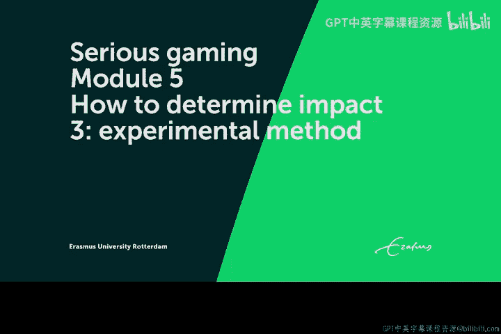

# 严肃游戏：5.3c：影响力评估之实验研究方法 🧪

在本节课中，我们将深入学习用于评估严肃游戏影响力的实验研究方法。我们将探讨如何在游戏实验室和调查研究中应用这一方法，并通过具体案例来理解其实际应用与发现。

在上一讲中，我们介绍了调查研究中常用的前测-后测设计，并引入了实验方法的一个关键特征——使用对照组。本节中，我们将更详细地探讨这种实验方法。

## 游戏实验室：一个受控的研究环境 🎮

游戏实验室为进行影响力研究提供了一个绝佳的工具，因为它使我们能够测试严肃游戏的许多不同方面。

以下是游戏实验室的三个核心特征：

*   **受控环境**：这意味着研究在一个精心设计的环境中进行。通常，我们会邀请参与者到大学里一个安静的房间玩游戏，并规定固定的游戏时长（例如15-45分钟）。实验室中没有干扰因素，研究人员会确保参与者在游戏过程中不会查看社交媒体或听音乐。
*   **可操纵性**：这指的是研究者可以系统地改变**自变量**，以观察其对**因变量**的影响。例如，自变量可以是游戏中使用了德·拉·哈拉说服模型中的哪种说服属性。我们可以测试两个关于难民危机的说服游戏版本，每个版本突出一种不同的说服属性（如叙事说服与程序说服）。因变量则是玩家游戏后的态度改变程度。
*   **对照组**：参与者进入实验室后，会被随机分配到**实验组**或**对照组**。在我们的例子中，实验组玩难民游戏，而对照组则接触其他形式的信息，例如观看一部关于该主题的纪录片。

## 实验室实验案例：轮椅控制器研究 🦽

现在我们已经了解了游戏实验室中应用的实验方法，可以讨论一个使用此方法的近期研究案例。

凯瑟琳·格林宁及其同事利用游戏实验室实验，研究了玩一款名为《生日派对》的关于身体残疾的游戏，如何影响人们对残疾人的态度。他们的实验设计是操纵玩家的操作界面：一组使用普通游戏手柄玩，另一组则使用为此目的特别设计的、基于轮椅的控制器来玩。

结果显示，与使用游戏手柄的玩家相比，使用轮椅控制器的玩家对残疾人所面临挑战的认识程度更高。

## 调查中的实验方法：权衡与实践 📊

本模块中我们多次提到，严肃游戏的影响力研究是一个新兴领域。因此，迄今为止，符合说服游戏影响力研究标准的实验室研究发表得并不多。

实验方法更频繁地应用于严肃游戏影响力的**调查研究**中。这可能是出于实际考虑：对于游戏研究者来说，找到愿意在家完成在线问卷的人，比找到愿意花精力来大学参与实验室实验的人要容易得多。

这使研究者面临一个艰难的权衡：是投入额外的时间和金钱进行实验室实验，以确定游戏对因变量的影响，同时不必担心外部因素的干扰？还是接受玩家在游戏过程中可能查看社交媒体带来的干扰，以换取能够接触到远更多数量的受访者？

轮椅实验表明，有时选择哪种方法还有其他根本性的原因。显然，轮椅游戏控制器的操纵需要一个实验室环境，因为在家中无法实现。

## 调查研究中的实验案例

现在，我们来讨论几个在调查项目中使用实验方法来确定严肃游戏影响力的例子。

**案例一：《达福尔正在死去》**
我的同事鲁·雅各布斯将介绍关于《达福尔正在死去》的影响力研究。这款游戏在本慕课的第一个模块中已经讨论过，并在后续模块中多次出现，这凸显了它作为最著名的说服游戏范例之一的地位。

魏英、米拉·李和卡丽·希尔在在线调查中使用了该游戏进行实验设计。结果表明，与阅读文本或观看游戏片段相比，玩游戏对玩家帮助达福尔局势的意愿产生了更显著的影响。通过将实验组的“玩游戏”与对照组的“观看游戏录像”分开，这些研究者证明，是游戏的**互动性**导致了角色代入感的增强，而非声音、画面等其他说服元素。虽然作者没有明确得出此结论，但可以说，**程序修辞**是产生这些效果的原因，因为这一元素依赖于说服对象在体验中拥有能动性。

**案例二：《SPENT》**
达纳·罗哈斯研究了《SPENT》的影响力。她调查了超过5000名青少年玩家对无家可归者的态度，这很可能是迄今为止规模最大的说服游戏影响力研究。在接触游戏后立即测试，实验组（玩游戏）与对照组之间没有发现显著差异。然而，当参与者在三周后再次接受测试时，那些玩过游戏的人比没玩过的人对无家可归者持有更积极的态度。因此，该游戏产生了研究中所谓的**休眠效应**。很可能是随着时间的推移对游戏的反思导致了态度的改变。

## 伊拉斯姆斯大学的研究案例 🏫

实验方法也被用于伊拉斯姆斯大学的研究中。

**案例一：《我的摘棉生活》**
在我们最近的一项研究中，我们将玩说服游戏《我的摘棉生活》与观看一个涵盖相同主题的动员性YouTube视频进行了比较。该研究包括前测和后测，以及两种媒体条件（玩游戏或看视频）。结果显示，对于“采摘50公斤棉花需要多少工作量”的态度，玩游戏的人比看视频的人有更大的提升。此外，对游戏的**享受度**以及对游戏**意图的认知**，也增强了从前测到后测的态度改变。我们发现这些结果有趣且充满希望，因为《我的摘棉生活》是一个非常基础的说服游戏。显然，这种数字化的宣传册也能产生影响。

**案例二：《ABCDE模拟器》**
在伊拉斯姆斯医学中心，玛丽·邓克巴研究了《ABCDE模拟器》对正在接受急诊医学培训的年轻医生的影响。她的实验设计是比较玩游戏的医生与通过教科书或电子学习接受急诊室指导的医生。结果凸显了玩游戏的**动机性影响**，例如，玩家投入的学习时间远多于其他组。对游戏和电子学习的严格比较显示，两者在提高技能水平方面影响相似，但《ABCDE模拟器》在提升医生练习技能的**动机**方面更胜一筹。

如今，《ABCDE模拟器》被嵌入伊拉斯姆斯医学中心的一个三步培训计划中：第一步是包含背景知识的电子学习程序；第二步是玩《ABCDE模拟器》来练习技能；最后一步是面对面的培训课程，由训练有素的指导员评估这些技能的执行情况。这个案例显示了**游戏情境**对游戏影响力的重要性，这显然最适用于学习和培训环境。

## 总结 📝

本节课中，我们一起学习了实验研究方法。该方法包含实验组和对照组，并使用前测-后测的研究设计。我们的案例表明，这种研究方法为确定严肃游戏的短期和长期影响提供了一个实用工具。

实验研究最适合研究少数明确定义的自变量对一个或少数几个因变量的影响。这可能会限制我们所能研究的影响范围，但幸运的是，游戏研究者还可以采用其他方法，例如深度访谈，以更深入地挖掘玩家的主观体验。当实验或调查产生难以解释的结果时，这可能就是必要的。