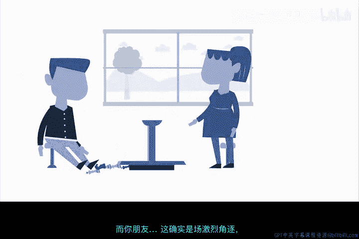
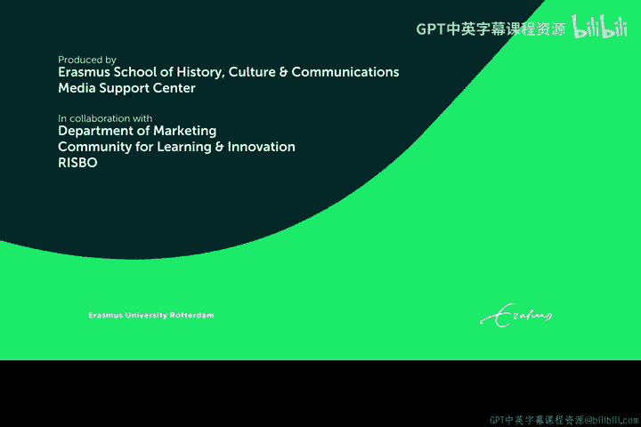

# 鹿特丹伊拉斯姆斯大学《严肃游戏｜Serious Gaming》中英字幕 - P3：2_严肃游戏的定义与特征阐释.zh_en - GPT中英字幕课程资源 - BV1axeUzbE3D

Look at the pictures on the screen。The first depicts a game of chess。The second one。

 a game of hide and seek。Although both are called games。

 it will not be difficult to imagine the differences。

While chess is played by a fixed number of two people。

 hide and seek is a group game that can be played by two or more。

To play chess a chessboard and chess pieces are necessary。

 while hide and seek does not require very specific playing objects。

The children can use already existing things to hide a tree， for example。Now。

 try to think of the similarities between these two games。Can you name one。Okay。

 let's go over the similarities together。 This is important because these similarities form the building blocks to define games。

Usually games share five specific characteristics。They are goal oriented。

You have to follow specific rules while playing them。

They have some kind of feedback system when you play， and often there is a competition element。

Finally， they are voluntary， meaning that you decide if you like to play or not。

We will now take a closer look at the game of chess。

The animation shows you the five characteristics applied to this particular game。

🎼So you've invited a friend over to play a nice game of chess。 Well， nice。 Of course。

 you both try your hardest to win and to do so， you have to take her king。

 But that's easier said than done。 There are a lot of rules you have to take into account。

 All the pieces started a fixed place， for example。

 and each piece can only move across the board in a certain way。 Hey， hey， that's cheating。

 the game's going pretty well， that is until you make a wrong move。

 And one of your pieces immediately gets taken。Luckily， in the end， you still win and your friend。

🎼Well要。

Well， this was quite a competition until one player reached his goal。The rules of chairs stand out。

 in particular， when they are broken。Here， it resulted in immediate feedback。

Concerning the voluntary nature of play well。They choose themselves to play。

 But whether these two will ever play again， I don't know。

So now you understand the basic characteristics of games in general。

These characteristics apply to entertainment games。

The type of games that most people are familiar with。However， many people do not know serious games。

 and there is often confusion about the term。We have to admit， it sounds like an oxymoron。

The words serious in games seem to be contradicting each other。Can games be serious and。

Does that mean that they're not fun at all。Well， serious games can definitely be fun。

But the most important thing that sets them apart from entertainment games is their educational purpose。

Serious game developers intend to teach their players something。 For example。

 awareness of a certain issue， information or an attitude change。

The makers of serious games apply motivation principles from entertainment games and use these to teach their players something in an engaging way。

The purpose of the game is thus different from pure entertainment games。Also。

 entertainment games might teach their players something， but their primary motive is to entertain。

Taking this primary difference into account the definition of series games we will use in this course is as follows。

Series games are games that use computer game and simulation approaches。Or。The technologies。

 for primarily non entertainment purposes。A serious game can have all the elements that characterize any other game like chess。

 as discussed in the beginning of this video。It can be goal oriented with specific rules。

 a feedback system， and a competitive competitive element。

The only characteristic that is sometimes not present in serious games is the voluntary character。

Since these games are generally used in an educational setting or a training situation。

 players will often be asked or told to play a certain simulation or game。

Serious games are different from other media products， such as educational movies or books。

 because they offer an experience in which the player is actively involved in making decisions。

The player is immersed in the game experience and is receiving feedback over his or her own decisions。

This is also why series games are supposed to achieve a better learning outcome。

According to the researchers， Rierfeld， Cody and Voder。

 who wrote the book on the mechanisms and effects of serious games。

 seriousious games are both educational and enjoyable because they are intrinsically motivating。😊。

The game environment is responsive and can have a complexity that allows for learning opportunities。

In this MOocC， we do not consider serious games to be a genre。

Serious games can be made in all game genres that you can imagine from shooters to strategy games to ge games on your phone or in the form of large scale simulation games。

Sometimes even advertisements are made in the form of a serious game。Later in this course。

 we will present a classification of serious games based on the sector they are applied in。

 such as health or education。

