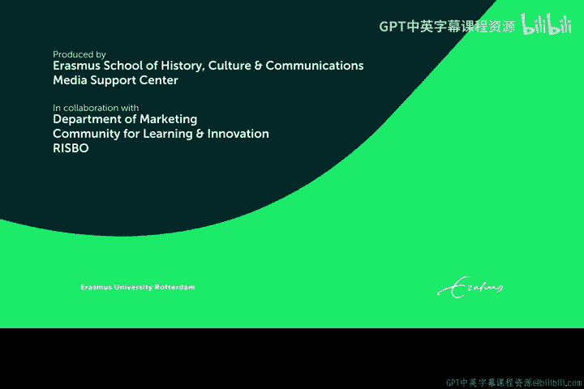

# 严肃游戏：P3：2_严肃游戏的定义与特征阐释

在本节课中，我们将学习游戏的基本特征，并探讨“严肃游戏”这一概念的定义及其与普通娱乐游戏的区别。

---

观察屏幕上的图片。第一张描绘的是国际象棋游戏。第二张是捉迷藏游戏。虽然两者都被称为游戏，但想象它们之间的差异并不困难。

国际象棋由固定的两人进行。捉迷藏则是群体游戏，可以由两人或更多人参与。下国际象棋需要棋盘和棋子，而捉迷藏则不需要非常具体的游戏道具。孩子们可以利用现有的事物来躲藏，例如一棵树。

现在，尝试思考这两种游戏之间的相似之处。你能说出一个吗？接下来，我们将一起梳理这些相似点。这很重要，因为这些相似点构成了定义游戏的基础构件。

通常，游戏共享五个具体特征。它们是：**目标导向**、**遵循特定规则**、**拥有某种反馈系统**、**常包含竞争元素**，以及**自愿参与**（即由你决定是否想玩）。

我们将以国际象棋为例，更详细地审视这些特征。

动画展示了这五个特征如何应用于这个特定的游戏。

> 你邀请了一位朋友来下一盘精彩的国际象棋。当然，你们都尽力想赢。为此，你必须“将死”对方的国王。但这说起来容易做起来难。你必须考虑许多规则。例如，所有棋子起始位置固定，每个棋子只能在棋盘上以特定方式移动。游戏进行得相当顺利，直到你走错一步，你的一个棋子立刻被吃掉。幸运的是，最终你还是赢了。

这是一场竞争，直到一方达成目标。国际象棋的规则在**被违反时**尤为突出，并导致了**即时反馈**。至于游戏的自愿性，他们选择自己来玩。但他们是否会再次对弈，就不得而知了。

---

现在你理解了游戏的基本特征。这些特征适用于**娱乐游戏**，即大多数人所熟悉的游戏类型。

然而，许多人并不了解**严肃游戏**，并且对这个术语常常感到困惑。必须承认，它听起来像是一个矛盾修辞法。“严肃”和“游戏”这两个词似乎相互矛盾。游戏能是严肃的吗？这是否意味着它们一点乐趣都没有？

严肃游戏当然可以很有趣。但它们与娱乐游戏最重要的区别在于其**教育目的**。严肃游戏开发者旨在教导玩家一些东西，例如，提高对某个问题的认识、传递信息或促进行为态度的改变。

严肃游戏的制作者运用娱乐游戏中的动机原理，以一种引人入胜的方式来教导玩家。因此，游戏的目的不同于纯粹的娱乐游戏。同样，娱乐游戏也可能教会玩家一些东西，但其**首要动机是娱乐**。

考虑到这一主要区别，我们在本课程中将使用的严肃游戏定义如下：

> **严肃游戏**是指主要出于**非娱乐目的**，而使用计算机游戏和模拟方法或技术的游戏。

一个严肃游戏可以拥有任何其他游戏（如本视频开头讨论的国际象棋）的所有特征元素。它可以是目标导向的，有特定规则、反馈系统和竞争元素。唯一有时在严肃游戏中不存在的特征是**自愿性**。由于这些游戏通常用于教育环境或培训情境，玩家常常会被要求或被指示去玩某个模拟或游戏。

严肃游戏不同于其他媒体产品，如教育电影或书籍，因为它们提供了一种**玩家积极参与决策的体验**。玩家沉浸在游戏体验中，并接收关于自己决策的反馈。这也是为什么严肃游戏被认为能实现更好的学习效果。

根据研究者 Rierfeld、Cody 和 Voder（他们撰写了关于严肃游戏机制与效果的著作）的观点，严肃游戏之所以兼具教育性和趣味性，是因为它们具有**内在激励性**。游戏环境是响应式的，并且可以具有允许学习机会的复杂性。

在本课程中，我们并不将严肃游戏视为一个游戏类型。严肃游戏可以是你所能想象的任何游戏类型，从射击游戏到策略游戏，再到手机上的休闲游戏，或是大型模拟游戏的形式。有时，甚至广告也会以严肃游戏的形式制作。在本课程后面，我们将根据严肃游戏应用的领域（如健康或教育）来介绍其分类。

---

本节课中，我们一起学习了游戏共有的五个基本特征，并深入探讨了严肃游戏的定义。我们了解到，严肃游戏的核心在于其**教育目的**，它借鉴了娱乐游戏的激励元素，旨在以互动和沉浸的方式实现特定的学习目标。下一节，我们将进一步探索严肃游戏在不同领域的具体应用。