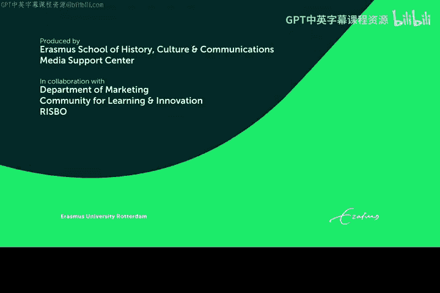

# 鹿特丹伊拉斯姆斯大学《严肃游戏｜Serious Gaming》中英字幕 - P4：3_案例研究：《优步游戏》.zh_en - GPT中英字幕课程资源 - BV1axeUzbE3D

Every week we will discuss an interesting example of a series game with you。

We call these examples case studies because they can be used to illustrate part of the theory we discussed in this course。

The first case study is the Uber game developed by the Financial Times。

 we will investigate if and why this game can be seen as a serious game。Before we continue。

 it's important that you explore the game yourself， we will give you the link to play in a bit。

In the game， you are a full time Uber driver with two children to support in a week。

 you must pay1000 for your mortgage。 So it's pretty urgent to make enough rides to pay your bills。

 We advise you to choose the easier level in the game。 Now。

 go ahead and pick up your first passenger。😊，Did you succeed in earning enough money？

And that you still have some time left to spend with your family。

The game you just played is called the Uber game with a subtitle。 Can you make it in the gig economy。

 It was developed in 2018 by an in house team at the Financial Times。

 The game is based on news reports and interviews with dozens of Uber drivers playing the game transports you into the driver's seat of a full time Uber driver。

 given you a deeper understanding of what of what it's like to try to make a living in the sharing or a gig economy。

😊，In May 2018， the Uberga won a gold medal at the annual series Play wars in the United States。

We chose this game because it's a great example for you to reflect on the five game characteristics we discussed earlier。

Games have goals are rule based， include feedback， have a competitive elements and are played voluntarily。

 Does the Uber game fit these characteristics。 What do you think。😊。

Its goal send out you make right to earn enough money to pay your mortgage and feed your kids。

You do so in a context of rules， as the game instructs you what to do。 For example。

 you can only proceed in the game as long as you make choices on further actions that you take。

 Your actions receive feedback at regular intervals so you can determine whether the target is within sight。

At the end of each day， you'll receive an overview of your progress。 For example。

 the game will also provide you with feedback about the consequences of your actions when you did not spend money to buy a phone mount for your phone。

 the game will tell you that passengers have noticed that you keep your smartphone in your lap and that they have complained to Uber about dangerous driving leading to a four hour deactivation。

 That's a bummer because you make less money。😊，The game has two competitive aspects By the end of the game。

 your performance is related to your personal goals， you needed $1000 to pay your bills。

 but the game also shows you how other players performed。The voluntary aspect is obvious。

 people can decide for themselves whether they play or not。

 although I know I actually asked you to play it。This brings us back to our initial question。

 why is this game a serious game？Remember the definition of a series game。

Serious games are games that use computer game and simulation approaches and or technologies for primarily non entertainment purposes。

Generally， the developers of series games apply motivating principles from entertainment games and use them to teach their players something in an engaging way。

In the Uber game you are put in the shoes of one of the millions of Uber drivers who try to make a living in what is called the gig economy。

 The gig refers to freelance work or short term contracts as opposed to permanent jobs。

Although in many accounts， the gig economy is celebrated as something great。

 we can have a right for less money than a traditional taxi。

 and it's supposed to give people flexibility in when and how they work。😊。

As you might have experienced in the game for Uber drivers。

 this also means uncertainty about what they will earn in a week's time and results in a life that is characterized by last minute scheduling。

😊，Maybe the giggonomy is not as positive as we might think。

The developers at the Financial Times call this a news game。

 emphasizing that the game particularly aimed at informing us players。

Awareness seems a serious goal here。 They want their audience to understand the problems of Uber driversvis better since they have experienced it themselves。

At the end of the game， you can also get more information by clicking on a link that will send you to an article about the same topic。

 Other series games link information to a call for actions such as donating money or sharing a certain message with others。

 as we'll see later in this MOOC。😊，In short。The purpose of the Ubri game is not offering entertainment but sharing information about a current practice。

 Nevertheless， the game does so in a playful manner。😊。

