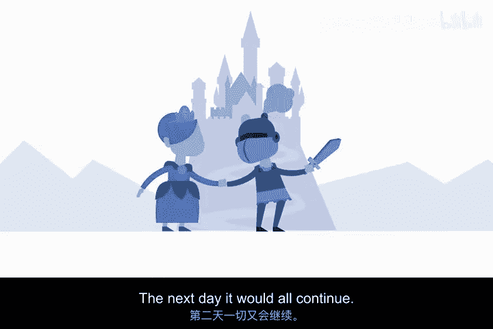

# 鹿特丹伊拉斯姆斯大学《严肃游戏｜Serious Gaming》中英字幕 - P6：5_玩耍理论的起源、定义与功能.zh_en - GPT中英字幕课程资源 - BV1axeUzbE3D

Playfulness and play are deeply rooted in human life。

 All people play in old cultures and in old times。 Play is even older than humans。

 as many animals play， too。Play is also a subject of study because it evokes all kinds of questions。

 such as what exactly is play and why do we play？Do we play just for fun or does play have other functions in our lives？

Play theory attempts to answer these kinds of questions。In this video。

 philosophyo Professor Yosta Mill will first provide the origins of play theory。

Then he will define play by giving it six characteristics。Finally。

 he will discuss the function of play in our culture。Platori has a long history。

 about 25 centuries ago， the Greek philosopher Heraclitus already reflected on the playful character of the universe。

😊，However， especially in the second half of the 20th century。

 play has become an important object of study in disciplines such as biology。

 psychology and ethology， the study of animal behavior。😊，In the last decades。

 we have witnessed the development of plate theoryery as an independent discipline。

One of the founding studies of Play theoryory is the book Homoudence。

 published in 1936 by the Dutch cultural historian Johan Hsingha。According to H care。

 play is not just a frivolous activity。😊，It is a primary category of life and constitutive for culture as such。

This means that play and culture are closely linked。😊，In H classs own words。😊。

Culture arises in an asplay and never leaves it。In Homoolidenence。

 housing car givess a definition of play。😊，Summing up the formal characteristics of play。

 we might call it a free activity。😊，Standing quite consciously outside ordinary life as being not meant。

But at the same time， absorbing the player intensely and utterly。

It's an activity connected with no material interest and no profit can be gained by it。😊。

It proceeds within its own proper boundaries of time space。

According to fixed rules and in an orderly manner。It promotes the formation of social groupings。

 which tend to surround themselves with secrecy and to stress the difference from the common world by disguise or other means。

This definition contains six characteristics， let's take a closer look at them。😊，First。

 play is an expression of human freedom， feV， both nature and morality。

Like beauty to which it is closely related， play is disinterested。😊。

It contains its own core course and meaning。It's an inlude in our daily lives。😊。

This does not mean that it's only fun， because if we are immersed in play。

 we often play with holy earnest。😊，Second， play is not meant。

 It refers to an activity of just pretending。Playing is pretending， acting as if。

Third play is immersive in the sense that it is absorbing the player intensely。😊。

It is accompanied by a feeling of exultation and tension and followed by mirth and relaxation。😊。

Fourth， play is distinct from ordinary life， both in terms of locality and duration。

It is characterized by specific limits of time and space。😊。

This so called magic circle is not only a spatial circle， but a temporal one as well。Fifth。

 the rules that constitute the playw world are crucial to the concept。All play has its own rules。

They determine what holds in the temporary world circumscribed by play。

As soon as the rules are transgressed， the whole playw world collapses。

Whereas the cheater still pretends to play and in doing so still acknowledges the magic circle and cycle。

 the player who tspasses against the rules or ignores them is a spoil sport。😊，Sth play creates order。

 is order into an imperfect world and into the confusion of life。

 it brings a temporary and limited perfection。😊，Play is indispensable for the well being of a community。

 facconant of cosmic insight and social development。😊。

We will summarize these six characteristics for you in an animation。Do you remember playing as a kid。

 one would be the fearlessn， the other the beautiful princess in need of saving？

There in that small kingdom， anything could happen Shady bandits had to be captured and you would have to fight the most dangerous of monsters like this fiery dragon Even your mom bringing ice cream couldn't distract you you kept on fighting and for what really Does it matter it was magnificent until of course。

 because obviously that's not something princesses do。The next day， it would all continue。

Studying the six characteristics of play in depth brings us to the important question about the function of play。

😊，In order to be able to live our human lives in a meaningful way， we have to understand our world。

 our fellow men and ourselves。Playing can help us to develop the necessary skills and insights to play the game of life successfully。

This cognitive function of play has been studied since the 19th century by biologists and developmental psychologists。

😊，Play can prepare human juveniles for adult life， and different forms of play have different functions in developing disparate spheres of adult life。

 varying from practicing motor skills and competition to exercises in imagination。😊，Moreover。

 play both helps us to acquire specific skills and insights as well as enhancing the flexibility of behavior。

As it helps us learn to switch between and improvise with all kinds of behaviors and prepares us to deal with the unexpected。

In summary， we could say that playing enhances our adaptive variability in this sense。

 playing is an utmost serious matter。😊，Thoughs may have been characteristic for human life and play from the very beginning。

 the need for it seems all the more urgent in our present age， characterized by rapid changes。

 increasing complexity and reflective uncertainty。😊，Exercising。

 exercising world openness and developing playful identities and to keep playing as an adult seems to be more crucial now than ever。

😊，Fortunately， in our age， digital media provide all kinds of affordances for serious play。

And this can be attributed to their multimediaial， interactive， virtual and connective character。😊。

We should not only think of playing computer games， but also， for example。

 of the playful usage of internet and smartphone。In short。

 digital media have disclosed a whole new domain of serious playing。😮。

