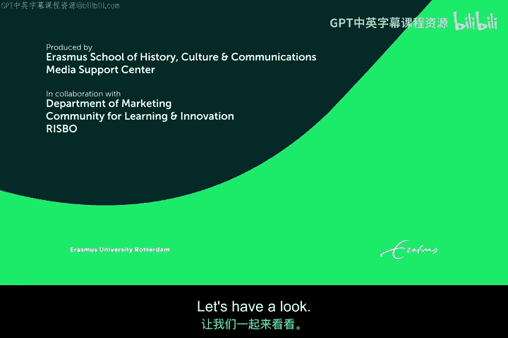

# 鹿特丹伊拉斯姆斯大学《严肃游戏｜Serious Gaming》中英字幕 - P8：7_我们为何喜爱游戏：动机分析.zh_en - GPT中英字幕课程资源 - BV1axeUzbE3D

Welcome， this is the third video in our module and game theory。In the first one。

 philosophy professorfessor Lem addressed playfulness and the inextricable link between play and culture In a second video。

 I discussed the psychological functions of play and how rewards contribute to the appeal of gaming。

Now I aim to deepen the psychological analysis of why people like to play。

Let me start with the question why people choose to play a game in the first place。

The decision to spend time on gaming rather than on， for example， television viewing， a hobby。

 school or work can be understood as a kind of motivated action。

Two theoretical traditions have been drawn upon the investigations of why people play digital games。

I will first discuss the users in gratification theory and next self determination theory。

Users and gratification theory developed within media research by Greenberg。

 Sherry and Rogerio holds that people use media to obtain gratifications which are related to the individual's needs。

The theory emphasizes that media users actively seek particular media content in order to satisfy their needs。

In the case of digital games， the active role of their users is beyond doubt。

Games can function only if players respond to the messages appearing on their screen。

 if they do not push the buttons， the game simply stops。

Empirical research has shown that particular games or genres are indeed chosen to satisfy specific needs。

I will briefly discuss the seven motivations that were established in research。

The first one is control。The virtual world of a game is appealing because it allows players to act as agents exerting control over their game character and its context。

For example， in the Sims where the player is in charge of a complete household。It should be noted。

 however， that control is never total。Players are confronted immediately with the limits of their command when they make a mistake。

The second motivation is challenge。Players like to push themselves to attain a higher level of skill。

 Challes often linked to a third motivation， competition。

It refers to a need to win or surpass others。Generally。

 sports and action games are the most competitive， but playing a simulation game may also satisfy his need。

 for example， when one is able to finish levels that one's friends cannot。

The fourth motivation is fantasy。It was found that gaming is attractive because it enables the player to engage in a variety of acts that would be difficult or even impossible to perform in their own lives。

It's particularly prominent in games offering an alternative adventurous game world where players are engaged in role playing like Fi Fant。

One of the conclusions from our own research is that players often use the adventurous game world to test their own behaviors and emotions。

In other words， the game comes to function as a kind of safe laboratory。

Interest is motivation number5。 it refers to an urge to explore the game in detail and gather information about it。

Control， challenge， competition， fantasy and interest are directional kinds of motivations。

 the sixth motivation is less directional。Players often feel a need to play because they seek diversion。

 using the game to take their minds off their usual concerns by doing something completely different。

The second and final motivation is social interaction。

People like to play with each other and against each other。

 This is obviously the case when people seek to play multiplayer games online。

 such as the immensely popular world of warcraft。But research has also shown that single player games are often played in the company of siblings。

 peers or friends。The second theory explaining motivations to play is selfdetermination theory。

 or in short SDT， it was developed by psychologists DC and Ryan。

 it holds that human behavior is determined by the interplay of three basic psychological needs。

 autonomy， competence and relatedness。Autonomy refers to the desire to self organized experience and behavior。

Competence is the need for challenge and the experience of one's effectiveness。

Relatedness refers to the need to experience connections to other people。STT researchers Ryan。

 Rickby and Shiibbilski have established that gaming indeed satisfies autonomy needs。

Players like to be in charge。 Competnce is satisfied as well。

 in particularly by the challenges included in games。Finally。

 players satisfied their need for relatedness by engaging themselves with other players。Additionally。

 autonomy， competence and relatedness have been found to work as good predictors of persistence in play。

 That is the continuation of play， despite the unavoidable frustrations。Obviously。

 self determination theory and uses in gratification theory have a lot in common。For example。

 autonomy is close to UNG's control motivation， competence is similar to challenge。

 and the need for relatedness is equivalent to social interaction。

The obvious difference is that STT purly concentrates on three basic needs。

 where UNG includes a larger set of motivations。By reducing all possible motivation to three basic ones。

 self determination theory aims to be applicable to many different situations， thus。

 increasing the theory's predictive power。Users in gratification by contrast is more concerned with Deby describing the diversity of needs people seek to satisfy by playing a digital game。

It is time to conclude。The popularity of gaming underlines the fact that many people are motivated to invest a lot of time to experience the pleasures of playing digital games。

Thus far， the research based on use in clarification theory and self determination theory。

 was largely concerned with explaining the appeal of digital entertainment games。Conceivably。

 serious games could satisfy needs as well。For example， by offering diversion。

 a sense of control or catering for needs concerned with competence， challenge or interest。

It also seems very well possible to design a series game that satisfies competitive or social motivations。

In the next video， we will present the case from five to four。

The game has been developed by organic near Rotterdam and is concerned with changing commuter habits。

You will be informed about how the game developers have taken the possible motivations of players into account。

Let's have a look。

