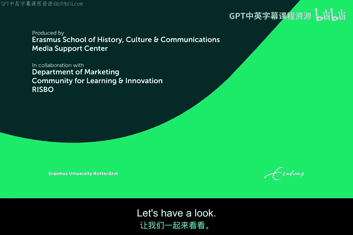

# 严肃游戏：P8：我们为何喜爱游戏：动机分析 🎮

在本节课中，我们将深入探讨人们喜爱游戏的心理学动机。我们将介绍两种核心理论：使用与满足理论以及自我决定理论，并分析它们如何解释玩家投入游戏的行为。

---

在上一节中，我们讨论了游戏的心理功能。本节中，我们将聚焦于驱动人们选择游戏而非其他活动的具体动机。理解这些动机是分析游戏吸引力的关键。

人们选择花费时间玩游戏，而非看电视、从事爱好或工作，可以被视为一种有动机的行为。在数字游戏研究领域，主要借鉴了两种理论传统。

首先，我们来探讨**使用与满足理论**。该理论由格林伯格、谢里和罗杰里奥在媒体研究中提出，认为人们使用媒体是为了获得满足，这些满足与个人的需求相关。该理论强调，媒体使用者会主动选择特定的媒体内容以满足自身需求。

对于数字游戏而言，用户的主动性毋庸置疑。只有当玩家对屏幕上的信息做出反应、按下按键时，游戏才能进行下去。实证研究表明，玩家确实会选择特定的游戏或类型来满足特定需求。

以下是研究中确立的七种主要游戏动机：

*   **控制**：游戏的虚拟世界吸引人，是因为它允许玩家作为代理人，对其游戏角色及其环境施加控制。例如，在《模拟人生》中，玩家负责管理整个家庭。但需注意，控制并非绝对，一旦犯错，玩家会立刻感受到其指令的局限性。
*   **挑战**：玩家喜欢挑战自我以达到更高的技能水平。
*   **竞争**：指获胜或超越他人的需求。体育和动作游戏通常最具竞争性，但模拟游戏也能满足此需求，例如完成朋友无法通过的关卡。
*   **幻想**：游戏之所以吸引人，是因为它使玩家能够进行一系列在现实生活中难以或不可能完成的行为。这在提供另类冒险游戏世界的角色扮演游戏中尤为突出。研究表明，玩家常利用冒险游戏世界来测试自己的行为和情感，游戏就像一个安全的实验室。
*   **兴趣**：指深入探索游戏细节、收集相关信息的冲动。
*   **消遣**：这是一种方向性较弱的动机。玩家常因寻求消遣而游戏，通过做完全不同的事情来暂时忘却日常烦恼。
*   **社交互动**：人们喜欢与他人一起玩或对抗。这在寻求在线多人游戏时显而易见，例如极其流行的《魔兽世界》。研究也表明，单人游戏也常在兄弟姐妹、同伴或朋友的陪伴下进行。

---

接下来，我们看看第二种理论：**自我决定理论**。该理论由心理学家德西和瑞安提出，认为人类行为由三种基本心理需求的相互作用决定：**自主性**、**胜任感**和**关联性**。

*   **自主性**指自我组织体验和行为的愿望。
*   **胜任感**是对挑战的需求以及体验自身效能感的需要。
*   **关联性**指与他人建立联系的需求。

研究表明，游戏确实能满足这些需求：玩家喜欢掌控感（自主性）；游戏中的挑战尤其能满足胜任感；玩家通过与其他玩家互动来满足关联性需求。此外，这三种需求被发现能有效预测玩家的**坚持性**，即在遭遇不可避免的挫折时仍继续游戏的行为。

显然，自我决定理论与使用与满足理论有许多共通之处。例如，自主性接近“控制”动机，胜任感类似“挑战”，关联性需求则等同于“社交互动”。主要区别在于，自我决定理论纯粹集中于三种基本需求，而使用与满足理论包含更广泛的动机集合。通过将所有可能动机归结为三种基本需求，自我决定理论旨在适用于多种不同情境，从而增强了理论的预测能力。相比之下，使用与满足理论更侧重于描述人们通过玩数字游戏寻求满足的多样化需求。

---

本节课中，我们一起学习了人们喜爱游戏的核心动机。游戏的风行表明，许多人都有强烈的动机投入大量时间去体验数字游戏带来的乐趣。目前基于使用与满足理论及自我决定理论的研究，主要致力于解释数字娱乐游戏的吸引力。可以想见，严肃游戏同样能满足需求，例如提供消遣、控制感，或满足与胜任感、挑战或兴趣相关的需求。设计一款满足竞争或社交动机的严肃游戏也完全可行。

在下一个视频中，我们将以“Five to Four”游戏为例进行案例分析。这款由鹿特丹附近机构开发的游戏旨在改变通勤习惯。你将了解到游戏开发者是如何将玩家的潜在动机考虑在内的。让我们一起来看一看。