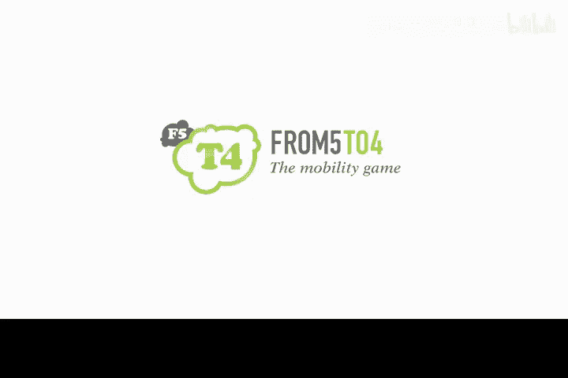
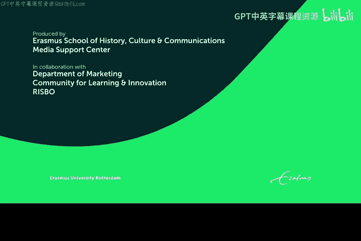

# 鹿特丹伊拉斯姆斯大学《严肃游戏｜Serious Gaming》中英字幕 - P9：8_案例研究：《从5到4的启示》.zh_en - GPT中英字幕课程资源 - BV1axeUzbE3D

If you've ever experienced a traffic jam， you might understand how frustrating it can be。

 it takes up a lot of time and causes nuisance， for example。

 when you arrive too late in an appointment， traffic jams also have a negative impact on the economy and environment in a small country such as the Netherlands。

 commuting car driverss are stuck in traffic for over 50 hours a year。

To encourage Dutch car drives to change their behavior， for example。

 by choosing alternative commuting times， some government initiatives offer a monetary reward。

 they assume that money will motivate people to participate in these programs。

The Rodand based company organicganic is of the opinion that there are other and better ways to motivate car drivers by using elements from series gaming。

Game developers at Organic designed from five to four。

 a series game that aims at motivating commuters in an Netherlands to replace their car by an alternative way of transportation for one day a week。

This game is chosen as case study of this MOOC because it's a great example to analyze in more detail how gaming principles are used to enhance the motivation of players to actually change their behavior。

We invited Phs for Hoof， gamification analyst at Organic to the studio so he can explain the game to you。

He will show in game examples of game principles and will also discuss the impact this game has on its players。

🎼From 5 to4 motivates employees of participating organizations to commute more smartly on at least one out of five working days by using public transport or a bicycle by carpooling or by working from home。

 the game responds to a growing trend to link behavioral change into action and game elements in a fun and challenging way。

 In addition， from 5 to4 is the ideal tool to measure changes in travel behavior in a responsible and reliable way and to translate these results into relevant information for the management team。

🎼The game encourages its players to think about their travel behavior and how to improve this by this from 5 to4 also fulfills a social and environmental purpose。

 reducing congestion by 20%， thus contributing to a more sustainable and accessible country。

At Organic， we believe that serious gaming is often a viable solution to motivate people to change their behavior。

To accomplish this， we have developed a motivation gamification framework。

 This framework translates specific behavioral goals into three practical design rules。

 If you'll allow me， I'll explain these rules to you in light of a successful serious game from 5 to 4。

😊，First of all， it is important to know who the players are。

What motivates them to start playing in the first place？

Our research has shown that most players are motivated by social status。

We have taken this as a first design rule， always designed for the socializer。

Stays and W are important in almost any game， and from five to four is not an exception。

And from five to four， points are awarded for a more sustainable way of commuting， the greener。

 the better。More points then equals a higher status。

But fictional points could be seen as insignificant if there's no real community that cares。

From five to four then pits departments or teams against each other in order to become the most sustainable commuter。

At a water coololer， team marketing then lasts at the car loving sales team and John from Finance。

 who bikes 15 kilometers to work every day， has become the most departmental hero。

 ranking in points like no one else。For the second design role。

 we have analyzed the idea of play in more detail。Because what motivates people to really play？

We have not taken the classic definition of play that has been discussed by philosophyophy Professor Yosster Mill。

 but we use recent definition， where play is described as an invigorating rush of activity that causes an optimistic sense of capability。

To achieve this， a game can neither be too difficult or too hard in the beginning。

Our design rule taken from this is that it's most important to design the game with a novice player。

 to ensure the game is engaging and does not frustrate a player at the very beginning。

Our usability experts work to design applications in such a way that they are intuitive to play and pleasant to look at。

This approach makes from five to four engaging from the very beginning。

The third design rule is the Game5 solutions are designed in a balanced way in order to be fun。

Because it's most important that behavior learned in a game needs to cross the socal game boundary into reality。

 A game should not be administrative。 That is， it should not be too much of a boring task。

 nor should it be too adaptive， so not too much fun in itself。

Balancing this to guarantee authenticity was a tough challenge from for five to4。

 because mobility measurement applications are generally extremely administrative in nature。

Tougher yet is that we did not want to have any monetary or other real rewards。 In the end。

 we settled on a motivator that appeared to be surprisingly effective， Moby。

Players can customize our little Moby with shop items that they can unlock or buy with the points they generate by playing。

Movie then becomes their personal avatar。And coach， because of the dashboard。

 you see your smiling little Moby， but if you behave who becomes worse。

 Move will start to frown and eventually even start crying。

We had calls from players to a help desk asking what they could do to make them smile again。

The answer is always simple， just go from five to four。In short。By applying our design rules。

 we could incorporate fun and play to achieve a certain behavioral change。

 and it seems to work because research at different universities and research institutes show that a reduction in car use of around 20% during the program。

Which is already a good result。 But better still， from 5 to 4。

 seems to have a lasting impact on behavior， as even up to three months after playing after playing。

 participants showed to use their cards up to 13% less。 This got from 5 to4 some attention。😊。

It won the Intertraffic Award and the W contest and was slim nominated。

 It even generated European interest， resulting in from five to4 not being played in the Netherlands。

 Belgium， the UK， Romania， Portugal and Bulgaria。In sum。

 we believe that from fact  four shows the gamification does work well when used well and can achieve behavioral change without the need of monetary rewards。

