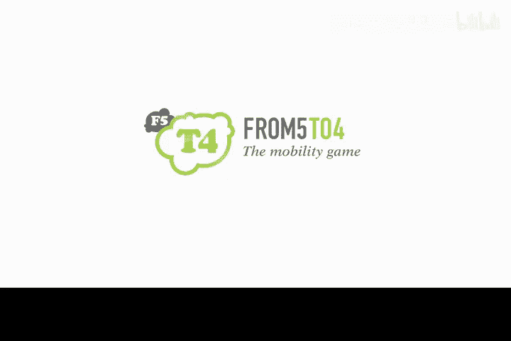
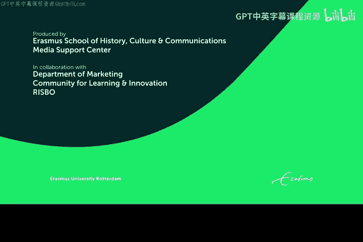

# 严肃游戏：P9：案例研究：《从5到4的启示》

在本节课中，我们将通过一个具体的案例——《从5到4》游戏，来深入分析如何运用游戏化原则激励人们改变行为。我们将了解该游戏的设计理念、核心机制以及它如何成功促使通勤者减少私家车使用。

---

如果你曾经历过交通堵塞，你或许能理解那有多么令人沮丧。交通堵塞会耗费大量时间并造成诸多不便，例如导致你约会迟到。在荷兰这样的小国家，交通堵塞对经济和环境也有负面影响。通勤的汽车驾驶员每年被困在交通中的时间超过50小时。

为了鼓励荷兰的汽车驾驶员改变行为，例如选择替代的通勤时间，一些政府倡议提供了金钱奖励。他们假设金钱能激励人们参与这些计划。

总部位于鹿特丹的公司Organic则认为，存在其他更好的方法来激励汽车驾驶员，那就是利用严肃游戏中的元素。

Organic的游戏开发者设计了《从5到4》。这是一款严肃游戏，旨在激励荷兰的通勤者每周有一天用替代交通方式取代私家车。

这款游戏被选为本慕课的案例研究，因为它是一个绝佳的例子，可以详细分析游戏原则如何被用来增强玩家的动机，从而真正改变其行为。

我们邀请了Organic的游戏化分析师Phs for Hoof来到演播室，由他来为你解释这款游戏。他将展示游戏原则在游戏中的实例，并讨论这款游戏对玩家产生的影响。

---

《从5到4》激励参与组织的员工，在五个工作日中至少有一天以更智能的方式通勤。方式包括使用公共交通、骑自行车、拼车或在家办公。这款游戏顺应了一个日益增长的趋势，即以有趣且富有挑战性的方式，将行为改变与游戏元素联系起来。此外，《从5到4》是负责任且可靠地测量出行行为变化，并将这些结果转化为对管理团队有用信息的理想工具。

这款游戏鼓励玩家思考自己的出行行为以及如何改进。因此，《从5到4》也实现了一个社会和环境目标：将拥堵减少20%，从而为建设一个更可持续、更畅通的国家做出贡献。

---

在Organic，我们相信严肃游戏通常是激励人们改变行为的可行解决方案。为了实现这一点，我们开发了一个动机游戏化框架。这个框架将特定的行为目标转化为三条实用的设计规则。如果你允许，我将结合成功的严肃游戏《从5到4》来向你解释这些规则。

首先，了解玩家是谁至关重要。是什么最初激励他们开始游戏？我们的研究表明，大多数玩家受到社会地位的激励。我们将其作为第一条设计规则：**始终为社交者设计**。

积分和排行榜在几乎任何游戏中都很重要，《从5到4》也不例外。在《从5到4》中，玩家因采用更可持续的通勤方式而获得积分，方式越环保，积分越高。更多的积分等于更高的地位。但是，如果没有一个真正在乎的社区，虚拟积分可能显得无足轻重。因此，《从5到4》让部门或团队相互竞争，以成为最可持续的通勤者。在茶水间，市场团队可以嘲笑热爱汽车的销售团队，而每天骑车15公里上班的财务部约翰，则成为了部门英雄，积分排名无人能及。

对于第二条设计规则，我们更详细地分析了“玩”的概念。因为什么才能真正激励人们去“玩”？我们没有采用哲学教授Yosster Mill讨论过的经典“玩”的定义，而是使用了一个更新的定义，其中“玩”被描述为一种令人振奋的活动激流，能带来一种乐观的能力感。为了实现这种感觉，游戏在开始时既不能太难，也不能太简单。我们从中得出的设计规则是：**最重要的是为新手玩家设计游戏**，以确保游戏具有吸引力，并且不会在最初就让玩家感到挫败。我们的可用性专家致力于以直观易玩、赏心悦目的方式设计应用程序。这种方法使《从5到4》从一开始就充满吸引力。

第三条设计规则是：**游戏化解决方案应以平衡的方式设计，以确保趣味性**。因为最重要的是，在游戏中学到的行为需要跨越游戏边界进入现实。游戏不应是行政性的，也就是说，它不应是一项过于无聊的任务；也不应过于自适应，即本身不能太有趣。平衡这两点以保证真实性对《从5到4》来说是一个严峻的挑战，因为出行测量应用程序本质上通常极其行政化。更棘手的是，我们不希望提供任何金钱或其他实质奖励。最终，我们选择了一个被证明出奇有效的激励因素：Moby。

玩家可以用他们在游戏中赚取的积分解锁或购买商店物品，来定制我们的小Moby。Moby从而成为他们的个人虚拟形象和教练。因为在仪表板上，你会看到你微笑的小Moby，但如果你行为变差，Moby就会开始皱眉，最终甚至开始哭泣。我们曾接到玩家打给帮助热线的电话，询问他们能做些什么让Moby再次微笑。答案总是很简单：只需做到“从5到4”。

简而言之，通过应用我们的设计规则，我们可以融入趣味和游戏元素来实现特定的行为改变，而且这似乎行之有效，因为不同大学和研究机构的研究表明，在项目期间汽车使用量减少了约20%。这已经是一个很好的结果。但更好的是，《从5到4》似乎对行为产生了持久的影响，因为即使在游戏结束三个月后，参与者仍显示其汽车使用量减少了高达13%。这为《从5到4》带来了一些关注。它赢得了Intertraffic奖和W竞赛，并被提名。它甚至引起了欧洲的兴趣，导致《从5到4》不仅在荷兰，还在比利时、英国、罗马尼亚、葡萄牙和保加利亚运行。

总之，我们相信《从5到4》表明，**当运用得当时，游戏化效果很好，并且无需金钱奖励也能实现行为改变**。

---

本节课中，我们一起学习了《从5到4》这个严肃游戏案例。我们了解了它如何通过三条核心设计规则——为社交者设计、为新手玩家设计、平衡趣味性与真实性——来激励通勤者改变出行行为。该游戏成功证明了，巧妙运用游戏化原则可以有效促进可持续行为，并产生持久的影响。