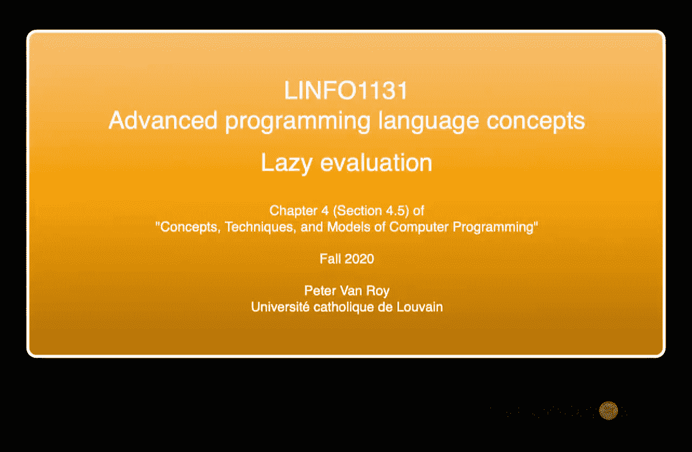
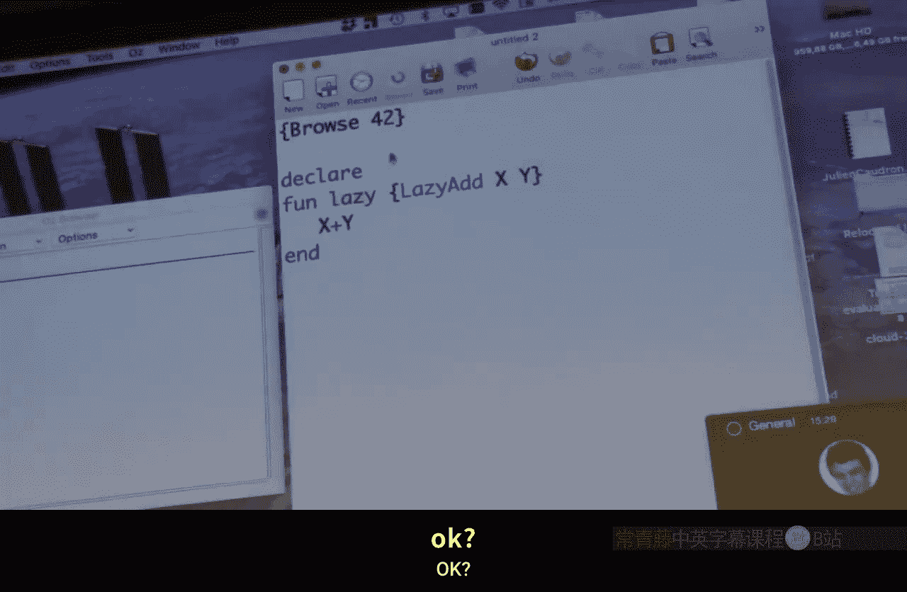
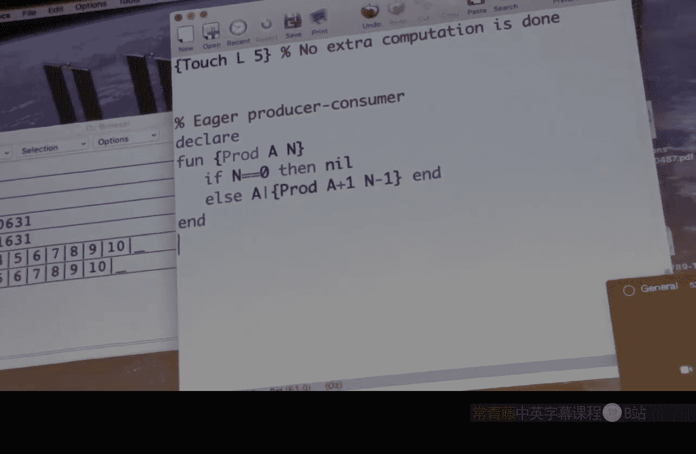
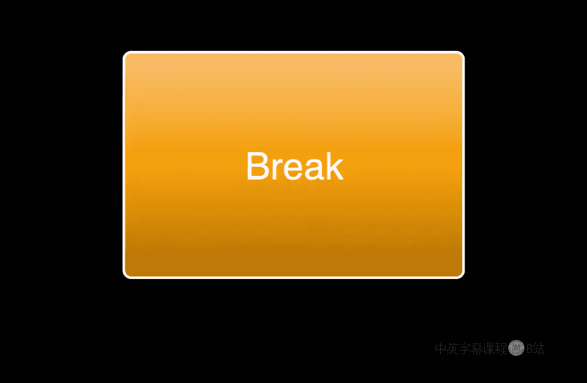
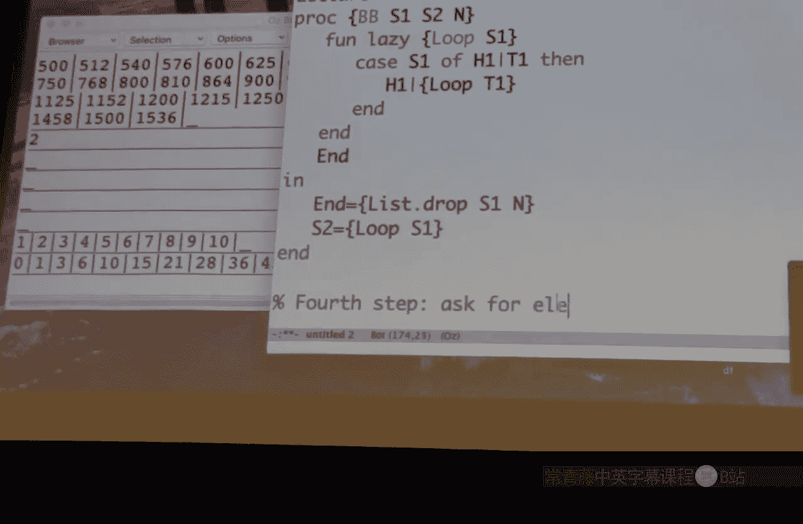

# 001：惰性求值 🚀




在本节课中，我们将要学习**惰性求值**，这是函数式编程中一种重要的方法。我们将探讨其基本概念、工作原理，并通过实例展示其在编程中的强大应用。



## 概述

惰性求值是声明式函数式编程中的一项关键技术。它允许我们延迟表达式的计算，直到其结果真正被需要时。这种“按需计算”的模式，使得我们可以处理无限数据结构、简化代码逻辑，并实现更灵活的程序控制流。


---

## 惰性求值的基本概念


上一节我们介绍了本课程的主题。本节中，我们来看看惰性求值的基本概念。

惰性求值是一种计算策略，其中函数或表达式的求值被推迟到其值被实际需要时。这与我们通常熟悉的**及早求值**（或称为严格求值）形成对比，在及早求值中，函数参数在函数调用前就会被计算。

### 一个简单的例子

以下是理解惰性求值的一个简单示例。我们定义一个惰性加法函数：

```oz
fun lazy {LazyAdd X Y}
    X + Y
end
```

当我们调用 `{LazyAdd 10 20}` 时，并不会立即得到结果 `30`。相反，系统会创建一个名为**惰性挂起**的对象。计算只会在我们“需要”这个结果时才会发生。

那么，什么是“需要”呢？例如，如果我们尝试对这个结果进行另一个操作，比如 `S + 100`，这里的加法操作 `+` 需要它的两个参数都是具体的值。因此，它会触发对 `{LazyAdd 10 20}` 的求值，最终我们得到 `30` 和 `130`。

**核心思想**：是“需求”驱动了计算。这个简单的想法在实际编程中具有极其强大的威力。

---

## 惰性求值的语义

理解了基本概念后，我们需要深入其底层语义，看看它是如何实现的。

### 数据流语义回顾

首先，让我们回顾一下确定性数据流的语义。它基于两个基本操作：
*   `wait X`：挂起当前线程，直到变量 `X` 被绑定为一个值。
*   `bind X`：将变量 `X` 绑定为一个值，并释放所有正在等待 `X` 的线程。

例如，对于 `C = A + B` 这样的操作，其语义是：
1.  `wait A` （等待 `A` 成为值）
2.  `wait B` （等待 `B` 成为值）
3.  执行原始的加法操作 `V = A + B`
4.  `bind V` （将结果绑定到 `V`）

这种 `bind` 和 `wait` 的配合，实现了线程间的数据流同步。

### 引入惰性：`waitNeeded`

为了支持惰性求值，我们在上述语义基础上增加一个新的原语操作：`waitNeeded X`。

*   `wait X`：等待直到 `X` **被绑定**为一个值。
*   `waitNeeded X`：等待直到 `X` **被需要**（即，有另一个线程对 `X` 执行了 `wait` 操作）。



**关键区别**：`wait` 关注的是**值何时准备好**，而 `waitNeeded` 关注的是**值何时被索取**。

### 惰性函数的翻译

在语言层面，惰性函数通过 `waitNeeded` 来实现。一个及早函数和惰性函数的对比如下：

**及早函数** `fun {F X} E end` 被翻译为：
```oz
proc {F X R} R = {Translate E} end
```

**惰性函数** `fun lazy {F X} E end` 被翻译为：
```oz
proc {F X R}
    thread
        {WaitNeeded R} % 等待结果R被需要
        R = {Translate E} % 然后才进行计算
    end
end
```

可以看到，惰性函数创建了一个新线程，该线程会一直等待，直到有人需要函数的结果 `R`。当 `R` 被需要时（即有其他线程执行了 `wait R`），该线程被唤醒并执行计算 `E`，最后将结果绑定到 `R`。

---



## 惰性编程技术

掌握了惰性求值的原理后，本节我们来看看它能实现哪些强大的编程技术。

### 1. 无限数据结构


惰性求值允许我们轻松定义和使用逻辑上无限的数据结构，而无需担心程序陷入无限循环或耗尽内存，因为只有被请求的部分才会被实际计算。

**示例：无限自然数列表**
```oz
fun lazy {LazyNats N}
    N | {LazyNats N+1}
end
```
调用 `L = {LazyNats 1}` 会创建一个惰性的无限列表 `[1 2 3 4 ...]`。只有当我们通过 `{Touch L 10}` 这样的函数请求前10个元素时，相应的部分才会被计算出来。

### 2. 推（Push）与拉（Pull）模式

这是程序设计中控制流的一个根本区别：
*   **推模式（及早求值）**：生产者控制节奏。生产者生成数据并“推”给消费者。控制权在输入侧。
*   **拉模式（惰性求值）**：消费者控制节奏。消费者按需“拉取”数据，驱动生产者进行计算。控制权在输出侧。

这两种模式是互补的。一个完整的系统通常会结合使用两者。例如，数据库查询是典型的拉模式（按需获取），而实时数据流处理可能是推模式（数据到达即处理）。

#### 生产者-消费者示例对比

以下是两种模式的简单代码对比，它们都计算1到100的和：

**及早（推）版本**：生产者决定生成100个元素。
```oz
fun {Producer N} ... end % 生成N个元素后停止
fun {Sum Xs} ... end % 消费所有到来的元素
L = {Producer 100}
Result = {Sum L}
```

**惰性（拉）版本**：生产者无限生成，消费者决定只取前100个。
```oz
fun lazy {Producer} ... end % 无限生成元素
fun {Sum Xs N} ... end % 只求和前N个元素
L = {Producer}
Result = {Sum L 100}
```

### 3. 海明问题（Hamming‘s Problem）

这是一个经典问题，展示了惰性求值如何优雅地解决复杂算法。目标是生成所有形如 `2^a * 3^b * 5^c`（a, b, c为非负整数）的数，并按升序排列。

**惰性解法**：
1.  从1开始。
2.  将当前序列分别乘以2、3、5，得到三个新序列。
3.  合并这三个序列，每次取最小的数加入结果序列。
4.  递归地进行下去。

```oz
fun lazy {Times Xs N}
    case Xs of X|Xr then (X*N)|{Times Xr N} end
end

fun lazy {Merge Xs Ys}
    ... % 合并两个有序流，去重
end

H = 1 | {Merge {Times H 2} {Merge {Times H 3} {Times H 5}}}
```
这个程序简洁地定义了一个无限的海明数序列 `H`。由于是惰性的，我们可以按需获取任意多个海明数，而内存消耗很小。

### 4. 有界缓冲区（Bounded Buffer）

这是结合及早和惰性求值的一个精妙例子。有界缓冲区插入在生产者和消费者之间，用于提升性能。

**工作原理**：
1.  **启动时（及早）**：缓冲区立即向生产者预取N个元素存起来。
2.  **消费时（快速响应）**：当消费者请求元素时，缓冲区可以立即从库存中给出，无需等待生产者。
3.  **补充库存（惰性触发）**：每当缓冲区给出一个元素，它就会异步地（在另一个线程中）再向生产者请求一个元素，试图将库存维持在N个。

这样，生产者和消费者都能更高效地工作：消费者等待时间减少，生产者的空闲时间也减少。关键在于，**生产者和消费者的代码完全不用修改**，缓冲区作为一个声明式组件被透明地插入。



---

## 总结

本节课中我们一起学习了惰性求值这一核心概念。

我们首先了解了它的基本思想：**延迟计算，直到结果被真正需要**。然后，我们深入探讨了其语义基础，即通过 `waitNeeded` 原语操作来实现“按需驱动”的计算模型。

基于这一模型，我们看到了多种强大的编程技术：
*   创建和操作**无限数据结构**，简化算法逻辑。
*   在**推**和**拉**两种控制模式间进行选择，以适应不同的应用场景。
*   使用惰性流优雅解决**海明问题**等经典算法挑战。
*   设计**有界缓冲区**这类混合了及早和惰性计算的组件，以提升系统性能，同时保持代码的声明性和模块化。


惰性求值不仅是函数式编程的利器，其思想也可以应用于任何编程范式，帮助我们编写出更高效、更简洁、更灵活的代码。