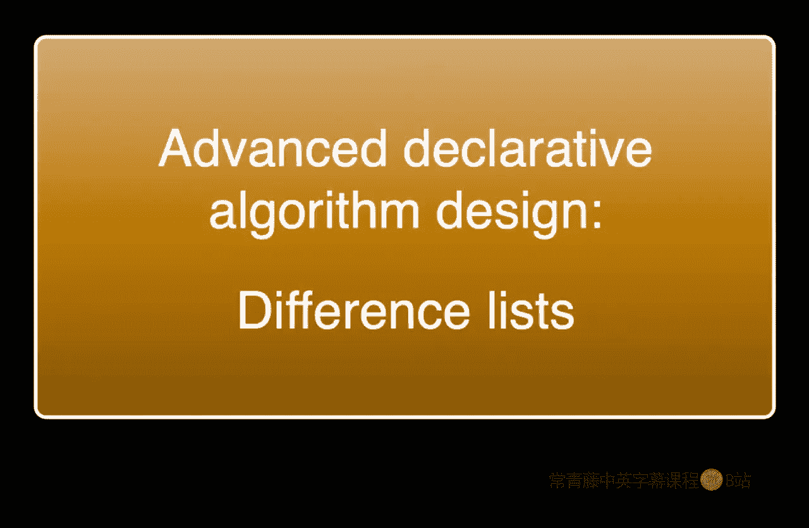
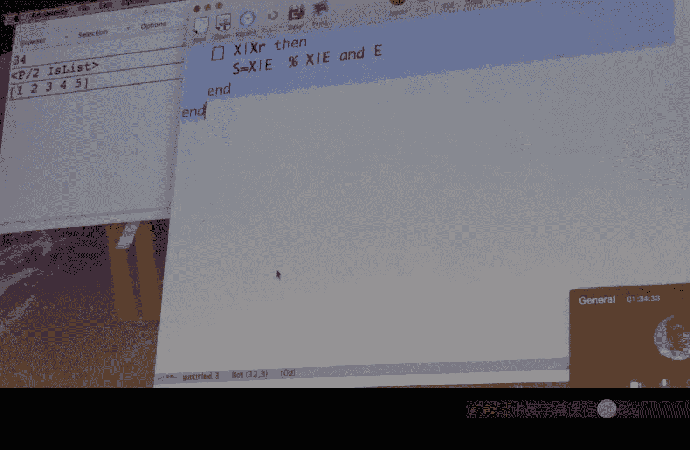
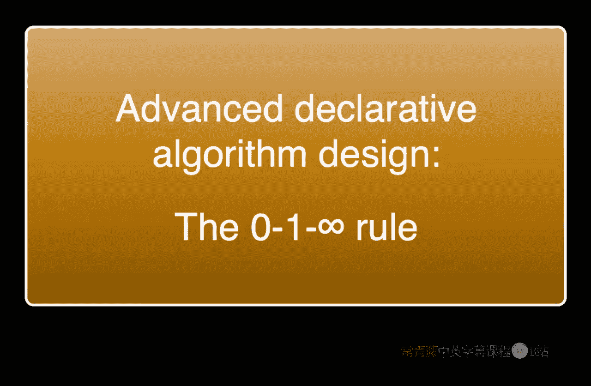
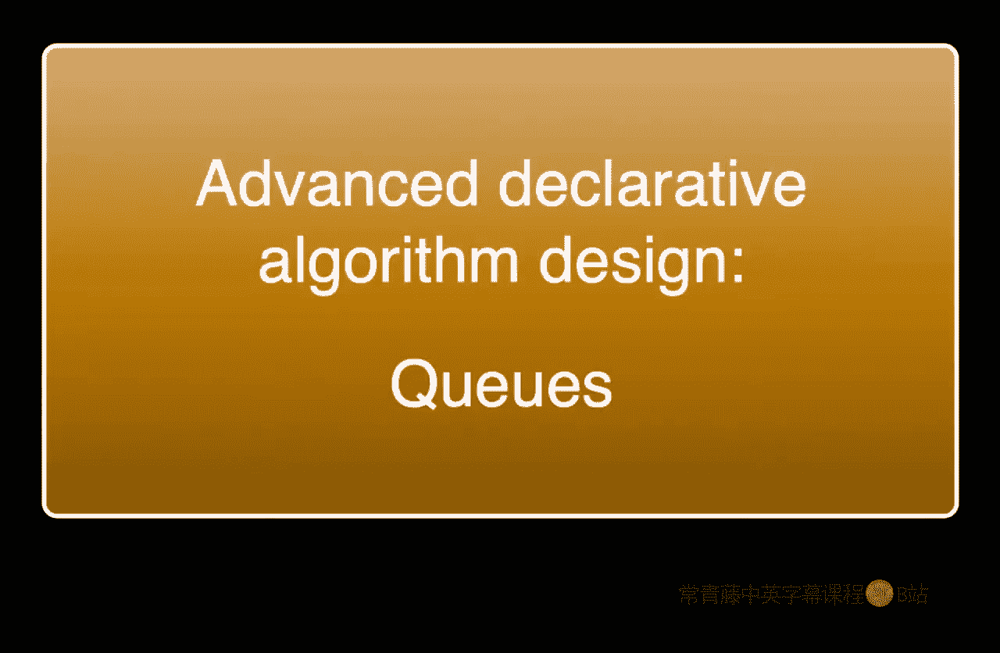
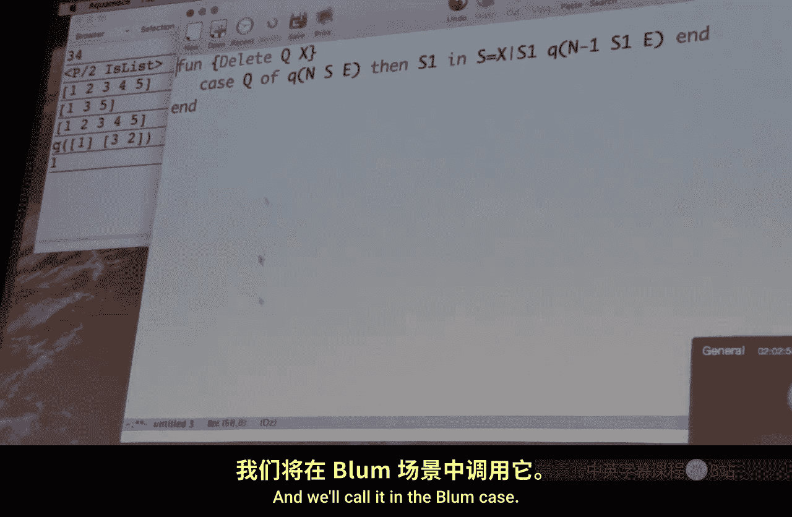

# 003：第4讲 - 声明式编程范式与算法设计

## 概述

在本节课中，我们将学习声明式编程范式的完整体系，理解其理论基础，并探索如何利用声明式概念（如单次赋值、并发、数据流和惰性求值）来设计更智能、更高效的算法。课程分为两部分：首先，我们将系统性地回顾并比较各种声明式编程范式；其次，我们将深入探讨高级算法设计技术。

---

## 声明式编程范式概览

声明式编程是命令式算法的最终课程。我们将解释为何以声明式方式编写大部分程序是明智之举，并展示其强大能力。

首先，我们将概述所有已见的声明式编程范式。事实上，范式众多。我将制作一个表格，展示不同编程语言对这些范式的支持情况，以便你可以下载这些语言并亲自尝试。此外，像MapReduce这样的云工具也支持其中一些范式。

接下来，我将给出声明式编程，特别是声明式并发的精确定义，因为并发性至关重要。

---

## 声明式范式的分类

为了理解所有这些不同的范式，我们从顺序函数式编程开始，然后加入并发性和数据流变量（单次赋值变量），最后再加入惰性执行。为了理解所有这些不同的模型，我们将通过讨论变量生命周期中的三个特殊时刻来提供良好的直觉。

### 变量生命周期的三个时刻

1.  **变量的创建**：当你定义变量时，例如使用 `declare` 或 `local` 语句。
2.  **指定赋予其值的函数**：例如，`X = F(Y)`。这里我们指定了函数 `F`，但尚未求值。
3.  **实际求值该函数**：执行函数以获取变量的值。

在许多编程语言中，这些时刻是合并在一起的。但将它们分离会带来一系列不同的可能性。

---

## 范式表格

以下表格基于教材第286页，我将提供更多信息使其更清晰。表格包含六个部分。

*   **横轴**：执行策略 - **及早求值** 或 **惰性求值**。
*   **纵轴**：计算模型 - **顺序** 或 **并发**，以及是否使用 **数据流变量**。

以下是不同象限的详细说明：

### 顺序 + 及早求值 + 值（无数据流变量）

这是算法设计课程中常见的内容。标准的函数式编程，通常称为**严格函数式编程**。`Scheme` 和 `ML` 是位于此象限的语言，它们拥有活跃的社区。

### 顺序 + 及早求值 + 数据流变量

这本质上是带有数据流变量的顺序语言。它允许你实现**尾递归列表函数**。例如，`Prolog`（在确定性子集下）就属于此类。更强大的扩展是**约束编程**，这是一个非常强大且实用的范式。

### 并发 + 及早求值 + 数据流变量

这是我们讨论过的**确定性数据流**模型，也称为“傻瓜式并发”。这是一个非常优雅的并发范式。实际上，所有的大数据云分析工具（如 `MapReduce`、`Apache Flink`）都使用此模型。

### 顺序 + 惰性求值 + 值（无数据流变量）

这被称为**惰性函数式编程**或**非严格函数式编程**。`Haskell` 是此象限的代表性语言。其惰性求值实际上是通过**协程**实现的。

### 并发 + 惰性求值 + 数据流变量

这是我们称为**惰性确定性数据流**的模型。在此模型中，你可以编写**有界缓冲区**，因为生产者和消费者是并发且独立的。这比纯惰性模型（如Haskell）更具优势，因为它允许生产者提前计算。

### 顺序 + 惰性求值 + 数据流变量

这个模型使用较少，但也可以实现一些算法，如惰性快速排序。

---

## 声明式范式的优势与总结

所有这些模型都是声明式的，它们没有可变状态。其优势包括：
*   并发编程中没有竞态条件，无需担心锁。
*   易于并行化。
*   易于测试，各部分可独立测试，因为它们没有历史状态。

本课程的一个重要启示是：在构建系统时，应尽可能保持在此模型内。当然，并非总能如此，尤其是在与现实世界交互时（如处理用户界面、外部事件），有时需要引入状态。但对于大型应用程序的大部分代码，声明式范式是可行且高效的。

---

## 理论基础：超越邱奇-罗瑟定理

上一节我们介绍了各种声明式范式的分类。本节中，我们将从更理论的角度探讨声明式编程的基础。

在之前的课程中，我们看到了λ演算和**邱奇-罗瑟定理**。该定理指出，所有归约顺序都会产生相同的结果（至多变量重命名）。这被称为**合流性**，是声明式编程优势的基础。

但λ演算只描述单一计算：从一个初始表达式开始，经过归约，得到一个最终结果。我们的声明式模型则超越了这一点。

### 扩展方式一：部分终止

在声明式模型中，我们可以有永不真正终止的**智能体**。例如，一个处理流 `[1, 2, 3, ...]` 并输出其平方 `[1, 4, 9, ...]` 的智能体。输入流可以无限扩展，每次扩展都会触发新的计算，但每次计算本身会达到一个**部分终止**或**静止点**。邱奇-罗瑟定理适用于每一次这样的计算步骤。

### 扩展方式二：逻辑等价性

λ演算没有数据流变量（即未绑定变量）。在我们的模型中，变量可以未绑定。我们通过考虑所有可能的绑定方式来处理它们。即使结果中包含未绑定变量，只要所有可能的执行路径产生的变量**可能值集合**是相同的，那么这些结果就是**逻辑等价**的。这可以用一阶逻辑中的约束来形式化。

### 声明式并发的定义

基于以上，我们可以定义声明式并发程序：一个并发程序是声明式的，当且仅当对于相同的输入，所有执行要么都**不终止**，要么都达到**部分终止**，并且结果**逻辑等价**。

### 扩展方式三：封装非声明式部分

大型应用程序通常混合了声明式和非声明式代码。非声明式部分（如可变状态、错误）会“污染”整个程序，使其变得非确定性。解决方案是**封装**非声明式部分，使其从外部看仍然是声明式的。例如，通过异常处理来捕获错误并返回合理结果。

### 总结与实例：MapReduce



所有优势都源于邱奇-罗瑟定理。声明式模型通过**部分终止**和**逻辑等价性**扩展了该定理，从而实现了强大的声明式程序。

`MapReduce` 是一个绝佳的例子。它是一个纯粹的函数式（声明式）计算模型，用于处理海量数据。在由数千台计算机组成的分布式系统中，节点可能崩溃。但由于计算是声明式的，`f(x)` 总是对相同的 `x` 产生相同的结果。因此，如果一个节点崩溃，系统可以简单地在另一节点上重新执行 `f(x)`，而整个系统的其他部分不受影响。这正是声明式编程在大规模、容错分布式系统中成功的关键原因。

---

## 高级算法设计技术

上一节我们探讨了声明式编程的理论基础。本节中，我们将转向更实际的内容，看看如何利用声明式概念设计巧妙的算法。

### 差异列表

首先介绍的概念是**差异列表**。差异列表是一种列表表示法，它将一个列表表示为**两个列表的差**。

例如，列表 `[1, 2, 3]` 可以表示为差异列表 `(S, E)`，其中 `S = [1, 2, 3 | X]`，`E = X`。当 `X` 被绑定为 `nil` 时，`S` 就代表了列表 `[1, 2, 3]`。

#### 优势：常数时间追加

差异列表的妙处在于，它允许以**常数时间**追加两个列表。假设我们有差异列表 `L1 = (S1, X)` 代表列表 `[1, 2, 3]`，`L2 = (S2, Y)` 代表列表 `[4, 5, 6]`。要追加它们得到代表 `[1,2,3,4,5,6]` 的差异列表 `L = (S, E)`，只需将 `X` 绑定到 `S2`，并令 `S = S1`, `E = Y`。这只是一个简单的绑定操作。

#### 示例：展平函数

以下是使用差异列表实现列表展平函数的示例，它避免了低效的追加操作。



```oz
% 普通展平函数，使用追加（低效）
fun {Flatten Xs}
    case Xs
    of nil then nil
    [] X|Xr andthen {IsList X} then
        {Append {Flatten X} {Flatten Xr}}
    [] X|Xr then
        X|{Flatten Xr}
    end
end

% 使用差异列表的展平函数（高效）
proc {DFlatten Xs S E} % S, E 构成结果差异列表
    case Xs
    of nil then S = E % 空列表表示为 S=E
    [] X|Xr andthen {IsList X} then
        M in
        {DFlatten X S M} % 展平X，结果差异列表为(S, M)
        {DFlatten Xr M E} % 展平Xr，结果差异列表为(M, E)。这相当于追加。
    [] X|Xr then
        M in
        S = X|M % 将X放在结果差异列表的开头
        {DFlatten Xr M E}
    end
end
% 调用方式：{DFlatten [1 [2 3] 4] S nil}，结果在S中。
```

### 0-1-无穷大规则




差异列表体现了 **0-1-无穷大规则**：对于一个操作（如赋值），应该有三种可能性：
*   **0次**：不可能。例如，常量值。
*   **1次**：只能执行一次。例如，数据流变量（单次赋值）。
*   **无穷次**：可以执行任意多次。例如，可变状态。

**单次赋值** 获得了可变状态的部分优势（可以赋值），同时保留了声明式编程的所有优点，是一个非常有益的折中方案。

---



## 声明式队列实现

接下来，我们看看如何用声明式范式实现队列数据结构。队列支持在队尾插入、在队头删除。

### 简单（低效）实现

最简单的实现是使用一个列表，将队头放在列表头部。这样，**插入**是常数时间（在头部添加），但**删除**是 O(n) 时间（需要遍历到列表尾部）。

### 摊销常数时间队列

我们可以用两个列表 `(F, R)` 更巧妙地表示队列。队列的实际内容是 **F ++ {Reverse R}**。
*   **插入**：将新元素添加到 `R` 的头部。O(1)。
*   **删除**：从 `F` 的头部取出元素。O(1)，前提是 `F` 非空。
*   当 `F` 为空时，执行一次 `F = {Reverse R}` 并清空 `R`。这个 `Reverse` 操作是 O(n) 的，但因为它只在一系列删除操作后 `F` 变空时才发生一次，所以**平摊**下来，每个操作仍然是常数时间。

这是一个纯函数式（严格）的实现。

### 最坏情况常数时间队列

通过引入**数据流变量**和**差异列表**的概念，我们可以实现**最坏情况常数时间**的队列。

我们将队列表示为一个差异列表 `(S, E)`，并额外使用一个计数器来区分空队列。
*   **插入**：在差异列表的末尾添加元素。这涉及创建一个新的末尾变量，是 O(1)。
*   **删除**：从差异列表的头部移除元素。这涉及将头部绑定到一个新的变量，是 O(1)。

这个实现保证了每次插入和删除操作都是常数时间，但需要数据流变量的支持。

### 持久化数据结构



上述两种队列实现都是**短暂性**的：你只能有一个当前版本。如果你想要一个**持久化**数据结构（可以同时存在多个版本，例如用于协作编辑），则需要引入**惰性求值**。惰性求值可以构建出既是持久化又在每次操作中具有平摊甚至最坏情况常数时间复杂度的数据结构，但这超出了本次讨论的范围。

---

## 总结

本节课中，我们一起学习了声明式编程范式的完整图谱，从理论基础到实际应用。我们了解到，声明式编程通过避免可变状态，带来了确定性、易于并发、测试和容错等巨大优势。通过邱奇-罗瑟定理的扩展（部分终止、逻辑等价性、封装），声明式模型能够支撑从函数式编程到大规模分布式计算（如MapReduce）的广泛应用。

在算法设计部分，我们探索了如何利用声明式概念（如单次赋值、数据流）设计高效的数据结构和算法。**差异列表**展示了如何通过巧妙的表示法实现常数时间的列表追加。**0-1-无穷大规则**为我们设计语言特性提供了有益的指导。最后，我们比较了**摊销常数时间队列**和**最坏情况常数时间队列**的实现，直观地看到了数据流变量带来的性能提升。


掌握这些声明式编程的核心概念和技巧，将帮助你构建更可靠、更易于维护且高效的程序。