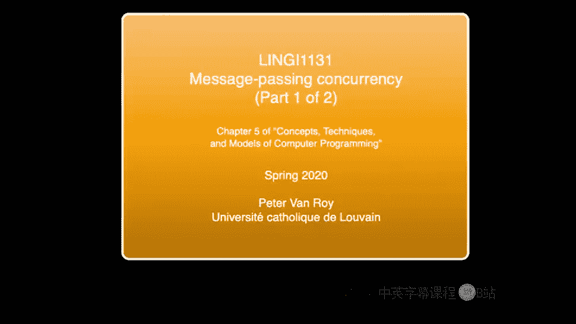
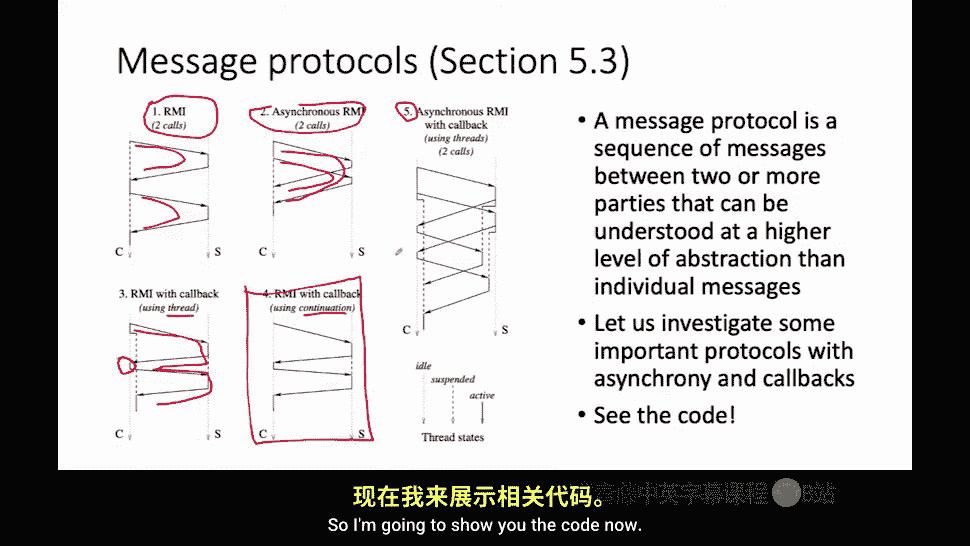
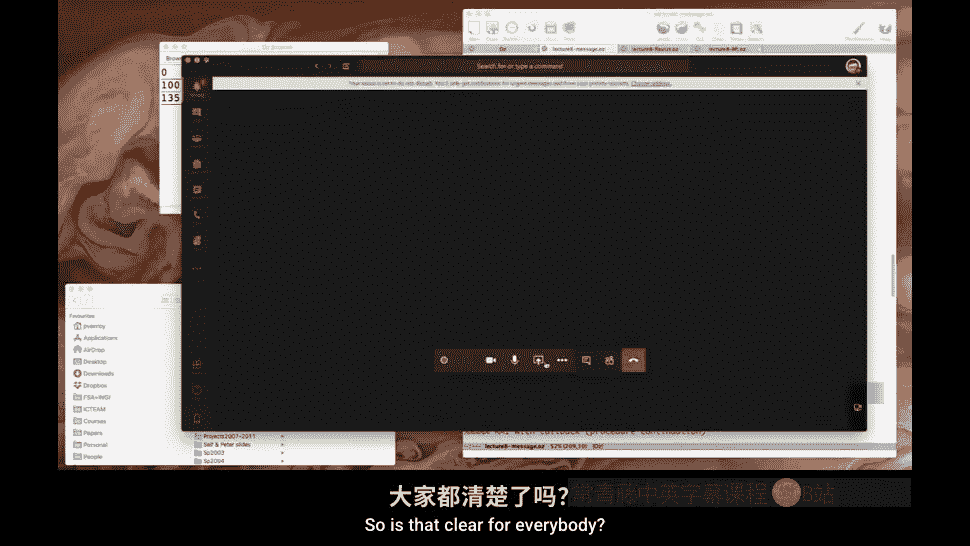
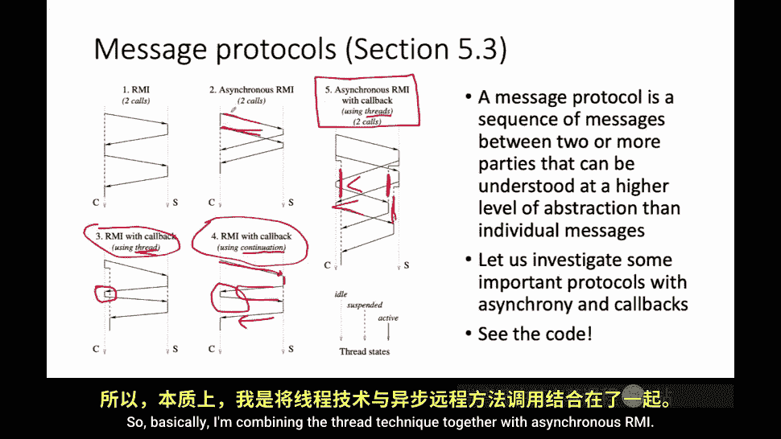
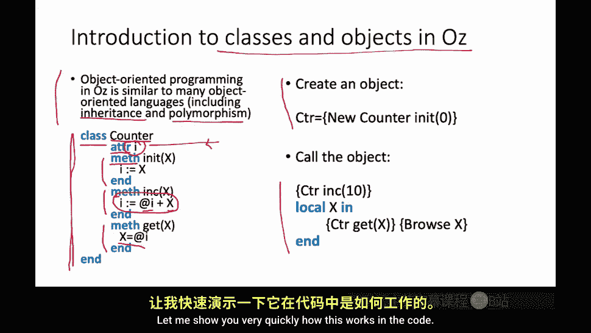
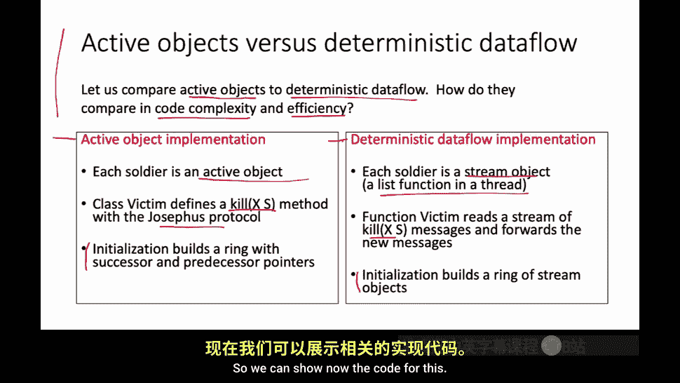
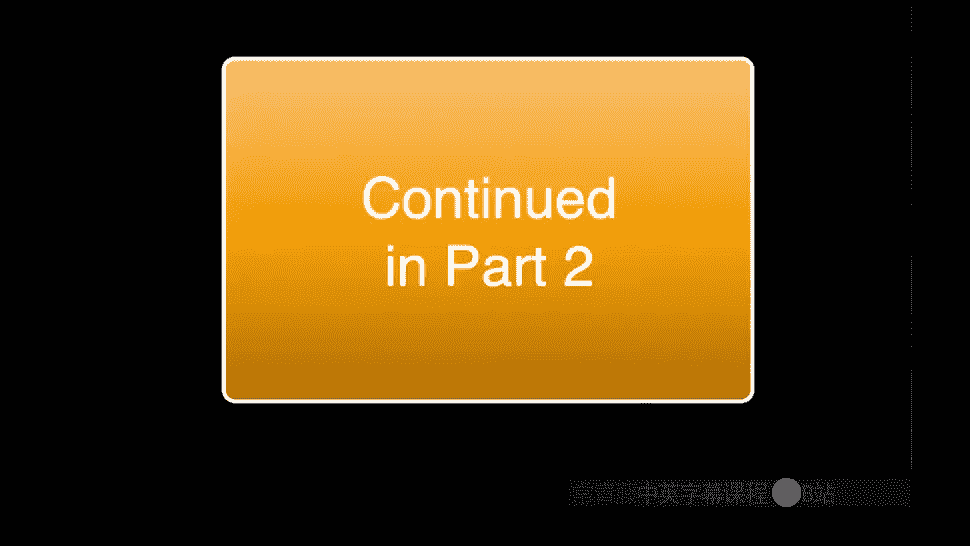

# 005：消息传递并发（第一部分）




在本节课中，我们将要学习消息传递并发的高级概念，包括消息协议、主动对象，并通过一个经典问题来比较不同并发模型的实现方式。

---

## 消息协议回顾与延续



上一节我们介绍了基本的远程方法调用（RMI）协议。本节中，我们来看看如何通过“延续”技术来实现带有回调的RMI，而无需创建额外的线程。

延续是一种数据结构，它封装了需要在未来某个时刻执行的计算。在带有延续的RMI回调中，客户端将原本需要等待服务器回调后才能执行的计算，封装成一个独立的“延续”消息。

以下是其工作原理：
1.  客户端向服务器发送初始请求消息。
2.  服务器执行计算，并在需要时向客户端发送回调请求（如请求一个`delta`值）。
3.  客户端处理回调请求后，服务器将最终结果连同“延续”消息一起发送回客户端。
4.  客户端收到“延续”消息后，执行其中封装的计算。

这种方法避免了在客户端创建新线程，但需要服务器了解并发送延续消息。其核心代码结构如下：



```oz
% 客户端发送请求，并准备接收延续
proc {ClientMethod}
    {Send ServerPort calc(x:X cont:$)} % 发送请求，指定返回延续
end

% 服务器处理请求并发送延续
proc {ServerLoop S State}
    case S of calc(x:X cont:Cont)|Sr then
        ... % 执行计算，可能涉及回调
        {Send ClientPort Cont(result:Y)} % 将结果通过延续消息发回
        {ServerLoop Sr NewState}
    end
end
```




---

## 从被动对象到主动对象 🧵



上一节我们讨论了基于消息的端口对象。本节中，我们来看看如何将其与面向对象编程结合，形成“主动对象”。


传统的对象（我们称之为**被动对象**）本身不包含线程。当多个线程同时调用同一个被动对象的方法时，这些方法的执行会在调用者的线程中交错进行，可能导致竞态条件。例如，两个线程同时递增一个计数器，最终结果可能由于读取和写入操作的交叉而错误地只为1。

**主动对象**通过为每个对象绑定一个专属线程来解决这个问题。所有对该对象的方法调用都转化为异步消息，发送到该对象内部的消息队列中，由对象自己的线程**顺序**处理。这保证了对象内部状态的一致性，无需额外的锁机制。

在Oz中，创建一个主动对象的简化模式如下：

```oz
fun {NewActive Class Init}
    Obj = {New Class Init} % 创建内部的被动对象
    P S
in
    {NewPort S P} % 创建端口
    thread % 对象专属线程
        for M in S do {Obj M} end % 顺序处理所有消息
    end
    P % 返回端口，用于向对象发送消息
end
```

主动对象结合了面向对象的封装、继承多态等优点和消息传递并发模型的线程安全性，是现代并发系统中的一个重要概念。


---

## 案例研究：弗拉维乌斯·约瑟夫斯问题 ⚔️

为了深入比较不同并发模型，我们使用一个经典问题：弗拉维乌斯·约瑟夫斯问题。

问题描述：N个人围成一圈，从第一个人开始报数，每数到第K个人就将其淘汰出圈，然后从下一个人继续报数，直到只剩一人。求最后幸存者的位置。


我们将用两种风格实现这个淘汰协议：
1.  **主动对象风格**：每个参与者是一个主动对象，通过异步消息传递来模拟报数和淘汰。
2.  **确定性数据流风格**：每个参与者是一个流式处理器（函数），通过流（列表）连接成环，消息在流中传递。




以下是两种实现的核心思路对比。

### 主动对象实现

在主动对象实现中，每个“士兵”是一个主动对象，它们组成一个环。每个对象有一个`kill(X, S)`方法，其中`X`是当前计数值，`S`是剩余存活人数。

协议规则如下：
*   如果对象存活且`S==1`，则它是幸存者。
*   如果对象存活且`X mod K == 0`，则该对象“死亡”，并向下一对象发送`kill(X+1, S-1)`。
*   如果对象存活且`X mod K != 0`，则它存活，并向下一对象发送`kill(X+1, S)`。
*   如果对象已死亡，则直接转发消息。

初始向第一个对象发送`kill(1, N)`消息即可启动过程。

### 确定性数据流实现

在数据流实现中，每个“士兵”是一个函数，它读入一个包含`kill`消息的输入流，并根据协议产生一个输出流。这些函数通过高阶函数`Pipe`连接成一个环。

每个处理函数`Victim`的逻辑与主动对象的协议类似，但它通过是否进行递归调用来表示自身的“存活”状态。当士兵死亡时，它停止递归，不再处理后续消息，相当于从环中被短路移除。

```oz
fun {Victim I K Last InStream} % I:身份, K:步长, Last:幸存者变量, InStream:输入流
    case InStream of kill(X S)|Ir then
        if S==1 then Last=I nil % 找到幸存者，终止流
        elseif X mod K == 0 then
            kill(X+1 S-1)|{Victim I K Last Ir} % 死亡，转发消息，自身不再递归（短路）
        else
            kill(X+1 S)|{Victim I K Last Ir} % 存活，转发消息，继续递归
        end
    end
end
```

### 对比与总结

通过对约瑟夫斯问题的两种实现，我们可以得出以下观察：
*   **代码复杂度**：确定性数据流版本通常更紧凑、更声明式，代码行数更少，尤其是结合了高阶函数后。
*   **概念模型**：主动对象模型更贴近我们对“自主个体”和“消息传递”的直观理解。数据流模型则更侧重于“计算”和“变换”。
*   **适用性**：确定性数据流仅适用于**确定性**并发问题（如约瑟夫斯问题）。对于涉及非确定性选择（如随机淘汰）或复杂交互状态的系统，主动对象模型更为灵活和强大。
*   **性能**：对于此类问题，两种实现经过优化（如在数据流中短路死节点，在主动对象中移除死节点）后，性能差异不大。



本节课中我们一起学习了消息协议中的延续技术、被动对象与主动对象的区别，并通过弗拉维乌斯·约瑟夫斯问题实践和比较了主动对象与确定性数据流这两种并发编程范式。下一部分，我们将探讨如何设计由大量主动对象组成的多智能体系统。