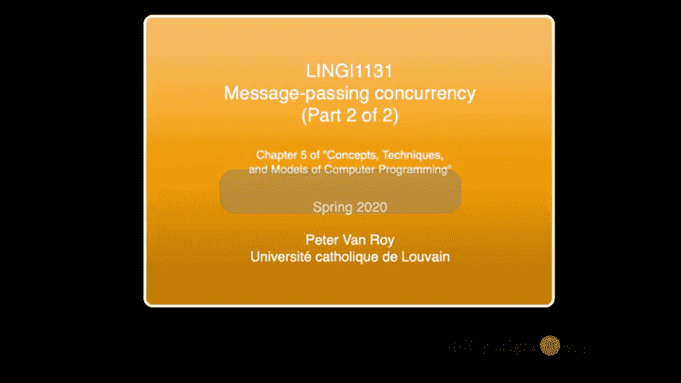
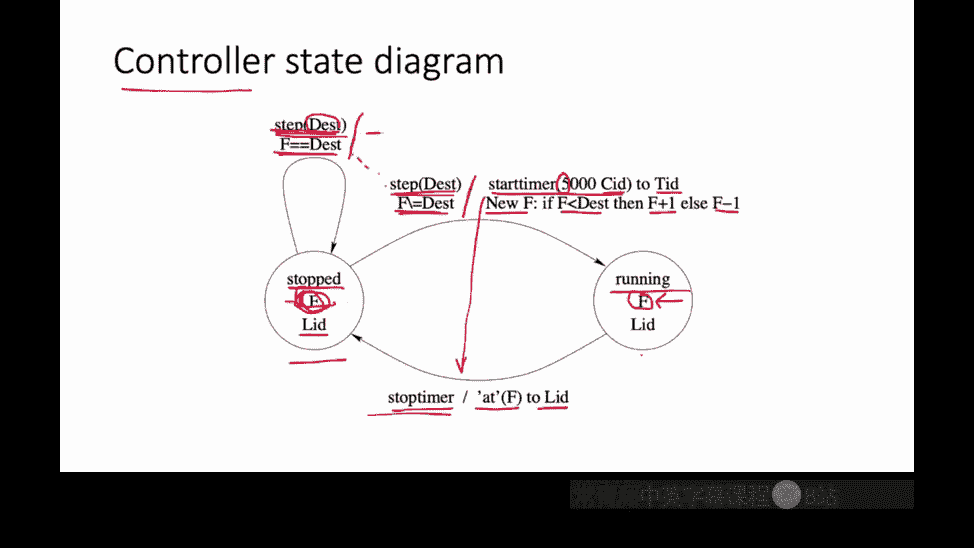
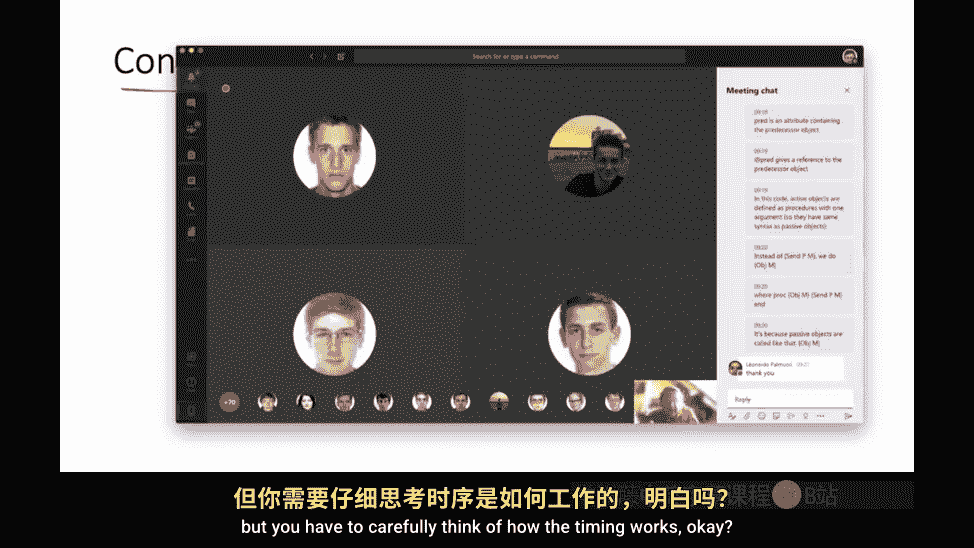
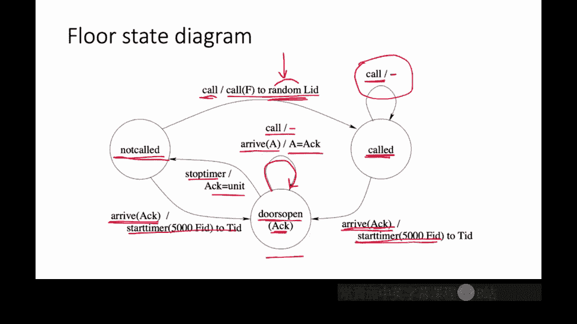
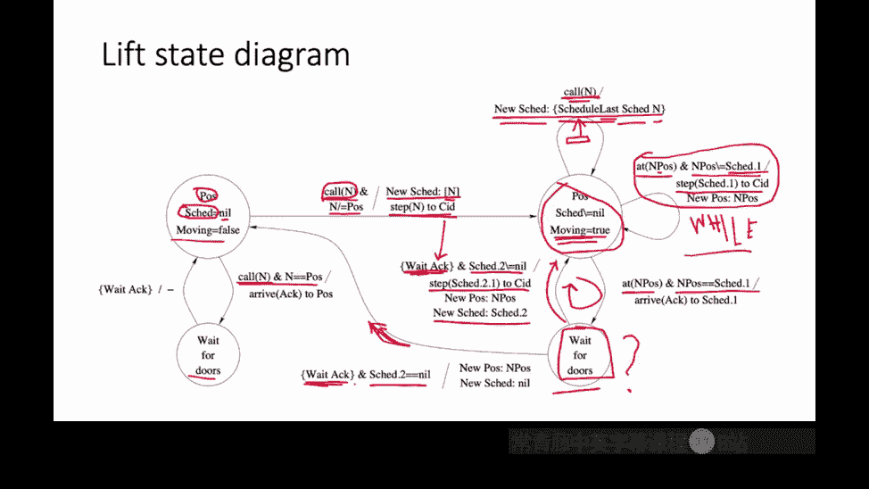
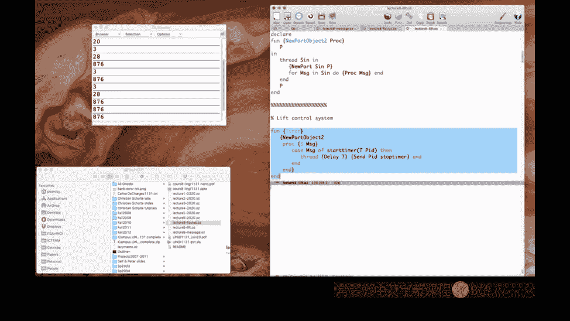

# 006：多智能体编程 🚀



在本节课中，我们将学习如何构建多智能体系统。多智能体编程涉及创建由多个并发组件（或称“智能体”）组成的大型系统，这些组件通过相互发送消息进行通信。我们将通过一个电梯控制系统的具体实例，来理解从设计到实现的全过程。

---

## 多智能体系统概述 🤖

多智能体编程是指构建由多个智能体组成的大型系统。这些智能体可以是活动对象、端口对象或确定性的数据流对象（流对象）。程序本质上是一组具有内部状态、并能相互发送消息的智能体的集合。

我们之前学习的确定性数据流，实际上是多智能体编程的一种受限形式，因为它保证了确定性。然而，在真实的复杂系统中，由于需要与外部世界（如用户输入）交互，程序往往必须表现出**非确定性**行为。例如，在客户端-服务器模型中，服务器必须对首先到达的请求做出反应，而请求到达的顺序是不可控的，这就引入了非确定性。

通过使用端口对象，我们可以超越确定性数据流，设计出具有非确定性行为的程序。

---

## 核心概念与构建模块 🔧

构建多智能体系统非常复杂，因为存在大量的并发交互。因此，我们必须采用严谨的方法。以下是构建此类系统的基本概念和操作。


### 并发组件

在我们的例子中，一个并发组件是一个带有输入和输出的过程。调用这个过程会创建一个智能体实例。这类似于面向对象编程中从类创建对象。

**代码示例：创建组件实例**
```oz
% 定义一个全加器组件
proc {FullAdder Xs Ys Cs ?S ?C}
   ...
end
% 实例化一个全加器智能体
{FullAdder Xs Ys Cs S C}
```

### 四种基本操作

构建系统时涉及四种基本操作：

1.  **实例化**：创建一个组件的新实例（即一个新的智能体）。
2.  **组合**：将多个较小的组件组合成一个更大的组件。例如，全加器内部由多个逻辑门组成。
3.  **连接**：将组件通过“连线”连接起来，以便它们可以通信。连线有不同的类型：
    *   **单次发送 vs. 多次发送**：单次赋值变量（数据流变量）是“单发”连线，只能绑定一次值。端口和流是“多发”连线，可以发送多条消息。
    *   **单源 vs. 多源**：流是**单源**的（只有一个写入者，多个读取者），因此是确定性的。端口是**多源**的（多个写入者），因此是非确定性的。
4.  **限制**：在连接组件时，隐藏内部的连线，实现封装。这就像在构建电子电路时，将内部连线封装在芯片内部。

---

## 设计方法论：从规范到实现 📐

由于系统复杂性，我们不能直接开始编码。我们需要一个系统化的设计方法，其核心是**状态图**。以下是设计步骤：

1.  **非形式化规范**：首先用自然语言描述系统需要做什么。
2.  **定义组件**：确定系统中有哪些类型的智能体，它们各自负责什么，以及它们之间传递哪些消息。
3.  **定义消息协议**：精确定义组件间通信的消息格式和顺序。
4.  **绘制状态图**：为每个组件绘制有限状态自动机图。这是设计过程中最关键、最困难的部分。状态图需要枚举组件所有可能的状态，以及在每个状态下，接收到各种可能消息时应如何转换状态。
5.  **实现**：根据状态图编写代码。一旦状态图正确，实现过程几乎是机械式的，甚至可以使用工具自动生成代码。
6.  **验证与测试**：对实现进行形式化验证（证明某些属性始终成立）和大量测试（在各种场景下运行）。发现问题后，可能需要回到前面的步骤进行修改。

上一节我们介绍了多智能体系统的基本概念和设计方法论，本节中我们来看看如何将这些理论应用到一个具体的、复杂的例子中。





---

## 实例：电梯控制系统 🛗

我们将构建一个控制多部电梯在多层建筑中运行的系统。这个系统很好地展示了多智能体、并发和非确定性的特点。

### 系统组件

系统包含三类基本组件：




1.  **控制器**：控制电梯马达，使电梯一次移动一层楼。它接收来自电梯的“步进”指令，并通知电梯它已到达某一层。
2.  **楼层**：代表建筑中的每一层楼。它接收用户的“呼叫”请求，并管理电梯门的开关。
3.  **电梯**：电梯本身。它接收来自楼层和电梯内部用户的“呼叫”请求，维护一个需要前往的楼层“日程表”，并与控制器协作来移动。

### 消息协议


组件间通过以下协议通信：

*   **用户 -> 楼层**：`call` （用户按下楼层呼叫按钮）
*   **楼层 -> 电梯**：`call(F)` （楼层F呼叫一部电梯）
*   **电梯 -> 楼层**：`arrive(F, Ack)` （电梯到达楼层F，并等待一个确认`Ack`才能离开）
*   **楼层 -> 电梯**：`Ack=unit` （楼层绑定`Ack`，允许电梯离开）
*   **（电梯内）用户 -> 电梯**：`call(F)` （用户按下电梯内前往F层的按钮）
*   **电梯 -> 控制器**：`step(Dest)` （电梯请求移动到目标楼层`Dest`）
*   **控制器 -> 电梯**：`at(F)` （控制器通知电梯现在位于楼层F）

### 组件状态图分析

以下是各组件状态图的要点分析。

**控制器状态图** 🎛️
控制器有两种状态：`stopped`（停止在某层）和`running`（正在移动）。
*   在`stopped`状态收到`step(Dest)`消息时，如果目标`Dest`与当前层`F`不同，则启动定时器模拟移动，并进入`running`状态。
*   在`running`状态收到`stopTimer`消息（表示移动完成）时，向电梯发送`at(F)`消息，并返回`stopped`状态。




**楼层状态图** 🏢
楼层有三种状态：`notcalled`（空闲）、`called`（已呼叫电梯，等待中）和`doorsOpen`（门已打开）。
*   关键点在于，在**任何状态**下，都必须能处理`call`（用户再次按键）和`arrive`（电梯到达）消息，并做出合理反应（例如，在门已开时再次收到呼叫，则忽略；在空闲时收到到达消息，也需开门）。

**电梯状态图** 📈
电梯的状态更复杂，核心是维护一个日程表（需要访问的楼层列表）。主要状态包括`moving`（移动中）和`waitForDoors`（等待门关闭）。
*   在`moving`状态，它可以接收新的`call(F)`消息，并将其加入日程表。
*   当收到控制器的`at(F)`消息且`F`是日程表的第一项时，电梯进入`waitForDoors`状态，等待楼层发来的确认`Ack`。
*   收到`Ack`后，如果日程表还有后续楼层，则返回`moving`状态前往下一层；否则进入空闲状态。

---

## 从状态图到代码实现 💻

一旦状态图设计完成并经过推敲，代码实现就相对直接了。以下是如何将状态图转化为Oz代码的示例。

**控制器代码示例**
```oz
proc {Controller Init}
   % 状态表示为元组：Motor#Floor#LiftID
   fun {StateLoop Motor F Lid}
      case Motor
      of running then
         % 在运行状态，只处理 stopTimer 消息
         receive stopTimer then
            {Send Lid at(F)} % 通知电梯到达
            {StateLoop stopped F Lid}
         end
      [] stopped then
         % 在停止状态，处理 step 消息
         receive step(D) then
            if F==D then {StateLoop stopped F Lid}
            elseif F<D then
               {StartTimer} % 启动定时器模拟移动
               {StateLoop running F+1 Lid} % 状态变为运行，目标层+1
            else
               {StartTimer}
               {StateLoop running F-1 Lid} % 目标层-1
            end
         end
      end
   end
in
   thread {StateLoop Init} end
end
```
这段代码几乎是状态图的逐行翻译。`receive`语句等待特定消息，`case`语句区分不同状态。

**关于消息处理的说明**
在本例的模型（基于端口对象）中，每个智能体有一个消息队列，并严格按照消息到达的顺序处理。如果某个状态不处理某种消息（例如电梯在`waitForDoors`状态不处理`call`），该消息会留在队列中，直到智能体进入一个能处理它的状态。**消息永远不会被丢弃**。

---

## 测试、验证与软件工程三大支柱 🏗️



实现完成后，必须进行严格的测试和验证。

*   **测试**：运行系统，模拟各种场景和极端情况（如同时呼叫多部电梯、在电梯门开启时按键等）。
*   **验证**：通过逻辑推理或模型检测等形式化方法，证明系统始终满足某些关键属性。例如：
    *   **属性1**：电梯最终总会停在其日程表中的每一个楼层。
    *   **属性2**：如果向电梯发送了`call(F)`消息，电梯最终总会到达楼层F。


这引出了稳健软件开发的**三大支柱**，对于多智能体系统尤为重要：
1.  **设计**：使用清晰的方法论（如基于状态图的设计）来构建坚实的系统结构。
2.  **测试**：通过运行大量案例来发现错误。
3.  **验证**：通过形式化推理来保证关键属性的正确性，覆盖测试难以触及的角落。

三者缺一不可，忽略任何一项都会带来风险。

---


## 总结 📚


本节课中我们一起学习了多智能体编程的核心内容。我们从基本概念出发，了解了如何将系统视为由交互的智能体组成。然后，我们深入探讨了一个严谨的设计方法论，其核心是绘制详尽的状态图。最后，我们通过一个完整的电梯控制系统实例，演示了如何从非形式化规范开始，逐步定义组件、协议、绘制状态图，并最终实现为可运行的代码。我们强调了在构建此类复杂并发系统时，结合设计、测试和验证这三大支柱的重要性。