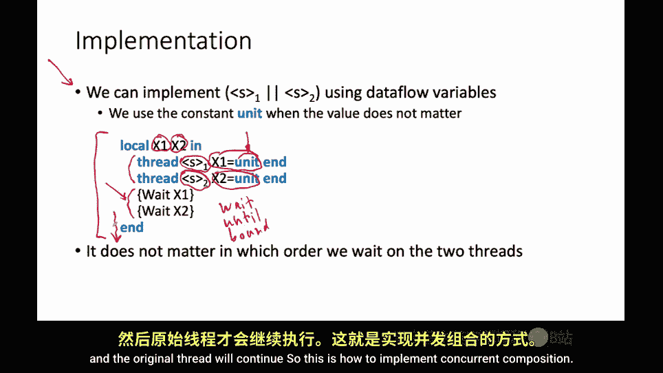
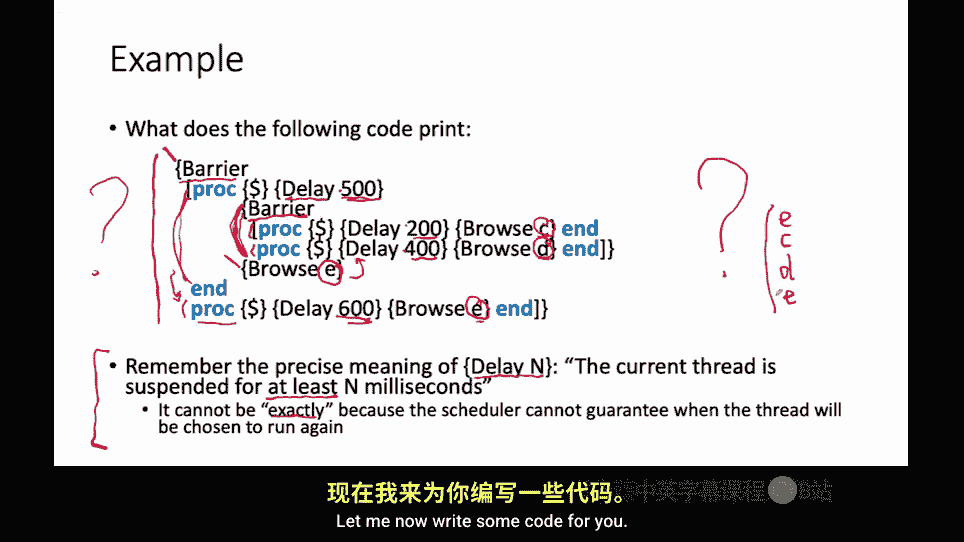
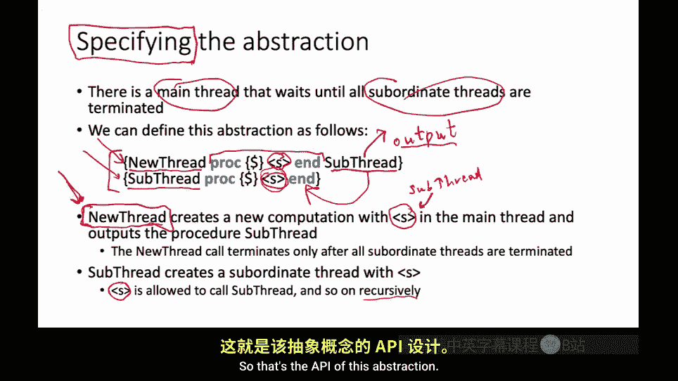
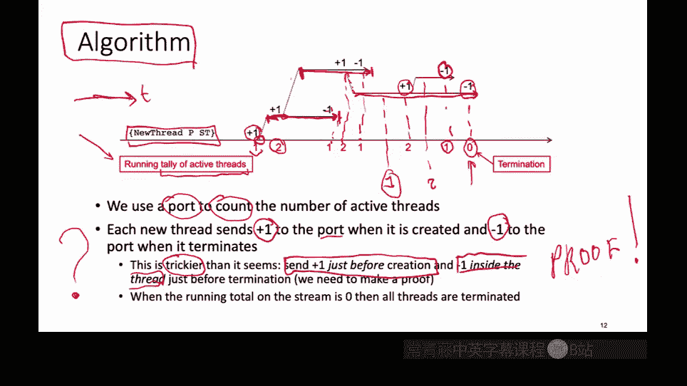
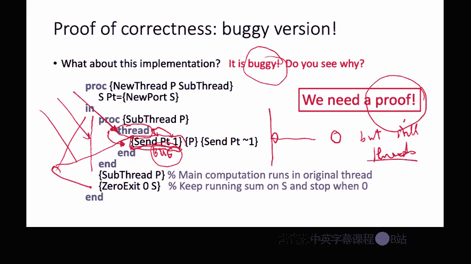
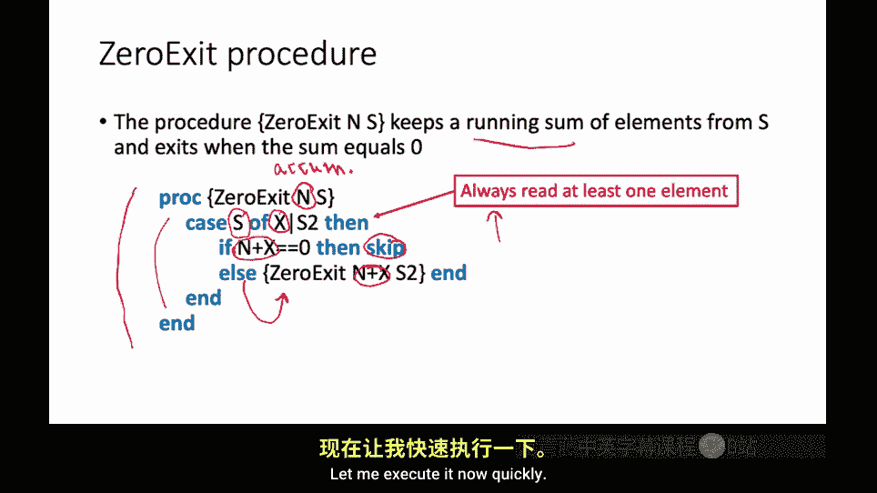

# 007：构建并发程序的最佳方式 🚀


在本节课中，我们将要学习构建并发程序的最佳方式，即结合确定性数据流和端口。我们将从回顾并发组合开始，然后深入探讨如何实现动态的线程同步，并理解其背后的证明。

## 概述




构建并发程序是困难的。在多智能体编程中，我们必须确保消息可以随时发生，这在处理大量智能体时尤其复杂。然而，确定性数据流模型则简单得多，它允许我们随意添加线程。本节课的核心问题是：我们能否在保持确定性数据流优势的同时，进行通用的分布式编程？答案是肯定的。我们将学习如何尽可能多地使用确定性数据流，并在必要时引入端口，从而以最简单、最易于理解和证明正确性的方式编写并发程序。

## 并发组合（屏障同步）🧱

上一节我们提到了确定性数据流的优势。本节中，我们来看看如何实现一个基础的并发控制结构：并发组合，也称为屏障同步。

线程语句 `thread S end` 会创建一个独立执行的新线程。但有时，原始线程需要等待其创建的所有子线程都完成后才能继续。这就是并发组合的作用。




并发组合的表示法为 `S1 || S2`。它创建两个并发执行的线程（S1 和 S2），并等待它们都终止后，再执行后续语句 S3。

以下是使用单赋值数据流变量实现并发组合的代码：

```oz
local X1 X2 in
    thread
        S1
        X1 = unit
    end
    thread
        S2
        X2 = unit
    end
    {Wait X1}
    {Wait X2}
    S3
end
```

在这段代码中，我们引入了变量 `X1` 和 `X2` 用于同步。每个子线程在完成其任务 `S` 后，会将对应的变量绑定为 `unit` 值。原始线程通过 `{Wait X}` 语句等待这两个变量都被绑定，从而确保在继续执行 `S3` 之前，所有子线程都已结束。

## 构建高阶抽象：`Barrier` 过程


上述实现较为冗长。我们可以利用高阶编程构建一个通用的 `Barrier` 抽象，它接受一个语句（过程）列表，并等待所有语句执行完毕。

以下是 `Barrier` 过程的实现：

```oz
fun {Barrier Ps}
    Xs = {Map Ps
        fun {$ P}
            X
        in
            thread
                {P}
                X = unit
            end
            X
        end}
in
    for X in Xs do {Wait X} end
end
```

`Barrier` 过程的工作原理如下：
1.  使用 `Map` 函数为列表 `Ps` 中的每个过程 `P` 创建一个新线程来执行它，并返回一个与该线程关联的单赋值变量 `X`。
2.  线程执行完 `P` 后，会将 `X` 绑定为 `unit`。
3.  最后，使用 `for` 循环等待列表 `Xs` 中的所有变量都被绑定。

这个抽象完全使用确定性数据流实现，没有引入任何非确定性。




## 动态并发组合：挑战与定义

上一节我们介绍了静态已知线程数量的并发组合。本节中，我们来看看一个更强大的概念：动态并发组合，其中线程数量在运行时动态变化且未知。

考虑一个场景：主线程创建子线程，而子线程自身也可以创建更多的子线程（递归地）。我们需要同步所有后代线程的终止，但事先并不知道线程的总数。




这个抽象无法仅用确定性数据流实现，它需要一个端口。我们定义以下 API：
*   `NewThread`：一个过程，它接受一个主语句 `S` 作为参数，并返回一个 `Subthread` 过程。
*   `Subthread`：一个由 `NewThread` 返回的过程。在 `S` 或任何 `Subthread` 的执行体中，可以调用 `Subthread` 来创建新的子线程。
*   当调用 `NewThread` 时，它会执行 `S`，并等待所有通过 `Subthread` 创建的后代线程（包括递归创建的）都结束后才返回。

## 使用端口实现动态并发组合 🧮

我们使用一个端口来跟踪活跃线程的数量。基本算法是：
1.  创建一个端口 `P` 及其流 `S`。
2.  每当通过 `Subthread` 创建一个新线程时，在创建线程**之前**，立即向端口发送 `+1`。
3.  在每个新创建的线程内部，在其执行体**结束之后、终止之前**，向端口发送 `-1`。
4.  主线程读取流 `S`，维护一个运行总和（初始为0）。每收到一个 `+1` 则加一，收到 `-1` 则减一。
5.  当运行总和再次变为0时，意味着所有创建的线程都已终止，此时主线程的等待结束。



以下是 `NewThread` 和 `Subthread` 的实现代码框架：


```oz
fun {NewThread P}
    Pt = {NewPort S}
    proc {Subthread P}
        {Send Pt 1} % 发送 +1
        thread
            {P}
            {Send Pt ~1} % 发送 -1。~1 在 Oz 中表示 -1。
        end
    end
in
    {Subthread P} % 启动主任务
    {ZeroExit 0 S} % 等待总和归零
    Subthread % 返回 Subthread 过程
end

proc {ZeroExit N S}
    case S of X|S2 then
        if N+X == 0 then skip
        else {ZeroExit N+X S2}
        end
    end
end
```

## 正确性证明：不变式断言 🔍

为了确信上述算法的正确性，我们需要进行形式化推理。我们使用一个**不变式断言**：**流 `S` 上所有元素的总和，始终大于或等于当前活跃线程的数量**。

我们通过归纳法来证明这个不变式：
*   **基础情况**：程序开始时，流为空（总和为0），活跃线程数为0。不变式成立。
*   **归纳步骤**：考虑可能改变不变式的四种动作：
    1.  **发送 +1**：这只会增加流的总和，不会减少活跃线程数，因此不变式保持或变得更安全（总和更大）。
    2.  **创建新线程**：此动作使活跃线程数加1。关键点在于，根据代码，`Send Pt 1`（发送+1）**发生在线程创建之前**，并且与创建动作在同一个（父）线程中顺序执行。因此，在活跃线程数增加之前，流的总和已经增加了1。所以不变式仍然成立。
    3.  **发送 -1**：这发生在子线程内部，且在其执行体 `{P}` 完成之后。我们可以认为线程的“终止”逻辑上发生在此发送动作之前。发送-1会减少流的总和，而活跃线程数也因该线程即将终止而减少。因此，在调整后，不变式依然成立。
    4.  **线程终止**：这使活跃线程数减1。由于对应的 `-1` 消息已经在流中（或紧随其后），总和也已反映，不变式成立。



由于不变式始终成立，那么当 `ZeroExit` 检测到流的总和（运行总和 `N`）为0时，根据不变式（总和 >= 活跃线程数），可以推出活跃线程数也必须为0。这就证明了所有线程都已终止，同步是正确的。

## 总结

本节课中，我们一起学习了构建并发程序的一种强大方法。
1.  我们首先回顾了**并发组合（屏障同步）**，并使用确定性数据流实现了它。
2.  接着，我们将其抽象为高阶的 `Barrier` 过程。
3.  然后，我们探讨了更复杂的**动态并发组合**问题，其中线程数量动态未知。
4.  我们利用一个**端口**来计数活跃线程，并设计了 `NewThread`/`Subthread` 的 API 和实现算法。
5.  最后，为了确保算法的正确性，我们引入了**不变式断言**进行推理和证明，展示了形式化方法在并发编程中的实际应用。


这种方法的核心思想是：**尽可能使用纯粹的确定性数据流，仅在必要时（如管理未知数量的动态线程）引入最少量的非确定性元素（如端口）**，从而在保持程序易于理解和推理的同时，获得强大的并发表达能力。