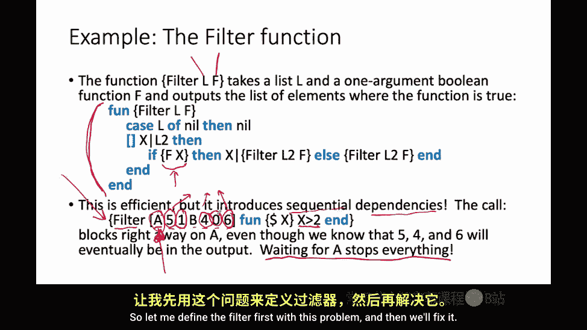
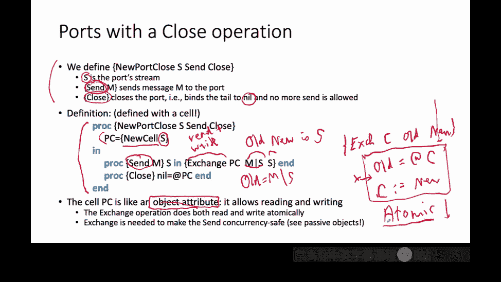
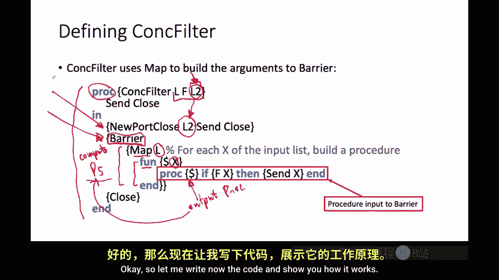
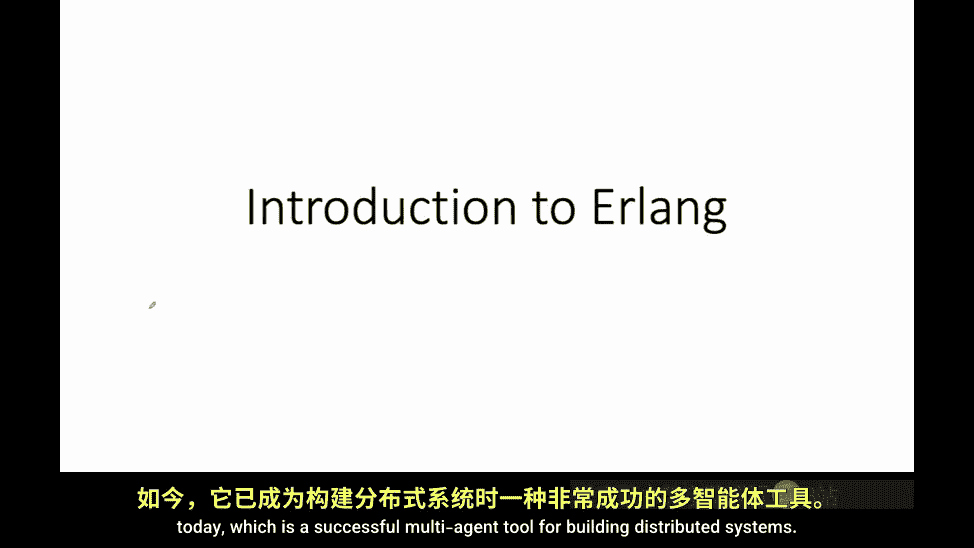
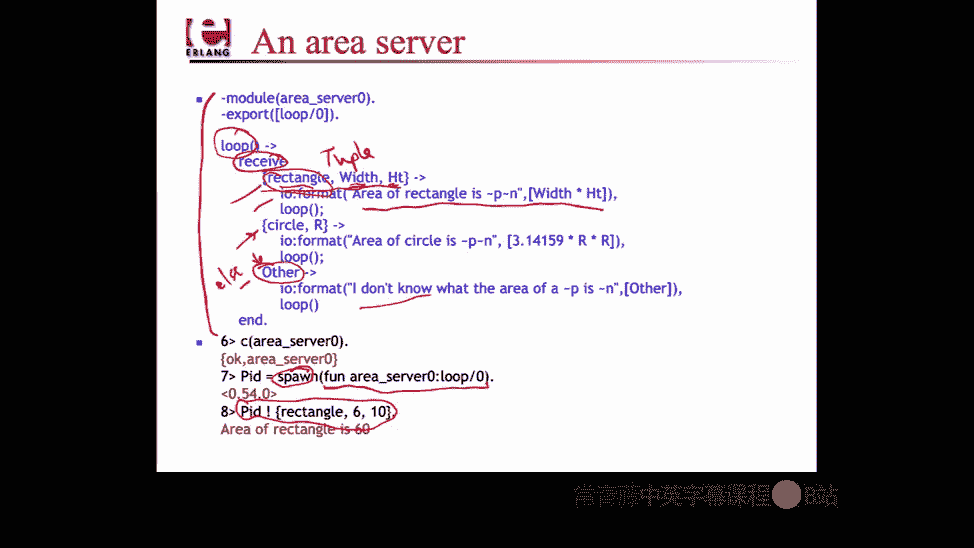

# 008：并发编程技术与Erlang简介


在本节课中，我们将学习两种重要的并发编程技术：如何通过移除顺序依赖来提升程序灵活性，以及工业级并发编程语言Erlang的核心概念。



## 移除顺序依赖：并发过滤器示例


上一节我们介绍了端口和屏障等并发构建块。本节中，我们来看看如何利用它们来移除程序中的“无用”顺序依赖，从而提升程序的灵活性和响应性。

在顺序程序中，指令按顺序执行，后一条指令必须等待前一条指令执行完毕。这有时会引入“无用依赖”：即使两条指令在逻辑上无关，后一条指令也会因为前一条指令（例如，等待一个未绑定的变量）的阻塞而被阻塞。

我们可以通过引入新线程和端口来移除这些依赖，这种方法有时被称为“傻瓜式并发”。但需要注意，移除顺序依赖会引入并发，而并发意味着**不确定性**（输出顺序可能改变）。这是一个本质上的权衡：在确定性和灵活性之间做出选择。

### 顺序过滤器的问题



以下是一个标准的函数式过滤器定义，它存在无用依赖问题：

```oz
declare
fun {Filter L F}
   case L of H|T then
      if {F H} then H|{Filter T F}
      else {Filter T F} end
   [] nil then nil
   end
end
```

当我们对一个包含未绑定变量的列表（例如 `[A 5 1 B 4 0 6]`）应用过滤函数（例如 `fun {$ X} X>2 end`）时，整个计算会因为在`A`上的等待而阻塞。即使我们已知`5`、`4`、`6`肯定满足条件，也无法立即输出它们。


### 构建支持关闭操作的端口

为了构建并发过滤器，我们需要一种能“关闭”的端口，以便在收集完所有结果后将流转换为一个以`nil`结尾的列表。这需要一个“单元”（Cell）来动态追踪流的末端。



以下是带有关闭操作的端口实现：

```oz
proc {NewPortClose S Send Close}
   C = {NewCell S} % 单元C始终保存流的当前末端
in
   proc {Send M}
      Old New in
      {Exchange C Old New} % 原子操作：读取Old值，并将C更新为New
      Old = M|New % 扩展流
   end
   proc {Close}
      {Assign C nil} % 将流的末端绑定为nil，关闭端口
   end
end
```

`Exchange`是一个原子操作，确保了在并发环境下发送消息的正确性。


### 实现并发过滤器

利用新端口和屏障，我们可以实现并发过滤器`{ConFilter L F}`。其核心思想是：为输入列表中的**每一个元素** `X` 单独创建一个线程来执行 `{F X}`。如果结果为真，则通过端口发送`X`；所有线程结束后，关闭端口。

以下是并发过滤器的实现：

```oz
proc {ConFilter L F ?L2}
   Send Close
in
   {NewPortClose L2 Send Close} % L2是输出流
   {Barrier
    {Map L
     fun {$ X}
        proc {$}
           if {F X} then {Send X} end
        end
     end}}
   {Close}
end
```



**代码解析**：
1.  `{NewPortClose L2 Send Close}`: 创建端口，`L2`是输出流。
2.  `{Map L ...}`: 为输入列表`L`中的每个元素`X`，生成一个**过程**（线程任务）。该过程检查`{F X}`，若为真则发送`X`。
3.  `{Barrier ...}`: 屏障接收这个由过程组成的列表，为每个过程创建线程，并等待所有线程结束。
4.  `{Close}`: 所有线程结束后，关闭端口，使`L2`成为一个完整的列表。

运行`{ConFilter [A 5 1 B 4 0 6] fun {$ X} X>2 end}`会立即输出`[5 4 6]`，而不会因`A`和`B`未绑定而阻塞。`1`和`0`被立即排除。但请注意，输出结果`[5 4 6]`的顺序可能是任意的（如`[4 6 5]`），这体现了移除依赖后引入的非确定性。

## 并发编程范式总结

到目前为止，我们学习了三种构建并发程序的有效范式：

1.  **确定性数据流**：这是最佳选择，如果适用。它结合了函数式编程的清晰性和并发性。许多现代大数据处理框架（如Apache Flink/Spark）都基于此范式。
2.  **多智能体编程**：适用于存在大量外部非确定性的系统（如电梯控制系统）。程序由多个有状态的、通过异步消息通信的智能体（端口对象）组成。Erlang语言是这一范式的杰出工业代表。
3.  **确定性数据流与端口结合**：这是作者推荐的、最全面的方法。首先尽可能使用确定性数据流编写程序主体，仅在需要非确定性的地方（如与外部交互、收集异步结果）引入端口。这种方法在保持大部分代码纯净的同时，提供了必要的灵活性。


接下来我们将简要了解Erlang，看看多智能体编程在工业实践中是如何应用的。

## Erlang语言简介

Erlang是一种为构建高并发、分布式、容错系统而设计的编程语言，广泛应用于电信、金融等领域。

### 核心概念

Erlang程序由大量轻量级**进程**组成，这类似于我们学习的**端口对象**。关键区别在于：
*   **无共享**：进程间不共享内存，消息传递时进行复制。这使得单个进程的失败不会直接影响其他进程。
*   **邮箱**：进程拥有一个邮箱（而非严格的流），可以基于模式匹配从邮箱中提取消息，消息处理顺序更灵活。
*   **“Let it Crash”哲学**：不试图避免所有错误，而是设计系统在部分进程崩溃后能够快速恢复。这通过**进程链接**和**监督树**等机制实现。

### 语法速览

Erlang在语法和理念上与课程内容高度相似：
*   **单次赋值**：变量不可变。
*   **函数式核心**：支持高阶函数、模式匹配、递归。
*   **进程创建与通信**：
    ```erlang
    % 创建一个新进程（类似于NewPortObject）
    Pid = spawn(fun() -> server_loop() end).

    % 向进程发送消息（! 操作符）
    Pid ! {rectangle, Width, Height}.

    % 接收消息（从邮箱中模式匹配）
    receive
        {rectangle, W, H} ->
            io:format("Area: ~p~n", [W * H]);
        Other ->
            io:format("I don't know: ~p~n", [Other])
    end.
    ```

一个著名的成功案例是爱立信的AXD301 ATM交换机，其声称达到了99.9999999%的可用性，展示了Erlang在构建超高可靠性系统方面的强大能力。

---



本节课中我们一起学习了：
1.  如何通过**并发过滤器**的实例，利用端口和屏障移除顺序依赖，并理解了由此带来的**确定性与灵活性的权衡**。
2.  回顾了三种主流的并发编程范式：**确定性数据流**、**多智能体编程**以及结合二者优点的**混合方法**。
3.  对工业级并发语言**Erlang**进行了初步了解，认识了其基于轻量级进程和“Let it Crash”哲学的设计理念，及其在构建分布式容错系统中的应用。


这些概念和工具为你设计和理解复杂的并发系统提供了坚实的基础。