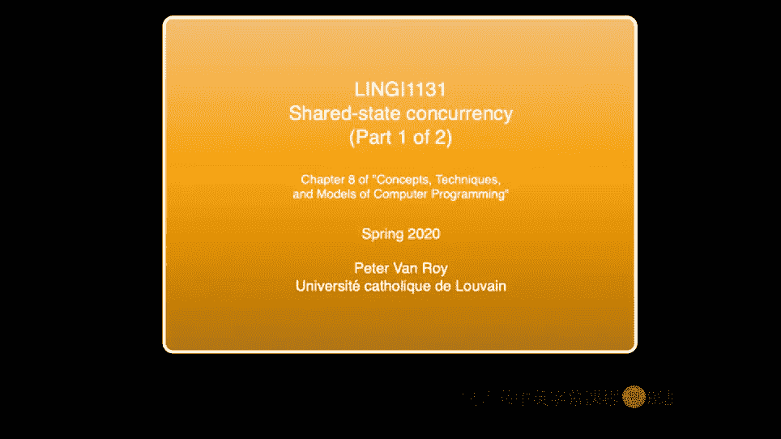
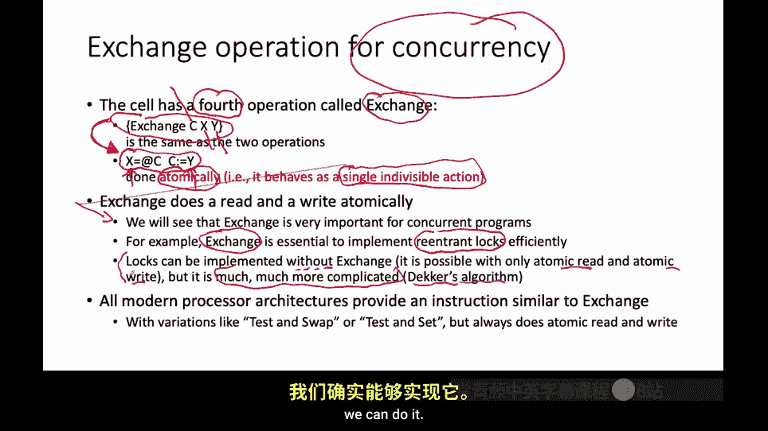
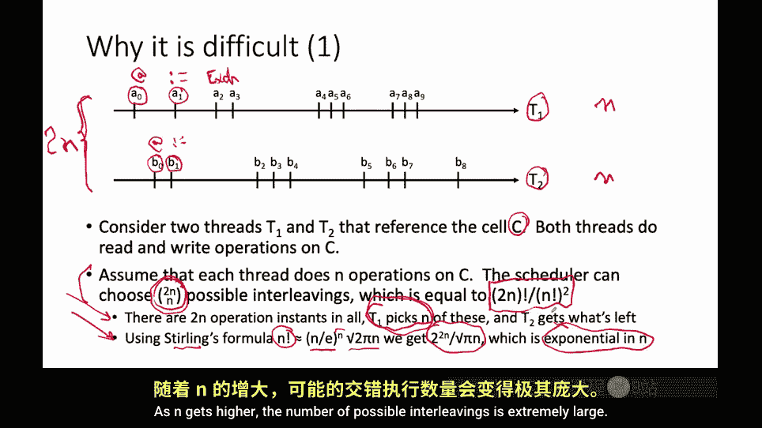
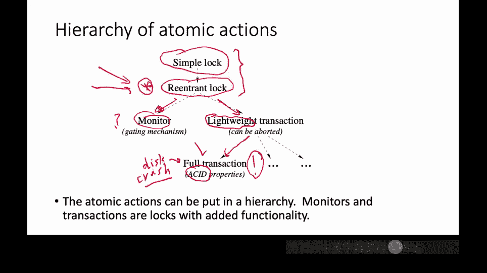
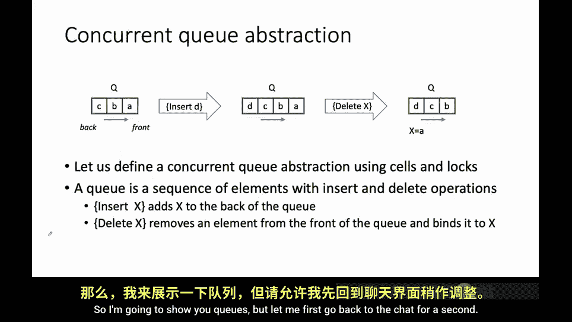
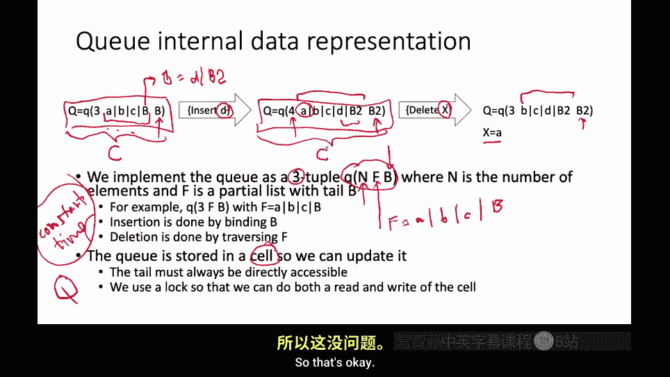
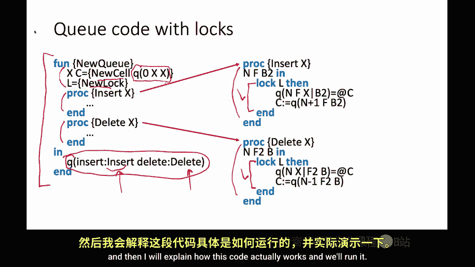

# 009：共享状态并发




在本节课中，我们将要学习共享状态并发。这是一种编写并发程序的方式，它允许线程通过共享可变状态（称为“单元”）进行通信和协作。我们将介绍单元的概念、共享状态并发的挑战，以及如何使用锁来管理并发访问的复杂性。

---

## 概述：共享状态并发

共享状态并发是一种基于线程和可变单元的并发编程范式。它被许多主流语言（如Java、C++）广泛使用，但也是最复杂的范式之一。为了驾驭这种复杂性，我们引入了三个核心概念：**锁**、**监视器**和**事务**。

上一节我们回顾了三种良好的并发范式。本节中，我们来看看第四种范式——共享状态并发。

---


## 单元：可变状态的基础


共享状态意味着存在一些可变的、在线程间共享的信息。共享状态并发基于**可变状态**的概念，即可以被多次赋值的变量。

为了避免术语混淆，我们将这种可变的存储位置称为**单元**。一个单元就像一个盒子，它有一个固定的名称（或身份标识）和一个可以改变的内容。

我们向内核语言添加了三个操作来使用单元：

*   **创建单元**：`C = {NewCell A}`。创建一个初始内容为 `A` 的新单元，并将单元的名称绑定到变量 `C`。
*   **赋值**：`C := X`。将单元 `C` 的内容替换为 `X` 的值。
*   **读取**：`Z = @C`。将变量 `Z` 绑定到单元 `C` 的当前内容，而不改变单元。

例如，在类似Java的语言中，语句 `i = i + 1` 实际上隐含了读取 `i` 的值和向 `i` 赋值两个操作。在我们的模型中，这会明确地写为类似 `i := @i + 1` 的形式。



此外，对于并发编程，还有一个至关重要的原子操作：
*   **交换**：`{Exchange C X Y}`。这个操作**原子性**地执行读取和写入：它将单元 `C` 的当前内容读取到 `X`，同时将 `Y` 作为新内容写入 `C`。处理器架构（如x86的`CMPXCHG`指令）提供了对这类操作的原生支持，确保其执行过程不会被调度器中断。


---

## 共享状态并发的挑战

当我们有多个线程操作共享单元时，就会面临**交错执行**的问题。如果每个线程对共享单元执行 `n` 次操作，那么总的可能操作序列（交错）数量是 `C(2n, n)`，这大约等于 `2^(2n) / sqrt(πn)`。



这是一个关于 `n` 的指数级函数。这意味着随着操作数增加，可能的执行路径数量会爆炸式增长。程序要正确，**所有**可能的交错都必须正确。仅靠测试无法覆盖所有情况，而形式化验证在面对指数级状态空间时也会变得困难。

因此，确保共享状态并发程序正确的唯一可行方法，是通过设计来减少需要担心的交错数量。

---

## 解决方案：构建大型原子操作


所有并发范式都在通过不同方式减少交错。对于共享状态并发，核心策略是将多个细粒度操作组合成**大型原子操作**。调度器要么在原子操作开始前中断，要么在其完成后中断，但绝不会在操作中间中断。这样，我们只需要考虑这些大操作之间的交错，而非其内部每个原始步骤的交错。

这通常通过以下三种技术实现，它们构成了一个层次结构：
1.  **锁**：确保一次只有一个线程能执行受保护的代码段（临界区）。
2.  **监视器**：在锁的基础上，增加了让线程在条件不满足时等待、并在条件满足时被唤醒的机制。
3.  **事务**：在锁的基础上，增加了对失败（如崩溃）的处理能力，能保证操作的原子性、一致性、隔离性和持久性（ACID属性）。

锁是最基础的概念。监视器非常复杂且在现代设计中通常不推荐使用。而事务（尤其是具备ACID属性的完整事务）则至关重要且被广泛应用。

---

## 锁的概念与语义

锁是一种语言概念，它保证在程序的某个部分（称为**临界区**）内，一次最多只有一个线程在执行。




我们定义锁的抽象，它包含以下操作：
*   `L = {NewLock}`：创建一个新的锁 `L`。
*   `{IsLock L}`：测试 `L` 是否为锁。
*   `lock L then S end`：用锁 `L` 保护语句 `S`。`S` 就是受保护的临界区。

锁的语义如下：
*   如果没有线程正在执行任何由锁 `L` 保护的语句，那么任何线程都可以进入其临界区。
*   如果一个线程试图进入时，已有另一个线程在临界区内，则该线程将**挂起等待**，直到内部线程离开。
*   **可重入性**：如果一个线程已经在锁 `L` 保护的临界区内，它再次尝试获取同一个锁 `L` 时会立即成功（允许进入）。这个特性对于构建复杂的、可能递归调用自身方法的抽象至关重要。

同一个锁可以保护程序中多个不连续的代码段，所有这些代码段的集合构成了该锁的临界区。


---


## 示例：使用锁实现并发队列

为了理解锁的应用，我们来实现一个并发队列。队列支持在尾部插入元素和在头部删除元素。

我们使用一个元组 `q(N, F, B)` 来表示队列内部结构：
*   `N`：队列中的元素数量。
*   `F`：一个列表，表示队列的头部。这个列表的末尾不是一个空值，而是一个**未绑定的逻辑变量** `B`。
*   `B`：指向列表末尾的未绑定变量，代表队列的尾部。

这种利用单赋值变量表示动态结构的方法，可以实现常数时间的插入和删除操作。



以下是使用锁保护的队列实现的核心思路：


```oz
fun {NewQueue}
   Q = {NewCell q(0 X X)} % X是未绑定变量，代表空队列的尾部和头部末端
   L = {NewLock}
   proc {Insert X}
      lock L then
         ... % 1. 读取当前队列状态 q(N, F, B)
         ... % 2. 将B绑定为新的列表节点 [X|B2]，并将B2作为新的尾部
         ... % 3. 将单元格更新为 q(N+1, F, B2)
      end
   end
   proc {Delete ?X} % X是输出变量
      lock L then
         ... % 1. 读取当前队列状态 q(N, F, B)
         ... % 2. 从列表F中取出第一个元素，绑定到X，剩余的列表作为新的F
         ... % 3. 将单元格更新为 q(N-1, 新的F, B)
      end
   end
in
   queue(insert:Insert delete:Delete)
end
```

`Insert` 和 `Delete` 过程都使用同一个锁 `L` 来保护。这确保了修改队列内部单元格的操作（读取状态、计算新状态、写入新状态）是原子性的。一个线程在执行 `Insert` 时，另一个线程试图执行 `Delete` 或另一个 `Insert` 都必须等待。

---

## 总结



本节课中我们一起学习了共享状态并发的基础。我们首先引入了**单元**作为可变状态的基本构件，并解释了原子**交换**操作对并发的重要性。我们分析了共享状态并发的主要挑战——**指数级增长的执行交错**，并指出解决之道在于构建**大型原子操作**以减少需要分析的交互点。


我们详细介绍了最基础的同步原语——**锁**。锁通过保证**临界区**的互斥访问来创建原子操作。我们还了解了锁的**可重入**特性。最后，我们通过一个**并发队列**的实例，演示了如何使用锁来保护对共享数据结构的复合操作，确保其线程安全性。




锁是更高级概念（监视器、事务）的基石。理解锁的工作原理是掌握共享状态并发编程的关键第一步。