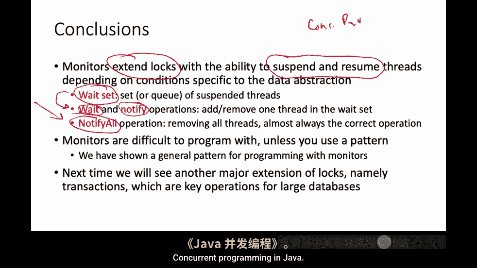
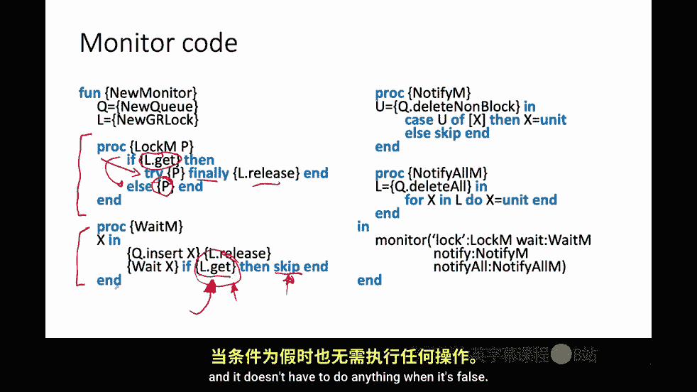
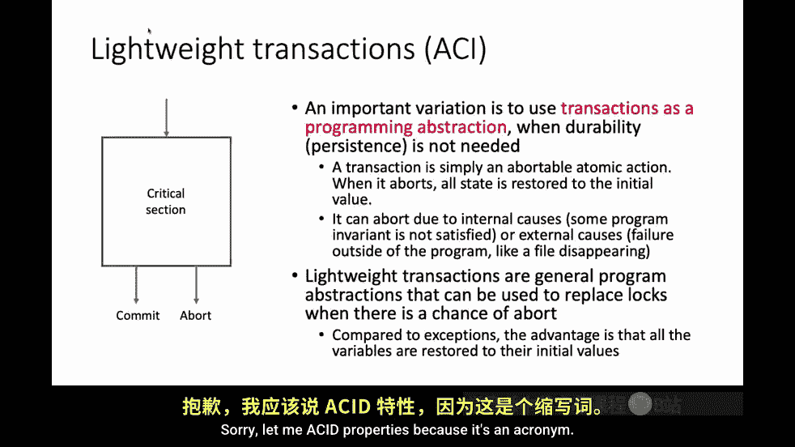
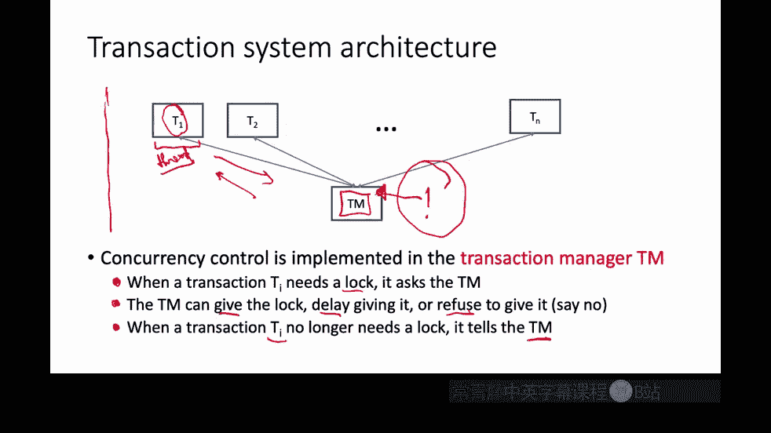

# 012：管程与事务

在本节课中，我们将要学习并发编程中的两个核心高级概念：管程和事务。我们将首先回顾管程的使用模式，然后深入探讨其实现原理。接着，我们将转向事务的概念，了解其在数据库系统中的关键作用及其核心属性。

## 管程的实现

上一节我们介绍了管程的编程模式。本节中我们来看看如何实现管程。管程是对锁的扩展。

记住可重入锁的工作原理。现在展示如何实现管程。

管程始于一个可重入锁。记住可重入锁使用交换操作来管理令牌，使用线程标识来检查是否已进入锁，并且使用Try-finally进行异常处理。我们实际上是在扩展这个机制。

与可重入锁相比，我们将做两处修改。首先，我们将稍微修改锁的接口。它被称为获取-释放锁。这样进入和退出是两个独立的操作，我们称之为获取和释放。因为我们需要在不同的地方进入锁。当持有锁时我们进入，但等待操作也必须尝试进入，并且也必须释放锁。所以我们在多个地方使用它。因此我们将有一个获取-释放锁。

第二点是等待集，我们将添加一个队列。队列确实被大量使用，我们将等待集实现为队列是为了保证公平性。

队列对于公平性非常好。你将一个线程放入队列，线程沿着队列移动最终会出来。所以最老的线程最先出来。如果你使用队列，线程不可能永远停留在队列中，线程总是会移动，老的线程会出来。这也是为什么在商店里人们排队等待，因为他们不会永远等待。这确保了公平性，所以每个人的等待时间大致相同。这就是为什么不用栈实现。如果用栈实现，你放在顶部，从顶部移动，栈底的线程可能会停留非常长的时间。所以栈不公平。这就是我们将其实现为队列的原因。

等待集是一个队列。我们稍微扩展之前看到的队列。我们有一个删除所有元素的操作。我们有一个获取大小的操作，可以找出队列的大小。我们有一个非阻塞删除操作，它立即返回元素，或者如果队列为空则返回nil，立即告诉你队列是否为空。

有了这些，我们可以实现管程。第一件事是获取-释放锁。这实际上是对可重入锁的修改。我们不是用一个包含交换操作和环绕过程执行退出的过程，而是现在有两个操作：获取锁和释放锁。可以看到它们实际上在做同样的事情。

获取锁发生在临界区之前，释放锁发生在之后。获取锁将在这里用交换操作进行令牌管理。它还将检查ID，并返回。如果它实际上必须进入，则返回true；如果它已经进入且无需做其他事，则返回false。

这里的释放锁注意它不处理异常。我们将在其他地方处理异常，它只是传递令牌。我们还需要另一个单元来确保获取和释放可以相互通信。获取中的新变量被放入一个名为token2的单元中，这样释放锁实际上可以释放它。我们需要这个额外的单元，并且它必须是一个单元，因为我们可以多次调用获取锁和释放锁。

锁有两个操作：获取和释放。这就是获取-释放锁。我们还扩展了队列。这里有一个队列。我将使用带单元和锁的那个。这里有一个包含队列状态的单元，插入和删除操作如前所述。我们还有一个标准的可重入锁来实现队列。我们有一个获取-释放锁，但我们也需要一个锁来实现队列。可能有更高效的方法只用一个锁，但这里我使用一个单独的锁，这样我们实际上有一个单独的队列。

以下是队列的额外操作：
*   **大小操作**：基本上只是告诉我大小，返回大小。
*   **删除所有操作**：返回所有元素的列表。它获取S，即队列前端的引用。它将尾部绑定为nil，这将S变成一个列表。然后它清空队列，进行赋值以便移除所有元素。
*   **非阻塞删除操作**：检查大小是否大于0。如果是，返回一个包含一个元素的列表，即删除的元素；否则，如果为空则返回nil。

非阻塞删除实际上会告诉我队列是否为空。这是我的队列，带有我实现管程所需的额外操作。获取-释放锁和扩展的队列。

以下是管程本身的代码。我有一个队列和一个获取-释放锁。首先是实际的锁。它的工作方式是，如果L.get为真，则执行try P finally L.release L P。仔细看，这与之前可重入锁的代码完全相同。这是一个标准的可重入锁。

现在我们有了等待操作。这个操作管理插入。我们如何将一个线程插入队列？基本上，我们想要挂起线程。我们将创建一个新的未绑定的数据流变量。我们将把这个变量放入队列。这个变量是我们管理挂起的方式。然后我们将等待x。这样线程就会挂起。可以看到x实际上在队列中，所以如果其他线程绑定了x，那么该线程将继续。这给了我们挂起线程并将其放入队列的效果。

注意这里我们释放了锁。我们插入到队列中，然后释放锁。这就是为什么我们需要一个获取-释放锁，因为我们在两个地方进行释放。然后我们执行等待。等待之后，我们再次执行获取。可以看到锁中有一个获取和释放的组合。我们将执行获取然后释放。但在内部，当我们执行等待时，记住我们已经在主锁中执行了获取，我们将执行释放。然后最终，当线程继续时，我们再次执行获取。总是成对出现：获取-释放。原始的是获取后跟释放。但如果我们执行等待，那么它将执行一个释放然后另一个获取。最后，在结束时执行释放。如果我们多次执行等待，你总是会得到获取-释放，获取-释放，获取-释放。这就是我们实现等待的方式。

现在我们有了通知和通知所有操作。通知和通知所有的区别在于它是一个还是所有线程。通知移除一个任意线程，基本上我们执行非阻塞删除。如果它返回一个列表，意味着我们有一个挂起的线程。我们通过执行x=unit来使线程继续。否则，如果队列为空，我们什么也不做。

通知所有将删除所有。L实际上是一个变量列表，即挂起线程的列表。对于L中的所有x，我们执行x=unit，我们启动它们全部。当然，它们都将尝试执行L.get。你可以看到它是如何工作的。具体来说，在等待之后，当等待继续时，它会立即执行获取操作，这样当你从等待中退出时，你将立即再次执行获取操作。这是等待的一部分。

对于实现来说，这实际上是一个相当微妙的实现。这本书的原始版本在这个实现中实际上有一个错误，但据我所知，这是一个正确的实现。

## 管程总结

现在让我总结一下管程。可以看到我们实际上扩展了锁。我们可以根据条件挂起和恢复线程。注意管程只有一个等待集。

存在管程的变体，你可以根据需要拥有多个等待集，为每个条件定义一个单独的等待集。非空是一个等待集，非满是另一个等待集，依此类推。程序员声明这一点。有些语言这样做。如果你有争用，这会给你更高的效率。因为在Java实现中，相同的等待集用于所有条件，所以如果你有很多争用，可能会有点低效，但这使得它简单得多。实际上，如果你有那么多争用，通常你的应用程序结构有问题，无论如何你必须重构。这就是Java的哲学。

等待集通过等待和通知来添加和移除一个线程进行管理。然而在实践中，我们几乎总是使用通知所有操作。实际上有一本关于Java并发编程的书，第二版，作者是Doug Lea。这本书全是关于使用管程等编程的内容，它提供了许多特殊技术。所以它可能变得复杂，但基本上很多内容实际上是使用管程构建抽象，使用它们，构建线程池，构建元组空间等等。所以基本上试图通过使用管程构建抽象来做其他事情来摆脱管程。实际上，除非你使用模式，否则用管程编程是困难的。这就是我给你的建议。总是使用这个通用模式，否则你会遇到问题。

## 事务简介

在管程之后，我们将讨论事务。事务是锁的扩展。但事务是用于数据库的概念。现在我们不担心管理多个线程和抽象，现在我们管理数据。我们有一个大型数据库，大量需要更新的信息。我们将更新数据库。但数据库很重要，所以我们希望它即使在崩溃时也能存活。我们将有并发更新。我们将有崩溃。数据库必须在崩溃中存活。这是事务为我们解决的关键问题。

大型数据库极其重要。许多大公司都基于此。100年前，一切都写在书上，人们在书上记录，但如今大公司的所有关键信息都存储在这些大型数据库中。如果数据库消失，公司基本上会破产，无法继续，所以这很关键。它是大公司的核心。你的银行账户存储在数据库中，你拥有的金额存储在数据库中。所有人员、所有部件、采购，一切都存储在数据库中。所以数据库是计算基础设施的关键部分。它被实现为完全能够抵御崩溃。可能存在的最高可靠性软件就是数据库软件。它必须具有弹性。弹性是一个技术术语，弹性意味着它在崩溃后存活。我们甚至可以说能承受多少次崩溃。信息必须存活，即使计算机崩溃或存储信息的磁盘崩溃。信息必须存活。有一整门课程和书籍都是关于如何使系统具有弹性。基本思想是使用冗余，所以数据库存储在多个副本中。如果一个副本崩溃，另一个副本存活，然后当你更新数据库时，你必须更新两个副本。但问题也可能是你可能会在更新期间崩溃。你可以看到这非常棘手，我们将解释这是如何完成的。崩溃可能发生在更新期间或之后的任何时间，数据库必须存活。这就是它被实现的原因。

第二点是性能。我们对这个东西的要求非常高。数据库仅仅存活是不够的，它们必须快速，因为银行有客户。如果客户必须等待几天才能完成交易，客户会不满意并转向另一家银行。所以交易必须快速完成。需要高并发的更新速率。

最后是可扩展性。需要支持大量客户端，银行和公司，大公司。它们有数千或数百万客户。一家大银行通常有数百万客户，所有这些客户的信息都存储在数据库中。你可以看到数据库是当今存在的最令人印象深刻的软件之一。

事务是访问数据库的方式。问题是我们如何实现所有这三个属性，这并不简单，但它们确实实现了。这是计算机技术最令人印象深刻的结果之一，我们实际上可以实现它。

让我展示一些例子来说明它是如何工作的。这是我的数据库。它有信息。我们将其表示为一个单元数组，因为我们可以更新它们。这里有1000个，但在真实数据库中，我们可以有更多。可以有数十亿个。它非常庞大。我们想要更新这个数据库。让我首先从更新开始，然后讨论弹性。许多客户端想要更新。我们如何做？我们有一个庞大的数据库，许多客户端进行并发访问。很简单，我们使用锁来保护数据库。我们可以有一个锁，假设一个单独的锁保护整个数组。但这是个问题，我们有数百万客户端。可能1000个客户端想同时进行交易。每当你去ATM机从墙上取钱时，你就在进行交易。每当用信用卡买东西时，就在这个数据库上进行交易。但这个单独的锁是一个瓶颈。如果一个客户端锁定了它，其他客户端就不能做任何事情。所以如果客户端A在这里操作，客户端B被阻塞。但为什么？这不合逻辑，因为客户端B使用的是完全不同的数据库部分。客户端A没有理由阻塞客户端B。这有点人为。所以这是一个非常幼稚的实现。真正的系统，我们想做得比这好得多。这会非常非常慢。

让我们改进它。让我们为每个单元放一个锁。这更聪明，因为我们可以有一个客户端在这里，客户端A。我们可以有客户端B在这里。如果它们使用数据库的不同部分，它们不会干扰，它们实际上可以同时运行。这样系统会非常快。但如果存在冲突呢？假设我们这里有一个银行账户。每个存储金额。假设有一个交易T1将资金从C1转移到C2，这是两个账户。假设有另一个交易T2将资金从C3转移到C2。所以C2很高兴，因为它从C1和C3获得资金。

我们如何用锁来做这个？我们必须非常小心。如果这两个交易重叠会怎样？如果T1读取C1，T2读取C3并写入C2，然后T1写入C2。C2将忘记来自C3的数字，所以C2中的值将不正确。因为它们之间存在干扰。更新必须是原子的，并且不能相互干扰。原子意味着我们将移除资金并添加资金。资金总额相同。但不干扰意味着如果两者并发，它们不应该相互踩踏。这就是我们想要做的，以实现高并发更新。我们想保证这一点。但我们如何做到？这就是我们要在这里解决的问题。

## 事务总结与ACID属性

现在让我总结一下事务在做什么以及为什么我们需要事务这个概念。首先，每个交易（我称之为更新）可以进行许多操作。你正在转账，但不仅仅是转账。你还在更新审计，跟踪其他信息。银行跟踪大量信息。所以我们有一个大的原子操作。有点像我们需要锁的原因。此外，我们不希望有干扰。如果我有两个并发更新修改数据库的同一部分，它们不应该相互干扰。这是第一件事。

第二件事。系统可能崩溃。现在我们在讨论弹性。它可能在任何时间崩溃。为了使事物持久化，数据库存储在磁盘上。但很多事情可能出错。计算机可能崩溃。磁盘本身可能崩溃，可能损坏。所以一切都必须保持正确。如果我正在执行更新，系统在更新期间崩溃，可能无法完成更新。那么我们该怎么办。实际上我们只能做两件事，要么提交，意味着我们执行更新；要么中止，意味着我们不执行更新，就像我们什么都没做一样。如果更新只完成了一部分，我们无法使其完成。我们实际上完全丢弃它，并保持初始状态。所以当你进行交易时，你总是可以中止。这意味着你保持初始状态。交易中止时，你所做的所有工作，可能做了一些工作，全部被丢弃，你保证拥有初始状态。这是如何实现的？但看一个想法。

更新可以做很多事情。如果计算机崩溃会发生什么？如果磁盘崩溃，我们将有磁盘的另一个副本，让我说说如果计算机崩溃会发生什么。然后你重新启动，磁盘上有损坏的信息。那么这是如何工作的？方法是，当你进行更新时，你将其存储在磁盘上的一个特殊位置。所有新东西。当更新完成时，你将磁盘上的旧数据切换到新数据。为了做到这一点，你向磁盘写入一个字，基本上像一个从旧到新的开关。这假设你可以原子地写入磁盘上的字，这实际上是正确的。你实际上可以原子地写入磁盘上的块。所以切换是正确的。如果磁盘在这个字写入之前崩溃，那么新信息被丢弃。这是一个中止。如果磁盘在这个字写入之后崩溃，那没关系，因为数据已经存在于磁盘上。当我们重新启动磁盘时，我们将看到新数据，这是一个提交。所以就是这个字的切换确保磁盘实际上正确地执行提交或中止。所以就是这个，我不打算多说这项技术。

我要说的是，你可以并行执行许多操作。只要不相互干扰，你可以在性能允许的情况下，让多个更新同时访问磁盘的不同部分。你必须保证它们不会相互干扰。这就是事务的真正技巧。你如何保证它们不相互干扰。

事务，你可以看到它们有一堆要求。实际上，事务背后有巨大的实现。人们谈论ACID属性。因为这是一个首字母缩写。事务有四个重要属性，它们以A、C、I和D开头。所以人们说事务具有ACID属性。这些是事务最重要的属性。

*   **原子性**：意味着磁盘将执行所有操作或不执行任何操作。就像我刚才解释的。它像一个单一操作。所以这就是原子性，操作是原子的。
*   **一致性**：意味着我们尊重数据库的不变量。当我进行更新时，在银行中，例如，我将资金从一个地方转移到另一个地方，那么银行中的资金总额不应改变。如果我从一个账户移除100，我向另一个账户添加100。我不会添加95并把5块放进口袋。不允许。我必须尊重不变量。这被称为一致性。注意这个属性实际上是程序员的责任，而原子性是事务实现如何实现的责任。
*   **隔离性**：这是当你有并发交易访问相同数据时发生的情况。在相同账户之间转账，它们不应该相互干扰。所以隔离意味着交易不相互干扰。我们知道它们是原子的，但这还不够。如果两个交易并发，它们实际上不应该能够相互踩踏。这被称为隔离。它也被称为可串行化，但人们更喜欢隔离，因为它更适合首字母缩写，但人们谈论可串行化。想法是，如果你进行两个访问相同数据的交易，就好像它们以某种顺序进行。所以就好像是顺序的。实现实际上是并行的，但在语义上，一个交易总是在另一个之前。所以就好像数据库的变化就像它们是顺序完成的一样，即使它们实际上是并行执行的。所以这被称为隔离或可串行化。这对性能当然非常重要。
*   **持久性**：持久性，也称为持久化。意味着它在崩溃后存活。意味着有像磁盘这样的稳定存储。即使计算机关闭电源，即使没有电源，系统也会存活。这对于事务的所有现实世界实现都很重要，持久性。通常，这也称为持久化。数据持久存在，即使电源关闭。

## 轻量级事务与并发控制

有一个轻量级事务的概念。记住在银行中，交易存储在磁盘上。它是持久的。所以它在崩溃后存活。但有时不需要。有时你不需要持久性，你想要执行提交或中止的良好能力。但你不在乎持久性。它们就像编程抽象，是事务。它只是一个可中止的原子操作。所以如果有一些问题，那么程序代码被修复。实际上，这是一种异常处理的智能版本。记住，我们进行异常处理，当有问题时，比如你试图读取文件，但文件消失了。那么你有一个异常，程序必须修复所有错误的变量。事务将自动完成。所有变量都恢复到初始值，这都是自动的。事务完成这个。

提供软件事务或轻量级事务的语言，通常称为软件事务内存，这就是轻量级事务。它们不持久，不持久化。但如果有问题，所有变量都会自动恢复。这当然需要更多工作。效率不高，但对程序员来说容易得多。所以现在有一些语言。这也称为STM，有时是软件事务内存。当你看到人们谈论STM时，这就是他们谈论的内容，意味着你拥有除持久性之外的一切，你不在乎磁盘之类的东西，但你的程序可能有问题，所以你想处理它。这是当你不需要持久性时事务的一个变体。

现在让我谈谈我们如何实现事务，这是一个很大的领域。实现事务是一个巨大的产业，你可以想象，因为涉及这么多钱，因为它对公司和银行和工业如此重要，有大量的工作。所以人们用来构建事务系统的所有技术都有一个名称，称为并发控制。这是一个奇怪的名字，但每当你构建一个事务系统时，你需要做所谓的并发控制。

我们将解释并发控制的一部分。我们将给你介绍并发控制。我们将实际展示如何实现这些轻量级事务。我们将给你实现这个的实际代码，我们将要做的算法是一种非常特定形式的并发控制，称为具有严格两阶段锁和死锁避免的乐观并发控制。

红色部分是我们选择的特殊部分，我们将解释所有这些，所以你会理解它。我们将给你具有严格两阶段锁和死锁避免的乐观并发控制的完整代码，这已经是一种很好的事务处理方式。当然，还有其他方式，但这是我们将要展示的方式。实际上在书中有这个实现。

我不打算详细讲解这个实现，因为它有点复杂，但我们将展示算法。我们将算法展示为状态图。你将确切看到它是如何工作的。我们如何一起完成所有这些事情。这实际上是书中最复杂的算法。是两页复杂的代码。但思想非常简单直接。

让我简单解释一下事务系统是如何工作的。它的工作方式是，事务系统看起来像这样。当我启动一个像T1这样的交易时。我这里有一个线程。一个线程实际上运行一个交易，它做事情，读取和写入，读取和写入，等等。但在内部，就像在锁内部。它与系统的一个特殊部分对话，称为事务管理器。

每个交易，当它需要一个锁时，它会询问事务管理器。当它需要一个锁时，它请求，请给我单元55的锁。事务管理器说，好的，锁给你，但事务管理器可以做很多事情。它可以给锁。它可以延迟。它可以询问那个交易。它可以让那个交易等待，因为锁可能在别处，或者它可以拒绝给锁。它可能说不。不，你得不到。请中止。你必须中止。所以事务管理器决定如何给锁。然后当交易T不再需要锁时，最终它将锁交还给事务管理器。所以事务管理器以智能的方式管理数据库中所有单元的所有锁，以便所有交易尽可能并行运行。但它仍然是可串行化的，就好像所有交易都以某种顺序运行一样，在语义上，数据库中的状态变化就像那样。

所以事务管理器是处理顺序串行化幻象和实际并行实现现实之间接口的魔术师。所以事务管理器实际上是系统的核心。这是我们将要讨论的部分。我们将向你展示事务管理器如何做这些神奇的事情。

## 总结

本节课中我们一起学习了并发编程中的两个高级概念：管程和事务。

我们首先深入探讨了管程的实现，了解到它是对可重入锁的扩展，通过获取-释放锁和队列管理等待集，实现了线程的挂起与恢复。我们强调了使用固定编程模式的重要性，以避免复杂性和错误。

接着，我们转向了事务的概念。事务是管理大型、关键数据库系统的核心机制，需要满足ACID属性：原子性、一致性、隔离性和持久性。我们讨论了事务如何在高并发环境下保证数据的一致性和性能，并简介了其背后的并发控制机制，特别是乐观并发控制。

事务是现代计算基础设施的基石，其实现涉及复杂的技术以平衡性能、可靠性和可扩展性。理解这些原理对于构建健壮的并发系统至关重要。