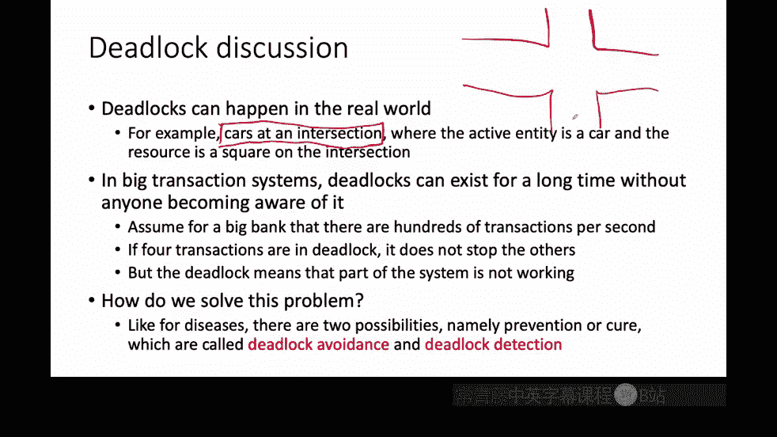
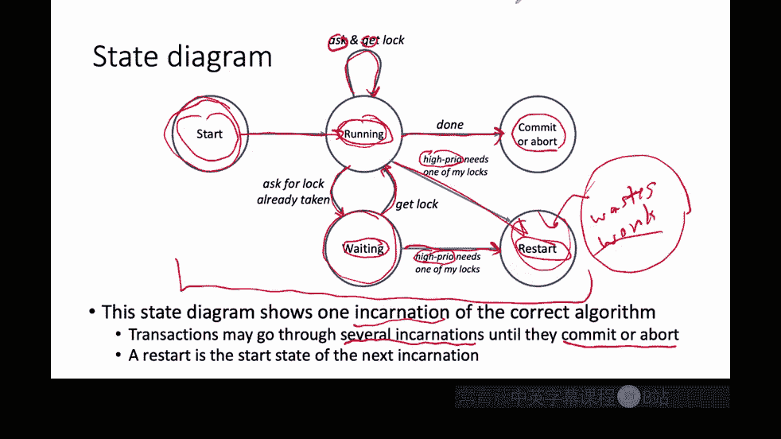
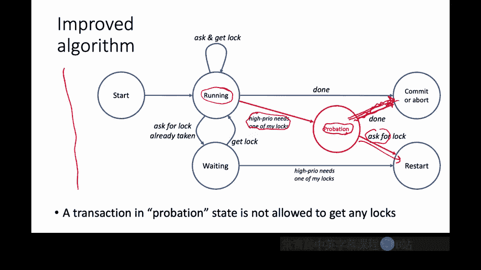
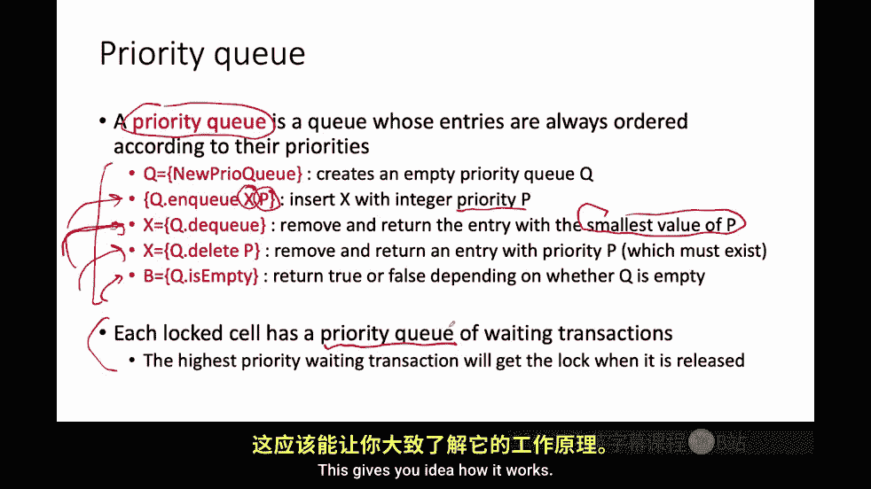

# 013：事务管理器与死锁处理

在本节课中，我们将学习一个真实的事务管理器实现，并深入探讨并发控制中一个关键问题——死锁。我们将从最简单的“天真”算法开始，分析其问题，然后逐步引入死锁避免机制，最终得到一个结合了乐观并发控制、严格两阶段锁和死锁避免的完整算法。

## 概述：一个简单的事务系统

休息之后，我们现在开始。我将向你们展示一个真实的事务管理器。

让我们从幻灯片开始。我将从最简单、最“天真”的一个算法开始，看看它是如何工作的。我们将构建一个简单的事务系统，它采用乐观并发控制，并具有严格两阶段锁。

以下是算法，非常简单：
*   当一个事务请求一个未上锁的单元格的锁时，它会立即获得锁。事务管理器会说“好的，请用”。
*   如果单元格已经被锁住，请求的事务将等待，直到它被解锁。因为另一个事务正在使用它，所以第二个事务会等待第一个事务完成，然后才能获得锁。
*   当事务提交或中止时，它会一次性释放所有锁。

这是一个严格两阶段锁的例子。它有一个增长阶段，即获取锁。中间可能需要等待，但最终它会获得所有锁，当它完全完成后，就释放所有锁。

这个算法实现了严格两阶段锁。该算法也是乐观的，因为它总是把锁给予请求的事务。它不检查事务是否“在轨道上运行”，它不担心这个。当锁未锁定时，它总是给予锁。它假设给予锁不会导致问题。

这是一个使用了我们目前所见技术的算法。但这个算法有一个大问题：它遭受死锁。这是一个新问题，我们还没见过。这个算法实际上有一个非常具体的问题叫做死锁。我们在这里没做错任何事。我们有乐观的、严格的两阶段锁，这很好。但仍然会出问题。

让我展示一个场景来说明死锁问题是如何出现的。

## 死锁场景与分析

假设我有两个事务，T1 和 T2。我可以画一个图，T1 和 T2。它们各自使用两个单元格。T1 将使用 C1 和 C2，T2 也使用 C1 和 C2。但 T1 从使用 C1 开始，稍后才使用 C2。T2 从使用 C2 开始，稍后才使用 C1。

这取决于时间安排。如果 T1 执行，很久之后 T2 才执行，那就没问题。但如果执行过程中有一些并发性，有一些重叠，那么就可能出现问题。

假设 T1 获得了 C1 的锁，T2 获得了 C2 的锁，它们都在运行。现在 T1 想要 C2 的锁，T2 想要 C1 的锁。根据我们的算法，T1 请求 C2 的锁时，它会等待，直到 T2 释放它。但 T2 在做什么？T2 想要 C1 的锁。它会等待，直到 T1 释放它。所以 T1 等待 T2 释放锁，而 T2 等待 T1 释放锁。这是一个循环等待条件，它们将永远等待下去。因此，系统被阻塞了。这就是一个死锁情况的例子。

这是一个活性问题。事务没有做任何不正确的事，只是它们无法进展。这是一个活性问题。

让我们理解这个问题，然后看看如何解决它。这实际上是一个非常普遍的问题——死锁。它可以发生在任何类型的系统中，不仅仅是事务。

系统中有两种实体：事务（主动实体）和单元格（资源）。主动实体需要资源。当我占用一个资源时，其他人就无法拥有该资源并必须等待。一次只能有一个主动实体使用该资源。

当我有这种情况时，我可以画一个图，这被称为等待图。这个图有两种节点：事务节点和单元格节点。事务节点，单元格节点。然后我有边或箭头。我有一个从事务指向它所需单元格的箭头，以及一个从单元格指向锁定它的事务的箭头。

T1 在等待 C2，但 C2 被 T2 锁定。T2 在等待 C1，而 C1 被 T1 锁定。这就在图中形成了一个环。因此，死锁在形式上被定义为等待图中的一个环。

这里我有一个包含两个事务 T1 和 T2 的环。但在现实生活中，我可以有包含三个、四个、五个事务的环。我可以有 T1 等待 T2，T2 等待 T3，T3 等待 T1。所以我可以有任意数量的环。当然，2 是最小的环。

这就是我们定义死锁的方式，它可以发生在任何有资源的系统中。

在现实世界中，你已经经历过死锁。一个典型的死锁例子是十字路口的汽车。

这是两条路，这里有一个十字路口，有不同的部分。这里有一辆车向上行驶，可能这里有一辆车试图向前，这里的车试图向前，这里的车试图向前。汽车是主动实体，资源是十字路口的一部分，这个方块是一个资源。当一辆车在这个方块上时，另一辆车就不能上去。

这里，四个主动实体之间存在循环依赖。这辆车需要资源 B，它想向前。但 B 已经被占用，而 B 需要 C，C 需要 D，D 需要 A。所以我再次在这个依赖等待图中得到一个环。这也是死锁的一个例子。

所以死锁是一个资源分配问题。当我们有被分配的资源，并且资源之间存在循环依赖时，就会发生。这不仅仅是事务的问题，当然它在事务中经常发生，因为锁是资源——当一个事务获得锁时，它只能被一个事务持有。在这个意义上，它是一个资源，另一个事务无法获得它。这是一个典型的资源分配问题。

但这是大型系统中一个真正的问题，可能造成实际问题。假设你有一个大银行，它有很多 ATM 机，很多分行，有一个管理所有交易的庞大数据库。这个数据库每秒可能有数百个事务。如果你有一百万客户，就会产生大量事务，每秒可能有数百个。

假设有四个事务陷入死锁，在一个环中，它们停止了。这是活性问题。但它不会停止其他事务。有数百个事务在进行，其中四个死锁了。我们甚至可能检测不到，可能根本看不到。系统的一部分死了，停止了，但其余部分运行良好。所以甚至很难检测到这一点。我们必须非常小心。这个大银行有大量事务，其中许多可能死锁了，除非我们专门去查看是否能找到它们，否则我们甚至不会知道。

所以死锁是大型系统中一个真正的问题。你在路上看到很多车时，死锁也是一个问题。所以当你有许多主动实体和许多资源时，这是系统中的一个实际问题。

## 解决死锁：检测与避免

那么，我们如何解决它？我们必须解决这个问题。有两种方法来解决它。就像对待疾病一样，如何解决疾病？有预防或治疗。预防就像疫苗，治疗就像抗生素。

要么你等到系统出现死锁，然后你对等待图进行计算，看看是否能找到一个环，然后你中止，强制其中一个事务中止，从而打破死锁。这被称为死锁检测。

另一种方式称为死锁避免，在这里，当你启动事务时非常小心，事务管理器只会在不会导致死锁的情况下给你锁。它会管理锁，所以没有死锁。

我们将展示一个死锁避免的例子。死锁的概念清楚了吗？死锁是一个存在于所有系统中的重要概念，不仅仅是事务。所有有资源的系统都可能遇到这个问题。你理解了它是如何工作的：在这个称为等待图的资源图中存在循环依赖。这个环意味着系统的一部分无法进展，所以这是一个活性问题。

现在我可以解释如何修复死锁，我们如何修复它？

你会看到我们必须修复它。你不可能让一个系统存在死锁，它根本无法工作。所以修复的方法，我们将采用我们的天真算法，并希望实现死锁避免。

我们要做的是打破环，打破环的方法是确保它们不对称。如果我有 T1 等待 T2，T2 等待 T1，这是一种对称情况。但我们想引入一些不对称性，一些不对称的东西。所以我们将为事务添加优先级。有些事务的优先级高于其他事务。我们将给最早的事务最高的优先级。系统中的第一个事务拥有所有事务中最高的优先级，第二个优先级较低，依此类推，优先级不断下降。

现在我们可以进行死锁避免了：当一个事务试图获取锁时，我们将比较优先级。如果我试图获取锁，而别人已经持有锁，那么我们将比较两者的优先级。如果我的优先级低于已经持有锁的事务，那么我必须等待，优先级高的事务优先。但如果我的优先级高，而有一个低优先级事务持有锁，那么我将重启那个低优先级事务。这意味着我将强制它释放所有锁并重新开始，然后我将获得锁。

所以，如果低优先级事务持有锁，那么事务管理器会强制它重启，释放所有锁，然后高优先级事务获得锁。当然，低优先级事务会尝试再次开始运行，它会再次尝试获取锁，但它必须等待，因为现在高优先级事务持有锁。

另一种情况是第一种情况。所以，如果我试图获取锁，而一个更高优先级的事务持有锁，那么低优先级事务就等待。所以，新的想法是我有优先级，并且我可以重启事务。事务管理器实际上可以产生强大的效果：它可以强制一个事务释放所有锁，恢复其状态，并重新开始。这不是中止，因为它可能仍然提交，但它必须重新做所有工作。这很重要，因为单元格的值可能已经改变，因为高优先级事务可能会修改它们，但它必须再次开始运行其代码。

我们现在可以证明，这种方法将避免所有死锁。我们通过对事务创建顺序的归纳来证明。系统中的第一个事务当然拥有最高优先级，没有人能阻止它。如果它试图获取锁，它总是能获得那个锁，所以没有人能阻止它，它将完成。一旦它完成，第二个事务就拥有最高优先级。同样，没有人能阻止它。因此，通过归纳，最终所有事务都将完成。

这就是它的工作原理。我们现在可以制定一个协议，然后我将为此运行代码。

当我创建一个新事务时，我给它最低的优先级，所以优先级总是不断下降，它们就像整数，所以我递增整数，整数越大，优先级越低。

当一个事务试图获取锁时：
*   如果它未锁定，我就获得锁。我在这里仍然有点乐观。
*   如果它被一个更高优先级的事务锁定，我就等待。我非常谦卑，让高优先级的人完成。
*   如果它被一个更低优先级的事务锁定，那么我比那个事务有优先权。所以事务管理器将重启那个低优先级事务。基本上，它强制性地——我称之为中止——它强制该事务恢复所有状态，释放所有锁，并重新开始，但具有相同的优先级，这非常重要。所以它始终是同一个事务。一个事务永远不会改变其优先级。它可能会因为更高优先级的事务而被重启几次，但它永远不会改变自己的优先级。所以它最终仍然会成为最高的，然后继续。如果我把优先级改得更低，那么我可能会遇到饥饿问题。你看，重启时保持相同优先级非常重要。

然后高优先级事务获得锁，低优先级事务尝试获取锁但无法获得并等待。当一个事务提交时，它释放其锁，并且可能有等待它锁的事务，它会唤醒一个，所以等待的事务可以继续。当一个事务中止时，它做同样的事，但它也恢复状态。就像什么都没发生一样，并且每个锁也会唤醒一个等待事务，使其可以执行。

你看到它是如何工作的了吗？这个算法。实际上，我画一个状态图来展示这个算法是如何工作的。

算法开始时，事务从这里开始，这是一个开始状态。它开始运行代码。现在可能发生不同的事情：它可以请求锁并获得锁，很好，继续运行。它可以请求一个已经被占用的锁，通常它会等待直到锁可用，获得锁，然后继续运行。最终它完成了，然后提交或中止。这就是正常的生命周期。

现在，当事务正在运行时，可能高优先级事务需要我的一个锁，糟糕，所以我必须重启。所以我会重启。重启就像再次进入开始状态。这被称为算法的一个“化身”。一个事务在最终提交或中止之前，可能会经历几个化身。

重启也可能发生在等待状态。我正在等待一个锁，但一个高优先级事务需要我已经持有的一个锁。所以在这种情况下我也会重启。所以有两种方式可以重启。

重启当然有点低效，因为事务所做的所有工作都浪费了，它必须重新开始。所以，我们为死锁避免付出的代价是性能稍低。因为重启。但这是不可避免的。很难。你必须付出一些代价。死锁检测算法也要付出代价，因为它必须去分析等待图以查看是否有环，这也需要计算，然后它必须强制某个事务中止或重启。所以同样，会有一些浪费的工作。所以死锁解决方案总是要付出代价的。在这里，代价是当事务重启时会有一些浪费的工作。所以我们希望不会有太多的重启。当许多事务试图访问相同的单元格时，就会发生重启。所以这被称为热点。如果数据库中有热点，那么我们可能会有一些性能问题。

你看到它是如何工作的了吗？让我继续。

## 算法总结与状态图

现在你看到死锁避免是如何工作的了。所以优先级解决了这个问题。

我们有两件事：一是严格两阶段锁解决了安全性问题，它确保可串行化。这意味着系统是安全的，不会发生坏事。但仍然可能发生死锁，所以死锁避免解决了一个活性问题。因为没有发生错误，只是系统停止了。所以我们希望系统继续运行。死锁避免使系统具有活性，确保事务可以进展。

你看到我们如何用严格两阶段锁解决安全性问题，使其可串行化，以及我们如何用优先级解决死锁这个活性问题。注意，死锁是一个基本问题，不是人为的。任何有资源的系统都会有这个问题。没有办法绕过它，死锁会发生。

你在现实生活中见过死锁。如果你开车或在车里，如果你在一个拥挤的城市，你见过死锁。那么，当汽车在十字路口行驶时，死锁是如何解决的呢？实际上，这很难。汽车必须倒车，也许它们开上人行道，它们必须让出空间。这实际上是一个死锁检测算法。事实上，如果你看交通规则，交通规则的设计是为了实现死锁避免。实际上有一条规则说，如果你不确定之后能离开十字路口，你就不允许进入。所以，如果另一边没有空间离开十字路口，你通常不允许进入。你必须在之前停下。所以，如果另一边有一大堆车，那么通常，在那些车移动、你在另一边有一些空间之前，你不允许进入这个十字路口。实际上有一条规则说，除非你确定能离开，否则不允许进入十字路口。这条规则实际上是在实现死锁避免。但当人们匆忙时，并不总是遵守这条规则。

清楚了吗？让我现在转到幻灯片，让我谈谈其他事情，一个实现问题。

## 实现优化：标记与缓刑状态

这是一个很好的算法。这实际上是一个相当不错的算法。我们将实现这个算法，但这个算法有一个实现问题。我可以说这是一个棘手的问题。问题是我们随时随地终止（重启）这些事务。它正在运行。所以一个事务有一个锁，它正在运行。然后一个高优先级事务进来。它将立即重启那个低优先级事务。它可能在任何地方，那个低优先级事务可能在任何地方运行。所以它在任意点终止（实际上是重启）。在它们执行过程中的任意点重启正在运行的事务，这实际上不是很好。我们如何实现它？我们杀死线程吗？所以这对于实现来说不是很好，如果你做错了，可能会在运行时数据结构中产生严重问题。

我们实际上想要一种更有纪律的重启方式。当我们重启时，我们希望在一个明确定义的点重启。我们不希望在任何地方重启那个可怜的低优先级事务。我们希望在一个明确定义的点重启它。这样数据结构就很整洁，一切都很整洁。

什么是明确定义的点？例如，当事务请求锁时。让我们改进我们的算法，这将给我们最终的算法，当它重启算法时，它将在事务执行的一个明确定义的点重启它们。所以一切都很整洁和有纪律。

我们如何做到这一点？嗯，我们必须在重启时更加小心。与其立即重启，我们不如标记它。我们在它上面设置一个小标志。我们说，你被标记了。当那个低优先级事务试图获取锁时，如果它试图获取锁，它不会得到锁，因为它被标记了，它会重启。如果它稍后试图获取锁，它会重启。你看到它是如何工作的了吗？所以，与其立即重启，我们标记它，当它试图获取锁时，它实际上会重启，而不是获得锁。

实际上，这也稍微提高了性能，因为也许那个低优先级事务不再需要获取锁了，也许它快完成了。在那种情况下，我们让它正常完成。这意味着我们实际上浪费了更少的工作。所以这个新版本的算法实际上也更高效。

这导致了一个更新的状态图。这是我们的状态图。事务正在运行，它运行得很好，忙着自己的事。然后某个高优先级事务来了，需要我的一个锁。嗯，我不立即重启。我继续运行，但我进入一个特殊状态，我称之为缓刑状态。这就是被标记的状态。我仍然在运行。如果我完成了，我可以正常完成，这可能会发生。但如果我请求一个锁，那么我就完了，结束了。然后我必须重启。所以这将是一个明确定义的点。

低优先级事务被置于一个特殊状态，允许它完成。但如果它试图获取锁，它就会被重启。所以它实际上会在一个明确定义的点重启。但也许高优先级事务将不得不等待更久一点。因为低优先级事务可能在这里做一些计算，但它不需要更多的锁。高优先级事务将等待，但它知道该事务最终会完成，所以它最终会获得锁。所以高优先级事务可能不得不等待更久一点。但低优先级事务实际上将有机会完成。它不会立即被重启。这意味着系统实际上甚至因为这个改进的算法而具有更高的性能。

这就是我们在这里实现的最终算法。这实际上是一个相当不错的算法，实现了乐观的严格两阶段锁和带有缓刑状态的死锁避免。你看，这实际上是一种相当微妙的算法。它并不那么简单，我的意思是，一切都有其原因。你必须理解它为什么这样做，但你可以看到它获得了所有好的属性，它给了我们这个非常好的算法，做了很多事情。

很好。现在让我运行这个东西。

## 代码实现与示例

首先让我回到事务这张幻灯片。我将向你们展示一点这是如何实现的。

这是一个状态图，很清楚，但实际上，当你真正编写代码时，你会看到有很多小细节需要考虑。让我说几句关于实现的话，实际上我们将运行一些例子。

我们将实际定义一个抽象。这在书中有解释。然后我将展示一个实现。这是一个 ACI 事务，没有持久性，没有磁盘，但它仍然是一个带有中止和提交的事务。

每次我创建一个事务管理器，所以 `newTrans` 实际上会创建一个全新的事务管理器系统，有两个操作：`trans` 用于启动新事务，`newCell` 用于创建由事务管理的单元格。

我有这两个操作，所以 `newCell` 看起来就像旧的 `newCell`，我称之为 `newCellT`。它用初始值 x 创建一个新单元格 C。而 `trans` 实际上是一个高阶函数。它把这个表达式作为一个函数。这个表达式实际上是事务的代码，它读取和写入单元格。B 是最终结果，当事务完成时，它将被绑定到提交或中止。

这个表达式如何执行单元格操作？这是因为这个 T 参数。你看事务在这里设计得很巧妙。这个 T 是一个记录，有四个字段，提供访问、赋值、交换操作。这些实际上是标准的三个单元格操作。还有第四个操作叫做中止。我们可以强制事务中止。

在表达式内部，我们可以运行 `T.access`、`T.assign`、`T.exchange` 和 `T.abort`。你看，这有点复杂。当然，我们可以给它语法，让它看起来非常非常漂亮。但你看这里的抽象，我们使用这个高阶函数，但确实有这个额外的参数 T，因为我们需要使用这些特殊的单元格操作。

事务如何中止？事务要么在引发异常时中止（我们假设异常是一种中止情况，它将恢复所有状态），要么显式调用 `T.abort`。

让我在系统中实际运行这个。你看那个抽象。它不那么简单，因为我们没有特殊语法，但它确实为你提供了事务。

让我看看是否有问题。问题是关于事务中的优先级。问题是：我们能否根据某个事务等待完成的时间来分配优先级，类似于老化？这可以避免饥饿。

首先，没有饥饿。无论如何，没有饥饿，因为最高优先级的事务总是会完成。没有人能阻止它。所以通过归纳，它们都将完成。其次，也许我们可以优化优先级。这取决于我们如何使用事务。也许一个事务等待了很长时间。通常，它已经比所有后来创建的事务拥有更高的优先级。所以如果一个事务真的等待了很长时间，在某个时刻，它将成为最高优先级，没有人能阻止它。所以这已经避免了饥饿。所以我展示的算法已经避免了饥饿。

但也许你可以稍微优化一下优先级，也许有些事务你想给它们非常低的优先级，但你必须小心不要引入饥饿。当然，所有事务最终都必须完成。这又是一种公平性属性，你希望系统是公平的。优先级在我展示的算法中保证了这一点。

这回答了这个问题吗？

让我转到这里的系统。

这是我的事务管理器。它使用活动对象。所以事务和事务管理器被实现为活动对象，所以它们交换消息。我们还使用所谓的优先级队列。这就像一个队列，只是元素有优先级，最高优先级的元素自动到前面。然后我们实际上有事务管理器的代码，这有点复杂。

让我复制所有这些。我把它带到这里的系统中。这里我们有事务管理器，这实际上有点复杂，但它运行的正是我展示的算法。

让我首先定义活动对象。然后我将定义优先级队列。

让我在这里腾出一些空间。这是优先级队列。现在我来定义实际的事务管理器。我忘了声明。现在应该没问题了。编译好了。

现在事务管理器，它实际上被定义为一个类。所以我这里有一个活动对象。我有一个叫做 `newTrans` 的过程。

我在这里定义了一切。一切都编译好了，现在让我展示一个它是如何工作的例子。

我这里有一个现成的例子，但你可以做你自己的例子。只是一个简单的例子。

这是一个简单的例子。首先，我调用 `newTrans` 来创建一个新的事务管理器，它让我可以用 `newCellT` 操作定义事务。每次我调用 `newTrans`，我都有一个全新的世界，一个新的事务管理器，它独立于其他管理器。

在第二个例子中，我实际上创建了一个小数据库。让我调用这个。在第二个例子中，我实际上创建了一个数据库，一个小数据库。所以我创建一个包含 1000 个元素的元组，对于这 1000 个元素中的每一个，我创建一个单元格。值将是 I。所以是索引。所以我有 1000 个元素，索引从 1 到 1000，每个的初始值是 1, 2, 3, 4, ..., 1000。我这里有一个小数据库。就像一个小型内存数据库。

现在我可以在上面做事务。这里我有一个有点复杂的事务混合。

假设这个数据库就像一个银行。每个单元格告诉你账户里有多少钱。单元格 10 有 10 欧元，单元格 20 有 20 欧元。现在我要把钱到处移动。我将随机取三个账户，A、B 和 C。我将从 1 到 1000 中随机选取数字，取三个账户。第一个账户，我将放入 B 的钱并减去 C 的金额。第二个账户，我将做 A 减 B 加 C。第三个账户，我将做负 A 加 B 加 C。你看，我在三个账户之间以一种有趣的方式洗钱。我还有这个中止。如果 I 等于 J 或 I 等于 K 或 J，那么随机中止。

所以这个混合过程，每当我执行时，都会做一个事务。但它不会改变总金额，如果你注意 A 加 B 减 C，A 减 B 加 C，和负 A 加 B 加 C，如果你把它们加起来，你得到 A 加 B 加 C，所以银行里的总金额不变。

这是另一个叫做 `sum` 的事务。这个事务函数，我将创建一个值为 0 的新单元格。我将把 0 赋给这个单元格。然后我将做一个循环，我将汇总所有的钱，所以我把银行里所有的钱加起来。T S 将是访问 S 加上访问 D.I（D.I 是数据库中的单元格），这个函数的结果将是结果。所以这实际上是一个函数，它在这里返回一个结果。我不关心。我假设它总是会提交。

我编译这个。如果我执行一些事务，你会看到它显示 500500。这是初始总和，因为我有 1, 2, 3, ..., 1000 欧元在里面，单元格 100 有 100 欧元，等等。如果我把它们全部加起来，我得到 500,500。

现在我将混合它们。我将做 1000 次混合，但我将在线程中做它们。所以每个混合都在做一个事务，所以我有 1000 个事务冲击这个数据库，进行混合，它们都是并发的，运行在 1000 个线程上。我运行那个。

实际上，我可以看到它混合了。所以如果我查看元素 D1 到 D10，我将浏览它们。我有一个事务来显示元素。你可以看到元素是奇怪混合的东西，-795, -1, 2, 3, 4，所以混合真的混合了东西。但如果我对所有这些元素运行求和，我仍然得到相同的结果。所以尽管有所有这些混合，我仍然得到相同的结果。

你看，我实际上在这里做了相当复杂的事务。但你可以看到它是如何工作的。你可以自己试试。我会把代码放在 Moodle 上。你看，通过这个，我实际上在系统中创建了一个小数据库，我可以在那个小数据库上做事务。

现在让我说几句关于我如何实现这个东西的。

## 实现细节与数据结构

让我现在转到幻灯片。让我说几句关于实现的话。这段代码不那么简单，所以我不打算向你展示代码的所有细节。但我会给你一些信息，这样你就可以看到构建一个真实的事务系统是什么样子。

你可以看到它使用了活动对象。每个事务有一个活动对象，所以它在一个线程中运行。事务管理器也被实现为一个活动对象。所以它实际上是使用消息传递实现的。这很有趣。我有这个共享状态抽象，即共享数据上的事务，但我使用消息传递来实现它。这很好，因为这实际上是最简单的实现方式。

事务向管理器发送消息。它可以请求锁，可以保存单元格的状态（因为如果需要中止，我们必须恢复状态），可以说它提交或说中止。事务管理器必须做相当多的工作。它管理单元格锁，当然我们已经看到了，给予锁或拒绝锁（导致重启）。它还管理单元格的状态，保存状态和事务本身，提交、中止和重启。

如果你看消息，右边是我们的事务系统，每个事务是一个活动对象，还有事务管理器，它们彼此发送消息。这些是消息。如果一个事务想要锁，它会为事务和单元格请求 `getLock`。然后事务管理器最终返回。S 是 OK，意思是“是的，你有锁，可以继续”，或者 S 是 Halt，意思是“抱歉，我拒绝锁，你必须重启”。所以事务实际上必须重启。保存状态：当事务更新单元格状态时，它实际上首先运行 `saveState`。然后同步说“好的，我已经保存了状态”，这样如果我们中止，我们必须恢复状态。事务也可以在最后提交或中止。

所以事务管理器跟踪所有这些消息。

让我简单说一下内部的数据结构。我就说这些，不展示实际代码，因为那样就太深入了。

每个事务存储在一个记录中。它有以下数据：时间步长（就像我们说的，这是优先级，数值越低优先级越高，所以它是递增的），已保存的状态（实际上有一个字典，记住带有元组的字典，对于每个单元格，它有一个记录单元格和它保存的初始状态），所以它有一个包含其已保存状态的字典，每次你做越来越多的更新，这个字典会增长并跟踪所有已保存的状态。它有主体，即作为事务体的单参数函数。它还有事务的实际状态。有三种状态：运行状态、等待状态（这里它正在等待单元格 C 的锁），还有我们看到的缓刑状态。你看，这和我们看到的状态图非常相似。还有一些额外信息：每个额外的已保存状态。当我等待时，我也知道我在等待什么。

单元格也有一个记录。所以单元格，即资源。每个单元格有一个唯一的名字。这是我们明确定义的名字。我们实际上在这里重新发明了单元格。它不是内置的单元格。我们有所有者，所有者是当前锁定单元格的事务。这里我说它是 `newCell`。所以所有者字段可以更改。它指的是一个单元格，可以被更新。它是当前锁定单元格的事务，如果是 `unit` 则表示没有人。然后有一个队列，这是一个优先级队列，是等待该单元格锁的事务。可能有很多事务在等待那个锁，但那些等待事务中优先级最高的将首先获得它。所以它不是常规队列，而是一个按优先级排序的队列。最后，单元格的当前状态。

所以单元格有一点额外信息需要管理。我们需要管理的信息。

现在让我简单说一下优先级队列。为了实现事务管理器，我们需要这个优先级队列。每个条目 x 有一个整数优先级。当我们出队一个实体时，我们将移除优先级值最小的条目。所以它们总是在队列内部排序。当我放入一个新条目时，它不是放在后面，而是根据其优先级放在一个位置。如果它是最高的，它完全放在最前面。我有一些其他操作：入队、出队、删除操作（我也可以从中间移除一个条目，移除一个优先级为 P 的条目，也许这是因为……有时我实际上必须从中间移除一个事务），以及检查它是否为空。

所以每个被锁定的单元格，每个被事务使用的单元格，都有一个等待事务的队列，但它是优先级队列。

就是这样。我不展示代码了。这给了你它是如何工作的概念。让我现在来总结。

## 总结：大型原子操作与事务

大型原子操作，提交或中止。管理大型数据库，它们有很强的实现约束，包括安全性和活性。所以弹性、性能和可扩展性。弹性是一个安全属性，意味着即使有崩溃，事情也是正确的，安全性不会被破坏。性能是在一定时间内发生事情，这是一个活性属性。可扩展性既是安全性又是活性，因为随着规模增加，我们希望保持弹性和性能。安全性和活性必须随着规模增加而保持。

我们看到了一个漂亮的算法，它实现了乐观并发控制、严格两阶段锁和死锁避免。你可以用它给你的朋友留下深刻印象。

现在让我快速回到聊天。

这就是我想说的全部。通过这个，你实际上可以看到真实事务系统是如何工作的基础。一个真实的算法，所有真实的问题以及解决它们的方法。这为你打下了良好的基础，如果你想进一步研究事务是如何工作的。

下周我们将讨论分布式编程，所以我们不再讨论事务了。但事务极其重要，对于使用计算机的大公司来说至关重要。所以事务是一个非常重要的概念。

非常感谢。我现在要结束课程了，现在是 10:30，10:33。课程现在结束。你们可以自由离开了。如果你们有任何问题，我会再待一会儿。非常感谢。