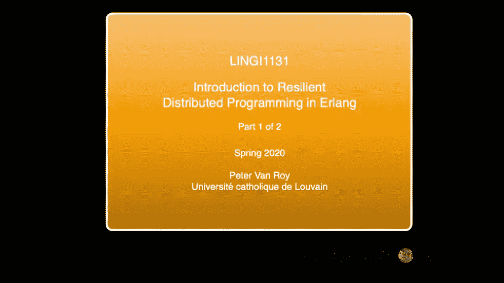
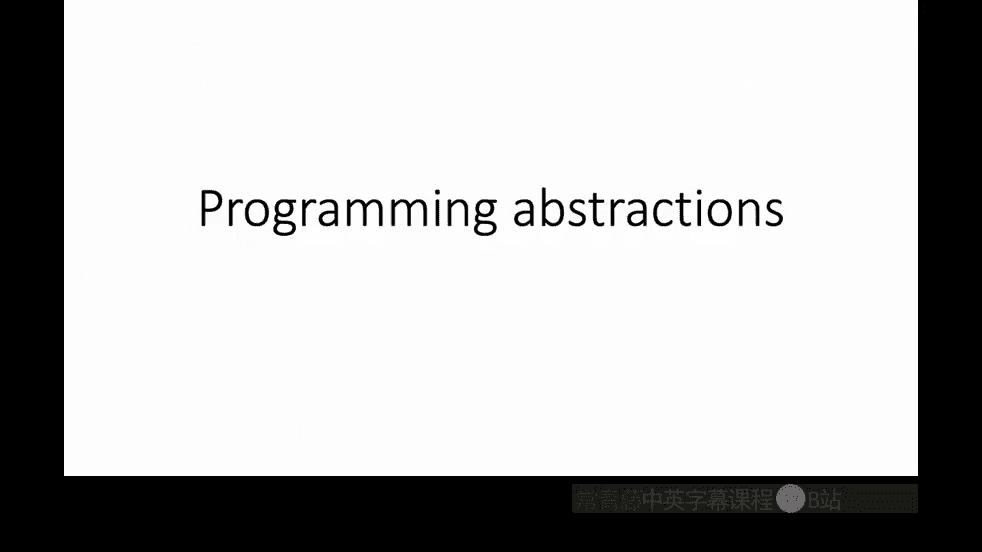

# 014：构建真实世界的弹性应用

在本节课中，我们将学习如何运用本课程所学的所有知识，结合Erlang语言和系统特有的新原则，来构建真实世界中具有弹性的分布式应用。

## 🚀 Erlang简介与优势

上一节我们介绍了课程目标，本节中我们来看看Erlang的背景及其核心优势。

Erlang由瑞典大型电信公司爱立信于1986年开发。它是一个拥有悠久历史的系统，附带大量库，统称为Erlang/OTP（开放电信平台）。Erlang程序基于消息传递，其基本概念是**进程**，这与我们在本课程中学到的**端口对象**非常相似。Erlang进程不共享任何数据，所有信息都是复制的，进程间没有指针。

Erlang/OTP支持构建长生命周期的可靠系统，其核心是**行为**（一种通用的并发模式）和**监督者**（处理故障的模式）。一个著名的成功案例是爱立信的AXD301 ATM交换机，它拥有超过100万行Erlang代码，文档声称其可用性达到99.9999999%，这意味着在一年中，系统宕机时间少于1秒。

以下是Erlang相比其他系统的性能优势：

*   **进程创建**：Erlang进程创建速度极快，可达微秒级，且可轻松创建数万个进程。相比之下，Java或C#的线程创建需要数百微秒，且数量有限。
*   **消息传递**：Erlang进程间的消息发送时间约为1微秒，可支持数万个进程。而Java或C#中线程间的消息传递则需要数十到数千微秒。

## 📈 Erlang应用案例

让我们通过两个具体案例来了解Erlang的实际表现。

**1. Web服务器 (Yaws)**
Yaws是一个用Erlang编写的Web服务器。下图展示了其并发处理能力。横轴是并发请求数（进程数），纵轴是吞吐量（服务器性能）。可以看到，即使并发请求数增加到数万，Erlang服务器的吞吐量下降也非常平缓。相比之下，Apache服务器在大约4000个并发请求时就会崩溃，性能急剧下降。这表明Erlang能非常优雅地处理高负载情况。

**2. AXD301 ATM交换机**
该交换机用于处理电信网络中的连接（如电话呼叫）。下图测量了其在不同负载下的表现。当负载达到系统容量的100%时，吞吐量保持线性增长。当负载超过100%（即过载）时，系统接受的呼叫数保持在其最大性能水平，而不会崩溃。随着过载程度的加剧（例如达到1000%），系统性能会平缓下降，这是因为需要资源来处理被拒绝的呼叫。这种**优雅降级**的能力在紧急情况（如短时间内涌入海量呼叫）下至关重要。

## 🧱 Erlang基本概念

我们已经了解了Erlang的威力和应用场景，现在深入探讨其实现这些特性的基本构建块。这些概念建立在我们已学的函数式编程和消息传递之上。

### 核心语言特性

Erlang的核心是一种纯函数式语言（在每个进程内部）。它具有以下特点：
*   变量是**单次赋值**的。
*   函数是**一等公民**，支持高阶函数和词法作用域。
*   支持**模式匹配**（在`case`、`if`和稍后提到的`receive`语句中）。
*   数据结构包括符号值、任意精度整数、浮点数、原子、列表、元组等。
*   字符串是ASCII码列表（即整数列表）。
*   包含**二进制向量**，用于低层协议计算，方便处理不同宽度的位域。

Erlang是**动态类型**但**强类型**的语言。类型在运行时被强制执行，但变量的类型在编译时未知。虽然静态类型有助于在编译时捕获更多表面错误，但Erlang通过其提供的容错机制，能够克服更深层的逻辑错误，从而构建出极其健壮的软件。

Erlang源代码组织在**模块**中。一个模块可以导出和导入函数。

### 进程与消息传递

Erlang的并发模型基于**进程**和**异步消息传递**（也称为Actor模型）。

*   使用 `spawn` 函数创建进程，并赋予其一个定义行为的函数（通常是尾递归函数）。
*   每个进程有一个唯一的**进程标识符**。
*   使用 `!` 操作符（bang符号）向进程ID发送消息，消息是异步的且数据会被复制。
*   使用 `receive` 语句接收消息。

`receive` 语句的语义是Erlang系统的基础：
1.  如果邮箱为空，`receive` 会阻塞。
2.  如果邮箱非空，`receive` 会按顺序尝试匹配消息与模式。
3.  如果找到匹配的模式，则执行相应代码并继续。
4.  如果没有消息匹配任何模式，`receive` 会阻塞并等待下一条消息。
5.  不匹配的消息会保留在邮箱中，可供后续的 `receive` 调用处理。

这意味着消息可以**不按到达顺序被移除**，进程的不同部分可以处理不同类型的消息。开发者需要小心，确保最终移除所有消息，否则可能导致内存泄漏。

### 关键机制：注册、链接与监控

除了基本的进程通信，Erlang还提供了几个关键机制来构建健壮系统。

**进程注册**
可以将进程ID与一个**原子**（符号名称）注册起来，使其全局可访问。这允许接口名称保持不变，即使背后的进程崩溃并被新进程替代。相关操作包括 `register`、`unregister`、`whereis` 等。

**进程链接**
进程可以相互**链接**，形成双向连接。当一个进程终止（正常或崩溃）时，它会向所有链接的进程发送一个**退出信号**（包含终止原因）。默认情况下，如果一个进程收到原因不是 `normal` 的退出信号，它自身也会终止，并将同样的信号传播给它的链接进程。这导致整个**链接集**中的所有进程都会崩溃。这种机制确保协作进程组中一个成员失败时，逻辑上无法继续工作的其他成员也会被终止。

**陷阱退出**
进程可以通过调用 `process_flag(trap_exit, true)` 将自己设置为**系统进程**。这样的进程在收到链接进程的退出信号时**不会崩溃**，而是将该信号作为一条普通消息（格式为 `{‘EXIT’, FromPid, Reason}`）放入其邮箱。这使得该进程可以**观察**其他进程的崩溃并采取相应行动（例如重启它们），这是构建**监督者**的基础。

**监控**
**监控**是链接的一种**不对称**变体。一个进程可以监控另一个进程。当被监控进程崩溃时，监控进程会收到一条 `{‘DOWN’, …}` 消息，但监控进程的崩溃不会影响被监控进程。这在客户端-服务器场景中很有用（客户端崩溃不应导致服务器崩溃）。

### 分布式Erlang与动态代码更新

**透明分布**
Erlang系统可以运行在多个节点（机器）上。节点间的进程通信语法与节点内通信完全相同，实现了**透明分布**。节点在首次被引用时会自动连接（例如通过TCP/UDP），默认形成全连接的网状拓扑，这对于可靠性很重要，但可能影响可扩展性。

**动态代码更新**
对于需要持续运行的系统（如丹麦国家医疗数据库），Erlang支持**动态代码更新**而无需停止系统。其机制基于模块：
*   每个模块可以同时存在两个版本的代码：旧版本和新版本。
*   新创建的进程使用新版本代码。
*   已运行的进程继续使用旧版本代码，直到它们**主动决定**切换到新版本（例如，通过调用 `Module:Function` 而非 `Function` 来使用最新版本）。
*   系统中只维护两个版本，待所有进程升级后，旧版本方可被移除，为下一次更新腾出空间。

此外，也可以利用高阶函数，通过向进程发送新函数来实现单个进程的代码热交换，但这通常用于特定场景，大规模应用更依赖基于模块的机制。

## 🎯 本节总结

本节课我们一起学习了构建弹性Erlang应用的基础。我们首先回顾了Erlang的背景及其在性能和可靠性方面的优势，并通过Web服务器和ATM交换机的案例看到了其实际表现。然后，我们深入探讨了Erlang的核心概念：函数式核心、基于Actor模型的进程与消息传递、用于容错的进程链接与监控、透明的分布式支持，以及实现永不停机系统的动态代码更新机制。这些低层原语为构建健壮应用提供了坚实的基础。在接下来的部分，我们将看到Erlang/OTP如何在这些基础之上，通过提供高级抽象（如行为和监督者树）来极大地简化可靠系统的开发。