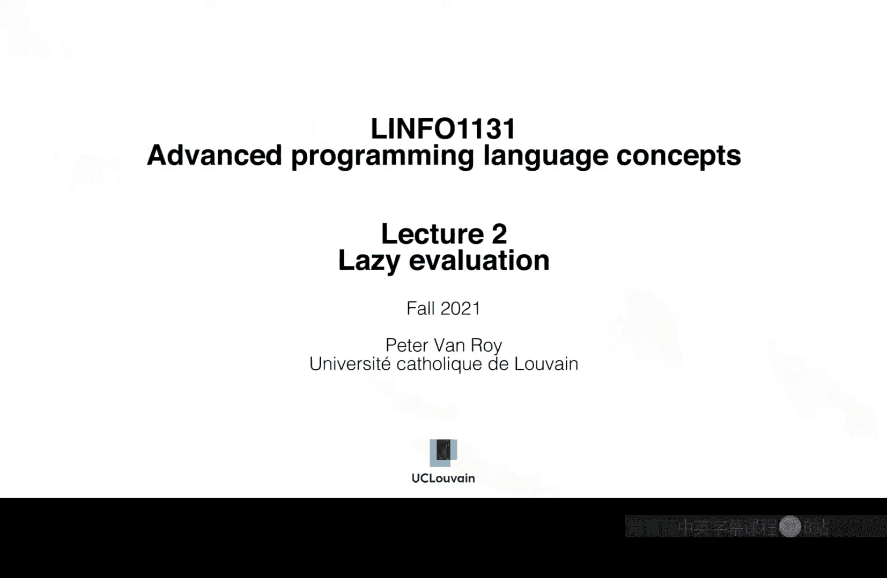
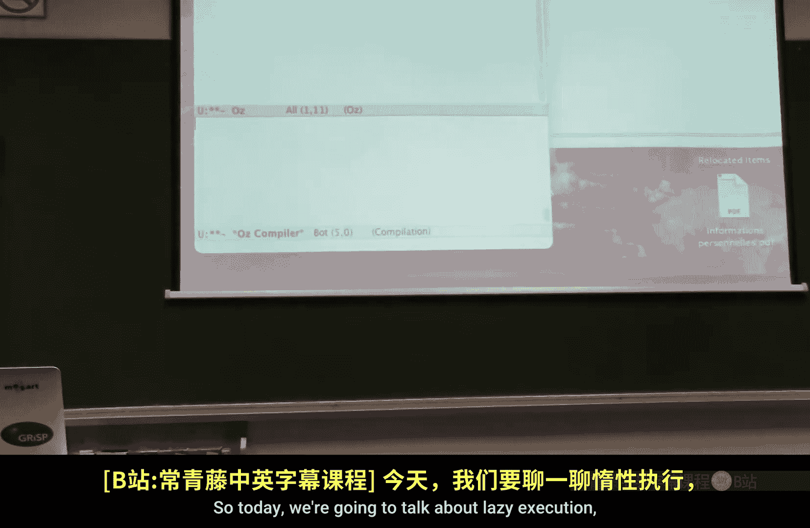
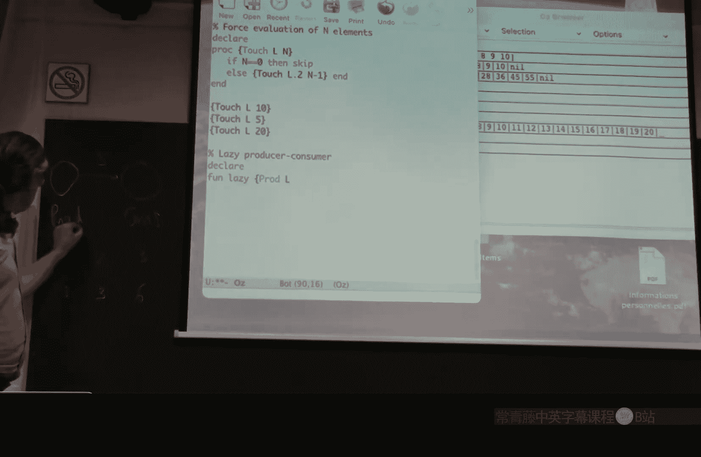

# 017：惰性执行







## 概述


在本节课中，我们将要学习**惰性执行**的概念。这是一种编程范式，程序会尽可能少地工作，只在结果被真正需要时才进行计算。我们将通过定义惰性函数、理解其语义、探索惰性流和无限列表，并解决一些经典问题（如Hamming问题）来深入理解惰性执行。最后，我们会探讨其内部执行机制，并构建一个更复杂的例子——有界缓冲区。

---

## 从确定性数据流到惰性计算

上一节我们介绍了确定性数据流的并发编程。本节中我们来看看如何将这种思想与惰性计算结合。

以下是一个简单的生产者-消费者模型，使用确定性数据流实现：

```oz
fun {Producer L H}
   if L > H then nil
   else
      {Delay 1000}
      L|{Producer L+1 H}
   end
end

fun {Consumer S Acc}
   case S of H|T then
      (Acc+H)|{Consumer T Acc+H}
   [] nil then nil
   end
end
```

这个例子中，生产者生成一个数字列表，消费者计算累积和。当它们并发运行时，我们可以看到结果逐步产生。

---

## 惰性计算简介

现在，让我们转向惰性计算的核心概念。惰性计算是函数式编程的一种形式，其核心思想是**只在需要时才执行计算**。

以下是一个简单的惰性函数定义：

```oz
fun lazy {LazyAdd X Y}
   X+Y
end
```

当我们调用 `{LazyAdd 10 20}` 时，它不会立即计算 `10+20`，而是创建一个**惰性挂起**。只有当这个结果被另一个操作（例如加法或模式匹配）真正需要时，计算才会被触发。

---

## 惰性执行的语义

为了理解惰性函数如何工作，我们需要了解其底层语义。惰性函数在内部被翻译成内核语言。



一个惰性函数 `fun lazy {F X} B end` 大致被翻译为：

```oz
proc {F X R}
   thread
      {WaitNeeded R}
      R = {B} % B 是函数体
   end
end
```

这里的关键操作是 `{WaitNeeded R}`。它会阻塞当前线程，直到变量 `R` 被某个操作**需要**。一个变量被“需要”意味着另一个操作（如算术运算 `+`、`case` 语句或记录访问 `.`）必须知道它的值才能继续执行。

`{Browse R}` 操作**不**需要 `R` 的值，因此它不会触发计算。这使得惰性挂起可以无限期地等待，除非被垃圾回收器回收（当没有任何运行中的线程引用它时）。

---

## 惰性流与无限列表

惰性计算的一个强大特性是能够轻松处理**无限数据结构**，例如无限列表。

以下是一个生成无限自然数列表的惰性函数：

```oz
fun lazy {Ints N}
   N|{Ints N+1}
end
```


调用 `L = {Ints 1}` 不会导致无限循环，它只是创建一个惰性挂起。只有当我们尝试访问列表的元素时，计算才会逐步进行。

我们可以定义一个过程来“强制”计算列表的前 N 个元素：

```oz
proc {Touch L N}
   if N==0 then skip
   else
      {Touch L.2 N-1} % L.2 需要 L 的值，从而触发计算
   end
end
```

执行 `{Touch L 10}` 会迫使惰性流计算并生成前10个元素。

---

## 惰性生产者-消费者

我们可以将之前的生产者-消费者模型改写为惰性版本，从而创建**无限流**的管道。

```oz
fun lazy {Producer N}
   N|{Producer N+1}
end

fun lazy {Consumer S Acc}
   case S of H|T then
      (Acc+H)|{Consumer T Acc+H}
   end
end
```

注意，这里移除了终止条件（`nil` 分支），因为惰性计算允许我们处理无限流。

当我们连接 `S1 = {Producer 1}` 和 `S2 = {Consumer S1 0}`，并使用 `{Touch S2 10}` 触发计算时，控制流会从输出（`Touch`）反向传播到输入（`Producer`），通过 `WaitNeeded` 操作一步步唤醒计算。

---

## Hamming 问题

Hamming 问题是一个经典的编程问题，要求按升序生成所有形如 `2^A * 3^B * 5^C`（A, B, C 为非负整数）的数字序列。使用惰性流可以给出极其简洁的解决方案。

序列 H 定义如下：
1. 第一个元素是 1。
2. 后续的每个元素都是 `2*H`、`3*H`、`5*H` 这三个序列合并后最小的那个数字，并去除重复项。

我们可以用惰性流直接实现这个递归定义：

```oz
fun lazy {Times N H}
   case H of X|T then (N*X)|{Times N T} end
end

fun lazy {Merge S1 S2}
   case S1#S2 of (H1|T1)#(H2|T2) then
      if H1 < H2 then H1|{Merge T1 S2}
      elseif H1 > H2 then H2|{Merge S1 T2}
      else H1|{Merge T1 T2} % 相等时只取一个
      end
   end
end

H = 1|{Merge {Times 2 H} {Merge {Times 3 H} {Times 5 H}}}
```

这个程序非常简短，却高效地生成了所需的无限序列。惰性计算确保我们只生成需要的部分，内存使用最小化。


---

## 有界缓冲区

有界缓冲区是一个用于平滑生产者和消费者之间速度差异的通用组件。在惰性计算框架下，我们可以用很少的代码实现它。

有界缓冲区的核心思想是：让生产者提前于消费者工作。缓冲区在启动时立即向生产者请求 N 个元素进行缓冲。每当消费者取走一个元素，缓冲区就立即再向生产者请求一个元素，试图始终保持缓冲区中有 N 个待消费元素。

以下是实现代码：

```oz
proc {Buffer S1 ?S2 N}
   fun lazy {Loop S1 End}
      case S1 of H|T then
         H|{Loop T End.2} % 将元素传递给消费者
      end
   end
in
   S2 = {Loop S1 {List.drop S1 N}} % 启动时请求N个元素
   thread {List.drop S1 N} end % 在独立线程中执行初始请求，不阻塞
end
```

这个 `Buffer` 过程插在惰性生产者和惰性消费者之间。它巧妙地结合了**急切**（启动时和消费后主动请求）和**惰性**（仅当消费者需要时才传递数据）两种求值策略，从而提升了管道整体的效率。

---

## 总结


本节课中我们一起学习了惰性执行的核心概念。我们从惰性函数的基本定义和语义（`WaitNeeded`）开始，了解了惰性求值如何通过“按需计算”来工作。我们探索了惰性流和无限列表的威力，并看到了如何用简洁的惰性代码解决经典的 Hamming 问题。最后，我们深入探讨了有界缓冲区的实现，这是一个结合了惰性与并发、用于优化数据流管道的强大模式。惰性计算通过将复杂的控制流隐藏在简单的声明式代码之后，让程序员能够编写出既简洁又高效的复杂程序。