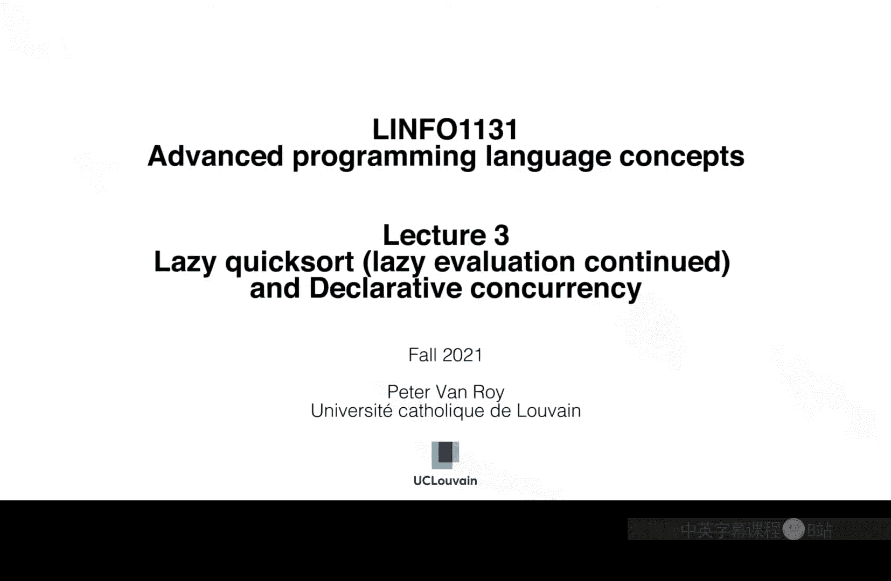
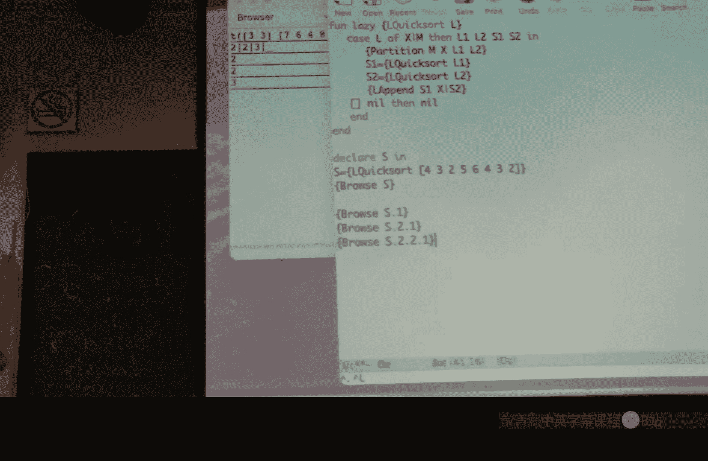
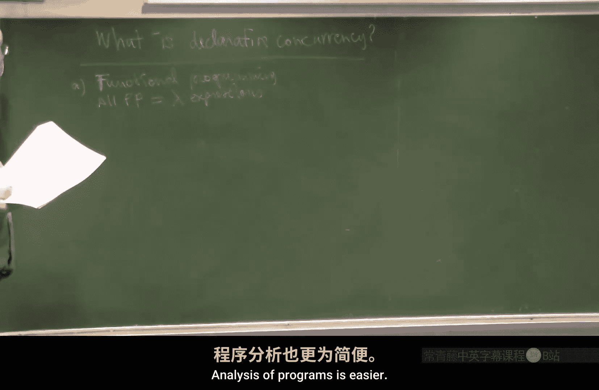

# 018：惰性求值与声明式并发





在本节课中，我们将要学习两个核心概念。首先，我们将通过一个惰性快速排序算法的例子，深入理解惰性求值如何催生出高效的算法。其次，我们将探讨声明式并发的本质，理解其理论基础，并了解不同声明式编程范式的全景图。

## 惰性快速排序：一个高效的算法

上一节我们介绍了惰性求值的基本概念。本节中我们来看看一个具体的例子：如何通过引入惰性求值，将一个普通的快速排序算法转变为一个极其高效的新算法。

### 快速排序算法回顾

快速排序是一种高效的递归排序算法，其平均时间复杂度为 O(n log n)。它的工作原理如下：

1.  从列表中选择一个元素作为“基准”。
2.  将列表划分为两个子列表：一个包含所有小于基准的元素，另一个包含所有大于或等于基准的元素。
3.  对这两个子列表递归地应用快速排序。
4.  将排序好的两个子列表与基准值连接起来。

以下是该算法的一个简单示例。假设我们有列表 `[7, 3, 2, 8, 6, 4, 1, 9]`，选择第一个元素 `7` 作为基准：
*   划分后得到 `L1 = [3, 2, 6, 4, 1]` 和 `L2 = [8, 9]`。
*   递归排序 `L1` 得到 `[1, 2, 3, 4, 6]`，排序 `L2` 得到 `[8, 9]`。
*   最终结果为 `[1, 2, 3, 4, 6] ++ [7] ++ [8, 9] = [1, 2, 3, 4, 6, 7, 8, 9]`。



### 引入惰性求值

现在，我们在这个算法中引入惰性求值。关键点在于将递归调用和列表连接操作标记为惰性的。这意味着，除非确实需要某个结果，否则不会执行相应的计算。

考虑以下场景：我们只要求排序后列表的前 `k` 个最小元素，而不是整个排序列表。在传统的快速排序中，无论你需要多少元素，算法都会完成整个 O(n log n) 的排序过程。

然而，在惰性版本中，情况发生了根本变化。当你请求第一个元素时，算法只会执行必要的计算来找出最小的元素。请求第二个元素时，它也只进行找出第二小元素所必需的最小计算量。

### 惰性快速排序的效率分析

惰性快速排序的性能表现非常出色：
*   **传统快速排序**：时间复杂度为 O(n log n)，无论你需要多少元素。
*   **惰性快速排序**：如果你只请求前 `k` 个最小元素，其时间复杂度为 **O(n + k log k)**。

这相当于一个专门用于查找“前 k 个最小元素”的算法，而且 `k` 的值无需预先知道。你可以持续请求元素，算法会增量式地、高效地提供下一个最小元素。这种增量式算法手动实现起来相当复杂，但惰性求值使其变得简单自然。

### 惰性如何工作：深入分析

惰性求值并非魔法。其工作原理基于我们之前定义的“按需计算”规则。当程序需要一个惰性表达式的值时，会触发其计算。在快速排序的例子中：
1.  请求结果列表的第一个元素 `S.1`，触发了整个惰性快速排序函数体的计算。
2.  函数体执行划分操作（这是严格的，会立即完成），并创建两个惰性的递归排序调用 `S1` 和 `S2`。
3.  接着执行惰性的 `append(S1, [X] | S2)`。为了得到结果的第一个元素，`append` 函数需要 `S1` 的第一个元素。
4.  这又触发了对 `S1` 的求值，即对左子列表 `L1` 进行惰性快速排序，而 `S2` 的计算则保持挂起状态。
5.  这个过程会递归地进行下去，沿着“左分支”深入，每次只对一个子列表进行划分和进一步探索，直到找到最小的元素。

本质上，算法只构建和探索了排序树中为获取所需前 `k` 个元素所必需的那部分路径。其他分支（对应较大的元素）的计算永远不会被触发。这就是效率提升的来源：**惰性求值自动地、最小化地执行了任务所必需的工作**。


通过这个例子，我们看到了惰性求值不仅是一种语言特性，更是一种强大的算法设计工具，它能从传统的算法中衍生出更高效、更灵活的增量式算法。



## 声明式并发的本质

在探讨了惰性求值的实践威力后，我们现在转向一个更理论性的问题：究竟什么是声明式并发？我们已经见识了顺序函数式编程、确定性数据流和惰性编程，它们的共同点是什么？

### 函数式编程的基础：Church-Rosser 定理

所有函数式程序都可以用 λ 表达式表示。函数式编程的一个强大特性是程序分析更简单，这源于一个关键定理：**Church-Rosser 定理**（或称合流性）。

该定理指出，对于一个 λ 表达式，无论你以何种顺序对其子表达式进行归约（求值），只要最终能归约到一个不可再归约的形式（范式），那么所有这些不同的归约路径最终都会得到**相同的结果**。

这意味着函数式程序具有**确定性**。即使计算过程是并发的（以不同顺序执行子计算），最终 observable 的结果总是唯一的。这是顺序函数式编程的基石。

### 扩展到并发与数据流

然而，我们讨论的声明式并发模型包含了更多内容：**流**（无限序列）和**数据流变量**（单次赋值变量）。

1.  **流与部分终止**：流处理程序通常永不终止。为了用函数式模型理解它，我们引入**部分终止**的概念。假设输入流暂时固定（不再有新元素），那么程序运行一段时间后，输出流也会达到一个稳定的、不再变化的状态。这相当于完成了一次“函数调用”。当新的输入元素到达时，程序从该状态“重启”，进行下一轮计算并再次达到部分终止。因此，流计算可以被视为一系列连续的函数式计算，每一段都满足确定性。

2.  **数据流变量与逻辑等价**：数据流变量允许先声明变量（创建一个“洞”），稍后再绑定值。这可能导致存储（store）中的绑定状态因调度顺序不同而有所差异。例如，考虑三个线程：
    ```
    thread X=foo(Z W) end
    thread Y=foo(Z W) end
    thread X=Y end
    ```
    不同的执行顺序可能产生不同的存储绑定（如 `X=foo(...), Y=foo(...)` 或 `X=foo(...), Y=X`）。虽然表面绑定不同，但这些存储是**逻辑等价**的。它们对变量 `X` 和 `Y` 所施加的**约束**是相同的（即，`X` 和 `Y` 最终都必须是具有两个参数的 `foo` 记录）。所有可能的变量值集合在两种存储下是一致的。因此，从程序外部观察到的效果仍然是确定性的。

### 声明式并发的定义

基于以上概念，我们可以给出声明式并发的形式化定义：

> 一个并发程序是**声明式**的，当且仅当：对于给定的所有输入，其所有可能的执行轨迹，要么都永不终止（发散），要么都达到（部分）终止，并且所有终止状态产生的输出（存储）都是**逻辑等价**的。

这精确定义了“无 observable 非确定性”的含义：无论调度器如何安排线程执行，程序最终表现出的行为（结果或永不终止）是唯一确定的。

### 处理非声明式情况：故障隔离

有时程序可能包含错误，导致其偏离声明式模型（例如，尝试多次绑定同一个变量为不同的值）。在实际系统（如 Mozart）中，这会引发异常，并且此时程序行为可能变得非确定性。

作为程序员，我们的目标应是尽可能保持程序的声明式特性。如果不可避免地引入了非确定性，应使用**故障隔离**技术将其封装起来，防止其污染程序的其他部分。核心思想是使用异常处理机制，在局部范围内捕获非确定性错误，并提供一个一致的默认值或处理方式，使得程序的其余部分仍然运行在声明式的、确定性的环境中。

以下是故障隔离的一个示例模式：
```
local X1 Y1 in
    try
        thread X1=1 end
    catch error then S1=error end
    try
        thread Y1=2 end
    catch error then S2=error end
    try
        thread X1=Y1 end
    catch error then S3=error end
    if S1==error orelse S2==error orelse S3==error then
        X=default % 发生错误时提供默认值
        Y=default
    else
        X=X1 % 无错误，使用计算值
        Y=Y1
    end
end
```

## 声明式编程范式全景图

最后，让我们俯瞰整个声明式编程的世界。我们可以根据两个维度对范式进行分类：**求值策略**（严格求值 vs 惰性求值）和**并发与变量绑定时机**（顺序、支持数据流变量的并发、完全分离声明/指定/求值）。

由此可以形成一个包含六种主要范式的全景图：

| | **严格求值** | **惰性求值** |
| :--- | :--- | :--- |
| **顺序函数式** | Scheme, ML | Haskell |
| **顺序 + 数据流变量** | (Prolog 确定性子集) | (Prolog 协程子集) |
| **并发 + 数据流变量** | **确定性数据流** (Oz, Apache Flink 等云数据分析工具) | **惰性确定性数据流** (实验性语言) |

**组织原则**：一个数据流变量的生命周期有三个关键时刻：1) 声明， 2) 指定计算其值的函数， 3) 实际求值。不同范式区别在于这些时刻是合并还是分离：
*   **严格顺序函数式**：三者同时发生。
*   **惰性函数式**：声明与指定同时，求值推迟。
*   **确定性数据流**：声明可早于指定和求值。
*   **惰性数据流**：三者完全分离，是最通用、最灵活的声明式范式。

**趋势与展望**：传统的函数式语言（如 Scheme, Haskell）位于表格上方。当前，**并发确定性数据流**范式正变得越来越重要，尤其是在云计算和分布式数据分析领域（如 Apache Flink），因为它结合了函数式的易于推理和并发的执行效率。未来，随着对按需计算和增量处理的需求增长，云平台可能会更多地融入**惰性**特性，向惰性数据流范式演进，以实现更高的资源利用率和响应速度。


本节课中我们一起学习了惰性求值如何通过“按需计算”创造出高效的算法（如惰性快速排序），并深入探讨了声明式并发的理论基础，理解了其确定性的本质源于 Church-Rosser 定理和对流、数据流变量的扩展定义。最后，我们纵览了声明式编程的多种范式，看到了从传统函数式语言到现代云数据分析平台的技术演进脉络。理解这些核心概念，将为你在未来选择和运用合适的编程语言与范式打下坚实的基础。