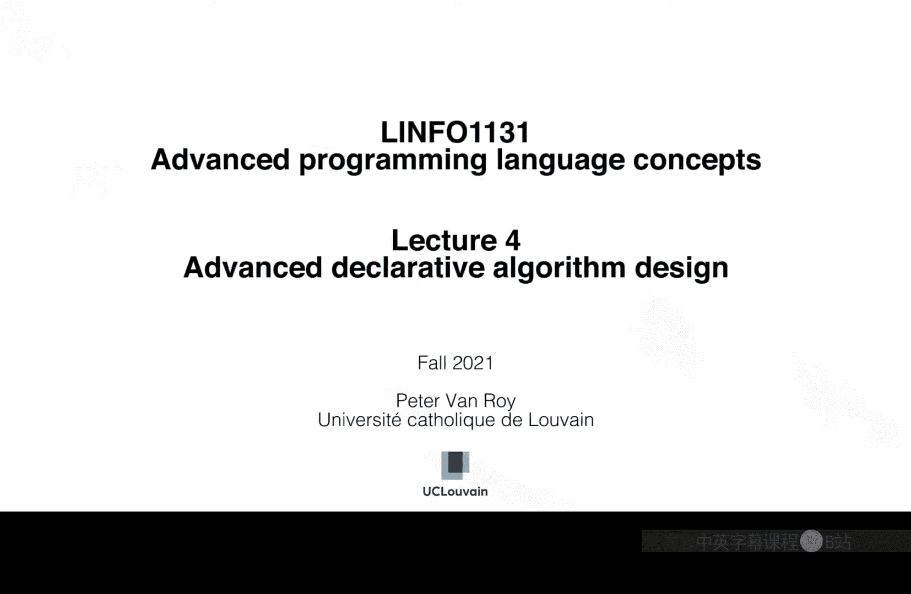
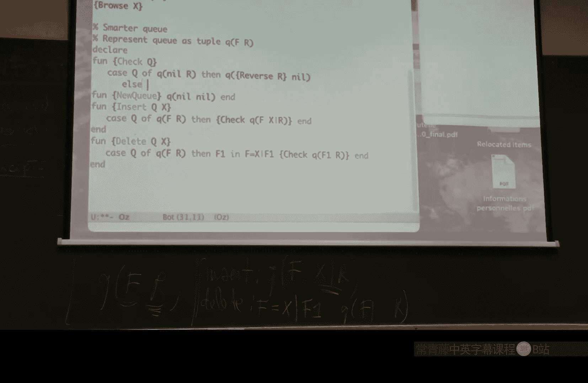
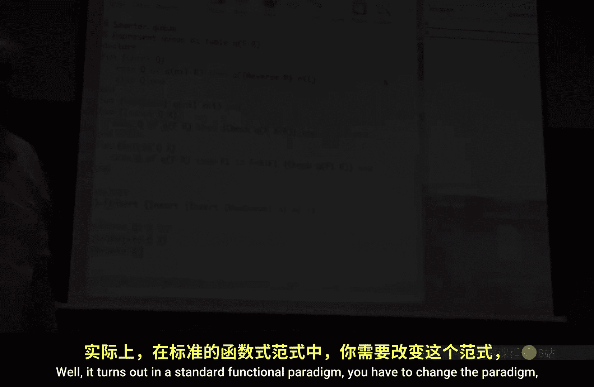
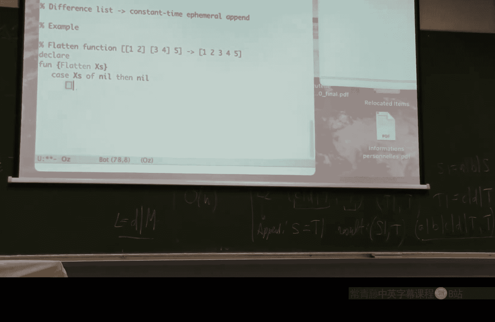
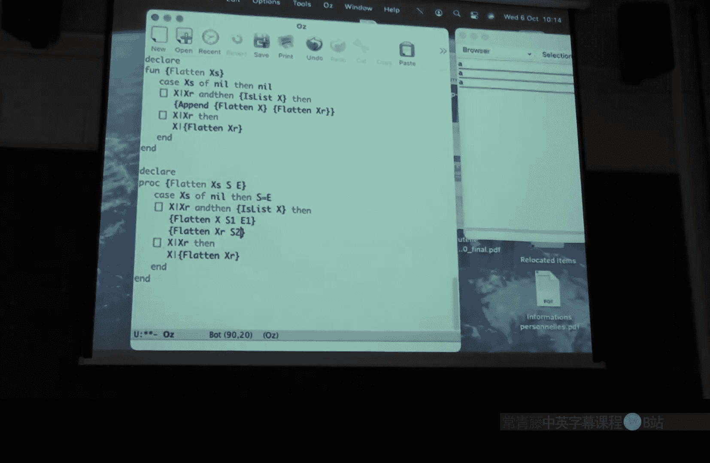

# 019：算法设计与声明式编程





在本节课中，我们将学习如何设计高效的声明式算法。我们将探讨几个核心概念，包括摊销复杂度、持久化算法以及惰性函数，并了解如何利用不同的声明式编程范式来实现高效的数据结构。

## 概述

声明式编程的核心优势在于其清晰性和可维护性。为了构建高效的声明式应用，我们需要理解算法设计的深层概念。本节将介绍摊销复杂度、持久化算法以及惰性函数中的增量与整体计算概念，并展示如何在不同的声明式范式中实现高效的队列数据结构。

## 核心概念介绍

在深入具体算法之前，我们需要理解几个评估和设计算法时的重要概念。

### 摊销复杂度 vs. 最坏情况复杂度

通常，我们分析算法时关注的是最坏情况时间复杂度，即每个操作在最坏情况下的时间上界。然而，对于某些算法，单个操作的成本可能差异很大：有些操作成本低廉（常数时间），有些则非常昂贵（例如 O(n) 时间）。如果仅看最坏情况，整个算法可能被判定为低效。

摊销复杂度的思想是，如果我们执行一系列 N 个操作，虽然其中个别操作可能很昂贵，但这些昂贵操作非常稀少。因此，**N 个操作的总时间**仍然是 O(f(N))。那么，我们可以说**每个操作的摊销复杂度**是 O(f(N)/N)。在实践中，如果操作在平均意义上成本低廉，这通常就足够了。

上一节我们介绍了复杂度分析的基本概念，本节中我们来看看算法的另一种分类方式。

### 短暂算法 vs. 持久化算法

大多数传统的数据结构（如用可变状态实现的栈或队列）是**短暂**的。这意味着数据结构在任何时刻只有一个“版本”。一旦你更新了它，旧的状态就不复存在。

然而，在某些实际场景中（如版本控制系统 Git、数据库或协同编辑），我们需要能够同时存在并独立修改的多个数据版本。支持这种功能的数据结构被称为**持久化**的。声明式范式（尤其是函数式编程）因其不可变性，使得实现持久化算法比在命令式范式中要容易得多。

理解了算法的持久性概念后，我们接下来探讨函数计算方式对效率的影响。

### 惰性函数：增量计算 vs. 整体计算

在惰性求值中，**增量**函数意味着当你只需要结果的一部分时，它只执行必要的部分计算。例如，快速排序在只需求最小元素时效率很高。

相反，**整体**函数则意味着即使你只需要结果的一部分（如列表的第一个元素），它也必须完成全部计算。惰性求值对这类函数没有帮助。一个典型的例子是反转列表的函数 `reverse`。为了得到反转后列表的第一个元素（即原列表的最后一个元素），它必须遍历整个列表。

以下是 `reverse` 函数的一个可能实现，它展示了整体计算的性质：
```erlang
reverse(L) ->
    case L of
        nil -> nil;
        [H|T] -> append(reverse(T), [H])
    end.
```
我们的一个目标就是学习如何将整体函数转化为增量函数。

## 声明式编程范式

我们将使用三种声明式范式来构建算法：
1.  **顺序函数式编程**（无数据流变量）：例如 Scheme、Haskell 或 Java 中的不可变操作。
2.  **带数据流变量（单次赋值）的顺序函数式编程**：这提供了额外的表达能力。
3.  **惰性函数式编程**：我们将主要关注其顺序版本。

## 队列数据结构的实现之旅



我们将以队列数据结构为例，展示在不同范式下如何实现高效算法。主要实现四个变体：
1.  短暂队列，摊销常数时间。
2.  短暂队列，最坏情况常数时间。
3.  持久化队列，摊销常数时间。
4.  持久化队列，最坏情况常数时间。

首先，我们从最基础的实现开始。



### 1. 朴素队列（顺序函数式编程）

这是最简单的实现，但效率低下。

```erlang
% 辅助函数，移除列表最后一个元素
butLast(L) ->
    case L of
        [X] -> {nil, X};
        [H|T] -> {R, X} = butLast(T), {[H|R], X}
    end.

% 队列表示为列表
newQueue() -> nil.
insert(Q, X) -> [X|Q]. % 在头部插入，常数时间
delete(Q) ->
    {NewQ, X} = butLast(Q), % 删除尾部，需要 O(n) 时间
    {NewQ, X}.
```
**效率分析**：`insert` 是 O(1)，但 `delete` 是 O(n)。执行 n 次插入和删除的总时间为 O(n²)。

### 2. 高效短暂队列（摊销常数时间）

我们使用更聪明的表示方法：用两个列表 `F`（前端）和 `R`（后端，但元素是反向存储的）来表示队列。队列的实际内容是 `F` 与 `reverse(R)` 的拼接。

```erlang
newQueue() -> {nil, nil}.

insert({F, R}, X) ->
    check(F, [X|R]). % 插入到 R 头部

delete({F, R}) ->
    case F of
        [X|F1] -> {check(F1, R), X}; % 从 F 头部删除
        nil -> % 如果 F 为空，则先反转 R 到 F
            [X|F1] = reverse(R),
            {check(F1, nil), X}
    end.

% 检查函数，确保当 F 为空时，将 R 反转并移至 F
check(F, R) ->
    case F of
        nil -> {reverse(R), nil};
        _ -> {F, R}
    end.
```
**效率分析**：`insert` 和 `delete` 通常是 O(1)。昂贵的 `reverse` 操作仅在 `F` 为空且需要执行 `delete` 时发生，并且它会将多个元素从 `R` 一次性移到 `F`。因此，一系列 n 个操作的总时间是 O(n)，每个操作的**摊销复杂度**是 O(1)。但此实现不是持久化的，因为从同一初始队列分叉出的不同版本会独立触发 `reverse`，导致重复计算。

### 3. 高效短暂队列（最坏情况常数时间）

为了获得最坏情况下的常数时间性能，我们需要改变范式，引入**数据流变量（单次赋值）**。关键是用**差异列表**来表示队列。

**差异列表概念**：
一个常规列表 `[a, b, c]` 可以表示为一个“差异列表”对 `(S, E)`，其中 `S = [a, b, c | E]`，而 `E` 是一个未绑定的变量。`S` 是列表的“起始”，`E` 是列表的“结束”（一个未绑定的尾部）。通过绑定 `E`，我们可以在常数时间内向列表末尾添加元素。

基于差异列表的队列实现：

```erlang
% 队列表示为三元组：{元素数量, 起始差异列表 S, 结束变量 E}
newQueue() -> {0, S, S}. % 空差异列表：S 和 E 是同一个未绑定变量

insert({N, S, E}, X) ->
    % 绑定当前结束 E 为 [X | E1]，从而在末尾添加 X
    E = [X | E1],
    {N+1, S, E1}.



delete({N, S, E}) ->
    % S 绑定为 [X | S1]，从而从头部取出 X
    S = [X | S1],
    {N-1, S1, E}.
```
**效率分析**：`insert` 和 `delete` 都是最坏情况 O(1) 操作。这得益于差异列表允许在头尾两端进行常数时间的添加/删除操作。此实现仍然是声明式的（单次赋值），并且是短暂的。

差异列表的威力不仅限于队列，它还能实现常数时间的列表拼接。

**常数时间列表拼接示例**：
假设有两个差异列表 `(S1, E1)` 和 `(S2, E2)`，分别代表列表 L1 和 L2。拼接操作就是绑定 `E1 = S2`，并返回新的差异列表 `(S1, E2)`。这仅需常数时间。



我们可以利用这个特性优化一些算法，例如展平嵌套列表的 `flatten` 函数。朴素版本使用 `append`，时间复杂度高。而使用差异列表的版本可以将所有 `append` 操作变为常数时间，显著提升效率。

## 展望：持久化队列与惰性求值

要实现**持久化**且高效的队列，我们需要引入**惰性求值**。

基本思路类似于摊销常数时间的短暂队列（使用 `F` 和 `R`），但关键区别在于：将昂贵的 `reverse` 操作封装为一个**惰性悬挂**。这个悬挂在需要时（即当 `F` 为空时）才会被求值。由于惰性求值的记忆化特性，一旦这个 `reverse` 在一个版本中被计算，其结果会被存储起来，所有其他从同一状态分叉出来的版本都会共享这个已计算的结果，从而避免了重复计算。

这展示了惰性求值的另一强大之处：它能够以优雅的方式实现高效的持久化数据结构。我们将在后续课程中详细探讨其实现。

## 总结


本节课中我们一起学习了高效声明式算法设计的核心概念。我们了解了摊销复杂度如何更公平地评估算法，认识了持久化数据结构在实际中的重要性，并区分了增量计算与整体计算。通过实现从朴素到高效的队列，我们实践了在顺序函数式编程、带数据流变量的编程范式中进行算法优化的技巧。最后，我们看到了惰性求值为实现持久化数据结构提供的强大潜力。掌握这些概念和技术，将帮助你设计出既清晰又高效的声明式程序。