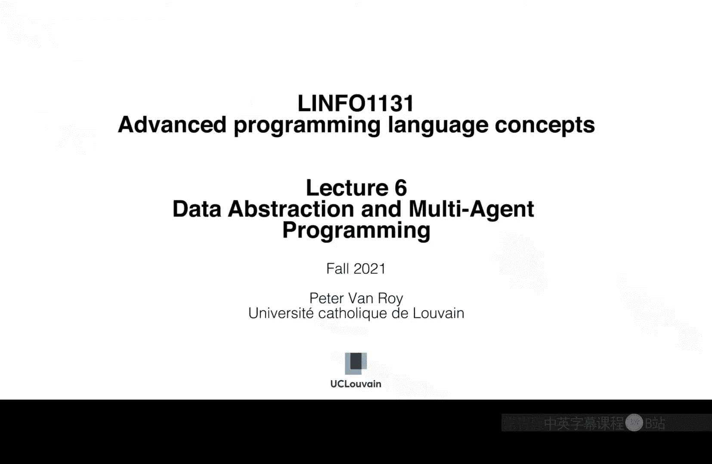
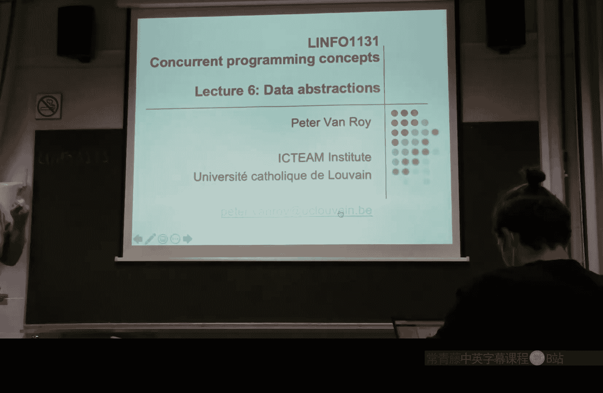

# 021：数据抽象与多智能体编程






## 概述

在本节课中，我们将要学习数据抽象的核心概念，包括如何构建安全的抽象数据类型和对象。我们将探讨四种不同类型的数据抽象，并理解其背后的语言机制。随后，我们将转向多智能体编程，通过一个历史问题——弗拉维乌斯·约瑟夫斯问题——来比较确定性数据流和主动对象这两种不同的并发编程范式。

---

## 数据抽象

数据抽象是程序的一部分，它包含一个内部实现和一个外部接口。内部实现对外部程序是隐藏的，只能通过定义好的接口操作来访问。这种封装保证了数据结构的完整性，防止外部代码破坏其内部状态。

### 未受保护的栈示例

以下是一个简单的栈实现，但它没有封装，任何人都可以直接操作其内部列表结构，因此无法保证其被正确使用。

```oz
fun {NewStack} nil end
fun {Push S X} X|S end
fun {Pop S X} X=S.1 S.2 end
fun {IsEmpty S} S==nil end
```

这个实现不是数据抽象，因为它没有受到保护。

### 抽象数据类型与对象

数据抽象有两种基本形式：抽象数据类型和对象。

*   **抽象数据类型**：将值和操作分离为两种不同的实体。例如，整数 `5` 和 `6` 是值，`+` 是操作。
*   **对象**：将值和操作捆绑在单个实体中。例如，在纯面向对象语言中，整数 `5` 本身就是一个对象，`+` 是发送给它的消息。

一个现实世界的例子是电视机（对象，所有功能集于一身）和自动售货机（抽象数据类型，机器、硬币、商品是分离的实体）。

### 构建安全的抽象数据类型

为了构建一个真正受保护的抽象数据类型，我们需要一种机制来“加密”内部值，使得只有授权的操作才能“解密”它。这需要两个核心语言概念：

1.  **不可伪造的常量**：一个无法被猜测或创建的密钥。
2.  **安全记录（盒子）**：一个只能用特定密钥访问的受限记录。

在 Oz 语言中，这两个概念分别称为 **Name** 和 **Chunk**。

以下是实现包装和解包装函数的代码，它们共同守护着内部数据：

```oz
proc {NewWrapper Wrap Unwrap}
   Key={NewName}
in
   fun {Wrap X}
      {Chunk w(Key:X)}
   end
   fun {Unwrap W}
      W.Key
   end
end
```

`NewWrapper` 过程创建一个新的密钥 `Key`，并返回两个函数 `Wrap` 和 `Unwrap`。`Wrap` 函数将值 `X` 包装成一个安全记录（Chunk），`Unwrap` 函数用密钥 `Key` 从安全记录中提取出原始值。由于 `Key` 是通过 `{NewName}` 新生成的、且仅在 `NewWrapper` 的词法作用域内可知，因此外部代码无法伪造或访问它。

利用这些函数，我们可以构建一个安全的栈抽象数据类型：

```oz
local Wrap Unwrap in
   {NewWrapper Wrap Unwrap}
   fun {NewStack} {Wrap nil} end
   fun {Push W X} S={Unwrap W} in {Wrap X|S} end
   fun {Pop W X} S={Unwrap W} in X=S.1 {Wrap S.2} end
   fun {IsEmpty W} {Unwrap W}==nil end
end
```

每个操作在执行前先解包（`Unwrap`）内部状态，执行操作后再重新包装（`Wrap`）起来。这类似于在银行的保险库中操作保险箱：只有进入安全环境（调用授权函数）才能打开箱子进行操作。

### 对象语义

对象将状态和操作捆绑在一起。从语义上看，一个对象可以表示为一个单参数过程，参数是消息，内部通过 case 语句进行方法分派。

以下是一个有状态栈对象的实现示例：

```oz
fun {NewStack}
   C={NewCell nil}
   proc {Push X} C:=X|@C end
   fun {Pop X} S=@C in X=S.1 C:=S.2 end
   fun {IsEmpty} @C==nil end
in
   proc {$ M}
      case M
      of push(X) then {Push X}
      [] pop(X) then {Pop X}
      [] isEmpty(B) then B={IsEmpty}
      end
   end
end
```

这里，栈的状态存储在一个单元（Cell）`C` 中。对象本身是一个过程，根据接收到的不同消息（`push`， `pop`， `isEmpty`）来更新或查询内部状态。

### 四种数据抽象

我们可以根据两个轴对数据抽象进行分类：捆绑方式（对象 vs 抽象数据类型）和状态性（声明式无状态 vs 有状态）。这产生了四种类型：

1.  **声明式抽象数据类型**：如我们刚刚构建的安全栈。值不可变，操作无副作用。
2.  **有状态对象**：如上例中的栈对象。状态可变，操作有副作用。
3.  **函数式对象**：像对象一样捆绑，但内部没有可变状态。任何“更新”操作都会返回一个全新的对象。这种对象在分布式和大数据系统中很有用，因为它们易于序列化和传输。
    ```oz
    fun {StackObject S}
       fun {Push X} {StackObject X|S} end
       fun {Pop X} X=S.1 {StackObject S.2} end
       fun {IsEmpty} S==nil end
    in
       stack(push:Push pop:Pop isEmpty:IsEmpty)
    end
    ```
4.  **有状态抽象数据类型**：值（通过安全包装）和操作分离，但内部值本身是可变的。这种类型目前不常用。

历史上，CLU 是第一个支持抽象数据类型的语言。而像 Java 这样的现代语言实际上混合了对象和抽象数据类型的特性。

---

## 多智能体编程

上一节我们介绍了数据抽象，本节中我们来看看如何利用通信通道进行多智能体编程。我们将使用端口（Port）来构建智能体，并比较基于消息传递的主动对象范式和声明式的确定性数据流范式。

### 端口对象

端口对象是一种基本的智能体模型，它包含一个内部状态和一个用于接收消息的端口。其行为由一个状态转移函数定义：`新状态 = F(旧状态， 消息)`。

我们可以用高阶函数 `Fold` 来简洁地定义端口对象，它不断将流中的消息折叠到当前状态中：

```oz
fun {NewPortObject Init F}
   P S in
   thread {FoldL S F Init _} end
   {NewPort S P}
   P
end
```

`NewPortObject` 创建一个新线程来运行 `FoldL`，该折叠操作以初始状态 `Init` 开始，并将流 `S` 中的每个消息通过函数 `F` 应用到当前状态。`NewPort` 创建端口 `P` 及其对应的流 `S`。任何发送到 `P` 的消息都会出现在流 `S` 中，从而触发状态更新。

### 弗拉维乌斯·约瑟夫斯问题

为了对比不同的并发范式，我们引入一个经典问题：弗拉维乌斯·约瑟夫斯问题。

问题描述：`N` 个人围成一圈，从第一个人开始报数，每数到第 `K` 个人就将其淘汰出圈，然后从下一个人继续报数，直到只剩一人。求最后幸存者的位置。

我们将设计一个消息协议来解决这个问题。消息格式为 `kill(X， S)`，其中 `X` 是已遍历的存活者计数，`S` 是当前存活的总人数。协议规则如下：

以下是每个士兵（智能体）接收到 `kill(X， S)` 消息后的处理规则：
*   如果士兵存活且 `S == 1`：他是最后的幸存者。
*   如果士兵存活且 `X mod K == 0`：该士兵被淘汰。他发送 `kill(X+1， S-1)` 给下一个人。
*   如果士兵存活且 `X mod K != 0`：该士兵安全。他发送 `kill(X+1， S)` 给下一个人。
*   如果士兵已死亡：他直接转发消息 `kill(X， S)` 给下一个人。

### 主动对象实现

首先，我们使用主动对象（类似于端口对象，但用类定义）来实现。每个士兵是一个主动对象，拥有 `alive` 状态、`id` 和指向下一个士兵的 `successor` 引用。

```oz
class Victim
   attr alive id step successor last
   meth init(I K L)
      alive:=true
      id:=I
      step:=K
      last:=L
   end
   meth setSuccessor(S)
      successor:=S
   end
   meth kill(X S)
      if @alive then
         if S==1 then
            @last=@id
         elseif X mod @step == 0 then
            alive:=false
            {@successor kill(X+1 S-1)}
         else
            {@successor kill(X+1 S)}
         end
      else
         {@successor kill(X S)}
      end
   end
end

fun {Josephus N K}
   Last
   A={NewArray 1 N null}
in
   for I in 1..N do
      A.I:={New Active.object init(I K Last)}
   end
   for I in 1..N-1 do
      {A.I setSuccessor(A.(I+1))}
   end
   {A.N setSuccessor(A.1)}
   {A.1 kill(1 N)}
   Last
end
```

代码首先创建 `N` 个 `Victim` 对象并连接成环，然后向第一个对象发送初始消息 `kill(1， N)` 启动流程。最终，全局变量 `Last` 会绑定到幸存者的 ID。

这个实现直观地反映了协议规则，易于理解。

---

## 总结

本节课中我们一起学习了数据抽象的核心原理。我们深入探讨了如何通过不可伪造的常量和安全记录来构建受保护的抽象数据类型，并对比了抽象数据类型与对象在语义上的根本区别。我们还将数据抽象分为四种类型，特别指出了函数式对象在分布式系统中的新兴应用。


随后，我们进入了多智能体编程领域，介绍了基于端口和状态转移函数的智能体模型。最后，我们通过弗拉维乌斯·约瑟夫斯问题，展示了如何使用主动对象范式来实现一个具体的并发协议。在接下来的课程中，我们将看到同一问题如何用更简洁的确定性数据流范式来解决，从而深刻理解这两种并发编程范式的差异与联系。