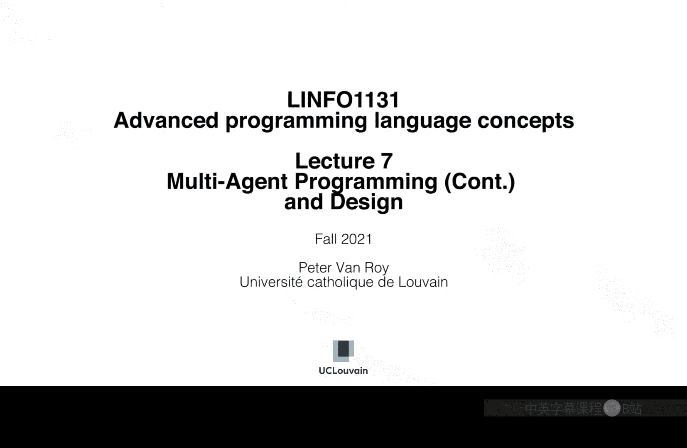
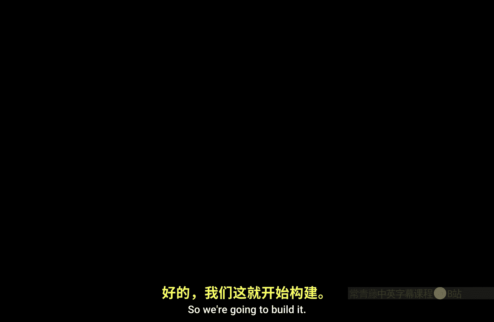

# 022：多智能体编程 🧠




## 概述
在本节课中，我们将学习多智能体编程。我们将比较确定性数据流与消息传递这两种并发编程范式，并通过一个设计过程来展示如何构建一个复杂的多智能体系统——电梯控制系统。

---

## 确定性数据流与消息传递的比较 🔄

上一节我们介绍了约瑟夫环问题。本节中，我们来看看如何用两种不同的并发范式实现它。

### 约瑟夫环问题回顾
约瑟夫环问题描述如下：有 `n` 个对象（士兵）围成一个环，从某个位置开始，每数到第 `k` 个对象就将其移除，直到只剩下一个幸存者。我们的目标是编写一个程序 `Josephus(n, k)`，返回最终幸存者的位置。

### 确定性数据流版本
在确定性数据流范式中，每个“士兵”是一个流对象，即一个读取输入列表并生成输出列表的函数。它们通过流连接成一个环。

以下是构建管道（环）的高阶函数 `Pipe`：

```oz
fun {Pipe L H F}
   if L > H then nil
   else {F L {Pipe L+1 H F}}
   end
end
```

以下是实现约瑟夫环协议的 `Victim` 函数：

```oz
fun {Victim I Xs}
   case Xs of kill(X S)|Xr then
      if S==1 then
         Last=I
         nil
      elseif (X mod K)==0 then
         kill(X+1 S-1)|Xr
      else
         {Victim I X+1 S Xr}
      end
   [] nil then nil
   end
end
```

整个 `Josephus` 函数通过调用 `Pipe` 来创建环，并注入初始消息：

```oz
fun {Josephus N K}
   Zs
   {Pipe 1 N
    fun {$ I Is}
       thread {Victim I Is} end
    end}
   Zs = kill(1 N)|Zs
   Last
end
```

**核心思想**：当“士兵”死亡（`X mod K == 0`）时，函数不进行递归调用，该流对象自动从环中消失，实现了“短路”优化。

### 主动对象（消息传递）版本
在主动对象范式中，每个“士兵”是一个拥有独立线程和消息队列的主动对象。它们通过显式地发送 `send` 消息进行通信。

以下是 `Victim` 类的简化代码框架：

```oz
class Victim
   attr alive successor
   meth init(...) ... end
   meth kill(X S)
      if @alive andthen S\=1 then
         if (X mod @Step)==0 then
            alive := false
            {Send @successor kill(X+1 S-1)}
         else
            {Send @successor kill(X+1 S)}
         end
      else
         {Send @successor kill(X S)} % 转发消息
      end
   end
end
```

**初始版本的问题**：死亡的“士兵”对象（僵尸）仍保留在环中，仅转发消息，导致效率低下。

### 优化版本：短路环
为了优化，我们需要在对象死亡时将其从环中移除。这需要双向链表（前驱和后继指针），并通过消息更新指针。

关键优化代码段如下：

```oz
meth kill(X S)
   if @alive andthen S\=1 then
      if (X mod @Step)==0 then
         alive := false
         {Send @predecessor setSuccessor(@successor)}
         {Send @successor setPredecessor(@predecessor)}
         {Send @successor kill(X+1 S-1)}
      else ... end
   else ... end
end
```

**正确性依赖**：此优化的正确性**关键依赖于**主动对象消息通道的 **FIFO（先进先出）** 属性。由于 `setSuccessor` 和 `setPredecessor` 消息在 `kill` 消息之前发送，并且FIFO保证它们先到达，因此当 `kill` 消息到达相关节点时，环的更新已经完成。

### 两种范式的对比总结
以下是两种实现方式的对比：

| 特性 | 确定性数据流 | 主动对象（消息传递） |
| :--- | :--- | :--- |
| **士兵实体** | 流对象（列表函数） | 主动对象（类实例） |
| **通信方式** | 通过流连接 | 显式 `send` 消息 |
| **死亡处理** | 自动消失（无递归调用） | 需显式更新指针或保留为僵尸 |
| **代码复杂度** | **非常紧凑**，逻辑简洁 | **相对冗长**，需处理消息协议、指针更新 |
| **确定性** | 完全确定性 | 可处理非确定性 |
| **适用场景** | 适用于确定性计算 | 适用于需要与非确定性环境交互的系统（如客户端-服务器） |

确定性数据流在适用场景下能自动生成高效、简洁的代码，而主动对象则提供了更强大、灵活的非确定性编程能力，但需要开发者进行更细致的设计和推理。

---

## 多智能体系统设计方法论 🏗️

上一节我们比较了两种并发范式。本节中，我们来看看如何系统地设计一个复杂的多智能体系统。

多智能体程序由多个并发执行的主动对象（智能体）组成，它们通过消息任意通信。由于其固有的复杂性，必须采用系统化的设计方法，否则极易出现难以调试的并发错误。

### 设计流程
一个稳健的多智能体系统设计通常遵循以下步骤：
1.  **非形式化规约**：用自然语言描述系统应有的行为。
2.  **识别组件**：确定系统中有哪些类型的智能体。
3.  **定义消息协议**：规定不同组件间如何通信。
4.  **绘制状态图**：为每个智能体设计其内部状态机（最核心、最困难的部分）。
5.  **编写代码**：根据状态图实现（相对容易）。
6.  **测试与验证**：通过测试和形式化推理确保系统正确性。



### 智能体与连接类型
智能体通过连接进行通信，主要有两种类型：
*   **单源连接**：只有一个发送者。通常是**确定性**的，如数据流变量或流，用于管道或确认。
*   **多源连接**：多个发送者可以向同一个端口发送消息。这是**非确定性**的，是类似 Erlang 语言的基础，用于客户端-服务器等场景。

---

## 实战：电梯控制系统设计 🛗

现在，我们将应用上述方法论来设计一个酒店电梯控制系统。

### 系统规约与组件
系统包含以下类型的智能体：
*   **用户**：模拟按下楼层按钮的行为（我们只建模其产生的消息）。
*   **楼层**：代表建筑的每一层，接收用户的呼叫并通知电梯。
*   **电梯**：核心控制器，接收目标楼层请求，并决定移动。
*   **控制器**：控制电梯马达，模拟电梯在井道中的移动。

### 消息协议
智能体间通过以下协议通信：
1.  **用户 -> 楼层**：`call(F)`。用户在楼层按下上行/下行按钮。
2.  **用户 -> 电梯**：`call(F)`。用户在电梯内按下目标楼层按钮。
3.  **楼层 -> 电梯**：`call(F)`。楼层请求电梯前来。
4.  **电梯 -> 控制器**：`step(Dest)`。电梯请求控制器移动至目标方向。
5.  **控制器 -> 电梯**：`at(Floor)`。控制器通知电梯当前到达的楼层。
6.  **电梯 -> 楼层**：`arrive(F)`。电梯通知楼层它已到达。
7.  **楼层 -> 电梯**：`ack()`。楼层确认门已关闭，电梯可以离开。

### 智能体状态图设计

#### 1. 控制器状态图
控制器是最简单的，它只有两个状态：`stopped`（停止）和 `running`（运行）。它通过一个计时器来模拟电梯移动一层楼所需的时间。

```
状态: stopped(F, LID)
接收消息: step(Dest)
条件: 如果 F == Dest -> 无操作，保持状态。
条件: 如果 F != Dest -> 发送 startTimer 给计时器，计算新楼层 NewF (F+1 或 F-1)，转移到状态 running(NewF, LID)。

状态: running(F, LID)
接收消息: stopTimer -> 发送 at(F) 给电梯 LID，转移到状态 stopped(F, LID)。
```

#### 2. 楼层状态图
楼层有三种状态：`notCalled`（未呼叫）、`called`（已呼叫）和 `doorsOpen`（门开启）。它也需要一个计时器来模拟门开启的时间。

```
状态: notCalled(F)
接收消息: call -> 发送 call(F) 给某个电梯，转移到状态 called(F)。
接收消息: arrive -> 发送 startTimer，转移到状态 doorsOpen(F)。

状态: called(F)
接收消息: call -> 已呼叫，忽略，保持状态。
接收消息: arrive -> 发送 startTimer，转移到状态 doorsOpen(F)。

状态: doorsOpen(F)
接收消息: call -> 门已开，忽略，保持状态。
接收消息: arrive -> 多个电梯可能同时到达，忽略，保持状态。
接收消息: stopTimer -> 发送 ack() 给所有等待的电梯，转移到状态 notCalled(F)。
```
**注意**：每个状态都必须处理所有可能接收到的消息（`call` 和 `arrive`），即使处理方式是“忽略”。

#### 3. 电梯状态图
电梯是最复杂的组件，因为它需要维护一个**行程计划**，记录所有需要停靠的楼层列表。其状态图包含嵌套循环。

```
状态: idle(Pos, Sched) // Sched 是楼层列表
接收消息: call(N) -> 更新计划 Sched' = smartSchedule(Pos, Sched, N)。如果 Sched' != nil，则发送 step(Sched'.1) 给控制器。转移到状态 moving(Pos, Sched')。

状态: moving(Pos, Sched) // 内层循环：移动至下一目标楼层
接收消息: at(F) -> Pos' = F。
条件: 如果 F != Sched.1 -> 未到目标，发送 step(Sched.1) 给控制器，保持状态 moving(Pos‘, Sched)。
条件: 如果 F == Sched.1 -> 到达目标，发送 arrive(F) 给楼层，转移到状态 waiting(Pos‘, Sched)。

状态: waiting(Pos, Sched) // 等待门关闭
接收消息: ack -> 门已关。
条件: 如果 Sched.2 != nil -> 还有后续楼层，新计划 Sched‘ = Sched.2，发送 step(Sched‘.1) 给控制器，转移到状态 moving(Pos, Sched‘)。
条件: 如果 Sched.2 == nil -> 行程结束，转移到状态 idle(Pos, nil)。
```
**智能调度**：`smartSchedule` 函数负责将新的楼层请求 `N` 插入到当前计划 `Sched` 中的合适位置，以实现高效的“电梯算法”（例如，扫描算法）。

### 从状态图到代码
一旦状态图设计完成，编写代码就变得直接。通常使用嵌套的 `case` 语句来实现：外层 `case` 匹配当前状态，内层 `case` 处理接收到的消息。代码结构严格遵循状态图的转换逻辑。

### 测试与验证
完成编码后，必须进行：
*   **测试**：模拟各种场景，包括极端情况（如连续快速按键、多个电梯同时到达同一楼层）。
*   **验证**：通过形式化推理证明系统的某些关键属性始终成立。例如：
    *   **活性**：如果一个楼层 `F` 在电梯的计划中，电梯最终总会停靠在 `F`。
    *   **安全性**：电梯不会在未到达目标楼层前发送 `arrive` 消息。
    可以使用**模型检测**工具（如 SPIN, TLA+）来自动化部分验证过程。

---

## 总结 🎯

本节课中我们一起学习了：
1.  **多智能体编程**的概念，即多个并发智能体通过消息交互。
2.  **确定性数据流**与**主动对象（消息传递）** 两种并发范式的对比，并通过约瑟夫环问题展示了它们在代码复杂度、效率和适用性上的差异。
3.  **系统化的多智能体设计方法论**，包括规约、组件识别、协议定义、状态图设计、编码、测试和验证。
4.  **电梯控制系统**这一完整案例，实践了从需求分析到状态机设计，再到代码实现和正确性考虑的全过程。


多智能体模型是构建复杂并发系统（如分布式系统、物联网、机器人协作）的强大工具。掌握其系统化的设计方法，是编写可靠、高效并发程序的关键。