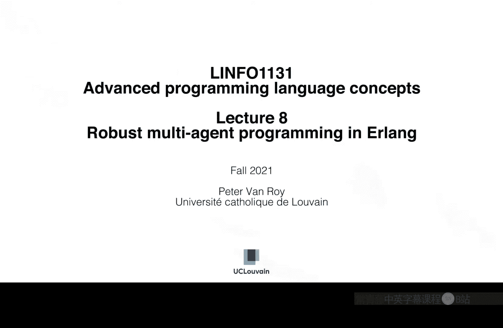

# 023：Erlang 系统概述与核心概念 🚀




在本节课中，我们将学习 Erlang 语言及其系统。Erlang 是一种由爱立信公司自1990年左右开始开发的多代理系统，专为并发和分布式编程设计。尽管它与 Java 同龄，但在处理高并发和消息传递方面表现出色。课程将包括两次实验课和两次讲座，以帮助你掌握 Erlang 的核心概念和编程模式。

## 为什么选择 Erlang？📈

上一节我们介绍了课程概览，本节中我们来看看 Erlang 的一些关键特性，特别是它在并发和消息传递方面的卓越性能。

Erlang 非常擅长处理并发和分布式系统，尤其是在需要大量消息传递的场景中。为了展示其优势，我们来看一些数据。

以下是关于进程创建时间的图表。在 Erlang 中，进程类似于 Java 中的线程，但它们不共享数据，更像操作系统进程。图表显示了系统中并发实体（进程）的数量与每个进程创建所需时间（微秒）的关系。数据虽然来自2002年，但相对关系在今天仍然成立。

*   **Erlang（红色线）**：在创建多达2500个进程时，每个进程的创建时间不到1微秒。即使创建10,000个进程，时间也低于10微秒。
*   **Java（绿色线）** 和 **C#（蓝色线）**：进程创建时间显著更高，并且随着进程数量增加，开销增长更快。

这表明 Erlang 能够轻松创建大量并发代理，而无需担心性能开销。

接下来，我们看看消息发送时间。图表显示了进程间发送一条消息所需的时间。

*   **Erlang（红色线）**：消息发送时间大约为1微秒（2002年数据）。
*   **Java** 和 **C#**：初始时间更高，并且随着进程数量增加，开销急剧上升。

这些数据表明，Erlang 在进程创建和通信方面进行了深度优化。它运行在一个名为 BEAM 的虚拟机上，虽然不像本地代码那样为矩阵或浮点运算优化，但专为进程和通信而设计。

## Erlang 的实际应用案例 🌐

了解了 Erlang 的理论优势后，我们通过几个实际应用来看看它在现实世界中的表现。

第一个案例是一个名为 Yaws（Yet Another Web Server）的 Web 服务器（2002年数据）。图表展示了并发请求数（HTML请求）与系统总吞吐量（千字节/秒）的关系。

*   **Apache（使用本地磁盘和NFS）**：在约4000个并发进程时性能良好，但超过此负载后会崩溃。
*   **Erlang（Yaws）**：可以处理高达80,000个并发请求（是 Apache 的20倍），且系统不会崩溃。虽然随着进程增加，吞吐量会下降并变得波动，但系统仍能继续工作，只是响应变慢。

这体现了 Erlang 的关键特性：它能优雅地处理极高的并发峰值，性能会下降但不会崩溃，保证了系统的可用性。

第二个案例是爱立信的 AXD 301 ATM 交换机。这是一个用于大型工业网络的高性能异步传输模式交换机，用于创建端到端的保证性能电路。该系统非常庞大：
*   包含120万行 Erlang 代码。
*   90万行 C++ 代码。
*   1.3万行 Java 代码。
*   使用了包含24万行 Erlang 代码的 OTP 库。

图表展示了该系统的呼叫吞吐量性能。当尝试建立的呼叫（负载）超过系统容量时，系统需要处理大量被拒绝的呼叫，这会产生开销。Erlang 实现的系统在过载时，吞吐量会逐渐下降，但不会崩溃，每个成功建立的呼叫仍能正常工作。这种“优雅降级”的行为对于电话网络等关键系统至关重要。

爱立信的工程师报告称，使用 Erlang 后，生产力和质量提升了四倍。这充分展示了 Erlang 在构建高并发、高可靠性系统方面的优势。

## 深入剖析：Para 传感器融合框架 🧠

前面我们看到了 Erlang 在服务器和电信设备中的应用，现在让我们深入一个更具体的物联网（IoT）应用实例，以理解 Erlang 所擅长的软件类型。

Para 是一个运行在 IoT 环境下的传感器融合框架。IoT 设备数量正在指数级增长，预计到2025年将达到750亿台，远超数据中心每年5%的增长率。这些设备是并发的、分布式的，并且运行在可能不稳定的环境中（如断电、网络中断）。Erlang 是应对此类挑战的绝佳选择。

Para 系统运行在一种名为 GRiSP 的专用硬件板上，该板专为运行 Erlang 和 IoT 应用而设计。系统架构如下：
*   多个 GRiSP 板通过 WiFi 组成网络。
*   每个板都运行完整的 Para 框架，实现冗余。
*   传感器数据被广播到所有板。
*   每个板都进行传感器融合计算、存储数据并管理通信。

Para 的核心技术是**卡尔曼滤波器**。其工作原理可以直观理解为：
1.  **预测**：根据物理模型（如人的运动）预测系统可能的状态（一个概率范围）。
2.  **测量**：通过传感器获取实际数据（另一个概率范围）。
3.  **融合**：将预测范围与测量范围相交，得到一个更精确的状态估计。

Para 系统充分利用了 Erlang 的特性：
*   **异步与动态**：传感器数据可能在任何时间到达，板或传感器可以随时加入或离开网络。
*   **容错性**：如果一块板崩溃，只要至少还有一块板在运行，传感器融合就能继续工作（性能可能下降）。这是通过 Erlang 的**监督机制**实现的。
*   **实时性**：在 GRiSP 板上，系统能够以约375赫兹的频率进行更新迭代。

这个复杂的“姿态与航向参考系统”由两名学生在四个月的硕士课题中实现，并最终形成了学术出版物。这证明了在 Erlang 和合适硬件的帮助下，可以快速构建出复杂、健壮的 IoT 应用。

## Erlang 语言核心概念刷新 🔄

在进入 Erlang 更高级的特性之前，我们先来回顾和明确一些核心的语言概念。如果你学过之前的课程，会对其中一些概念感到熟悉。

Erlang 的核心是纯函数式的，具有词法作用域和高阶闭包。变量是单次赋值（不可变）。它具有模式匹配（在 `case` 和 `if` 中）以及用于接收消息的 `receive` 语句。Erlang 是一种符号化语言。

**基本数据类型和语法**：
*   **原子（Atoms）**：符号常量，如 `ok`, `error`。
*   **列表（Lists）**：`[1, 2, 3]`。
*   **元组（Tuples）**：`{ok, Result}`。
*   **字符串**：是 ASCII 码列表。
*   **二进制数据（Binaries）**：用于高效处理协议数据，是 Erlang 的强项。

Erlang 的语法源于 Prolog，因此有些独特。后来社区创建了 Elixir 语言，它提供了更接近 Ruby 的语法，但两者都运行在相同的 BEAM 虚拟机上，并且可以互操作。本课程将使用原始的 Erlang。

关于类型系统，Erlang 是**强类型**且**动态类型**的。这意味着类型在运行时由语言强制执行，但变量无需声明类型，可以绑定到任何类型的值。尽管动态类型语言常被认为不如静态类型语言健壮，但 Erlang 通过其独特的机制（如链接和监督），构建出了极其健壮和容错的系统，其实际表现甚至超过了许多静态类型语言。

一个 Erlang 程序由模块组成。模块类似于 Java 中的包。以下是一个简单的模块示例：

```erlang
-module(geometry).
-export([area/1]).

area({square, Side}) -> Side * Side;
area({circle, Radius}) -> 3.14159 * Radius * Radius.

sum_areas(Shapes) ->
    lists:sum(lists:map(fun(Shape) -> area(Shape) end, Shapes)).
```


## 进程与消息传递：Erlang 的并发模型 ⚙️

Erlang 在函数式核心之上，构建了基于进程和消息传递的并发模型，这是其强大能力的基石。

Erlang 进程非常轻量级（类似线程），可以创建数十万甚至数百万个。关键特性是**进程间不共享数据**。当一个进程向另一个进程发送消息时，数据总是被复制，而非共享指针。这意味着一个进程崩溃不会直接影响其他进程的数据。

**创建进程**：使用 `spawn` 函数。它接受一个函数（定义进程行为）并返回一个进程标识符（PID）。

```erlang
Pid = spawn(fun() -> ... end).
```

**发送消息**：使用 `!` 操作符。消息发送是异步的。

```erlang
Pid ! {self(), some_message}.
```

**接收消息**：使用 `receive` 语句。每个进程都有一个邮箱存放收到的消息。`receive` 会查看邮箱中的消息，并提取**第一个**与给定模式匹配的消息。不匹配的消息会留在邮箱中。这不同于严格的流处理，提供了更大的灵活性。

```erlang
receive
    {From, Message} ->
        io:format("Received ~p from ~p~n", [Message, From]);
    Other ->
        io:format("Unexpected: ~p~n", [Other])
after 5000 ->
        io:format("Timeout after 5 seconds~n")
end.
```

`receive` 还支持超时机制（`after` 子句），增强了在真实世界系统中的实用性。

`receive` 的语义需要特别注意：它从邮箱中按顺序尝试匹配消息，但可以跳过不匹配的消息，取出后面匹配的消息。这使得一个进程可以轻松处理多种不同类型的消息。

## 超越基础：Erlang 的健壮性机制 🛡️

现在我们将进入 Erlang 独有的、用于构建真正健壮的多代理系统的核心概念。这些机制是 Erlang 哲学的具体体现。

**进程注册**：进程 PID 在进程崩溃重启后会改变。`register/2` 函数允许将一个进程与一个原子名称（如 `web_server`）关联。这样，即使底层进程重启，对外接口（名称）保持不变，提供了更稳定的抽象。

**进程链接**：这是容错的基础。`link/1` 在两个进程间建立双向连接。当其中一个进程**终止**时（无论是正常结束还是运行时错误），它会向所有链接的进程发送一个退出信号。

默认情况下，收到退出信号的进程也会终止（除非设置了陷阱退出标志）。这体现了 Erlang “让它崩溃”的哲学：如果协作组件中的一个失败，最好让整个相关组都快速失败，然后由外部实体来修复。

**监督者**：通过设置 `trap_exit` 标志，一个进程可以捕获链接进程的退出信号而不终止自身。这样的进程就成为**监督者**。它监视着工作者进程（P1, P2, P3），当它们崩溃时，监督者会收到通知并可以采取行动（如重启它们）。监督树就是这样构建的。

**监控**：这是链接的不对称版本。例如，在客户端-服务器模型中，如果服务器崩溃，所有客户端都无法工作，因此客户端需要链接到服务器。但如果一个客户端崩溃，服务器不应终止，因为它还有其他客户端。`monitor` 就提供了这种单向的监视关系。

**分布式编程**：Erlang 使分布式编程变得透明。进程可以位于不同计算机（节点）上。`spawn` 可以指定在远程节点创建进程，而消息传递、链接和监控在本地和远程进程间的工作方式完全相同，代码无需更改。这得益于“无共享”模型，消息传递总是涉及数据拷贝，自然适用于网络。

**代码热更新**：对于永不停机的关键系统（如丹麦的国家医疗数据库），软件更新不能导致服务中断。Erlang 支持代码热更新。其机制是：同一模块最多可以同时存在两个版本。新创建的进程使用新版本，而正在运行的进程继续使用旧版本，直到它们终止。程序员可以通过特定的递归调用方式（`loop()` 使用旧版本，`?MODULE:loop()` 使用新版本）来控制更新过程。这支持了数据库迁移等复杂操作。

## Erlang 哲学与 OTP 行为 🧩

Erlang 的成功不仅源于其机制，更源于其独特的编程哲学，并且这些哲学通过 OTP 框架中的“行为”得到了完美封装。

**Erlang 哲学**：
1.  **错误不可避免**：所有软件都有缺陷，硬件也会出错。
2.  **故障隔离**：需要强隔离的故障单元。Erlang 进程不共享数据实现了这一点。
3.  **快速失败**：一旦出错，立即崩溃，不要试图在错误状态下继续运行。
4.  **故障检测**：通过链接机制来传播故障信息。
5.  **无共享状态**：这是隔离的必然结果。

核心口号是 **“让它崩溃”**。不要进行防御性编程（到处添加检查），这会使代码复杂且无法覆盖所有错误。相反，当问题出现时，直接让进程崩溃。然后，由另一个专门负责监督和恢复的进程来修复问题。这就像生病了去找医生，而不是自己给自己动手术。

**OTP 行为**：OTP 是 Erlang 的标准库，它封装了常见的并发和容错模式，称为“行为”。专家编写了这些行为，隐藏了所有复杂性。普通程序员只需关注业务逻辑。

OTP 提供了五种标准行为：
1.  **通用服务器**：用于构建客户端-服务器模式，处理注册、启动、停止、超时、状态管理、同步/异步调用等。
2.  **通用事件处理器**：用于处理事件流，如日志记录。
3.  **通用有限状态机**：用于将应用建模为状态机。
4.  **通用应用**：用于将多个组件打包成一个可启动、停止、升级的单元。
5.  **监督者**：用于构建监督树，实现容错。

使用这些行为，构建健壮的并发应用变得非常简单。

## 持久化、测试与总结 🏁

为了构建完整的健壮系统，仅有监督树还不够，还需要持久化存储和测试框架。

**持久化存储**：
*   **ETS**：内存中的键值存储，用于在同一虚拟机内进程崩溃后快速恢复状态。
*   **DETS**：基于磁盘的 ETS，速度较慢，但能在虚拟机重启后恢复数据。
*   **Mnesia**：完整的分布式事务数据库，构建在 ETS/DETS 之上，功能强大但更复杂。通常 ETS 或 DETS 已足够。

**测试**：Erlang 同样重视测试。
*   **单元测试**：基础的代码测试。
*   **通用测试**：支持并行测试、竞态条件测试、依赖项测试和故障注入（模拟崩溃）。
*   **Dialyzer**：一个强大的静态分析工具，即使对于动态类型的 Erlang 代码，也能进行类型推断和缺陷检测，非常有用。


**总结**：本节课我们一起深入探讨了 Erlang 语言和系统。我们了解了 Erlang 在处理高并发和消息传递方面的卓越性能，并通过 Web 服务器、ATM 交换机和物联网传感器融合框架等案例看到了其实际应用。我们回顾并深化了 Erlang 的核心语言概念，特别是其基于进程和消息传递的并发模型。最重要的是，我们学习了 Erlang 构建健壮系统的核心机制：进程链接、监督、代码热更新，以及其“让它崩溃”的哲学。这些机制通过 OTP 框架中的“行为”得到了完美封装，使得开发高并发、高可用的分布式系统变得更加简单。最后，我们还简要介绍了持久化存储和测试工具，它们是构建生产级系统不可或缺的部分。下节课我们将深入查看通用服务器和监督者的具体代码实现。