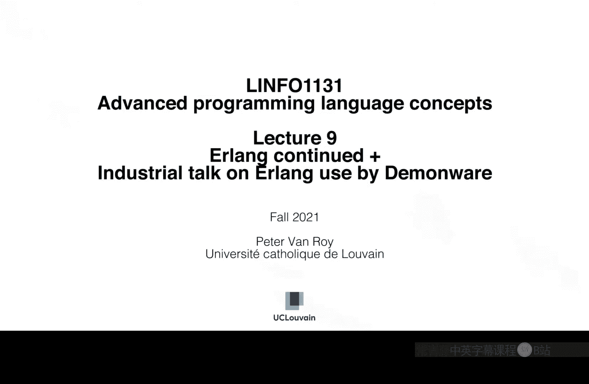

# 024：Erlang OTP 与工业级应用




在本节课中，我们将学习 Erlang 语言及其 OTP 平台的核心概念，特别是通用服务器和监控树。我们还将通过一个游戏公司的实际案例，了解这些概念如何应用于构建高并发、高可用的工业级系统。

---

## 通用服务器

上一节我们介绍了 Erlang 的“任其崩溃”哲学。本节中，我们来看看如何通过 OTP 中的“行为”来构建健壮的并发应用，首先从通用服务器开始。

通用服务器是一种设计模式，它封装了服务器进程的通用逻辑，如消息循环、状态管理和错误处理。程序员只需编写特定于应用的回调函数。

### 服务器基本结构

一个简单的 Erlang 服务器通常包含以下部分：
*   **初始化**：设置服务器的初始状态。
*   **消息循环**：一个递归函数，持续接收并处理客户端消息。
*   **消息处理**：根据接收到的消息类型执行特定操作，并更新状态。
*   **终止**：在服务器停止时进行清理工作。

以下是一个简化服务器的核心循环代码：
```erlang
loop(State) ->
    receive
        {request, From, Data} ->
            NewState = handle(Data, State),
            From ! {reply, NewState},
            loop(NewState);
        stop ->
            terminate(State)
    end.
```

### 通用化与特定化

我们可以将服务器代码分为两部分：
*   **通用部分**：所有服务器共有的逻辑（如消息循环、进程管理）。这部分由 OTP 的 `gen_server` 行为模块提供。
*   **特定部分**：与应用相关的逻辑（如初始化状态、处理请求的具体方式）。这部分由程序员编写的回调模块实现。

这种分离带来了巨大优势：代码复用、更少的错误、以及自动获得追踪、统计、日志和容错（通过监控树）等功能。

---

## 示例：频率分配服务器

为了具体说明，我们构建一个简单的频率分配服务器。该服务器管理一组频道，客户端（如手机）可以请求分配和释放频道。

### 服务器接口

服务器提供以下外部 API 函数：
*   `start(FreqList)`：启动服务器，`FreqList` 是初始可用频率列表。
*   `stop()`：停止服务器。
*   `allocate()`：请求分配一个频率。返回 `{ok, Freq}` 或 `{error, no_frequency}`。
*   `deallocate(Freq)`：释放一个频率。

### 代码结构

使用 `gen_server` 时，我们需要编写一个回调模块（例如 `frequency.erl`）。该模块包含两部分接口：

1.  **外部接口**：供客户端调用的函数。这些函数内部会调用 `gen_server` 模块的 `call` 或 `cast` 等函数。
2.  **回调接口**：由 `gen_server` 调用的函数，如 `init/1`, `handle_call/3`, `handle_cast/2`, `terminate/2`。

内部的状态管理（如从空闲列表移动频率到已分配列表）则在回调函数中实现。

### 架构图示

整个系统的架构涉及三个接口：
*   **客户端接口**：调用 `frequency:allocate()` 等。
*   **服务器接口**：`gen_server:start`, `gen_server:call`, `gen_server:stop`。
*   **回调接口**：`frequency:init`, `frequency:handle_call`, `frequency:terminate`。

`gen_server` 通用模块作为中间层，协调客户端请求和特定的回调函数。

---

## 通用服务器的优势

现在我们已经了解了通用服务器的基本工作原理，本节中我们来看看它如何简化编程并解决一些常见并发问题。

### 1. 解决竞态条件

在普通的消息传递中，如果多个进程都可能向客户端发送格式相似的消息，客户端可能无法区分回复的来源。

`gen_server` 内部通过使用唯一引用 `Ref` 来解决这个问题。它在请求中嵌入一个唯一的 `Ref`，并只接收包含相同 `Ref` 的回复，从而确保了请求-回复的精确匹配。程序员无需关心此细节。

### 2. 支持同步与异步调用

`gen_server` 原生支持两种调用方式：
*   **同步调用 (`gen_server:call`)**：客户端发送请求并等待回复。例如 `allocate` 操作。
*   **异步调用 (`gen_server:cast`)**：客户端发送请求后立即继续，不等待回复。例如 `deallocate` 操作。

这种区分使得 API 设计更清晰，资源使用更高效。

---

## 监控树

通用服务器处理了单个进程的健壮性，但复杂的系统由许多进程组成。本节中，我们将学习 OTP 的另一个核心行为——监控树，它负责管理整个进程组的生命周期和容错。

### 监控原则

大多数系统错误是瞬时的（如临时网络拥堵、时序问题）。监控树的核心理念是：当子进程崩溃时，简单地重启它通常就能解决问题。

监控树是一个层级结构：
*   **监控进程**：观察一个或多个子进程（工作进程或其他监控进程）。
*   **工作进程**：执行实际应用逻辑的进程（如 `gen_server`）。
*   **链接**：监控进程通过链接来监视子进程的终止。

如果子进程异常终止，监控进程会根据预设策略决定如何重启。如果重启过于频繁，监控进程自身可能终止，将问题上报给更高级别的监控进程。

### 重启策略


OTP 提供了几种标准的重启策略：
*   **one_for_one**：如果一个子进程终止，仅重启该进程。适用于子进程相互独立的场景。
*   **one_for_all**：如果一个子进程终止，终止并重启所有子进程。适用于子进程紧密协作的场景。
*   **rest_for_one**：如果一个子进程终止，终止并重启在该进程之后启动的所有子进程。适用于进程间有启动依赖的场景。
*   **simple_one_for_one**：用于动态添加子进程的场景。所有子进程都是同一类型的动态实例。

### 一个简单的监控器实现

以下是一个极度简化的监控器循环的核心逻辑，它展示了监控的基本思想：
```erlang
loop(ChildList) ->
    receive
        {'EXIT', Pid, normal} ->
            % 正常退出，从列表中移除
            NewList = lists:keydelete(Pid, 1, ChildList),
            loop(NewList);
        {'EXIT', Pid, _Reason} ->
            % 异常退出，重启该子进程
            {M, F, A} = find_child_spec(Pid, ChildList),
            NewPid = spawn_link(M, F, A),
            NewList = replace_pid(ChildList, Pid, NewPid),
            loop(NewList);
        stop ->
            terminate_all(ChildList)
    end.
```
实际的 `supervisor` 行为模块要复杂得多，并提供了配置策略、重启频率限制等丰富功能。

### 监控与稳定存储

为了实现一致性重启，进程状态需要保存在崩溃后仍能存留的地方。Erlang 提供了不同级别的稳定存储：
*   **ETS**：内存中的快速键值存储，独立于创建它的进程而存在。通常链接到监控进程进行管理。
*   **DETS**：基于磁盘的简单存储。
*   **Mnesia**：分布式关系型数据库，功能强大但复杂。

监控树与稳定存储结合，确保了系统在崩溃后能恢复到一致状态。

---

## Erlang 方法 vs. 防御式编程

让我们对比一下 Erlang 的“任其崩溃”哲学与传统的防御式编程。

研究表明，采用 Erlang/OTP 的方法可以显著减少代码量。例如，在 Motorola 的一个项目中，Erlang 实现比 C++ 实现少了 85% 的代码，并且只有 1% 的代码用于错误处理（C++ 中这一比例为 27%）。这是因为错误处理逻辑被抽象到了通用的监控树和服务器行为中，应用代码只需关注核心逻辑。

---

## 工业案例：Demonware 公司

理论需要实践检验。本节中，我们通过游戏中间件公司 Demonware 的案例，看看 Erlang 如何在实际的大型系统中发挥作用。

### 公司背景

Demonware 为大型多人在线游戏（如《使命召唤》系列）提供后台服务，包括匹配、排行榜、社交功能和反作弊等。在 2011 年，其系统已能支持 200 万并发用户和每秒 5 万次请求。

### 转向 Erlang

公司最初使用 C++ 和 Python 构建系统，但遇到了并发处理困难、错误处理复杂、维护性差以及无法在线更新配置等问题。

2007 年，一位开发者用 Erlang/OTP 重写了核心系统。短短几周内完成原型，四个月后投入生产。新系统展现了巨大优势：几乎不崩溃、支持动态配置更新、拥有强大的管理工具，且代码量大幅减少。

### Erlang 在 Demonware 的应用架构

*   **核心服务器**：用 Erlang 编写，管理数十万 TCP 连接，调度任务，处理度量统计。
*   **监督树**：使用 `simple_one_for_one` 策略管理海量用户连接进程。
*   **胶水语言**：Erlang 作为“胶水”，协调和组织用 Python、C++ 编写的业务逻辑模块。
*   **状态存储**：使用 **ETS** 实现高速计数器和高频访问数据；使用 **Mnesia** 实现分布式、高可用的玩家状态（Presence）服务器和消息系统。
*   **运维与监控**：利用 Erlang 的远程 Shell、YaWS 网页服务器和 SNMP 支持，构建了实时监控仪表盘和远程管理工具。

### 经验与教训

Demonware 团队分享了他们的宝贵经验：

**关于 Erlang 编程：**
*   **拥抱 OTP**：尽可能使用 `gen_server`、`supervisor` 等行为，避免直接使用 `send`、`receive`、`spawn` 等底层原语。
*   **保持模块简单**：模块应是顺序的、无副作用的。并发性由行为模块管理。
*   **KISS 原则**：保持简单。避免进程间不必要的依赖，多使用异步的 `cast`。

**关于系统设计：**
*   **消除瓶颈**：如果某个进程成为瓶颈，将其改造成进程池，或将工作分发出去。
*   **惰性消费**：让工作进程主动拉取任务，而不是被动接收推送，这样可以更好地控制负载。
*   **善用 ETS 和 Mnesia**：了解两者的优劣。ETS 极快且简单，适合缓存和计数器；Mnesia 功能全面但复杂，适合需要分布式事务和复杂查询的场景。
*   **重视测试**：进行自动化测试、故障注入测试（随机杀死进程）和重型端到端负载测试。

**关于团队协作：**
*   **保持友好**：Erlang 通常是多语言架构中的“胶水”，要与其他语言（如 Python、C++）的开发者良好协作，不要强求他人理解 Erlang。

### Erlang 的优缺点

**他们喜爱的方面：**
*   轻松实现并发。
*   为复杂并发问题提供完整解决方案。
*   开源、透明。
*   系统极其健壮可靠，可长时间运行。

**他们认为的不足：**
*   网络分区处理、最终一致性等高级分布式特性需要自行实现或整合。
*   与其它语言的互操作可以更简单。
*   他们希望有更强大的静态类型检查（尽管 Dialyzer 已很好）和更灵活的监控策略。

---

## 总结

本节课中我们一起学习了 Erlang/OTP 的核心概念。我们深入探讨了 **通用服务器** 如何通过分离通用和特定逻辑来简化并发编程，并提供了容错基础。接着，我们了解了 **监控树** 如何通过层级监督和不同的重启策略来构建“任其崩溃”但能自我恢复的健壮系统。最后，我们通过 **Demonware 公司的真实案例**，看到了这些概念如何被用于支撑拥有数百万并发用户的工业级系统，并总结了其中的实践经验和教训。


Erlang/OTP 提供了一套完整的理念和工具集，用于构建高并发、分布式且高可用的系统。虽然它有其特定的适用领域和学习曲线，但在需要极高可靠性和并发能力的场景下，它已被证明是一种极其强大的解决方案。