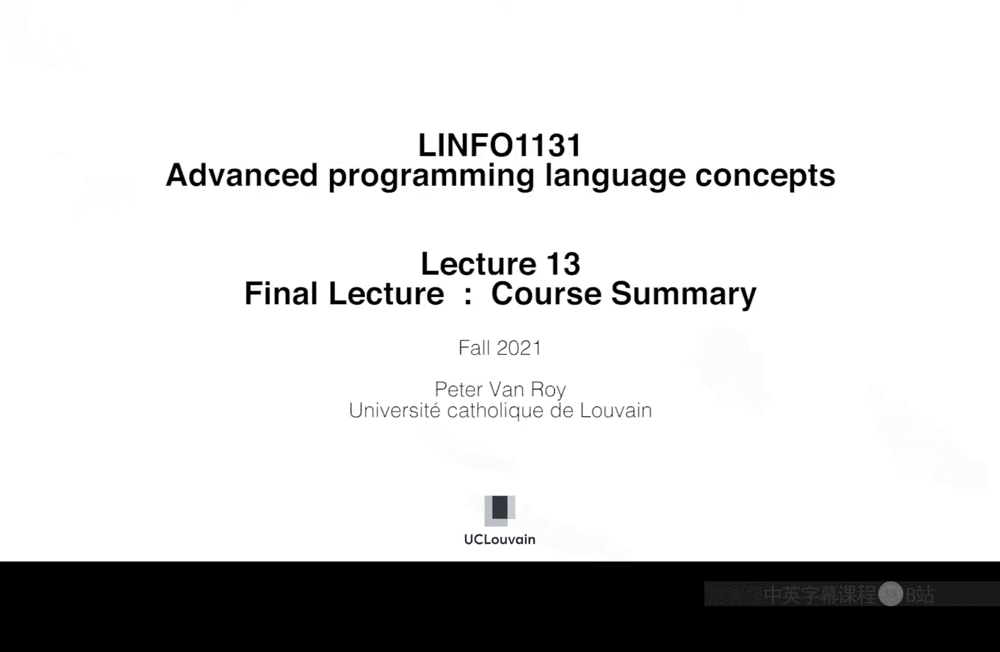

# 028：课程回顾与总结




在本节课中，我们将回顾整个学期所学的核心概念，涵盖从声明式编程范式到非声明式扩展，以及数据抽象和并发模型。我们将通过代码示例和关键解释，帮助您巩固理解，并为考试做好准备。

## 声明式编程范式

我们首先回顾了本学期探讨的各种编程范式。声明式范式是核心，它们从经典的顺序函数式编程开始，逐步扩展到更具表达力的形式。

以下是本学期涉及的声明式范式：

*   **顺序函数式编程**：这是大多数语言中常见的范式，例如 Scheme 和 Erlang。
*   **带数据流变量的顺序函数式编程**：在顺序函数式编程基础上增加了数据流变量。
*   **确定性数据流**：在数据流基础上增加了线程，用于编写并发程序。
*   **惰性确定性数据流**：在确定性数据流基础上增加了按需驱动的惰性求值。

我们同样学习了非声明式范式，它们通过引入可变状态或通信通道来处理现实世界中的不确定性。

以下是本学期涉及的非声明式范式：

*   **带端口的确定性数据流**：通过端口引入非确定性。
*   **多智能体编程**：基于端口和线程的并发模型。
*   **共享状态并发**：基于可变内存单元的并发模型。

## 声明式范式的特殊性质

上一节我们介绍了各种范式，本节中我们来看看声明式范式的一些特殊且重要的性质。在理想情况下，程序的大部分应使用声明式风格编写。

### 数据流变量的重要性

在顺序函数式编程中加入数据流变量，带来了两个关键优势。

首先，它使得所有递归函数都成为**尾递归**。这意味着递归调用在函数的最后一步执行，且不保留额外的栈帧。在支持数据流变量的语言中，编译器可以自动实现这一点。

例如，考虑列表连接函数 `append`。在支持数据流变量的语言中，其核心逻辑可以表示为：
```oz
proc {Append Xs Ys Zs}
   case Xs
   of nil then Zs = Ys
   [] X|Xr then Zr in
      Zs = X|Zr
      {Append Xr Ys Zr}
   end
end
```
这里，结果列表 `Zs` 的头部 `X` 在递归调用 `{Append Xr Ys Zr}` 之前就已构建好，这得益于未绑定的数据流变量 `Zr`。尾递归等价于循环，保证了恒定的栈空间使用，这对于实现高效的并发代理（其输入输出是作为流的列表）至关重要。

其次，数据流变量支持**常数时间**的列表连接操作。通过使用**差异列表**表示法，可以将列表表示为一对变量 `(S, E)`，其中 `S` 是列表的起始部分，`E` 是未绑定的尾部。连接两个差异列表 `(Sx, Ex)` 和 `(Sy, Ey)` 只需将 `Ex` 绑定到 `Sy` 即可，这是一个常数时间操作，尽管它是一次性的（瞬态的）。

### 确定性数据流与惰性求值

确定性数据流通过添加线程，允许编写并发的、声明式的代理程序，例如数字逻辑模拟器。所有计算仍然是确定性的。

惰性确定性数据流在此基础上增加了 `WaitNeeded` 操作，实现了按需驱动。`Wait` 会挂起线程直到变量被绑定，而 `WaitNeeded X` 会挂起线程直到有另一个线程在等待 `X`。这为惰性求值提供了语义基础。

惰性的一个典型应用是解决**生产者-消费者**问题中的资源与速度平衡。纯急切实现在消费者慢时可能导致内存溢出；纯惰性实现则可能因生产者和消费者交替执行而导致速度下降。**有界缓冲区**作为中间节点，结合了急切和惰性的优点：它对生产者表现为消费者（主动拉取数据直到缓冲区满），对消费者表现为生产者（立即提供数据）。当缓冲区不满时，它会向生产者请求数据，从而平衡了内存使用和并发执行速度。

## 高级声明式算法

有时人们批评声明式编程无法实现高效算法，因为存在单次赋值的限制。但事实并非如此，我们可以利用不同的声明式范式特性来实现高效的数据结构。

我们需要考虑算法设计的两个关键维度：


*   **瞬态 vs 持久化**：瞬态数据结构只允许存在一个有效版本；持久化数据结构允许多个版本同时存在并可用。
*   **摊还 vs 最坏情况** 时间复杂度：摊还复杂度考虑一系列操作的平均成本；最坏情况复杂度则保证每个操作的成本上限。

不同的声明式范式支持不同类型的高效实现：

*   **标准顺序函数式编程**：支持**摊还常数时间**的**瞬态**算法（例如使用双列表表示的队列）。
*   **顺序函数式编程 + 数据流变量**：支持**最坏情况常数时间**的**瞬态**算法（例如使用差异列表）。
*   **惰性顺序函数式编程**：支持**摊还常数时间**的**持久化**算法。
*   **惰性顺序函数式编程 + 数据流变量**：在某些情况下，可以支持**最坏情况常数时间**的**持久化**算法。

以队列为例，标准函数式队列使用两个列表 `(F, R)` 表示，`F` 是队列前端，`R` 是反向的后端。入队操作加到 `R`，出队操作从 `F` 移除。当 `F` 为空时，需要执行一次 `O(n)` 的 `Reverse(R)` 操作，并将结果作为新的 `F`。通过摊还分析，一系列操作的平均成本是常数。

然而，这个实现不是持久化的。如果创建多个队列版本，每个版本在出队时都可能触发独立的 `O(n)` 反转操作，导致总成本过高。

惰性求值通过**延迟计算**和**共享结果**来解决持久化问题。在惰性持久化队列中，`Reverse(R)` 操作被封装成一个惰性计算（`suspension`）。这个计算在创建时并不执行，只有当实际需要其结果（出队）时才执行。关键的是，这个惰性计算被所有引用该队列的版本所共享。当第一个版本触发计算并绑定结果后，其他所有版本都能立即看到这个已绑定的结果，无需重复计算。通过“银行家方法”确保在需要执行反转操作时，已经通过之前的入队操作“支付”了足够的成本。

更进一步，通过将惰性的、整体式的 `Reverse` 操作与增量式的列表构造相结合，可以将反转的成本均匀分摊到多个出队操作中，从而实现最坏情况持久化。

## 声明式编程的优势与局限

上一节我们看到了声明式算法的高效性，本节我们来探讨声明式编程的根本优势及其不可避免的局限性。

声明式编程的核心优势在于其**确定性**和基于 **λ演算** 的数学基础。根据 Church-Rosser 定理，声明式程序的计算结果与求值顺序无关。这使得**测试**非常容易，因为程序各部分如同数学函数，可以独立测试，无需考虑内部状态和历史操作。

然而，声明式编程的强项也是其弱点。其根本局限在于无法直接与**非确定性的现实世界**交互。一个经典的例子是**客户端-服务器**应用。多个独立客户端向服务器发送请求，由于网络延迟和用户操作，请求到达的顺序是非确定的。服务器必须立即处理最先到达的请求以满足性能要求。

在纯声明式范式中，我们无法编写这样的服务器。例如，尝试使用 `case` 语句同时等待两个输入流 `S1` 和 `S2`：
```oz
case S1 of M1|S1r then {Handle M1} ...
[] S2 of M2|S2r then {Handle M2} ...
end
```
`case` 语句是确定性的：它会严格按顺序尝试分支。如果 `S1` 暂时为空（但客户端还在），即使 `S2` 有消息到达，程序也会一直等待 `S1`，而不会处理 `S2`。要处理这种非确定性选择，需要语言提供类似 `select` 的原语，但这已超出了声明式范式的范畴。

因此，为了与现实世界交互，必须引入**非声明式**操作。主要有两种扩展方式：
1.  **可变状态**：变量可以多次赋值，新值覆盖旧值。
2.  **通信通道（端口）**：可以发送和接收消息，所有发送的消息都保留在通道中。

两者都引入了非确定性。在客户端-服务器例子中，可以使用一个端口来暴露客户端请求的非确定性顺序。服务器从该端口的流中读取消息，消息到达的顺序由现实世界决定。这样，程序的非声明式部分（端口）被限制在最小的边界内，内部处理逻辑仍然可以是声明式的。

## 数据抽象

数据抽象是组织程序的重要方法，它与声明式/非声明式的划分是正交的。数据抽象通过接口将内部实现与外部使用隔离，是构建大型可维护系统的关键。

语言需要三个概念来支持强大的数据抽象：
1.  **词法作用域（静态作用域）**
2.  **高阶编程**
3.  **封装键**：类似于“锁和钥匙”的概念，例如 Oz 语言中的 `Name` 和 `Chunk`，使得不知道字段名称就无法访问记录内部。

数据抽象主要有两种形式，它们在数学上有本质区别：
*   **对象**：只有一种实体，将状态和行为封装在一起。
*   **抽象数据类型**：有两种实体（类型和操作），操作在类型外部定义。

结合声明式与非声明式，我们可以得到四种数据抽象方式。其中特别有趣的是**函数式对象**——具有对象接口但完全用声明式风格实现的抽象。

例如，一个函数式栈对象：
```oz
fun {NewStack}
   S = nil
   fun {Push X} {StackObject X|S} end
   fun {Pop} S end % 简化示例，实际需返回新栈和顶部元素
   fun {StackObject State}
      fun {Push2 Y} {StackObject Y|State} end
      fun {Pop2} State end
   in
      stack(push:Push2 pop:Pop2)
   end
in
   stack(push:Push pop:Pop)
end
```
`{NewStack}` 返回一个记录，包含 `push` 和 `pop` 两个函数。这些函数通过词法作用域捕获了当前的栈状态 `S`。调用 `push` 会返回一个**新的**栈对象，其内部捕获了新的状态。这完全通过高阶函数和词法作用域实现，没有可变状态，却提供了对象的接口。

## 多智能体编程与总结

最后，我们简要提及其他主题。**多智能体编程**基于端口和线程，Erlang 语言是杰出代表。其核心贡献在于一系列通用的**行为**模式，如通用服务器、事件处理器，尤其是**监督者行为**。监督者行为可以管理其他行为的生命周期和故障恢复，这使得构建高可靠、高并发的系统变得非常直接。


本节课中我们一起回顾了高级编程语言概念的核心内容：从声明式范式的数学基础与高效算法，到其与非声明式扩展的边界；从数据抽象的两种基本形态，到函数式对象的巧妙实现；以及用于构建可靠系统的并发模型。理解这些概念的本质区别和联系，是掌握高级编程语言设计的关键。