# 030：惰性求值


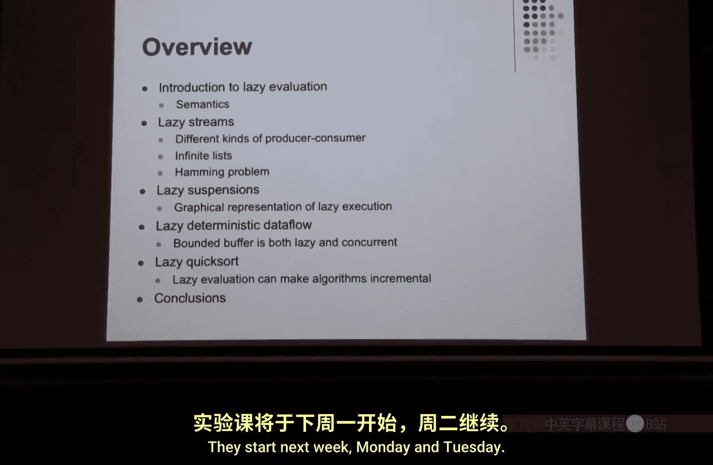


## 概述
在本节课中，我们将要学习一种名为“惰性求值”的函数式编程范式。我们将了解其核心概念、工作原理，并通过具体示例展示其强大之处。

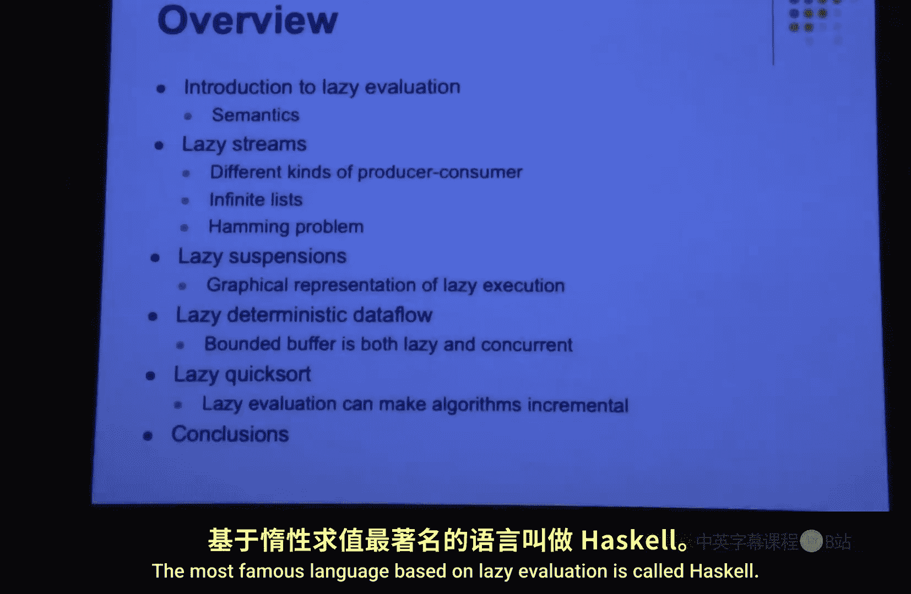


## 课程公告
在开始之前，先宣布一些课程安排。


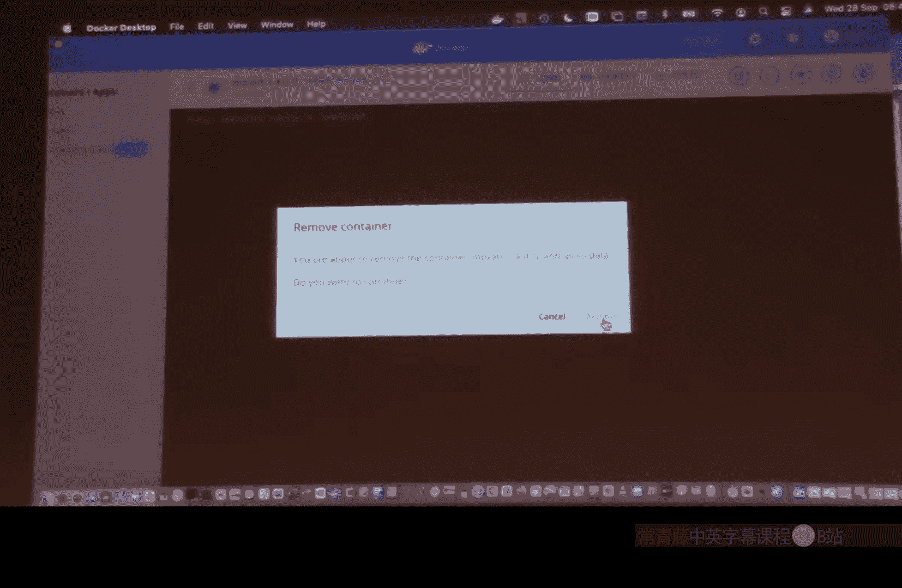

*   下周开始，每周一和周二将有三场实验课。
*   你每周只需参加其中一场实验课。
*   周一实验课时间为8:30-10:30，地点在Auditorium Me Ke 14。
*   周二实验课时间为14:00-16:00，地点在Methods 12。
*   如果你在整个学期中每周都参加实验课，你将在考试中获得1分的额外加分。如果缺勤少数几次，分数会按比例计算（例如，出勤率80%可获得0.8分）。这是为了鼓励大家参与实验课。
*   理论上，本课程最高可获得21分（包含这1分加分）。历史上曾有学生通过努力获得超过20分。
*   实验课将进行签到。助教Das Poque会发送邮件详细说明。
*   我们期望你在实验课上认真完成练习。如果你只是去那里看视频，我们可能会请你离开。

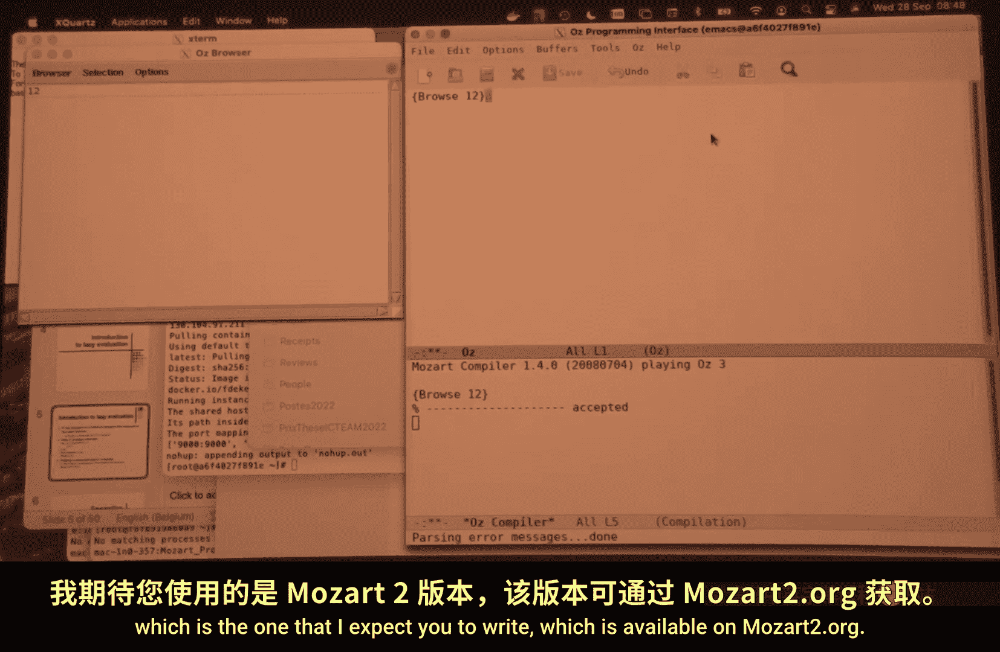


## 惰性求值简介
今天我们将讨论一种名为“惰性求值”的函数式编程范式。这是一种非常不同且强大的思维方式。我们将看到一些运行中的代码。

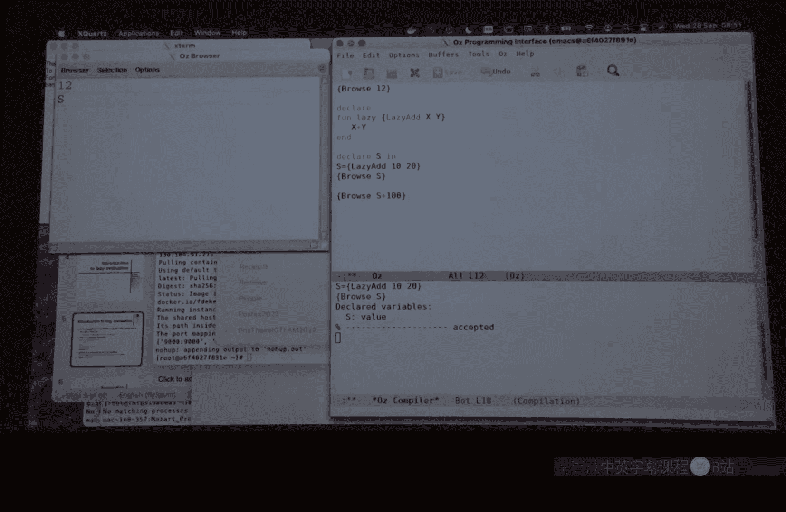


最著名的基于惰性求值的语言是Haskell。这门语言拥有庞大的社区，甚至有用它构建的加密货币。学习惰性求值不仅对Haskell有帮助，也对许多其他类型的编程大有裨益。

惰性求值是对确定性数据流范式的一个非常自然的扩展，实际上非常简单，只增加了一个新操作，但功能非常强大。

### 一个简单的例子
一个惰性程序看起来就像一个普通的函数式程序，但它的执行方式不同。当你调用一个函数时，它不会立即被求值。

例如，在Oz语言中，我们可以定义一个惰性加法函数：
```oz
fun lazy {LazyAdd X Y}
    X + Y
end
```
然后我们调用它：
```oz
S = {LazyAdd 10 20}
```
你期望结果是10加20，没错，它确实是10加20，但不是立即得到。当我调用这个函数时，什么计算都没有发生（实际上，系统内部会设置一个称为“惰性挂起”的东西，但计算本身没有执行）。

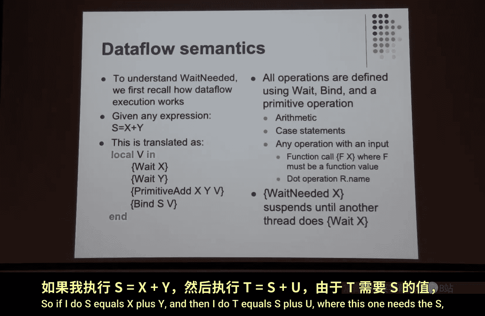


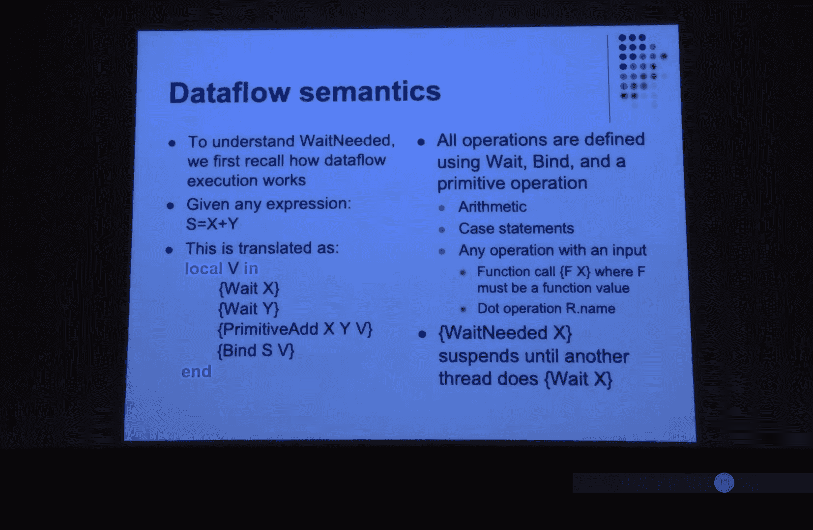


`browse` 是一个特殊操作，它显示变量时不需要其值。所以如果我们执行 `{browse S}`，它会显示 `S` 是一个未绑定的变量，而不是30。


但是，如果我执行 `{browse S+100}`，情况就不同了。加法操作 `+` 需要它的两个参数才能计算。为了计算 `S+100`，加法操作需要 `S` 的值，这将触发 `{LazyAdd 10 20}` 的计算。这就是惰性求值：只有当其他操作需要函数的结果时，该函数才会被执行。


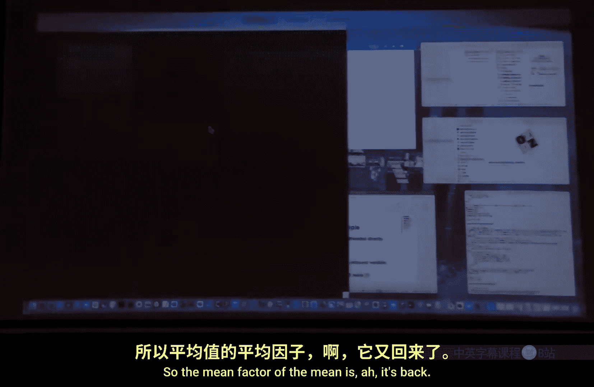

**核心思想**：我们只在别人需要结果时才进行计算。当我调用一个函数时，它不会立即执行，直到有其他人需要它的结果。


## 惰性求值的语义
为了准确理解其含义，我们需要解释其语义。这实际上非常简单。

### 底层原理
在底层，惰性加法函数 `{LazyAdd X Y}` 会被翻译成一个过程，并带有一个额外的结果参数 `R`：
```oz
proc {LazyAdd X Y R}
    thread
        {WaitNeeded R}
        R = X + Y
    end
end
```
它创建了一个线程，在线程内部执行一个新的操作：`{WaitNeeded R}`。

### WaitNeeded 操作
`WaitNeeded` 是我们添加到确定性数据流范式中的一个新操作。它的行为非常有趣：
*   `{WaitNeeded R}` 会挂起（阻塞）当前线程，直到另一个线程**需要** `R`。
*   例如，另一个线程执行 `R + 100`，加法操作 `+` 需要它的参数 `R`，这将导致 `WaitNeeded` 继续执行。

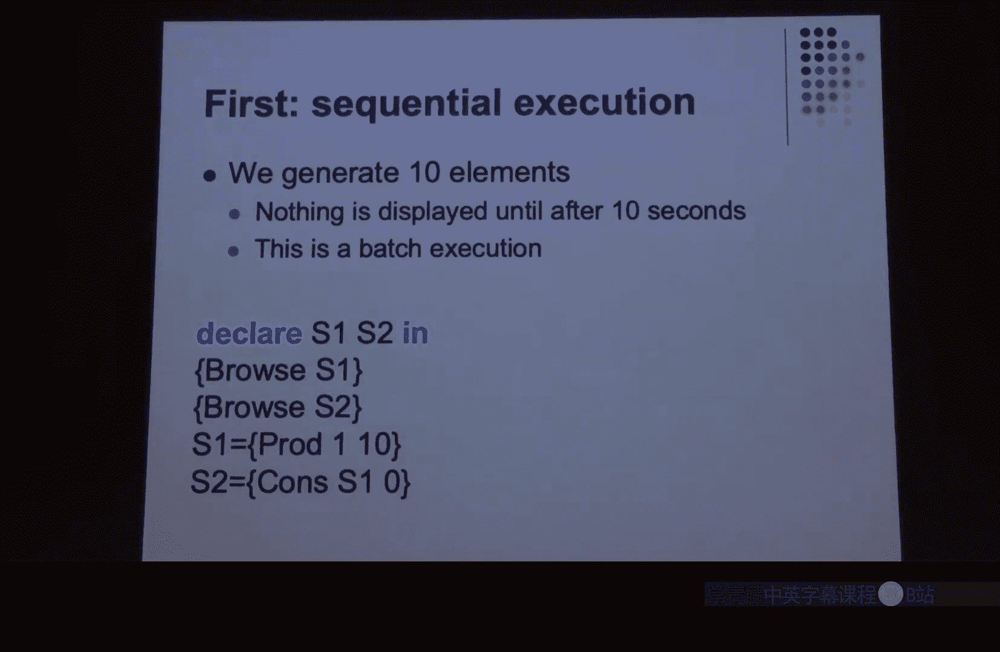


更精确地说，“需要”的定义是：一个线程需要 `R`，如果它执行了 `{Wait R}` 操作，即等待 `R` 被绑定一个值。这是一个数据流操作。所以，如果一个线程执行 `{Wait R}`，就意味着它需要 `R`。而 `{WaitNeeded R}` 则等待直到某个其他线程执行 `{Wait R}`。


### 数据流操作回顾
让我们回顾一下确定性数据流的工作原理。操作 `S = X + Y` 在底层被翻译为等待 `X` 和 `Y`，执行原始加法，然后将结果绑定到 `S`。这涉及到 `wait` 和 `bind` 两个基本操作。

许多操作都需要等待：
*   **算术运算**：需要等待操作数。
*   **Case语句**：`case L of H|T ...` 需要等待 `L` 被绑定为一个列表。
*   **函数调用**：`{F X}` 需要等待 `F` 被绑定为一个函数值。
*   **点操作**：`R.name` 需要等待记录 `R`。

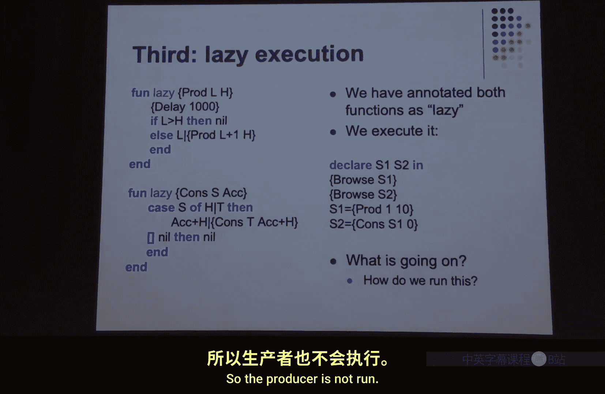


任何需要输入的操作都会执行 `wait`。

### 完整的语义模型
因此，完整的语义模型包含三个操作：
1.  **`wait`**：等待变量被绑定。
2.  **`bind`**：将变量绑定到一个值。
3.  **`waitNeeded`**：新增的操作，挂起当前线程，直到另一个线程对变量执行 `wait`。

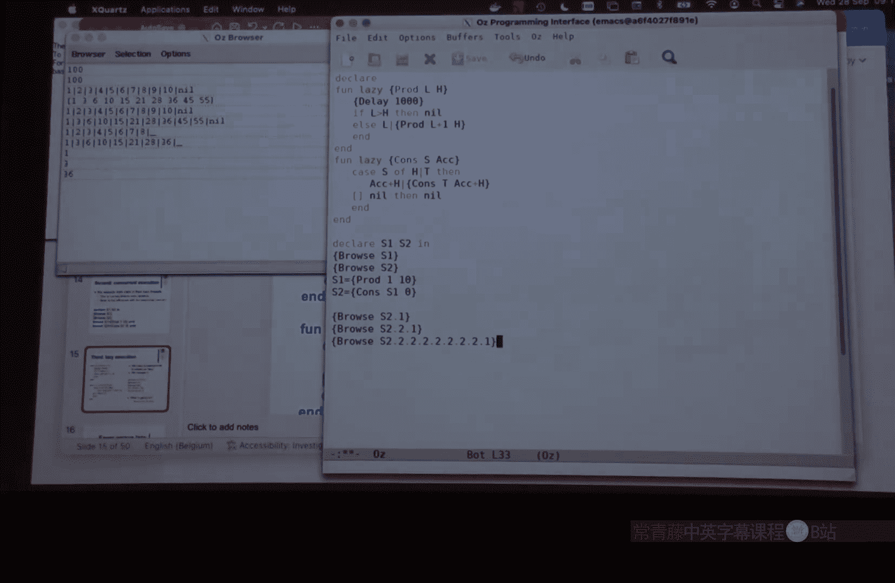

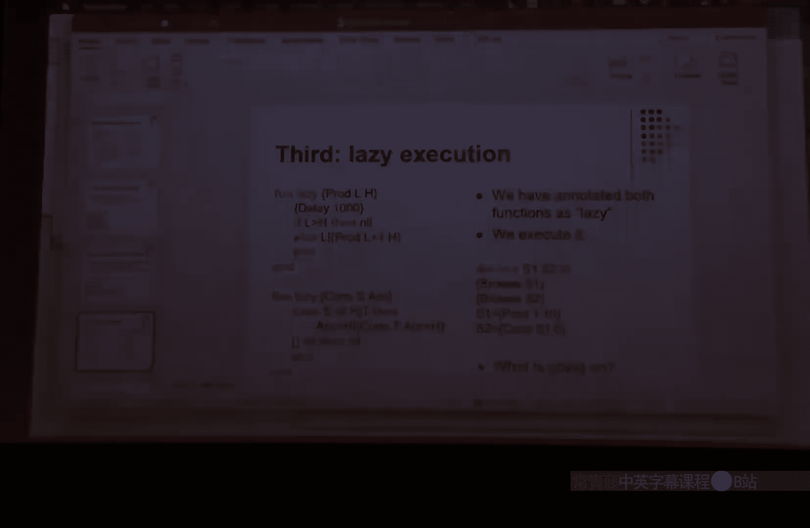

所有我们今天将看到的奇妙代码，其背后的“魔法”都源于这个简单的 `waitNeeded` 操作。

### 直接使用 WaitNeeded
你可以直接使用 `{WaitNeeded}`。例如：
```oz
{WaitNeeded X}
X = 100
{Browse X} % 显示未绑定变量
```
因为 `browse` 不需要 `X` 的值，所以 `X` 不会被绑定。如果我们通过一个需要 `X` 的操作来“需要”它，例如 `X+0`，那么 `{WaitNeeded X}` 就会继续，`X` 被绑定为100。

### 惰性函数的一般转换
在Oz中，用 `fun lazy` 定义的函数会被通用地转换。对于一个函数 `fun lazy {F X1 ... Xn} <expr> end`，它被转换为：
```oz
proc {F X1 ... Xn R}
    thread
        {WaitNeeded R}
        R = <expr>
    end
end
```
每个惰性函数都是这样定义的。

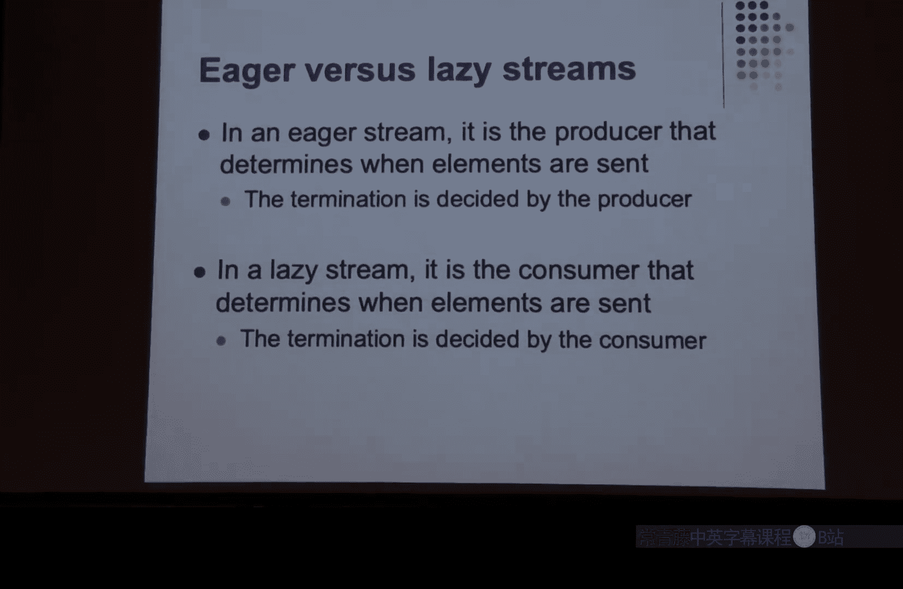


## 生产者-消费者示例
现在让我们看一些程序，了解惰性求值能做什么。我们将通过一个简单的生产者-消费者例子，展示同一段代码的三种不同运行方式。


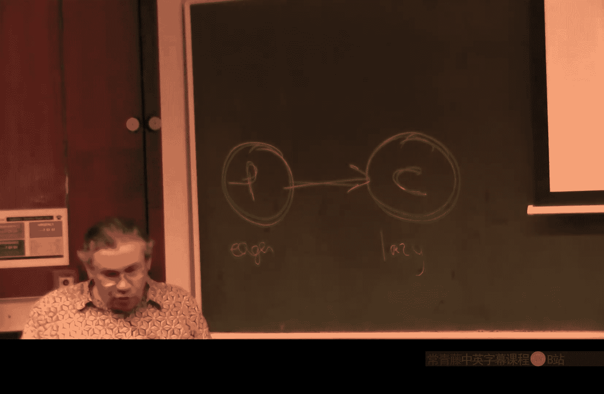

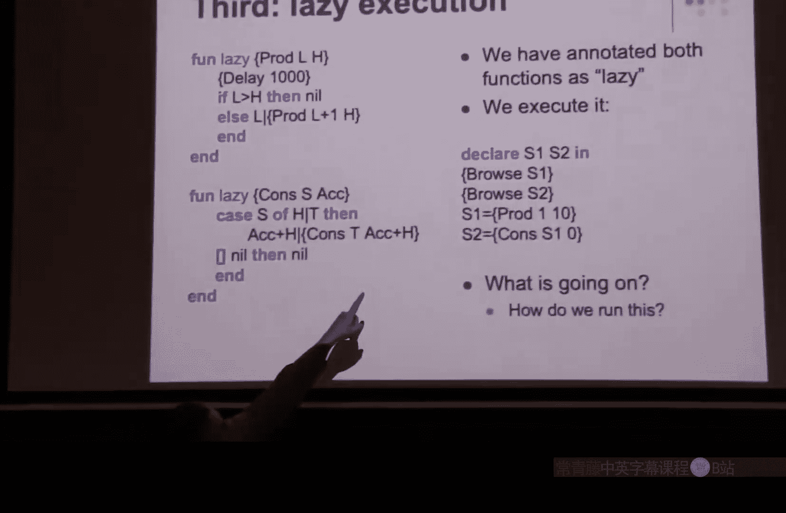

### 程序代码
我们有一个生产者，它生成从 `L` 到 `H` 的整数列表，但每次生成一个元素后延迟1000毫秒，从而创建一个流。消费者读取这个流，并计算累积和。

以下是三种运行方式：


#### 1. 顺序执行
生产者和消费者在同一个线程中顺序执行。生产者先生成完整的列表，然后消费者再处理它。结果是“批处理”式的：我们只在整个过程结束后才看到最终结果。

#### 2. 确定性数据流（并发）执行
生产者和消费者各自在自己的线程中运行，成为并发的函数式代理。这是“增量式”的：当生产者生成元素时，消费者可以同时处理它们，输出结果会逐步出现。

#### 3. 惰性执行
将生产者和消费者函数都定义为 `fun lazy`。在这种情况下，当我们调用它们时，什么都不会发生，因为 `browse` 操作不需要其结果。要开始计算，我们必须“需要”结果。

例如，执行 `{Browse S2.1}`（即需要输出列表的第一个元素）。点操作 `.` 需要其操作数，这将触发计算链：消费者需要 `S1` 的第一个元素，生产者因此被触发生成第一个元素。计算只进行到满足需求为止。如果我们再需要第二个元素 `{Browse S2.2.1}`，计算会再前进一点。


**三种方式的对比**：
*   **顺序**：批处理，全部完成才输出。
*   **数据流**：增量式，生产消费同时进行。
*   **惰性**：按需计算，只计算明确需要的部分。

惰性求值中，甚至递归调用也是惰性的。你可以让任何操作变得惰性，只需将其包装在 `fun lazy` 中。所有函数式编程的技术在惰性求值中依然有效。

### 推与拉
这引出了“推”和“拉”的编程模式：
*   **急切流（推）**：生产者是“老板”，决定何时生成数据并推给消费者。我们之前看到的数据流就是这种方式。
*   **惰性流（拉）**：消费者是“老板”，决定何时需要数据并向生产者拉取。生产者只在被要求时才工作。

大多数传统编程语言（如Java）都采用急切方式。惰性方式同样重要且强大，它提供了一种对称的视角。

## 无限列表计算
由于惰性求值只计算所需部分，因此它可以处理无限列表而不会陷入无限循环。这是一个非常强大的特性。

### 生成无限整数列表
```oz
fun lazy {Ints N}
    N|{Ints N+1}
end
```
`{Ints 1}` 会生成一个从1开始的无限整数列表。在惰性程序中，这不是错误，而是一种完美的编程方式。

执行 `L={Ints 1}` 后，`L` 只是一个未绑定的变量。只有当我们“需要”元素时，例如 `{Browse L.2.2.1}`（第三个元素），计算才会进行到生成该元素为止，然后再次挂起。


### 强制求值：Touch 函数
有时我们需要强制求值列表的前N个元素。我们可以定义一个 `Touch` 函数：
```oz
proc {Touch L N}
    if N==0 then skip
    else {Touch L.2 N-1} end
end
```
这个函数遍历列表的前N个元素。由于 `L.2` 需要列表的头部，因此它会强制惰性列表生成元素。在急切求值中，这个函数没有意义，但在惰性程序中，它非常有用。

例如，`{Touch L 10}` 会强制 `L` 生成前10个元素。

## 汉明问题
现在让我们看一个更复杂的例子，展示惰性求值解决实际问题的能力：**汉明问题**。

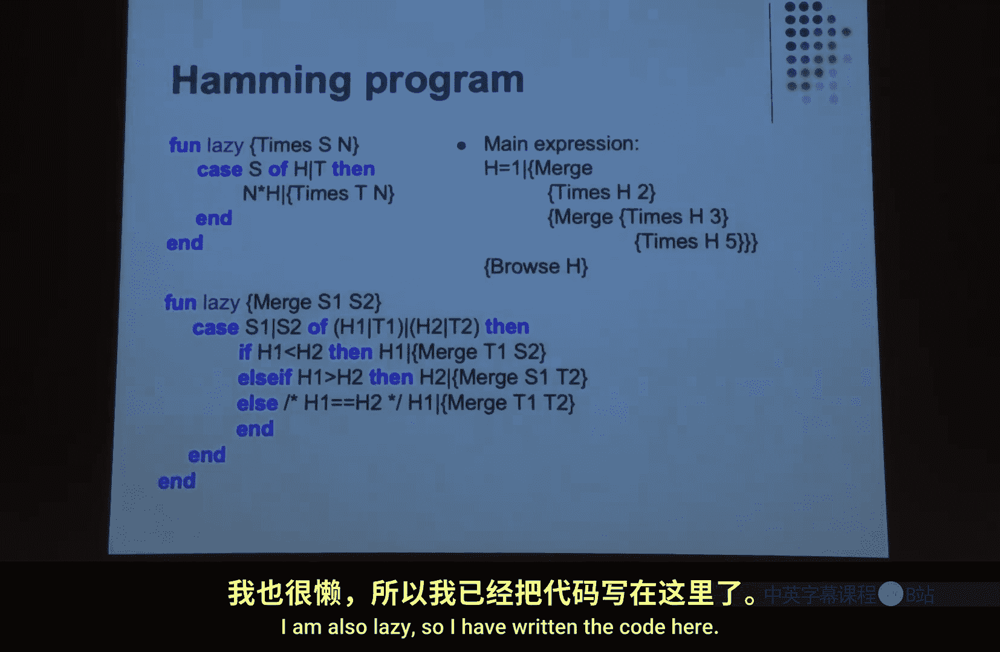

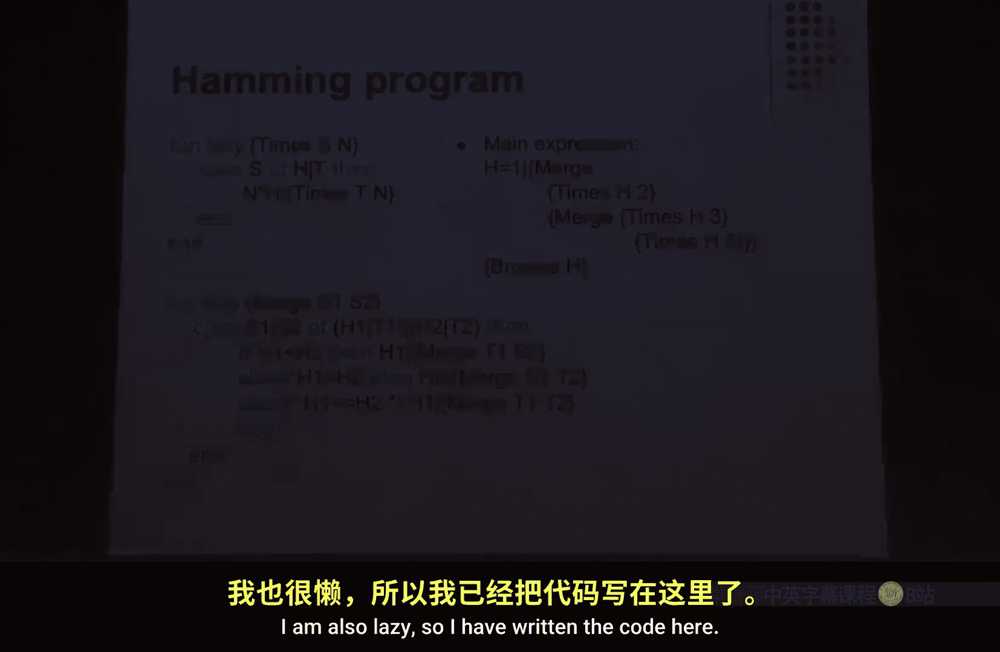

### 问题描述
我们需要按升序生成所有形如 `2^A * 3^B * 5^C` 的数（其中A, B, C是非负整数），不能遗漏任何数。序列开始于：1, 2, 3, 4, 5, 6, 8, 9, 10, 12, ...
问题是：我们不知道需要生成多少个数，程序必须能够动态地、增量地生成这个序列，并且要高效。


这是一个典型的、适合用惰性求值解决的问题。静态数组分配不好，因为可能浪费空间或不够用。

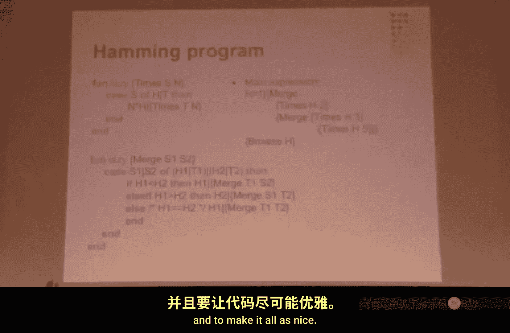

### 解决方案思路
假设我们已有序列 `H`，下一个数 `X` 必须是 `2*H`、`3*H` 或 `5*H` 中某个序列的最小值，且该值尚未被使用。
1.  生成三个惰性序列：`2*H`, `3*H`, `5*H`。
2.  合并这三个有序序列，并在合并时跳过重复项。
3.  序列 `H` 定义为 `1` 后接这个合并序列的结果。

### 程序实现
我们需要两个基本操作：
1.  **`Times`**：将列表每个元素乘以常数 `N`。
2.  **`Merge`**：合并两个有序列表。

```oz
% 将列表L每个元素乘以N
fun lazy {Times L N}
    case L of H|T then N*H|{Times T N} end
end

% 合并两个有序列表L1和L2，去重
fun lazy {Merge L1 L2}
    case L1#L2 of (H1|T1)#(H2|T2) then
        if H1 < H2 then H1|{Merge T1 L2}
        elseif H1 > H2 then H2|{Merge L1 T2}
        else H1|{Merge T1 T2} % 相等时去重
        end
    end
end

% 汉明序列
H = 1|{Merge {Times H 2} {Merge {Times H 3} {Times H 5}}}
{Browse H}
```
这个程序非常简洁高效。它使用的内存和计算量都与生成的元素数量成正比。尝试用Java编写同样简洁高效的汉明问题解决方案会很有挑战性。

### 执行过程分析
当我们定义 `H` 时，会创建多个惰性挂起（`WaitNeeded`线程）。例如，`Merge` 调用、`Times` 调用都会挂起。
当我们需要第一个元素 `H.1` 时，会触发一个链式反应：激活相关的惰性挂起，进行计算，生成结果 `1`，并为后续元素创建新的惰性挂起。
每次请求一个新元素，都会激活并重新创建一系列惰性挂起。所有这些复杂性都隐藏在 `fun lazy` 注解之后。

## 结合惰性与并发
我们目前看到的惰性求值本身并不是真正的并发。我们可以将线程（并发）与惰性函数结合起来，形成一个更强大的范式。

这个组合范式拥有三种强大能力：
1.  **合流性**：函数式编程的确定性。
2.  **并发性**：独立的代理活动。
3.  **惰性**：按需计算。

几乎没有语言能同时提供这三者。Haskell只做惰性，不做确定性数据流并发。Oz的这个组合范式非常强大，未来会看到更多应用。

### 实例：有界缓冲区
一个经典的并发问题是生产者-消费者速度不匹配。解决方案是在它们之间加入一个**有界缓冲区**。缓冲区平滑了波动：生产者过快时，缓冲区存储数据；消费者需要而生产者未就绪时，缓冲区提供已存储的数据。

传统上，有界缓冲区用状态变量实现。但我们可以用声明式方式（结合惰性与并发）来实现它。

#### 设计思路
假设生产者和消费者都是惰性的。我们在它们之间插入有界缓冲区。对于生产者，缓冲区表现得像一个消费者；对于消费者，缓冲区表现得像一个生产者。

缓冲区过程 `BoundedBuffer` 有三个参数：输入流 `S1`，输出流 `S2`，缓冲区大小 `N`。

#### 实现步骤
我们分四步构建这个缓冲区：

1.  **基本流转**：所有从 `S1` 输入的元素最终都必须输出到 `S2`。我们定义一个惰性循环来传递元素。
    ```oz
    fun lazy {Loop S1}
        case S1 of H1|T1 then H1|{Loop T1} end
    end
    ```

2.  **初始填充**：缓冲区启动时是空的，需要立即向生产者请求 `N` 个元素来填满自己。这使用了一个急切操作 `List.drop` 来遍历并“消耗”掉 `S1` 的前 `N` 个元素，从而触发生产者的计算。
    ```oz
    S1 = {List.drop S1 N} % 初始填充，急切操作
    ```

3.  **保持充盈**：每当消费者从 `S2` 取走一个元素（即 `Loop` 迭代一次），缓冲区就少一个元素。为了保持充盈，我们需要立即向生产者再请求一个元素。我们修改 `Loop`，让它每次迭代时都去读取 `S1` 的尾部（即下一个元素）。
    ```oz
    fun lazy {Loop S1}
        case S1 of H1|T1 then H1|{Loop T1} end % T1 会触发对下一个元素的请求
    end
    ```

4.  **并发化**：上述步骤中的初始填充 (`List.drop`) 和循环中的等待可能会阻塞。为了避免阻塞整个系统，我们将这些操作放在独立的线程中。这样，即使生产者暂时没有数据，消费者线程和其他部分也能继续运行。
    ```oz
    thread S1 = {List.drop S1 N} end % 在独立线程中初始填充
    thread S2 = {Loop S1} end % 在独立线程中运行传递循环
    ```

最终的 `BoundedBuffer` 代码就是这些部分的组合，它完全以声明式风格编写，没有使用可变状态。

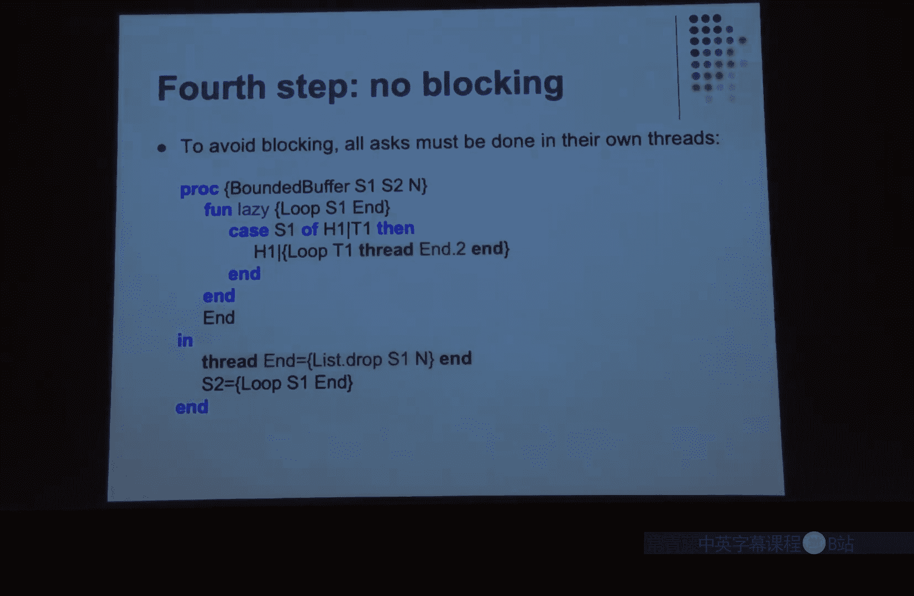

## 总结
本节课我们一起学习了惰性求值。我们从其核心语义 `WaitNeeded` 开始，理解了它如何延迟计算直到结果被需要。我们通过生产者-消费者示例看到了顺序、并发和惰性三种执行方式的区别。我们探索了惰性求值处理无限列表的能力，并用它优雅地解决了经典的汉明问题。最后，我们了解了如何将惰性与并发结合，实现了一个声明式的有界缓冲区。惰性求值是一种强大的范式，它提供了不同的程序构建和思考方式。