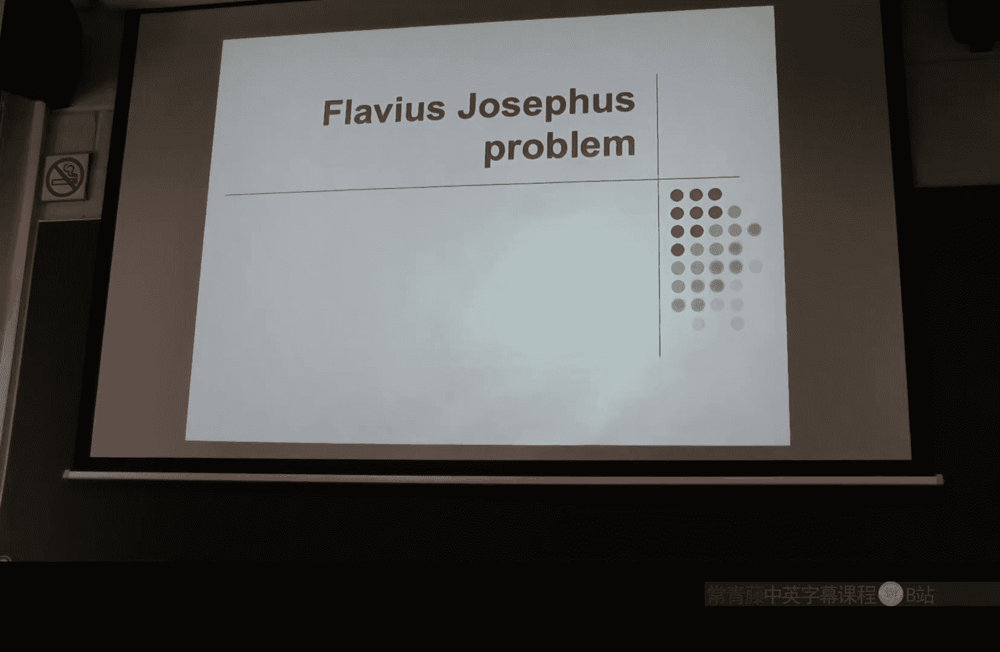
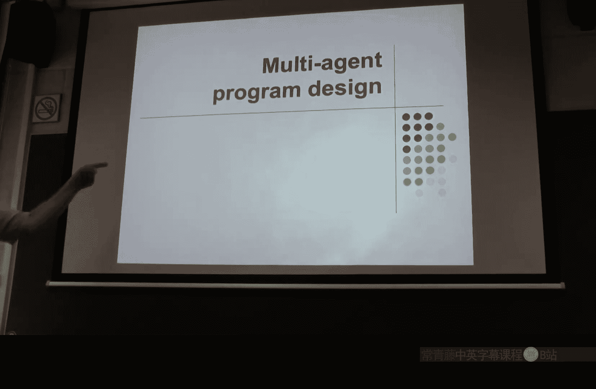

# 034：Flavius Josephus 问题与多智能体系统




在本节课中，我们将学习两种不同的编程范式——主动对象和确定性数据流——如何解决同一个问题：Flavius Josephus 问题。我们将比较这两种实现方式，并探讨它们各自的优缺点。最后，我们将简要介绍如何构建一个大型的多智能体系统，例如电梯控制系统。

---


## 问题回顾

上一节我们介绍了Flavius Josephus问题。现在我们来回顾一下其定义。

我们有 N 个受害者围成一个圈，编号从 1 到 N。每数到第 K 个人，该受害者就被淘汰。我们持续这个过程，直到只剩下最后一人。问题的目标是找出最后幸存者的编号。

我们定义了一个多智能体协议来解决这个问题。每个受害者都是一个智能体，可以接收和发送消息，从而在环中传递淘汰指令。

---

## 主动对象实现

上一节我们介绍了主动对象版本。本节中，我们来看看其代码实现，以加深理解。

首先，我们需要定义一个创建主动对象的抽象。这个抽象结合了对象、端口和线程三个概念。

```oz
fun {NewActive Class Init}
   Obj = {New Class Init}
   P
in
   thread S in
      {NewPort S P}
      for M in S do {Obj M} end
   end
   proc {$ M} {Send P M} end
end
```

这段代码创建了一个主动对象。它在一个线程中运行，持续从端口流 `S` 中读取消息 `M` 并执行 `{Obj M}`。`proc {$ M} {Send P M} end` 是返回的“对象”，用于向该主动对象发送消息。

以下是受害者类的定义：

```oz
class Victim
   attr id alive step last succ
   meth init(I K S Succ)
      id := I
      alive := true
      step := K
      last := _
      succ := Succ
   end
   meth setSucc(S) succ := S end
   meth kill(S)
      if @alive then
         if S==1 then
            last := @id
         elseif (S mod @step)==0 then
            alive := false
            {@succ kill(S-1)}
         else
            {@succ kill(S)}
         end
      else
         {@succ kill(S)}
      end
   end
end
```

*   `id`：受害者编号。
*   `alive`：布尔值，表示是否存活。
*   `step`：淘汰步长 `K`。
*   `last`：用于存储最后幸存者编号。
*   `succ`：指向环中下一个受害者的引用。

`kill` 方法是协议的核心：
*   如果 `S==1`，则当前受害者为最后幸存者，记录其 `id`。
*   如果 `S mod K == 0`，则淘汰当前受害者（`alive := false`），并向后继发送 `kill(S-1)` 消息。
*   否则，向后续发送 `kill(S)` 消息。
*   如果受害者已死亡，则直接传递消息。

以下是构建环并启动程序的函数：

```oz
fun {Josephus N K}
   Last
   A = {Array.new 1 N _}
in
   for I in 1..N do
      A.I := {NewActive Victim init(I K _)}
   end
   for I in 1..N-1 do
      {A.I setSucc(A.(I+1))}
   end
   {A.N setSucc(A.1)}
   {A.1 kill(N)}
   {Wait Last}
   Last
end
```

1.  创建 N 个主动对象（受害者）。
2.  将它们连接成环：设置每个对象的 `succ` 属性。
3.  向第一个受害者发送初始消息 `kill(N)` 启动淘汰过程。
4.  等待 `Last` 变量被绑定（即找到幸存者）并返回。

运行示例：`{Browse {Josephus 40 3}}` 输出 `28`。

这个实现简单直观，但效率不高。随着淘汰进行，环中会有大量已死亡的“僵尸”对象，消息需要在它们之间无效传递很多次。

---

## 确定性数据流实现

上一节我们看到了主动对象的实现。本节中，我们来看看另一种截然不同的范式：确定性数据流。

在数据流版本中，每个受害者被建模为一个**流对象**。它接收一个输入流（消息），并根据协议产生一个输出流。受害者之间通过流连接成环。

以下是核心的 `victim` 函数：

```oz
fun {Victim Xs I}
   case Xs of kill(X)|Xr then
      if X==1 then
         Last = I
         nil
      elseif (X mod K)==0 then
         kill(X+1)|{Victim Xr I}
      else
         kill(X)|{Victim Xr I}
      end
   end
end
```

*   `Xs` 是输入流。
*   `I` 是受害者编号。
*   使用 `case` 语句从流中读取消息。
*   协议逻辑与主动对象版本对应：
    *   如果 `X==1`，绑定 `Last` 为 `I`，并返回 `nil` 表示流终止。
    *   如果 `X mod K == 0`，输出 `kill(X+1)`，并**递归调用** `{Victim Xr I}`。这表示受害者存活并继续处理后续消息。
    *   否则，输出 `kill(X)`，并**递归调用** `{Victim Xr I}`。受害者存活。
    *   **关键点**：如果受害者应被淘汰，我们只需返回 `kill(X+1)|Xr` **而不进行递归调用**。这意味着该函数实例终止，受害者从处理链中“消失”。

以下是构建管道和环的函数：

```oz
fun {Pipe L H F Xs}
   if L =< H then {F Xs L} else Xs end
end

fun {Josephus N K}
   Last
   fun {F Xs I} {Victim Xs I} end
   Zs
in
   Zs = {Pipe 1 N F kill(1)|Zs}
   Last
end
```

1.  `Pipe` 函数递归地从 `L` 到 `H` 创建一串连接的流对象（受害者）。
2.  `F` 是创建单个受害者的函数。
3.  `Zs = {Pipe 1 N F kill(1)|Zs}` 是关键：它创建了一个从 1 到 N 的管道，并将管道的输出流 `Zs` 连接回其输入流 `kill(1)|Zs`，从而形成一个环。`kill(1)` 是启动消息。

运行示例：`{Browse {Josephus 40 3}}` 同样输出 `28`。

这个实现非常简洁，并且**自动实现了“短路”优化**：当受害者被淘汰时，通过不进行递归调用，它自然地从流处理链中被移除，消息无需再经过它。

---

## 两种实现的比较

我们已经分别介绍了主动对象和确定性数据流的实现。现在我们来系统地比较一下这两种范式。

以下是两种实现方式的核心对比：

| 特性 | 主动对象版本 | 确定性数据流版本 |
| :--- | :--- | :--- |
| **每个受害者** | 一个主动对象（类实例+线程） | 一个流对象（函数+线程） |
| **协议实现** | 类中的 `kill` 方法 | `victim` 函数中的 `case` 语句 |
| **初始化** | 需显式设置 `succ`（和 `pred`）指针构建环 | 通过 `Pipe` 函数和流连接构建环 |
| **移除死亡者** | 需显式发送消息更新前驱和后继指针（“短路”协议） | 自动移除（不进行递归调用） |
| **代码复杂度** | 较高，需处理指针和并发消息顺序 | 较低，更声明式，更紧凑 |
| **并发模型** | 非确定性，需考虑消息交错（依赖 FIFO 属性） | 确定性，无竞争条件 |
| **适用场景** | 通用并发编程，工业界常用 | 确定性并发算法，表达更简洁 |

**主动对象“短路”优化详解**：
为了让主动对象版本也能移除死亡节点，需要实现更复杂的“短路”协议：
1.  每个受害者需要同时持有 `succ`（后继）和 `pred`（前驱）指针。
2.  当受害者被淘汰时，它必须向它的前驱发送 `setSucc(MySucc)` 消息，并向它的后继发送 `setPred(MyPred)` 消息，从而在环中绕过自己。
3.  必须确保在淘汰消息绕环一周返回之前，这些指针更新消息已被处理。这依赖于端口**FIFO（先进先出）** 的属性：从同一个线程发送到同一个端口的消息，其接收顺序与发送顺序一致。通过精心设计消息发送顺序，可以保证环的正确修复。

**确定性数据流的优势**：
其代码量约为主动对象版本的一半，且更易理解。移除死亡节点在语义上非常自然（停止递归）。对于像 Josephus 问题这样的确定性协议，它是更优的选择。

---

## 迈向多智能体系统

通过比较，我们看到了不同并发范式的特点。本节作为过渡，将引入一个更复杂的现实世界例子：电梯控制系统。

许多现实世界的程序本质上是**多智能体系统**：由大量相互发送消息的智能体组成，每个智能体拥有内部状态。电梯系统就是一个经典例子：
*   **组件**：多个电梯轿厢、多个楼层、用户、中央控制器。
*   **并发**：用户随机在楼层外按按钮、在轿厢内按目标楼层按钮。
*   **消息**：呼叫电梯、请求前往楼层、到达通知、移动指令等。
*   **目标**：设计一个正确、高效、无死锁的系统。

如何设计这样的系统？
1.  **建模**：将每个电梯、楼层、控制器建模为智能体（如主动对象）。
2.  **定义协议**：精确定义智能体之间所有可能的交互消息。
3.  **绘制状态图**：为每个智能体类型绘制状态转换图。状态图清晰描述了智能体在不同状态下接收到不同消息时应如何响应并转换到新状态。
4.  **实现**：根据状态图编写每个智能体的代码。

我们将在后续课程中详细构建这个电梯控制系统，展示如何使用状态图和主动对象范式来设计和实现一个大型、并发、非确定性的多智能体程序。

---

## 总结

本节课中我们一起学习了：
1.  **回顾了 Flavius Josephus 问题**及其多智能体协议。
2.  **深入分析了主动对象实现**，包括其基本版本和需要处理指针更新的“短路”优化版本。
3.  **探讨了确定性数据流实现**，其利用流和递归函数，以更声明式、更简洁的方式表达了相同的协议，并自动实现了优化。
4.  **系统比较了两种范式**，指出了它们在代码复杂度、并发模型和适用场景上的区别。
5.  **引入了多智能体系统的概念**，并以电梯控制系统为例，概述了使用状态图设计复杂并发系统的流程。



通过这个案例，我们看到了解决同一个问题可以有多种编程范式，选择合适的范式能极大影响代码的简洁性、清晰度和正确性。