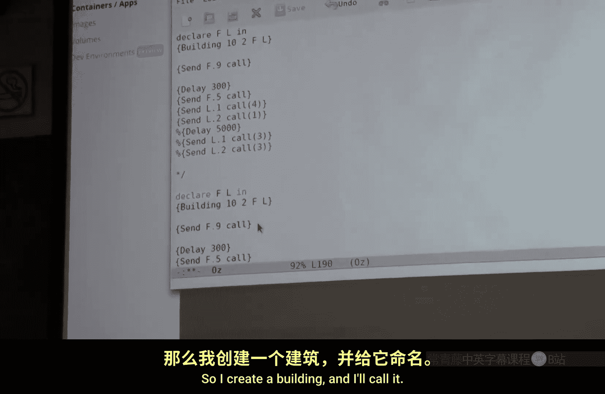

# 035：多智能体系统 🧠

## 概述

在本节课中，我们将学习如何设计和实现正确、大型的多智能体系统。多智能体系统在程序与现实世界交互时至关重要，因为现实世界本质上是并发和分布式的，很少存在纯粹的顺序程序。我们将从基本概念入手，然后将其应用于电梯控制系统，并贯穿整个设计方法学。这实际上并不简单，但我们将一步步完成。本节课也是为下周介绍一个工业级的多智能体系统——Erlang——做铺垫，Erlang 在故障处理方面尤为强大。

## 基本概念与背景

上一节我们介绍了活动对象或确定性数据流。本节中，我们来看看如何构建真正的、大型且正确的多智能体系统。

多智能体系统涉及对并发对象（我们称之为智能体或并发组件）进行编程。这些智能体之间会到处发送消息。如果处理不当，系统会变得非常混乱，因此我们必须非常小心。这就是为什么我们要展示一种良好的实现方法。

我们从确定性数据流开始，它非常简单，因为它是确定性的、函数式的。多智能体编程类似于函数式编程，确定性数据流就像是一种非常简单的、使用流对象的多智能体系统。但这还不够，因为当程序与现实世界交互时，我们经常需要非确定性行为。现实世界的事件（如电梯系统中人们随时按下按钮）可能在任何时间发生，这使得系统比确定性数据流复杂得多。

## 多智能体系统的挑战

多智能体系统之所以困难，是因为存在**交错执行**。所有智能体同时、并发地独立执行。根据交错语义，它们在任何时刻都可能执行步骤，而系统必须对所有可能的交错情况都保持正确。这非常困难，因为可能性是指数级的。许多系统因此存在大量缺陷，因为人们没有充分认识到其复杂性。

如今，我们有了构建这类系统的技术，甚至有了验证工具。例如，巴黎某些完全自动化的地铁线路就使用了类似的方法，并通过软件工具进行了形式化验证，以确保在所有交错情况下都是正确的。验证与测试不同：测试是在各种条件下运行程序，但这还不够，因为有些罕见情况可能每百万次执行才出现一次；验证则能保证正确性。

## 形式化概念与基本操作

首先，我们介绍一些多智能体系统的形式化概念、基本操作链接、示例和方法论，然后应用到电梯控制系统的例子中。

一个**并发组件**本质上定义了智能体的规格，类似于一个类。当你实例化一个并发组件时，就创建了一个智能体实例。我们的示例将使用端口对象（在 Oz 中），这与活动对象非常接近。

以下是四个基本操作：
*   **实例化**：创建组件的实例。
*   **组合**：用其他组件构建新的组件。
*   **连接**：定义组件之间的消息通道（谁可以向谁发送消息）。
*   **限制**：在新组件内部隐藏某些链接，类似于词法作用域。

当两个智能体连接时，它们之间就存在一个链接。链接的类型非常重要，因为它决定了是确定性的还是非确定性的，以及是使用流对象还是端口对象。

## 链接类型

链接类型主要有两个区分维度：

1.  **单源 vs 多源**：
    *   单源链接：发送方始终是同一个智能体。确定性数据流只使用单源链接，因此是完全函数式和声明式的。
    *   多源链接：多个发送方可以向同一个目的地发送消息。这引入了非确定性，因为消息到达的顺序取决于时间，可能导致相同程序多次运行结果不同。

2.  **单次 vs 多次**：
    *   单次通道：只能发送一条消息（类似于单次赋值变量）。这对于同步操作非常有用，可以保证只收到一条消息。
    *   多次通道：可以发送多条消息（即流）。

工业级语言（如 Erlang）通常只使用多源、多次的链接。但我们应该尽可能使用限制性最强的链接类型，以减少错误。

## 设计方法学

设计多智能体程序比设计顺序程序困难得多，因为所有交互都可能产生不同的结果和隐藏的错误。历史上曾有过因并发缺陷导致严重后果的案例。因此，遵循一个严格的方法学至关重要。

以下是设计方法学的步骤：

1.  **非形式化规格说明**：首先在头脑中明确系统要做什么。
2.  **定义组件**：确定系统中有哪些组件以及它们之间如何通信。
3.  **定义消息协议**：明确组件间交换的消息类型和格式。
4.  **定义状态图**：为每个组件（智能体）定义其内部状态和状态转换图。这是最困难的部分。
5.  **编写代码**：在完成状态图设计后，最后才编写代码。
6.  **测试与验证**：进行大量测试，并使用形式化方法（如模型检测）验证系统属性。

智能体是具有内部状态的状态机。我们使用**有限状态自动机**来建模。状态用圆圈表示，状态转换用箭头表示。箭头上的标注格式为 `条件 / 动作`：左边是触发转换的条件（如接收到特定消息），右边是转换时执行的动作（如发送消息或执行实际世界动作）。

## 应用实例：电梯控制系统

现在，我们将上述方法学应用于电梯控制系统。我们将从非形式化规格说明开始，逐步完成设计。

### 非形式化规格说明与组件识别

系统包含电梯井、楼层和用户。组件主要有四类：
*   **用户**：按下按钮的人（我们只建模其行为，不编写具体代码）。
*   **楼层**：每个楼层有一个呼叫按钮。
*   **电梯**：内部有目标楼层按钮。
*   **控制器**：控制电梯马达（每个电梯井一个）。

### 消息协议

组件间的通信协议如下：
*   **用户 -> 楼层**：发送 `call` 消息（在楼层按下呼叫按钮）。
*   **用户 -> 电梯**：发送 `call(F)` 消息（在电梯内按下目标楼层按钮）。
*   **楼层 -> 电梯**：发送 `call(F)` 消息（楼层呼叫电梯）。
*   **电梯 -> 楼层**：到达楼层时发送 `arrive` 消息。
*   **楼层 -> 电梯**：发送 `ack` 消息（允许电梯离开）。
*   **电梯 -> 控制器**：发送 `step(D)` 消息（请求移动到目标楼层 D）。
*   **控制器 -> 电梯**：发送 `at(F)` 消息（通知电梯已到达楼层 F）。

### 状态图设计

我们将为控制器、楼层和电梯分别设计状态图。

#### 控制器状态图

控制器状态相对简单，主要状态为“停止”和“运行”。它接收 `step(D)` 消息，如果当前楼层 `F` 不等于目标 `D`，则启动计时器（模拟马达运行），一段时间后到达新楼层，发送 `at(F)` 消息，并返回“停止”状态。

#### 楼层状态图

楼层状态包括“未呼叫”、“已呼叫”和“门已开”。它接收 `call` 和 `arrive` 消息。当从“未呼叫”收到 `call` 时，随机选择一部电梯发送 `call(F)` 消息，并进入“已呼叫”状态。当收到 `arrive` 消息时，启动开门计时器，进入“门已开”状态。计时器结束后，发送 `ack` 消息，并返回“未呼叫”状态。必须确保在所有状态下都能处理可能到达的消息。

#### 电梯状态图

电梯状态最复杂，因为它需要记住一个要访问的楼层序列（时间表）。主要状态包括“空闲”、“移动”和“等待门关闭”。电梯维护一个时间表列表。当收到 `call(N)` 消息时，如果 `N` 不在时间表中，则将其添加到列表末尾。只要时间表非空，电梯就会向控制器发送 `step` 消息前往第一个目标楼层。到达后，通知楼层，等待 `ack` 消息，然后从时间表中移除该楼层，并继续处理下一个。这是一个包含嵌套循环的复杂状态机。

### 实现与测试

根据状态图，我们可以将其翻译成端口对象的代码。代码结构通常是两层嵌套的 `case` 语句：外层匹配状态，内层匹配消息。

实现后，我们进行模拟测试，例如创建一栋有若干楼层和电梯的建筑，模拟用户在不同楼层呼叫电梯和在电梯内选择楼层，观察系统运行是否符合预期。

### 更智能的协议

基本的电梯调度策略（将新请求添加到列表末尾）可能不是最优的。我们可以引入更智能的协议，例如：
*   **协商协议**：楼层呼叫电梯时，先询问所有电梯的位置和状态，然后选择最优的一部。
*   **电梯算法**：电梯沿一个方向移动，服务所有该方向上的请求，直到该方向没有更多请求，然后调转方向。这类似于磁盘调度算法，可以减少不必要的移动。

### 验证与推理

除了测试，我们还需要对系统属性进行推理验证。例如，可以证明：如果电梯的时间表中包含某个楼层 F，那么电梯最终一定会到达 F。这个证明依赖于时间表的更新策略（如队列而非栈），以确保不会发生“饥饿”现象。

## 总结

本节课我们一起学习了多智能体系统的设计与实现。我们了解到，由于现实世界的并发性和非确定性，多智能体系统比顺序程序或确定性数据流系统复杂得多。为了构建正确的系统，我们需要遵循严格的方法学：从非形式化规格说明和组件识别开始，定义清晰的消息协议，设计详细的状态图，最后才编写代码。此外，必须结合**严格的设计**、**充分的测试**和**形式化验证**这三根支柱，才能最大程度地保证系统的正确性。通过电梯控制系统的实例，我们实践了从设计到模拟的完整流程，并探讨了如何通过更智能的协议来优化系统。下周，我们将学习一个工业级的、擅长处理故障的多智能体系统语言——Erlang。