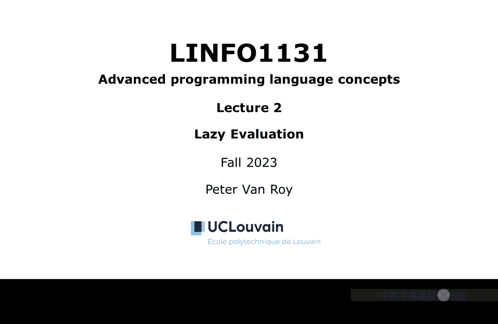
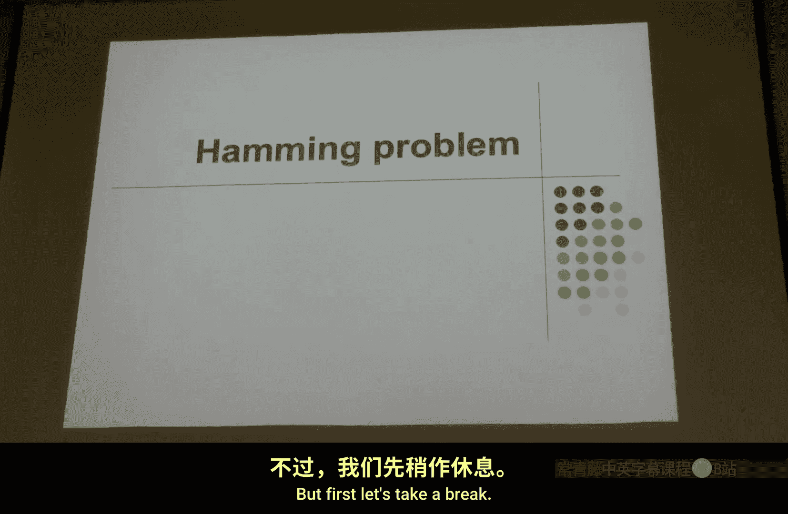
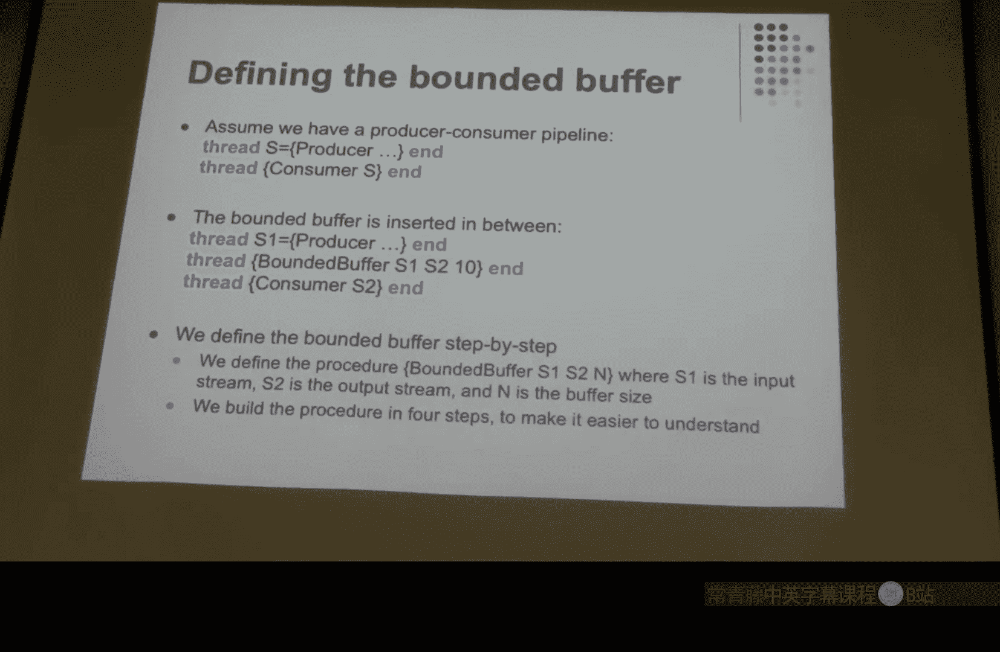

# 042：惰性求值 🧠



在本节课中，我们将要学习一种非常不同的计算方式——惰性求值。如果你之前没有接触过它，它可能会显得非常奇怪，但同时也非常强大。我们将从惰性求值的定义和语义开始，然后通过编程实例展示其应用，包括生产者-消费者模式、无限数据结构，以及一个经典的“汉明问题”。最后，我们会探讨惰性求值如何与并发结合，形成更强大的编程范式。

## 什么是惰性求值？ 🤔

惰性求值是一种函数式编程的执行策略。在我们之前见过的任何函数式程序中，你都可以采用惰性方式运行它。这意味着，当你调用一个函数时，它并不会立即执行。相反，它会创建一个称为“惰性挂起”的结构。只有当其他部分真正需要这个函数的结果时，它才会被执行。这听起来可能有些奇怪，但我们将通过其语义来精确理解它。

## 惰性求值的语义与数据流执行 🧱

要理解惰性求值如何工作，我们需要回顾程序的语义，即通过将其翻译成核心语言来获得。惰性求值正是通过这种方式被翻译到核心语言中的。

以下是其翻译规则。假设 `add X Y` 的结果是 `R`，其翻译如下：
```oz
thread
   {WaitNeeded R}
   R = X + Y
end
```
这段代码创建了一个新线程。在该线程中，它执行一个特殊的操作 `WaitNeeded`，该操作会等待，直到结果 `R` 被需要。

那么，“需要 `R`”是什么意思呢？系统中有一个称为 `Wait` 的操作，它会等待直到 `R` 被绑定为一个值。`WaitNeeded` 则会等待，直到另一个线程对 `R` 执行了 `Wait` 操作。

为了理解这在完整系统中如何工作，我们需要回顾一下确定性数据流是如何执行的。

### 数据流执行回顾

假设我们执行 `X = Y + Z`。这个加法操作需要等待 `Y` 和 `Z` 都成为数字（因为它们可能最初是未绑定的变量）。其翻译如下：
```oz
thread
   {Wait Y}
   {Wait Z}
   V = {PrimitiveAdd Y Z}
   {Bind X V}
end
```
`Wait X` 会挂起当前执行，直到 `X` 被绑定为一个值。`Bind X V` 操作则将值 `V` 绑定到变量 `X`。每当对 `X` 执行 `Bind` 时，任何正在 `Wait X` 的线程都会继续执行。这就是数据流执行的基础，所有操作（如算术运算、`case` 语句、函数调用、记录访问）都建立在 `Wait` 和 `Bind` 之上。

惰性执行只是在数据流之上增加了一个新操作。因此，我们有：
*   `Wait X`: 等待直到 `X` 被绑定。
*   `Bind X V`: 将值 `V` 绑定到 `X`。
*   `WaitNeeded X`: 等待直到另一个线程对 `X` 执行 `Wait`。

`WaitNeeded` 是实现惰性的关键。它并不等待值被绑定，而是等待有线程需要这个值。通过这个单一的新操作，我们就获得了惰性求值的全部能力。

## 惰性函数与编程技巧 🛠️

在系统中，你可以直接使用 `WaitNeeded`。例如：
```oz
thread {WaitNeeded X} {Bind X 100} end
{Browse X+0}
```
第一个 `Browse` 会显示未绑定变量，因为 `WaitNeeded` 在等待。第二个 `Browse` 执行 `X+0`，加法操作需要对 `X` 执行 `Wait`，这触发了 `WaitNeeded`，导致 `X` 被绑定为 `100`，从而显示结果。这是一种非常有趣的控制计算的方式。

更常见的是，我们可以定义惰性函数。使用 `fun lazy` 关键字定义的函数会被自动翻译。例如：
```oz
fun lazy {F A}
   Expression
end
```
会被翻译为：
```oz
proc {F A R}
   thread
      {WaitNeeded R}
      R = Expression
   end
end
```
当你调用惰性函数 `F` 时，并不会立即执行函数体，而是创建一个线程，该线程等待结果 `R` 被需要。这被称为“惰性挂起”。

需要注意的是，这种基于线程的实现可能看起来开销较大，但编译器可以采用更高效的方式来实现相同的语义。例如，Haskell 语言就完全基于惰性求值，并且拥有高效的编译器。

现在，你已经了解了惰性求值的工作原理。接下来，我们将通过实际编程来展示你能用这个思想做些什么。

## 生产者-消费者示例：三种执行方式 🔄

我们将通过一个简单的生产者-消费者示例，展示三种不同的执行方式：顺序执行、并发（急切）执行和惰性执行。三者最终会得到相同的结果，这得益于函数式程序的“合流性”理论（Church-Rosser 定理），即对同一个 lambda 表达式进行不同的规约，最终会得到相同的结果。惰性求值只是另一种规约方式。

以下是代码。生产者创建从 `L` 到 `H` 的整数流，每个元素产生后延迟1秒：
```oz
fun {Producer L H}
   if L > H then nil
   else
      {Delay 1000}
      L|{Producer L+1 H}
   end
end
```
消费者计算输入流的累积和：
```oz
fun {Consumer S Acc}
   case S of H|T then
      (Acc+H)|{Consumer T Acc+H}
   [] nil then nil
   end
end
```



### 1. 顺序执行
```oz
local S1 S2 in
   {Browse S1}
   {Browse S2}
   S1 = {Producer 1 10}
   S2 = {Consumer S1 0}
end
```
这里只有一个线程。生产者会逐步绑定 `S1`，但消费者必须等待生产者完全结束后才能开始运行，因此消费者是“批处理”的，一次性显示所有结果。


### 2. 并发（急切）执行
```oz
local S1 S2 in
   thread S1 = {Producer 1 10} end
   thread S2 = {Consumer S1 0} end
   {Browse S1}
   {Browse S2}
end
```
生产者和消费者在各自的线程中运行。生产者一旦产生第一个元素，消费者就可以立即开始处理并输出增量结果，实现了流水线式的处理。

### 3. 惰性执行
我们重新定义惰性版本的生产者和消费者：
```oz
fun lazy {LProd L H} ... end % 体与Producer相同
fun lazy {LCons S Acc} ... end % 体与Consumer相同
```
然后执行：
```oz
local S1 S2 in
   S1 = {LProd 1 10}
   S2 = {LCons S1 0}
   {Browse S2.1}
end
```
`Browse S2.1` 中的点操作（`.`）需要第一个元素，这迫使惰性消费者 `LCons` 执行。`LCons` 执行时需要对 `S1` 进行 `case` 分析，这又迫使惰性生产者 `LProd` 执行。它们各自只产生一个元素后就再次挂起，因为递归调用也是惰性的。只有当你需要更多元素（例如 `Browse S2.2.1`）时，计算才会继续。这种方式只进行最小必要的工作。

在急切执行中，终止由生产者决定（生产到上限为止）。在惰性执行中，终止由消费者（或最终用户）决定，他们需要多少就计算多少。这是一种对称性的转变。

## 无限数据结构与惰性求值 ♾️

惰性求值允许我们安全地处理无限数据结构。例如，一个生成无限递增整数流的函数：
```oz
fun lazy {Ints N}
   N|{Ints N+1}
end
```
如果这个函数不是惰性的，它将是一个无限循环并耗尽内存。但作为惰性函数，调用 `L = {Ints 1}` 只会创建一个惰性挂起，不进行实际计算。

当我们真正需要元素时，例如 `Browse L.2.2.1`（请求第4个元素），点操作会触发计算。`Ints` 函数体执行，产生第一个元素 `1`，递归调用 `{Ints 2}` 又创建一个新的惰性挂起。这个过程会重复，直到产生所需的第4个元素 `4`，然后计算停止。

为了更方便地查看多个元素，我们可以定义一个辅助函数 `Touch`：
```oz
proc {Touch L N}
   if N > 0 then
      {Touch L.2 N-1}
   else skip end
end
```
`Touch` 函数本身不“做”任何事，但它通过遍历列表的前 `N` 个元素，迫使这些元素被计算出来。例如 `{Touch {Ints 1} 20}` 会显示前20个整数。

## 汉明问题：一个经典的惰性编程案例 🧮

汉明问题是一个动态的数字序列生成问题，非常适合用惰性求值解决。问题描述：生成所有形如 `2^A * 3^B * 5^C`（其中 A, B, C 是非负整数）的数字，并按递增顺序排列，且不重复。序列开始于：1, 2, 3, 4, 5, 6, 8, 9, 10, 12, ...

我们不知道最终需要生成多少个数字，需要动态生成。算法思路如下：
1.  序列 `H` 以 `1` 开始。
2.  下一个数字是 `2*H`， `3*H`， `5*H` 这三个（潜在无限）序列中，大于当前最后一个数字的最小值。
3.  通过合并（`Merge`）和映射（`Times`）操作来实现。

以下是完整的惰性程序：
```oz
% 将流中每个元素乘以 N
fun lazy {Times S N}
   case S of H|T then
      (N*H)|{Times T N}
   end
end

% 合并两个递增流，去重
fun lazy {Merge S1 S2}
   case S1#S2 of (H1|T1)#(H2|T2) then
      if H1 < H2 then H1|{Merge T1 S2}
      elseif H1 > H2 then H2|{Merge S1 T2}
      else H1|{Merge T1 T2} % 相等时去重
      end
   end
end

% 汉明流
H = 1|{Merge {Times H 2} {Merge {Times H 3} {Times H 5}}}
```
`Times` 和 `Merge` 都是惰性的。整个定义 `H` 是递归的，如果急切求值，会立即无限展开。但在惰性求值下，只有当我们通过 `Touch` 等操作需要元素时，计算才会按需进行。例如 `{Touch H 50}` 会生成前50个汉明数。

这个程序简洁地展示了惰性的威力。如果不用惰性，程序员必须手动管理计算和内存，代码会复杂得多。

## 惰性求值的执行细节与并发结合 ⚡

让我们更深入地看看汉明程序是如何执行的。当我们请求 `H.1`（第二个元素）时，会触发一系列惰性挂起的激活：
1.  激活 `Merge(Times(H,2), Merge(Times(H,3), Times(H,5)))`。
2.  为了执行这个 `Merge`，需要 `Times(H,2)` 和内部 `Merge` 的第一个元素。
3.  这又激活 `Times(H,2)` 和内部的 `Merge`。
4.  内部的 `Merge` 又需要激活 `Times(H,3)` 和 `Times(H,5)`。
5.  ... 如此递归下去。

最终，所有这些激活的挂起会运行，产生结果 `2`，并为后续元素创建新的惰性挂起。整个过程虽然幕后发生了复杂的激活链，但对程序员来说，只是简单地请求了一个元素。这体现了声明式编程的威力：将复杂的操作逻辑隐藏在简洁的语义背后。

惰性求值本身是顺序的（尽管用线程描述语义），但它可以与并发结合，形成更强大的范式——惰性确定性数据流。这是本课程将介绍的最强大的通用声明式范式之一。它具备合流性、高阶函数、并发以及惰性求值。

### 有界缓冲区示例

一个能体现此范式威力的例子是“有界缓冲区”。在生产者和消费者速度不匹配时，有界缓冲区可以作为中间层平滑波动。当生产者快时，它存储元素；当消费者快时，它提供已存储的元素。

在声明式惰性并发模型中，我们可以编写一个纯粹函数式的有界缓冲区。生产者代码和消费者代码无需任何修改，只需在它们之间插入这个缓冲区组件。从生产者看，缓冲区像消费者；从消费者看，缓冲区像生产者。这实现了关注点分离和强大的流控制。

我们将在后续课程中详细探讨如何编写这个声明式的有界缓冲区。

## 总结 📝




本节课我们一起学习了惰性求值。我们从其核心语义 `WaitNeeded` 出发，理解了它如何通过“按需计算”来实现。我们通过生产者-消费者示例对比了顺序、并发和惰性三种执行策略。我们看到了惰性求值如何安全且优雅地处理无限数据结构。我们还深入探讨了汉明问题，这是一个利用惰性递归流巧妙解决的经典案例。最后，我们展望了将惰性求值与并发结合所形成的强大编程范式，并以有界缓冲区为例说明了其潜力。惰性求值将复杂的执行控制隐藏在简单的声明式代码之下，是函数式编程中一个非常强大且优雅的概念。