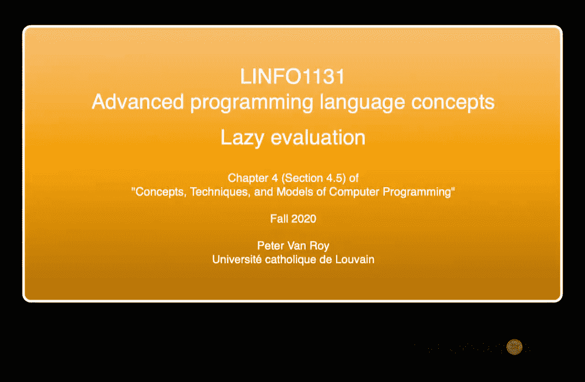
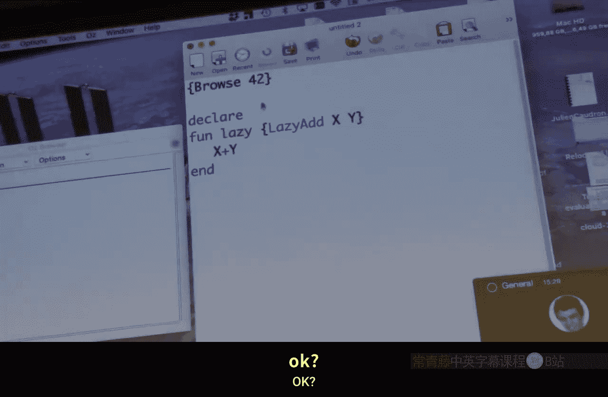
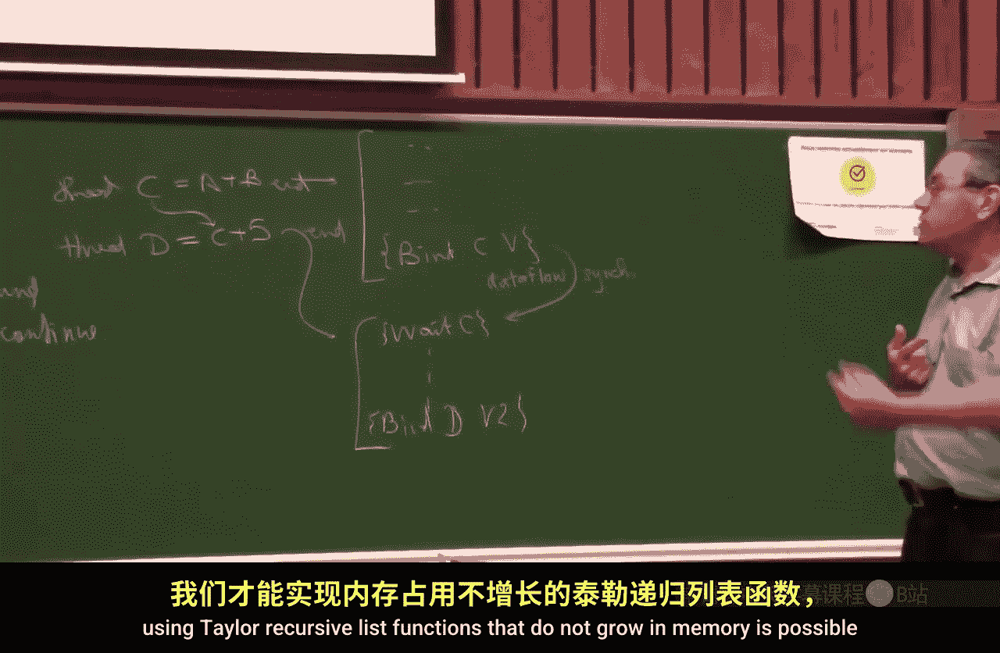
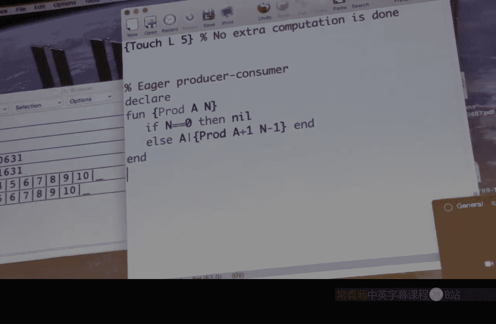
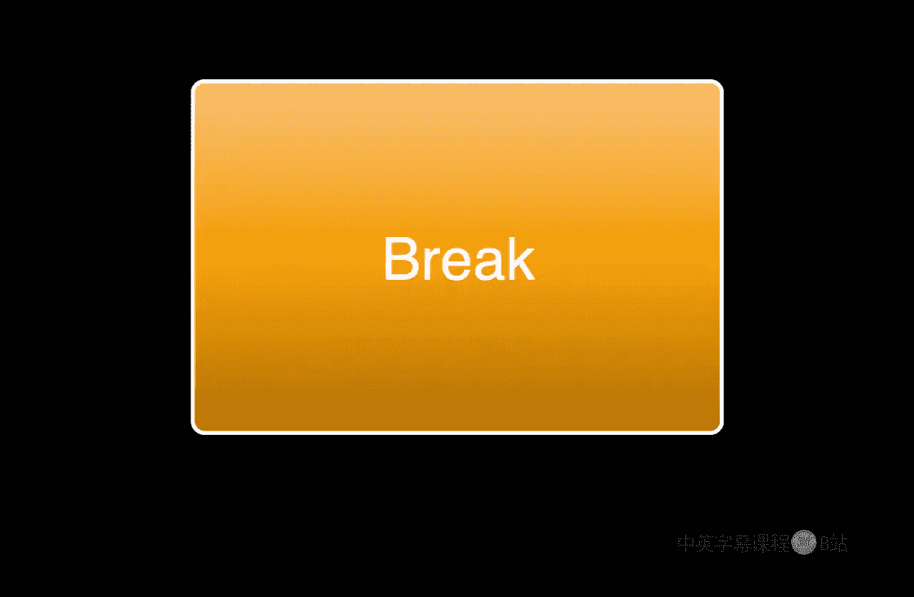
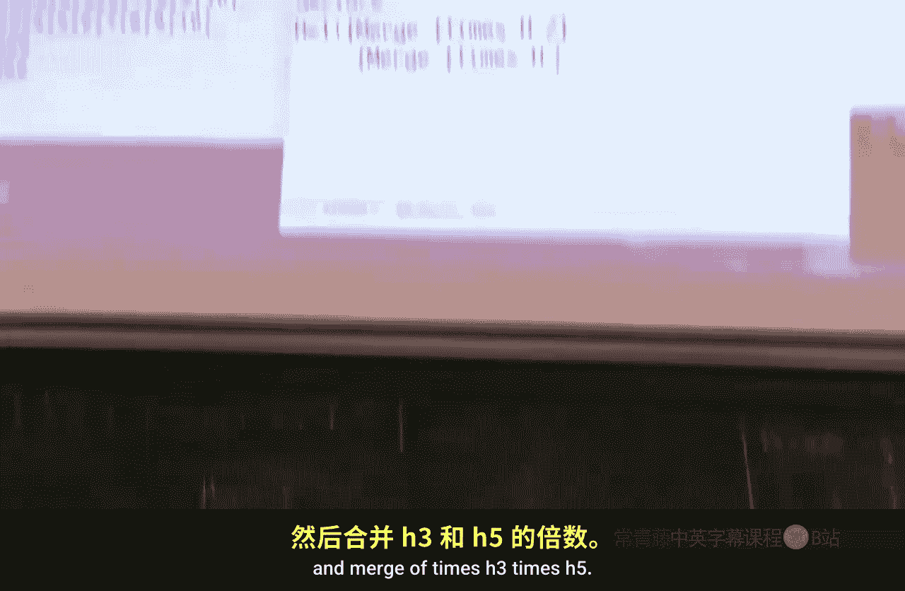
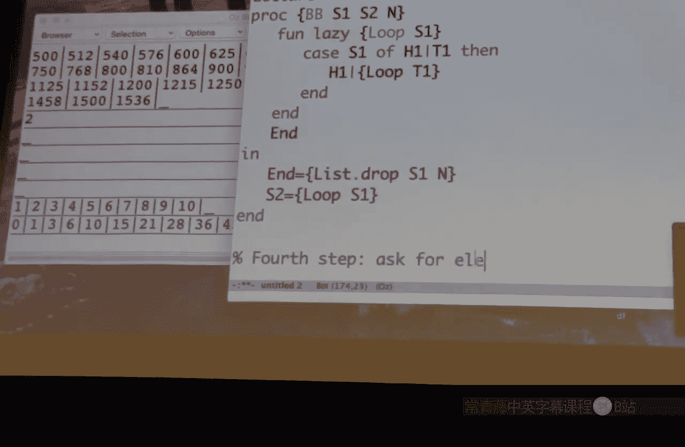
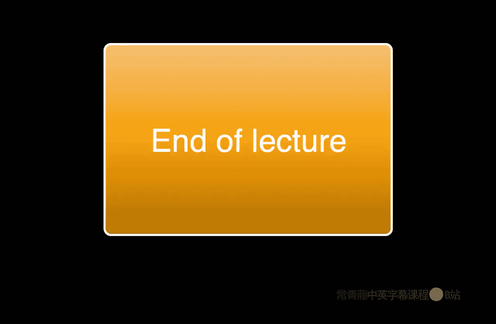

# 鲁汶理工学院【中英⚡高级编程语言概念｜LINFO1131, Advanced programming language concepts】 p01 P4 FO1131 Lecture 2 (2020) -BV1UDffBbEBZ_p1-

Welcome to the second course so now we're going to start new stuff so what I want to talk about this week is lazy evaluation which is an important approach for functional programming so this is still declarative functional programming so we're going to in the next couple of weeks show you a lot of powerful techniques in declarative functional programming。

These techniques will also work for the other paradigms and all the techniques in functional program also work for the others。

 but they have the extra advantage that they have the power of thelarative program。So before I start。

 I want to emphasize that this course。This year will not have very many slides。

 I will write on the board。And。Most of the material is in the textbook， this book。

So this is very important and so what we're going to see today is in section 4。5。

Most of it is in section 4。5， there are a few things I will say on the board that are not in section 4。

5。So， I would。You' will see that when I give the semantics。

 so in fact this book was published in 2004。So now we're 16 years may。

 so the semantics I'm going to give you now is a。Better， simpler， more powerful。

 cleaner semantics than the one in the book， okay， so this is proof。

So I will give some new things that are not in the book。

Extra things that we learned in the last years since the book was published。

 so not everything in is in here， but most of it is in the book is in the textbook。

Okay so this is important， another point is that I'm going to write Z code。

And I will put the code on the Moodle， so you will be able to see the code today directly。あブル。

So let me start with late evaluation。Let me start by giving you。An example。So here is。

The power system， which I hope that everyone。Normally the people and listen can see also。

 so let me show you first an example of a lazy function。And then we'll see how it works。

This is a function that's very simple。It will add two numbers together， okay， lazy a。

And it just looks just like a function。Except that I annotated by La。

 so I will first show you what how。What it does， and then we will look at the semantics and then I'll show you all the powerful techniques。

う。Now if I do now something like this。Lazy ad，210 and 20。Okay。So I' calling it the function。

And now I browse this。And I don't see the results。So anyway when I call a lazy function。I create。

That kind of。Object called a lazy suspension and the function is not evaluated immediately。

So what happens， it's only evaluated when I need the result。So browsing。

 the browser is a special tool， it will display things as they are， it does not need the receive。

So what does it mean to need， so I will show you a simple example and then the semantics will be more clear on that。

 so it will only display S。When we need to do so。So how do we need S Well。

 one way to need S is to do a computation。So if I do S plus 100。

So the addition operation at the plus needs its two arguments。

 so this will cause the function to be evaluated， so the function will only be evaluated when you do the plus so when I do the plus。

I will see that as is needed。And then I will evaluate the function and then I can execute the plus。

 so when I execute this， I will display S but also S plus 100。Okay， so 30 and 1003。

 So you see it's the need that drives the。The computation， so that's a very simple idea。

But it's incredibly powerful and we're going to see all the consequences。OfThis。And this today。

 of course。So let me first give you the semantics of this。Let me go back to。

This is not going to write on the board。So the semantics of this。

Semantics of lazy evaluation， let me refresh your memory first on the semantics of the data flow。

reputationシ？Of the deterministic。对。We have two operations called weight。X。And we have bind。

Next to the film。So the weight X will suspend the thread。And two。Ex balance。And the bind X。

Will release any weighting weights， okay？喂。So these are the two primitive operations that define the data flow。

 assume now that I want to do an addition C equals a plus B。Okay， well， the semantics of this。

 this plus will do weight。Compile this follows。えこ do。Weight a。Weights B。

And then a primitive ad operation。Which。For example， does V is equal to A plus B。And then the bias。

So whenever I do an operation。That has a data of flow amount。

 like plus or the case or the if or whatever， many buildings need weight for values。

 so I wait until a is a value。I wait until B is of value， and then I do a primitive addition。

 so this is an addition in the architecture in the machine， okay。

 so the primitive edition assumes that A and B are values。If they're not values， or there's an error。

 this one assumes that A and D are actually numbers。And it will bind V to the sum of A and B。

 and then I will do a bind operation。So if I do now a data flow operation。

 if I have something like C equals a plus B。And then D equals C plus5。Okay。

 then there is a data flow connection between these two， so the first one。We'll eventually do bind。

OCV。オッケ？And the second one。Would you wait。On see before continuing。

You see and this one will eventually provide。あのディ。It's a new value。So this data flow connection。

Is done by the bind and the weight， so we see how it works so if this is executed in its own thread。

And this one in another thread。Then if the scheduler executes this one first。

 then it will wait on sea。And eventually the scheduler will execute the first edition。

 and it will bind sea and this causes the data flow synchronization。

It's the connection between the bind and the weight。Okay。

 so these bind and weight are primitive operations。Supported in the virtual machine。

With Gilos semantics。Okay， so this is the semantics of the data flow。Without laser。

 so far we're not through Malasia， this is something we already saw。

 this is exactly the semantics of all the data flow we saw in deter termministic data flow。

And all of the good things。In deterministic data flow， tail recursive planned agents。

 declarative agents using tail recursive list functions that do not grow in memory is possible because of this data flow sematics。

OkaySo this is a very nice semantics for concurrent programming， and in fact it's now very popular。

 most of the large scale analytics tools based on the original map Red are using something like this。

So this semantics is today very popular， okay for data flow。

But now I will extend the semantics for lazy。Okay， so let me。Remove the example。 I'll keep the。

The way to the bind。So we will make an extension or small extension to this。That will allow laziness。

So for la evaluation。We add one。Simple operation to this， one new primitive。All wait needed。で。

So this one also waits。はいはい。Okay， so the weight needed also awaits。

But it does not wait until x is bound。So basically， it waits on another condition。It waits until。

There is a way X。This one will wait。Until another thread does weight X。See it's a little bit subtle。

 that means that when I。Do awake need for an computation？

And will only do the computation who will only continue if some other thread does wait。

So basically the weight， this is what we mean by needing so this is what。X is needed it means。

So we say that x is needed by the computation if a thread does weight x。In that case。

 x is needed and this one will continue。So this allows us to do some very interesting。

Interesting things， let's say I have X， I do weight。え。And I know x is equal to a big computation。我认为。

When I do this in a thread。This will suspend here。If I do browse X。

It will display and underscore because the browse does not do weight。If I do browse。X plus 100。全然。

This plus operation has data flow semantic。So this plus operation will do a weight on x。

The weight on x means it needs x， and that will cause the x to be bound， so you see the need for x。

Drives the computation。So this is extremely simple。

 but it has huge consequences when we start doing programming， okay。

 so it's very important to understand the difference between weight needed and weight， okay。

 they arere totally different。Let me show now。An example。それ是可。Are you waiting。

X and then x is standard computation。Okay。And browse that here。

So weight needed is an operation that exists in the system that you can use directly in your program。

You could use it and you could program it。哎？So I execute this at brown sticks。

And nothing is displayed。Underscore， so the weight needed blocks， it suspends。

So how can I make the computation？Be done well I have to need X。So I could just do weight X some。

If I want， then this will trigger the way needed。But I can also do something like this。

Browse x plus 1000。And you can see that none of the x is computed。First 1，000。

 so the addition operation。Is what。对。Calculation of x。

This is totally different from the regular data flow。

 regular data flow you call a function that's executed right away。

 here it's not executed until it's needed， which means until another thread does weight X。Okay。

So those are the primitive operations now the language has some syntactic support for this。

If I I a functions。So let's look at functions。So the regular functions， the ones that we know。

 we call them eager functions。Because they compute immediately。F F of x。With some expression。Okay。

And these are translated into a kernel language like this。X with one extra argument。

 R and R is equal to。Expression。And so the expression is also translated into kernel1。

 so this is how it's done the regular functions， so a lazy function also has a translation with weight needed。

So the Mozart system has a syntactic support for this。You annotate the function as lazy Fx。

Expression and。So you can see that regular and the laser function are almost the same。Yes。

 you have to move to。To change the screen They the dont that don't even see the box。

They don't see it Well， normally the。So the the screen is not showing this part。

 this is what you say。I so its it's my question。Let me see。 It tells you that they're not seeing it。

Okay， so where does it cut off？You。So I know about up to where don't know okay， let me make some。

 let me make it in the other part， so this is this is readable， right？啊。So it's okay now。Okay。

 so a lazy function has this lazy annotation， and it's also defined in permanent language。

In a slightly different way。So what happens is it's going to be defined using weight needed。

So it's going to create a thread。That does weight needed。好。Of the result of the function， so of R。

 okay， no x。And then you have our equal。Expression。And。Here。

So you see how the lazy function is translated， so the weight needed， it has to wait。

 so you know threads of units of weight， so in the deterministic data flow we would create a thread to weight。

On the need of the result， so it waits for R， okay， the weight needed on R， not on x。

 maybe there's more arguments here right？It doesnn't care about the arguments of X。

 it cares about the result。And when this weight needed。It continues， then I compute。Okay。

So this is a syntactic。A syntactic shortcut， so you can see there are eager functions and lazy functions。

And you can see the semantic says the lazy function is defined using weight needed。Okay。

But for the programmer， they look almost the same。Now that we have this， we can actually。Right。

There's a question here。It seems to be okay。Let me go back to the。Program here。

So we can use now we can write lazy functions， so if I' already showed you one。

 let me show you another function。Let me do a function call。And for by。Is。N plus1。

If I define this function。If I define a function like that， in end theres going to be problem， right？

What is this going to do here when I call it？啊，干嘛。It's a problem， right？It's an infinite loopa。

 there's no stopping。This is a regular function。这べ人或是。

But we can write it as a lazy function and it will work fine。We call one held。And followed by。

So if I write this function。This looks like an infinite loop。

But it's not because when I call this function， it will not execute until I need the results。オッケ。

So if I say L is equal to。是。helello。Is equal to L ins of one。This looks like an infinite loop。

And it's a potentially unbounded computation， but because of the lazy semantics。

 it will only execute the part that I need okay？So if I can browse them。It will display nothing。

 so how do I need this？Liiz， will I have to。Do a weight。

 I have to do some other computation that actually。Looks at the list。

 but you can't do addition on list， let me define another one。Let you define a function， a procedure。

Co touch。Which does nothing。要て。What does this procedure do， actually it does nothing in some sense。

Touch LN if n is equal to zero， then skip then I'm done。

 So skip is an operation that does nothing else recursive call touch of L do2。And minus1。

 so I will basically traverse down and elements of the list。

So when the regular eager model without what needed， this really doesn't do anything， okay。

 what am I doing， I'm just traversing， I'm not computing anything。But in the lazy model。

 this will trigger the computation of L。So the L dot2 operation here。Eda2。There's this dot。The dot。

Takes。A list or a record。And the name of a field and returns the field。 So the dot needs L。

 so it will do a weight L implicitly。 Okay， the dot operation needs L。 So this causes。

The L ins operation to trigger。That means the weight needed here。

 the weight needed will be activated。And I will do the recursive call。So explaining it here。

So if I look at the translation。Of LNs。So it looks like this now the actual translation of LNs。And R。

Thread， weight need。R， but then I have R is equal to n。放大。He it。And plus one。Okay。

So the L in operation， the semantics of LNs is this using the basic kernel operations。

 the thread and the way it needed。So when I call Elvintz。Of one， it will do nothing。

But if I assume that I do。L dot。2。Okay， assume now that I do。Browse L。t2。对位。Well， this causes。

 so the L is the same as the L here。The LW2 will cost this way needed。But this is actually Ella。

This is the L actually， if I use the same name of the acidifier。This is the result of L。

 if I do L that2， then I will be doing the weight on L。And so the weight D will go on。

And it will say L is equal to1 followed by ls and plus one。But notice it's not an infinite loop。

 but that inside the recursive call， there's another way it needed it。Okay。

So it will only compute one element to this。then it wasタ。So if I do Elda2。

 it will just make one step。So if I do this。Ruse L2。And you can see I have one bar underscore。

I've calculated one element and the recursive call to L its and plus one elementss of two。

Willll block again。See， so every recursive call does a weight needed， okay？

So it waits for every single element。Now， if I want more elements。Let me show you now touch。

If I do touch L， and I want 10 elements。This will do L dot2 of9， touch L do29。

 and it will keep going and times so it will force。

10 elements of the list to be computed then and the 11th element will not be computed and it will start to getting there。

So I will only do the ten elements。So you can see the results here。

So I have browsed L and browse L dot2， so the L is one to three up to 10。Okay， and the L2， of course。

 is two， three， four， five， and then there's intill and underscore the end。So the L is。

Basically did N10 recursive calls， and then it bs again at the end with another weight needed for the 11th fauna。

Now， interesting about laziness， if I do now a touch again。Let's say I do touch L5。

But I already have computed 10 elements of the list。Well， the list exists now。

 so the touch L5 will cause no computation to be done。

You see the laziness that function is only called once。Maximum once when I need it。

 if I do another touch here。嗯。And nothing。Of course， nothing。

 you don't see anything I'm not browsing。So the laziness， once the L is computed。The value stays。

 it's bound， okay， and if I do a touch again， if I do L2 again， it will do no extreme computation。

 The laziness will only do。B。Function at most once。So if you keep doing Elda 2。

 it's not going to call the function over and over again。

 and that's logical because the weight needed。Here。This thread only is created once。

And once this thread executes， it's done。And so， the， and the。呃。

The L is balanced and that's it if I again do an L2， there's no more thread wing it。

So then nothing happens。Okay。So you can see the ideas of how it to work so。No。

Let me show you before going on， let me explain a little bit now。Parads。

 let me give you a little bit more theory， and then we'll show some more examples。ok。

So is this clear any？Any questions， it's very clear， it's very simple， you understand the way needed。

 are the lazy functions work。Okay。But you see， we're going to start。

We're going to build lots of sophisticated things on top of this very simple figure。

So it's important to understand the weight need of it。And people。

 I know people get confused between weight and weight needed it。Totally different。wait。

 waits until it's gone to a value and weight needed waits until somebody does a wait。

 so weight needed will suspend until someone else another thread does await。Okay。

 so let me give now a little bit more。There's a bit more theory here。

Let me take one step back before showing your programs。Explain a little bit。

 now we have seen the different paradigms。A functional program。We have seen three now to Cam Asiaia。

If have see standard。Sequential function programming。If you add to this。

Threads and data flow synchronization threads。Single assignments。Plus， data flow synchronization。

Then you get the termministic data flow。Which is a very nice model， which we saw in the last course。

So this one is the concurrency for Ws model of， the selected call。

 and now if you add a single operation to that。We needed。

You can also call this by need synchronization。This is something's called binding synchronization。

Then you get lazy。Deterministic data。So these are three， all three of these are declarative。

 and this the lazy one is actually a very powerful model and in a couple of weeks we're going to show some very interesting algorithms。

And lazy， deterministic data。Okay。E me start showing you the programming techniques。レしいです。

Programing techniques。Let me first， I will first write them down here on the board。

 and then I'll show the code。So the first techniques， let me first give a kind of summary。

What kinds of techniques you could do with this。So you can， of course， build， you can have。

Techniques that use infinite data structures。With infinite loops。

So this makes the code simpler because you don't have to worry about termination。オッケー？

So you don't care about termination。Just write it infinite。It's very simple。

 and we show some nice example of this， so you don't care about termination， it's very nice okay。

And then there's other techniques。The other technique， it's sometimes called。Push versus。ho。

This is sometimes called output。就是份。Firstus input driven。So when I have a computation。

 so I here a box， here's a program。There an input。And newss。In the usual eager way。

 you give inputs and the outputs appear。Okay， so the usual way， this is called input driven。

 but it's called push， push。Is the usual way programs work？But the other way， the opposite way is。

靠 pull。This way， nothing is done until you ask for something at the output。

 so the control is on the output and not on the input， okay， so the eager way。

The control is here and in the lazy way， the control is at the output。

So you only do computation when you ask for at the output。So you're pulling things out of the system。

 okay， instead of pushing things in。And these are， this is a very interesting。

DoL seeing the difference， you can actually use this。In any languages。In all languages。Of course。

 the syntax， some languages have syntax to have support， languages like us or Haskell。

They support this。Support。The poll approach。Whereas the language said Java。

 if you can do poll in Java， but you need to program it。Okay。

So the lazy model is actually usable in any language。Except that some languages make it harder。Okay。

 but the poll model for real applications is sometimes what you want。

 sometimes you want to push or sometimes you want to pull。

And we'll see an example of combining push and pull。So this is a typical。

Question in program designer when you're building an application。

Does it need to be a push or pull application？Do I need to pull out results， for example。

 a database where you query the database， it's like a pull。

 the computation is only done when you ask for a result。It's not done beforehand。

But a smart database might precompute some important information。and combine the push with the pull。

 so you see push and pull are fundamental ways of building an application。Okay。

 so you can see that eager and lazy are very complementaryary。

La is a very natural thing and in fact if you don't have lazy， it's like you only have half a system。

 if it's like walking on one leg if you don't have lazy。

 a real system will be doing both eager and lazy。Okay。

But let me show now an example of this program example， let me first make a block diagram。Here。

On the boards， and then I'll show you the code。I'm going to do very simple example。Prodcer for。

So we have a producer consumer。We've already seen producer consumer in the deterministic data FA。

 we have a producer， he， that generates a stream。S in a consumer that consumes the dream。

Now there's two ways to do this。The eager way。AndIn the eager way， the producer is in control。

Producer controls how many things。Controls the computation。And in the lazy way。It's the consumer。

The controls the computation。So you see very it's a very dual approach in the usual way when you do a pipeline。

 you put things in and they go through and they come out the other side， but in the lazy way。

You pull things out， so only things come out when so the consumer is controlled determination。

Let's say you have a termination that controlled here。

For the eager way and termination is controlled by the consumer。不 the类行为。Okay。

So this is kind of up to track， so I'm going to show you the code for this。So let me go up to that。X。

So let me first show you an eager。Pro use consumer。So eager。

 this is something we've already seen before。So we have a function producer。Okay。

 let me it has a number of elements， so let me run through code， so it will create an element。

Okay so it will create10 elements and then it will stop。

So the producer controls how many elements， okay？And the consumer， let me call it some。For some。

 the elements。诶。So it will do something like this if it's a new。And otherwise， it。

So the consumer is the sum， I can call it consumer， I would it's nice to call it sum。

We're basically using an accumulator and we'll sum all the elements of the list。

 so you see the consumer does not know how many elements there are， the producer knows。Okay。

So the producer is controlling the size。So if I do something like this。Have a thread。Ell is producer。

呃。Starts with one that say I have 100 elements。And the sum will be sum through。

So this is a simple producer consumer， an eager one。The producer will generate elements。

 100 elements。And the consumer will sell them off， okay。And then I do browse through zone。

So the number of elements。Is known is controlled by the producer here， not by the。

The consumer does not know how many elements there are。

 the sub program has no idea how many elements。Producers is in control。that's very simple。You'll see。

 it's very interesting to see the laser version and then use the result。5050。

 the sum introduced from one to 100。Now let's do a lazy version。诶。Friend， lazy。Pro a。

Now I do this a followed by fraud。8 plus one， again， the producer will make a list。

But now the producer does not know how many。Producer is an infant loo， it just keeps going， okay？

This time the consumer will be in control。N will be the limit。So it's like this L one plus。

So here is another version of the sum。But the n argument here， so it takes a list as an accumulator。

 but it has n tells me how many elements I'm summing。And in zero the result of this act。

 otherwise I do recursive call， L do1 plus sec and minus。Okay， so basically。

The number of elements is known by the consumer。Okay。Let let me show you how this works。

So I do actually I don't actually have to put it in a thread， but I can。100 elements。

So the code is almost the same， except that the 100。

Is now sitting at the consumer and not the producer。

 the consumer is now controlling how much computation is done。Not the producer。Let be excuse this。

So it's going to give the same results， but gives the same results。

 so their final result is the same。The two。So the eager one。

 the control is at the producer and the consumer， the lazy one the control is the consumer。

 you can see how you can see that it's interesting， it's another way of writing applications。

 but it's very natural。There's nothing artificial and the code is very simple。Notice that the the。

The subcode here is actually not lazy， it's not a lazy function。

So this one will be executed immediately。It could be lazy if I make the sun lazy。

 then I would have to。Pull out the result after， okay， but I can write it in this way。

 so the producer is lazy。But the consumer， the sum actually。Will take these elders。

And will do its computation， it will not wait until somebody needs it okay I'm doing it directly。

So you can see it's very reasonable， it's quite okay to put a。

To make a lazy function with the input to an eager function。So that's a simple example。

Let me now show you a more sophisticated example of an infinite data structure。

OkaySo this producer consumer example here， you can generalize it to pipelines。

 and after the break I'll show you a more sophisticated combination of Ne and lazy called Bounded buffer。

 actually it's very simple concept that you already know in Network network and you already do it。

But you don't realize that a bounded buffer is actually a combination of eager and lazy computation and it's good to control the lazy。

Okay。So let me give you now an example of an infinite data structure。

I've already shown you one the infinite list but that was a very simple one。

 let me show you a more sophisticated example where if you don't use lazy。

 it's actually much harder to program。Okay。So let me formulate the problem。

 this is actually a famous。Problem called the he problem。And。In the time when this was formulated。

 so this was formulated by Richard havinglving， you heard of this guy， he's actually very famous。

 he did heming codes， he also did heming windows。And signal processing and he did this。

 so he did many things this guy。So the health problem was a programming problem。

That he presented in the 1950s。And in those days， it was very hard to do， okay。

 this was like research question， okay？So assume that you have numbers of the form。Two to the A。

 three to the B。5 to the C， where A， B， and C are integers。Greater than equal to zero。

 numbers of this form。In the general formulation， actually you have n primes here。

 but we'll just do with two， three， and five that makes the example a little bit simpler for writing it on the board。

We need to write them in。Order。Of increasing size。Until reaching is certain。Reaching。

A different limits。But the limit is not known in advance。That means I want numbers of this form。

 so I start with one， okay the next one will be。Two，2 to the1，3 the zero，5 to to the zero。

 the next one will be three， and then four， two squared and5。And then six， seven is not there。

 then there'll be8。And goes on，9。10， 11 is not there， 12 and so on。

So I wanted to generate this sequence。Until I reach a given live， maybe 1，000 or 10，000。

But I don't know the limit in advance。😔，So the question is， how do you program it？

How to program this？So it has to be simple program。And they have to use as little memory as possible。

So there's a resource issue。This is very。This is a very important condition if I'm at generating elements。

It gets bigger and bigger， so how do I make it so I use the least amount of memory。

And computation but memory， if I want to generate up to 1 million， but I don't know an attendance。

 maybe I only want to generate once to 1000。But if I want to generate more elements。How do I do it。

 if I allocate an array， for example， of a fixed size， it only works up until the array is full。

And when the array is full， I have to reallocate a new array and I waste a lot of time and it's complicated。

And maybe the new array is also too small， so I'm going to do a lot of overhead。If I guess wrong。

 what is the size？But the size of the limit， it's not done in advance and maybe it depends on something。

 so I'm asking for elements and elements keep coming and I stop when I have the right number of elements。

 okay。So how can I program that with the least number of？Resources and a simple program。

So this kind of program， when you don't know the limit in advance of a sequence。

 is potentially infinitefinita， there's no limit here。And you don't know in advance。

 so that's important condition whenever you do a computation or you don't know in advance how much you need。

 you only will know when you start running things， I than you need to see how it goes。

This is typically。A program that you can do very well with the lazy evaluation。

 so whenever you have an application where you don't know in advance how much you need。

 you have to have an alarm bell ringing in your head and saying，A。

 maybe I should use lazy evaluation for this。ok。Okay， so let me do now small break。

And we solved this problem after the break。😔。

But let me first show you an algorithm for solving the having problem。So for the having problem。

Let's construct the list。Inductive that's constructed incrementally starting from one。

So how do we figure out what is the second element？Well， there' there's。Three possibilities。

 it's either two times the previous element because one of these numbers， AB， C will increase by1na。

 or three times the previous element or five times。So in fact， I will multiply the sequence by two。

By three。And by five， excuse me three synses。Two， three， and five。

I will look at these three sequences。And I will take the least， the smallest。

So here at will put is a two。So I put into two。And when I do that， the sequences get updated。

 this one becomes2，4，3，6，5， 10， and the two here I've already used the two， so I advance to the four。

So now I have four， three， five。So I take the minimum of these three numbers。Which is three。

And then I update these sequences six。9，15。And the three now advance us by one。Now I have four， six。

 five。And I take the minimum of these three， which is four。And then this will update the sequence。

 2468。36 man， 12，5，115。20 before and now。It's used， so I moved up， but now I have six， six， five。

So the minimum is five， so I take the five and so and it goes like that。

And each time I take the minimum of the three new elements that I have not chosen yet。

And I put it in the list and I update the three multiples and I continue。Okay， and in this way。

 I will generate this。This sequence。Incrementally， starting from what。Now。

 this is very easy to program as a lazy program。So let me show you now how to program this。そ的那个就是。

Screen here。So they' having problem now。So basically， I will define。A function times。

 which takes a string， our list， and a number multiplyops。L by n。Then， I will define。Merch。

Which merges two streams， okay， two risks。So merges， so it takes the minimum each time。

So now I can declare。H， let's say H is the sequence。Of the heming sequence。And it starts by one。

And now there's actually， I can say how to compute it using these， so I multiply H by 2 by 3 by 5。

 and then I basically merge them together， so the merge is very similar to the merge in a merge sort。

Merging to order lists will。Take the minimum element， put it first and continue。

 so basically it gives you all of them in increasing order。So it looks like this。So as you emerge。

OfTimes L2。And merge of times。系。

3。してい。So this is it， that's the whole program， okay， so this program。

We'll compute the having sequence。Merch and times。Will have no limit in size。

 they're like infinite loops， but they will be lazy， so this is going to be a lazy computation。Okay。

 so let me define now the merge and the times operation。So times HN。So that's very easy to define it。

Is going to be H is a list。call this。Times of the soon。As of。Elements followed by pures。

So it's going to be D times n followed by。Times T，N。So this is a very simple definition。

 so the stream has no end， there's never going to be a nu。So I take an element E， I return e times n。

 so this is an infinite loop， so if I write it like this。

 it's not going to be working very well so let me turn this into a lazy function。And I also murder。

Merge function。So。Here I will do a case。This one is Su。

So I'm going to take an element from both streams。And helmet from both。

 and I will return the merge of the two streams， okay？So， let you ready。E1。异议。いつ？哎呦。

So I'm using the vertical bar as a separateparator， a combining operator， I'm looking at both trees。

 so the pattern at the right will take one element from S1 and also an element from this two。Okay。

Then I will have the merge operation if e1 is less than。The2。Then E1 goes to the output。

Followed by mergech。So I've taken D1， so I put T1。S2。オケ。If E1 is greater than E2。

 then E2 goes to the output， the smallest one。I keep S1 and I go to T2。

And the final case is when B1 is equal to。いつ？Here I will take， for example， E1。Com of the emerge。T 1。

 T2。I have to advance in both of them in the last case， if the two elements are the same。

 like the two sixes here， have to I only want one， six in the output， so I will skip both sixes。

So you see this is not exactly the same merge as merge sorts。

Because in me so when you merge two lists， there's two sixes。

 you have to keep the two sixes in the output because you can't remove elements in the list。

 whereas here all you want is elements in increasing order and you don't want duplicates。

 so if I have two sixes I will have to skip above of them。And have only one6 in the output。

 so if E1 is equal to E2， I have to do the recursive call T1 T2， you see is how it works。

So this is normally how it's going to work。So now we can execute this。

So there's two basic functions and a。And equation。So I browse H。And I see。Not much， I see one here。

Because I have created。呃。A lazy computation， but I have not asked for any resience yet。

So when I look at this one here。I create。Five lazy suspensions here， you see then。

 the two calls to merge and three calls to times。So if you remember the translation。

Of the lazy functions。 So in the blue part， when I execute the blue part。

How many threads am I creating that？You tell me。How many。A million。No。64， no。How many。3i。3。What？对。嗯。

I'm creating five threads， so each lazy suspension actually is a thread plus weight needed。

 remember how we did the translation？You need to weight and a unit of weighting is a threat。

 so if you need a weight needed， you need something to wait but you don't want to block the computation that you need an extra threat。

So we translated this using a thread and weight needed。

No that's the semantics of it you don't have to implement it with the thread and you can do more efficient way。

 but semantically it's creating a thread and inside that thread it's do weight meaning。

So the blue part is going to be executing five， creating five threads。So what happens now if I do？

Brows。H do 2 dot1。H。2。1 is actually the second element of the list。

H dot2 is going to be the underscore and dot1 appears to be the second element。

So this should be returning to here。So when I do that。这。

The computation is going to wake up but it's going to do stuff。Okay so what H。

2 is not going to do anything because I already have one bar underscore， so H。

2 will just return the underscore。But then I do a dot one。I'm asking for the。

First elements in that underscore。And that will cause a weight needed to wake up。In fact。

 it will cause the weight needed of the first merge to wake up， okay。

 the very first merge there will wake up because the first merge is doing this。

The first merch is returning this merch here。Is actually returning the underscore okay。

 you see that that mech that I made it blue， that is what the underscore is。

 that's the result of that so what I do，Atute of one， it will wake up that ver。

And so that merge will execute its body， which is this。And now it's doing case。S1 is 2。

 and it will ask for the first element of S1 and the first element of S2。

 so this merge is asking for the first element of each of its arguments。

See how it's working there and I'm executing when I wake up to merge， it causes the body。

 which is the glue part to execute。And then the case executes S1， S2， E1， T1， and2 D2。

 which means I ask for the first element of S1， and I'm asking for the first element of S2。

But what is the first element of S1， it's the first argument of merge， it's the result of this。

So I'm asking now for the first element of this thing。You see that？

Because that's the first argument to merge。That Time call also to wake up。And the S2 here。

Is asking for E2 T2， but that's the second argument to merge and this big thing here is the second argument to merge so that will cause this second merge to wake up so you see it's like a chain。

Each time I ask for something。I execute the function and when that function execute。

 it needs its arguments， so that will cause the argument functions to wake up so。A chain。

 you see how it works so。H。2。1 will cause first this merge to wake up。

When I execute the body of this mech， it will cause this times and this me to wake up。

 and when the second me executes its body， it will cause these two times to wake up。So， all five。

Of these。Lazy functions will wake up。And they will execute one iteration。One iteration here。

They will do one iteration。Like this。The body， and then they will do recursive call here or here。

 and then they will be a new lady suspension， the recursive call。So when I ask for one element。

 all of these。Functions will execute their body once。And then when they do the recursive call。

 they will stop again with a new lazy suspension。Okay。You see， it's how it works。So you。没。

No not so much。So yeah， I must have compiled them in the wrong border。So now I can see if I do h。2。1。

I have the one， the H。Goes a little bit farther， one， two and show the two， okay？Now I do。Touch810。

Then I can see。10 elephants。Be created， okay？But那个。Touch H 100。I will see 100 governments。Okay。

 let me。진짜 시작。You can see them here。The 100 elements。It goeses up to 1，536。

And if I want more elements， I could just ask for more elements。

And the amount of memory used by this is very limited。

 it's only I'm only using the memory for the part of the stream that I still have to read。

For computing the further elements， and I have always five lazy suspensions。

That are activated merge tongues。The five calls there will have five lazy suspensions。Okay。

So the resource consumption of this is very small program。In the 1950s， this was a。

How do you say a research question that was published in a journal， how to encode this algorithm。

 okay？And now I can just show it to you as a small exercise。Of course。It's very simple。

So the basic equation here is this one。You just have to define the merge and the times。

So you see the code is very simple。He， let me know。Show you another example of laziness。

 let me now show a really nice example， which is called a bound buffer。

An example where combining eager and least。An a bounded buffer is something you probably already see。

The fact。Computing system use bounded buffers all the time。So let me show you this example。

 let me draw first a picture。Sohow the problem that we're solving。So remember， we have our producer。

 consumer。Okay， producer。Consumer。There's a stream in there。Okay， and the producer。

 it's now it's eager， assume that it's eager。嗯。Theこなの。No no。

 it's a producer consumer and the producer produces elements and the consumer asks for elements。

So the consumer is in control。And C asks for elements。Ask for an element。

But then P will produce the elements。Okay， so the way it works is the consumer。

 whenever it needs an element。It asks the producer for an enough。that's reasonable。

But maybe it's too slow。The consumer asks for an element。And then when it asks for the element。

 the producer produces the element。And meanwhile， the consumer asked wait。So the sea has to wait。

 C waits。But州。The， okay。So the execution is kind of a co routineing。

So if I look at the execution now of this example。At C and P。when they do work。

 so C is asked he's doing something he asks for an element。And then P will computee the element。

And when the element exists， it goes back to see， see doest work。It asks for another element。

And we will compute the element。And go back to scene。So you can see the。

The execution is kind of going in alternation between the two。Great。

C does's something asks for an element， but while P is computing again， C is not doing it。

And while C is computing， P is not。So if these are running， are two different。Processors。

 it's kind of a waste。It's kind of slowing things down， maybe we could compress。

 maybe we can make things go a little bit faster。Okay。So that's the role of about the buff。

Bounded buffer will improve this， will optimize this。

So the second version here is I keep the same producer。And the same consumer。And in between。

 I had another component。Called a bounded buffer。Okay。So the producer。It looks the same， okay？

So the producer sees no change。And the consumer thinks it's looking at the producer。

 the consumer also sees no change。So this component is completely modular， you could put it in。

 you can take it out， and the producer and the consumer the code does not change。

The bounded buffer has the same interface here as the consumer and on the output has the same interface as a producer。

 to the consumer and looks like a producer to the producer， it looks like a consumer。Okay。

But it has a very special operation。This bound buffer。The bounded buffer has a size。It has。

Memory allocated to store end elements。And elements of the street。Okay。So when the system starts up。

The consumer does not ask yet。The bound and buff were immediately asked for n elements from the producer。

Me did， even if the consumer has not asked for anything。

So the producer will actually do eager execution for n elements。Until the buffer is full。

 so the producer will produce n elements， they all get stored in the buffer。

And when the consumer asks for an element。The bounded buffer can give it right away。

Don't have to wait。So if there's 10 elements in here， for example。Then when the system starts up。

 the producers will immediately compute 10 elements。And the bottleed buffer is full with 10 elements。

And if the consumer asks for an element later， it will immediately get it because it's already computed。

 okay， it doesn't have to wait。That means the consumer will be faster。

 also the producer will have less idle time， it will be going ahead of the consumer。

 the producer will be computing more elements。Then the consumer is asking for right away。

 so the producer is less idle and the consumer has to wait less。

So we have improved the performance of the system。😔，で。

They've improved the performance just by adding this component。Transparently。

 by replacing by adding that， we do not change the code， producer and consumer。

 we add this component and the performance is improved。Okay。Very good， that's great。😊，Well。

 this bounded buffer is actually a combination of eager and lazy computation。Okay。

 so when the boundary buffer starts up。When the producer starts executing。

 the bounded buffer has started and the producer starts， then it will execute eagerly。

 it will keep computing， so the producer will produceed elements until the bounded buffer is fall。

 and then it stops。And then it becomes lazy。Okay， so the producer will be eager until the buffer is full。

And then it becomes lazy again。And if the consumer takes elements out of the buffer。

 the producer will become eager so the system will alternate。

Between the producer would alternate between eager and lazy， it starts eager。But only fored elements。

 and then it becomes lazy。So it's kind of a combination of eager and lace。Okay。

So this bounded buffer。It's a very useful thing， and probably you've seen it already and every computer system will use this。

But。It's hard to understand what it precisely means， in fact， it's declarative。

It's completely declarative， does not require updating variables。

 and it's actually doing lazy deterministic data flow above the buffer。

So I'm going to show you how to design to code this boundary buffer。Okay。So let me show you now。

 bounded buffer is a typical example of combining eager and amazing companies。

So let me first do a simple producer consumer。And then we mill the build。

 so first that will program the producer consumer and then the dominant buffer will program lets see you can stick it in the middle。

Okay。So the simple produce your consumer。So let me。It would be very。Crowd and。

Let me pretend that the producer is doing a lot of work。So here's a producer。I put it in delay。

 so it's creating integers， one， two， three， four， forever。But I put it in delay of 500 milliseconds。

canSo it slows it down so we can actually see the execution。

 so assuming that each of those elements takes a lot of computation。

 so the producer is working for 500 milliseconds。Okay。And now let's make a。S board。

Let me say the consumer is doing an accumulating sum， takes screen S。And it returns。

The aulating some of the。So it's like this H plus。Yeah。So the consumer actually has an output here。

It's accumminating things， so if the stream is one， two， three， four。The consumer will output one。

 three， six， 10 on the accumulation。And they're both la。Okay。So now I can show you how it executes。

So here's this execution。So I could not in room。Take two streams。So S1 going be the producer。

And S2 will be the output of the consumer。This。So when I run this。Both of these functions are lazy。

 okay， so it's not going to display anything yet， I will only do work if I ask for results。Sorry。

 it was a。I'm in a weird mode to a previous element。out of it。Sorry， and I typed very quickly。

 sometimes I'll come back。てンクさんどいさて。Let me。Yeah， okay， so I've actually executed it several times。

 just look at the last two underscores， that's S1 and S2。Okay， and now I can do。Something I can say。

 for example， touch。Ss 2，5。 I won five0。See how it works。

 seedss taking some time at 500 milliseconds。Taking some time there。And if I do more elements。😔。

So each 500 milliseconds it's adding one more element， and the second one is theccumating sound。Okay。

So this is a standard producer consumer， with no bound of buffer。

Whenever the consumer needs something， it asks。The producer。Now let's try to improve the performance。

By adding a bounded book。So we have to define the bomb buffer。Okay。So let me define the bond buffer。

In。Steps。We're refinefining it。To find it。In steps。Okay， so here is。The Bo buffer。S1， S2。

 n is the size。Okay。So the bounded buffer will look like this， it procedure。That's S1 as input。

Stream as two as an output stream and sides。So I'm not writing it as a function because it has two。😔。

These two streets。outputSo this is the Bel buffer component， it looks like that。

So how am I going to write it？Well， the boundary buffer， first of all。

 it does not change the results， the S2 is the same as S1。

 so the basic bonded buffer is just going to pass the input。To the outcomes。

 so the first step I'm going to do。It's just passing that， doing that。

So this is the first step this one。Can you show you now second step？Okay。

 and here and now I will have a。The basic。Operation， I will start by just passing the elements。

ForB put to the output。 So like Noah a loop。So let me make a lazy look。It takes a grief。

Then reads the stream。It passes it to the outputlet because that they' doing nothing， okay。

And then we will improve that to make that boundary buffer。So the S2 is。グでワ。

This is the beginning of our bounded buffer， so so far it's not doing the bounded buffer yet。

 but this is the first part of the design。So the loop here is reading S1。

And is passing the elements to the output， so it's not changing anything。So this is like Noah， okay。

 this loop is not doing anything。Now in order to make Ab Buffett， we're going to。

Add stuff to this loop we're going to make it do more。

 we're going to make it do the work of a bounded puff okay so how do we do that？Well。

 when the system starts out？Okay。When the system starts up？

The bounded buffer immediately has to ask for n elements。B。Okay。So in this version。

 it's not doing that yet。So we have to add something where when I call the bound busword for the first time。

It asks for ten elements。Okay？So let me take this code and we'll make a third step now。So step that。

So you can see exactly how we're doing it， so now we actually have to add elements， okay。So here。

 for example。I'm going to use this list drop。Function。

 I'm not going to define it as part of the library， okay。And you have to define end course。

So this function here。Well。Remove N elements from S1。And return the resulting ends。Okay。

So what happens here is that it asks for n elements whenever it starts up。诶。

So I write down with Good， asked。For N elements。At start。That's the first part。佢都。Third step。

 the previous step is actually just doing it。Passing elements。嗯。Into。文联明兵。

There's that ask for N elements at startup， okay？But that's not enough。

 we have to do a little bit more than that。😔，Because when the consumer asks for one element。

From the bounded buffer， then it's not full anymore， then there's n minus1。

 but so the bounded buffer has to ask for another element。

 so we have to ask for N elements at the startup。But each time the consumer removes an element。

 we have to ask for one more element。ok。So we have to do a little bit more than this。

Let you go a little farther？For step。Whenever。Consumer asks。So ask whatever consumer asks。

 ask for one element。

When consumer asks for the， okay。So here's the code， but that means this is the consumer is actually。

The reading loop， okay， so that means we have to take thised argument and pass it to。The路。

Okay like this。So whenever the consumer asks for an element。Then I will actually execute this。

Whenever the consumer asks for an element， the lazy suspension loop will start。And it will。

And it will return H1。But also， at the same time， I have to ask the producer for another element。

 well that's by using ends， okay？Basically， I could end up too here。

So you can see here in the blue part， it's asking for an elements on startup。

And in this second blue part， it will ask for one more element each time the consumer asks for an element。

 so end is always n element farther down than。S1。I have S1 and N just already list drop。

 it's n element farther， so if I ask for one element from S1。

Then I need to ask for one element from head。And just going to the producer。ok。So that's almost done。

 now we're almost done。See how we're building it kind of step by step up。

Now it's almost not completely done。Because we are blocking the execution。This blue part。It actually。

It's sequential code。It will actually wait until it has dropped n elements from end。

So it will block the whole execution of the Boed buffer。

So how do we solve that when we have a piece of blocking code in deterministic dataflow。

 it's very simple， what do we do？We put it in。A threat。So the final step is putting it in a thread。

 and then we're done。And we have a bound buffer。Its that。嗯， put。Procer ask。In their own friend。

So this has to be put in some thread。And also this one has to be put in itself own。对对。

So now we have a complete running working found in buffer， okay？

And I think it's all completely correct， no， nothing wrong。This is a correct bundleed buffer。

Using lazy deterministic data flow。Now we can actually run it。Let me compiled this。By the way。

 if you see a bug， you have to yellhuh。It' sometimes I books， I know it's hard to believe in books。

Okay， so I do this now let me take the original program。Here。

 let's put the bounded buffer in the middle。So I take this one。

Now I will have the execution with Board Bffer。And we'll now put a bounded buffer in the middle there。

So the way to do that is I will now have a third dream。3。S1， I will have S2 is。er。As one as two。

 let me make a small boundary。Size three。This one now returns as two， it's as three。Like this。

You do like this and let me show two the three streams here。

So basically it's the same code as before， you can see producer， consumer， it's exactly the same。

 I just stick to the mounted buffer in the middle okay。You can see it there， no hand waving。

 it's exactly what I'm doing？And if there's no bugs， it should work。So I make a small buffer。

 size three， okay？So what happens。So look what happens。S1 is actually the producer stream。

 notice it has computed three elements。Okay。And S3 is the output of the consumer。

 so if I ask for one element now。Touch S31。Then the consumer will immediately return back。

 there's no weight， there was no 500 millised in delay and the producer immediately calculates the fourth element。

 you see that。If I now ask for five o。Here。Well， five elements in all， there's already one。

 so four more elements， three of the elements， I can give them immediately。Okay。

I we live bit long to make it for the year。8 so I'm asking for eight， I already have computed one。

So I need to get seven more elements。Three of them already exist， two， three， four。

 I will get them media。The other four， I will have to wait 500 milliseconds。

 so the bounded buffer has sped up the system， has made the system faster。

So you can see what happened there， so the two， three， four immediately appeared and the output，5。

 six，7， eight appeared a little bit later， and then the producer goes even a little bit farther， 9。

10，11 because it always tries to stay ahead by three。

 okay so the producer will be eager until the ved buffer is four。厨师。How it works， so。

This is actually a fairly subtle。Example of a program。That uses lazy deterministic data flow。

And with this bounded buffer， you can see it's completely declared that people don't believe when you tell them that a bounded buffer is declared if usually bounded buffers are written with arrays and theyre multiple in their assignments。

St？嗯。But in fact， a bounded buffer is a completely declarative component that is a combination of eager and lazy。

Okay。So this is already a more sophisticated example of programming with Nig and Lasia。Okay。

 let me stop there， Let me stop here for today。So this。

So normally so their next week lab will be all about laziness， okay？Lazy， so you have to。

 it's important to。To understand how the laziness works， the way it needed。

But also the thing is that you could use it in any languages。

 so the advantage of doing laziness in a language like uss is that the code is very compact。

So you don't have to worry about handling all kinds of boil plantss。

But then once you understand the algorithm， you can program it to any language。Okay。

 so laziness is very important to any programming language。

 but it's important to understand the basic。Basic idea okay。So let me stop there。

