# 鲁汶理工学院【中英⚡高级编程语言概念｜LINFO1131, Advanced programming language concepts】 p02 P3 FO1131 Lecture 3 (2020) -BV1UDffBbEBZ_p2-

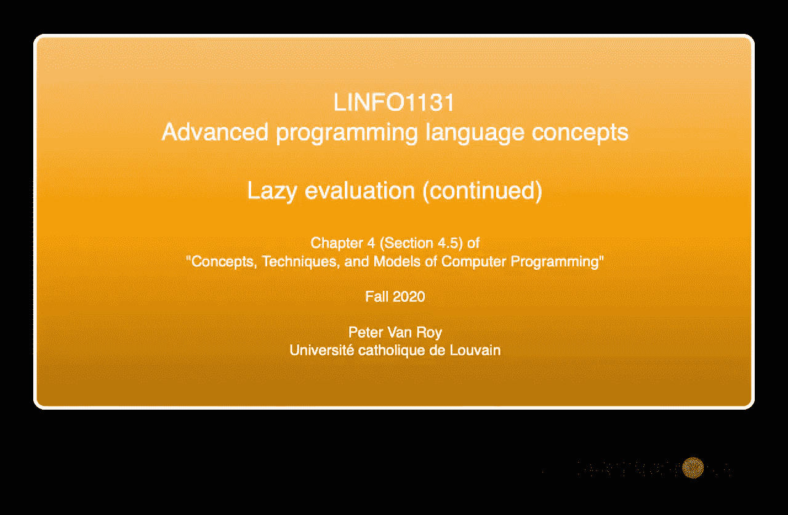

I'm going to say something more about lazy evaluation， this is new things。

 these are things that are not in the book。So it's important to look carefully at what I write on the board。

I'm going to talk about lazy suspensions。So last week I showed you what needed and I showed you lazy functions。

And we made some lazy programs。But it's very easy。To forget how it works。

 because all you have to do is take a function and write fun and lazy。So in this course。

 I want you to really understand it， so we're going to look closely at what happens during the execution。

Of a lazy program。So that's why I'd going to talk about lazy suspensions。

And we'll talk to some about hem， so we'll go revisit the Heming， but we look at how it executes。

How it executes exactly。The execution is triggered exactly by the need for printing the results。

And then I'll talk a little bit more， I'll talk about mononythtic versus incremental。

 this is some functions you cannot make them lazy。If you want the first element。

Sometimes you have to calculate the whole thing， there's no way to make it lazy， really。

 these are compound monolythic。And the functions that you could make lazy easily are called incremental。

And final example is lazy quick sort。 This is where the lazy evaluation。Is able to invent。

An algorithm。So this is showing。The power of lazy dev。So lazy it seems very easy。

 but in fact it's incredibly powerful so I want to show you some of that power so here I'm going to show you some of that power and then in the next course we're going to show even more power。

 show how you can invent， you can make very efficient algorithms using laziness。

 so Laziness is an extremely powerful technique much more powerful than you imagine when night food。

Talkked about it last week。😔，Okay。So most of this。The first park will be done on the board。

Would not be done on the screen， the very quick search I will be writing code。

 but also do on the board， so today is a little bit more theoretical course than last week。

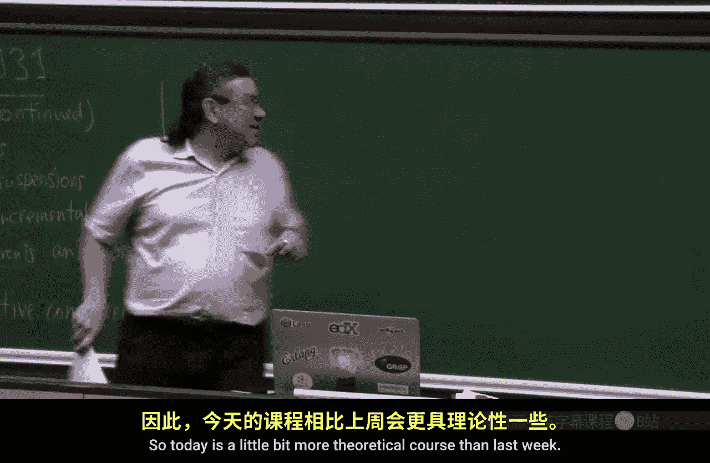

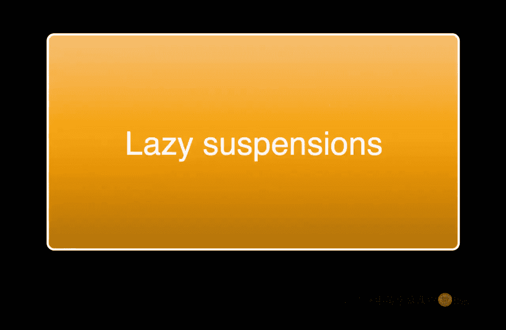

ButLet me talk about lazy suspensions。So let's go again to the simple function。あ。

That creates a lazy list of integers。Its。Very simple and bar ins。And plus plus one， okay。

So this looks extremely simple when you use it， but in fact。

 a lot of things happen when it's executing。So we're going to look at that。So this is actually。

Translated as follows。So I'm going to give you the kernel language translation。

 which gives the semantics。So the function becomes a procedure and creative thread。

The thread does wake the。こ年ぐいとことです。Wight needed R of the result。

Then I have r is equal to the function body。I will not translate that one into the colonel。

 that's not。Importantportance right now， so I will keep it as it was。Okay。

 so have a thread and inside that thread， I'm doing the way it needed。So if I call。Xス。以こで。And one。

 for example。This will create a suspended thread。Waiting on the way needed。

So I'm going to give that in name。I'm going to call that a lazy suspension。

So a lazy suspension is a threat。Suspending on weight needed， okay。

 so I'm going to call it a laser suspension and I'm going to make a picture。So here's the variable。

 x S。It' potentially infinite string。And the lazy suspension is attached to it。

 so I read it like this。So here is the body。Of the function。

So this is a lazy suspension attached to a variable。So when I meet the variable here。

I will execute this and the result of this would be bound。2 x S。オケ？So for example。

 if I do something like。Browse xs。1。So the dot operation is like。In addition or a case。

 it needs its first argument， so this will cause the weight needed。Of X S to execute。

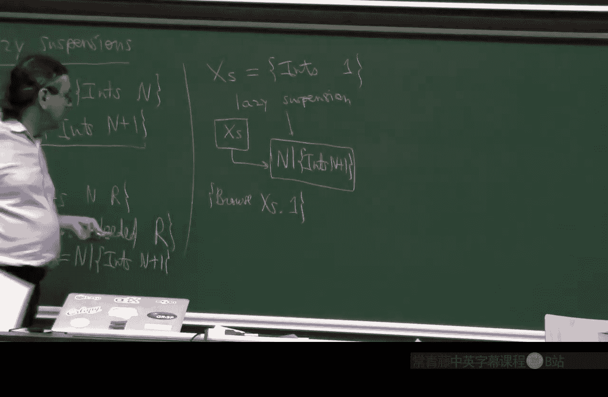

Okay， so what happens is we're going to have the result， so we're going to execute。Xs is equal to。

 there will be one followed by in。Of one plus one。This is we're going to execute in its own threat。

Okay。Now let me write this a little bit more。More specifically。One bar x prime。

 let me introduce this hidden variable because this is variable is there。It prime is equal to its。

What this one。So this will execute in its own threat。So I will combine Xs here。

To one bar excess prime。And then I will call excess prime is equal to ins， again。

 the same lazy function。So what happens is。I'm creating a new lazy suspension。

 so when I activate this lazy suspension， I find Xs。And here I'm creating a new one。

So the result is xs will be equal to one bar。Ex says prime， I can write it like this。あのこて。

Box are on excess。And I will have a new lazy suspension。Which I could write again like this。

So this new laser suspension will be ins of two。So this new lazy suspension will create another thread another way needed and do two bar。

Thanks。通とスワ。Okay。So this， this。Is transformed into this。See how it works， it's very simple。

 in fact we know already， but it's important I want you to get a good understanding so this is a simple case where I activate one lazy suspension and then I create I bind the variable and I create a new one because I have a recursive。

好。And if I keep going。If I do another one， browse。X。S dot 2， dot1。Then， I will。In fact。

 get the second element of the list， this operation， excess the2 is equal to excess prime。

This will do xs prime do1， so it will activate again the lazy suspension。

 so I will have another unfolding。So Im going to do it like this。

 the result to be something like this。Okay。So you can see that eventually I have a list。

Or stream actually， where at the very end there's a lazy suspension。And each time I ask for more。

 the list will unfold a little bit more， but always at the end。

 there's going to be a lazy suspension。And this one will sit there。Waiting until I need the result。

 So this is how the laziness works。 It's always at the end。

Of the data structure that I have lazy things。So if I have a lazy list。I had elements。A is0， a1。

8 two。A。And at the big end。I will have no lazy suspension。Now we can also have lazy trees。

I haven't done an example yet it's a lazy tree， a lazy tree is where the whole frontier of the tree is being created。

 so for example， I can have an element。And here's a binary tree。And at the frontier of this。

I will have again variables。As one is two as three as four， as five， as six， as seven， as eight。

 and each one of these will have a lazy suspension attached。Okay。So the whole frontier of the tree。

 the frontier， which is the edge of the tree， will have all lazy suspensions。

So in a list that's very simple because there's only one lazy suspension， yes question。

The norm with the lazy suspensions， so let me translate English， so the question is。

 does making a large number of lazy suspensions slow down the execution？Well。

 it's clear that a lazy suspension creates a trend。So lazy execution has an overhead， okay。

 so you pay a price of this very nice infinite structure is that you will be creating lazy suspensions。

Now in Oz and Mozzark system， the lazy suspensions are like threats。So threads are very lightweight。

So you can create very many of these thousands， 10000。

 but still it's much more expensive than just a variable， okay， so you are paying a price for this。

But it's a constant factor， there's no， you're not changing the duplexity question。

So is it interesting or some problem to use。Yes， it is interesting。Because again。

 it's like a laser list， you have an infinite tree。

 or you only compute the part of the tree you really need， okay。

So I don't have an example right away， but in fact。

 there are many examples of infinite data structure。

Using lazy execution that you can find in Google and sona。So yeah。

 it's not always interesting to have dais of trees。But sometimes it's very interesting。

 it's interesting when you do not know in advance how much you need， then it's very interesting。Here。

 if I don't know in advance how much of this list I will need。Then laziness is a perfect solution。

Okay， if you want your program to be dynamic， incremental where you don't know when you write the program。

 how much？Then the base is。Then it's really a foot。オ。

And the laziness will automatically do the minimum amount of computation。

And it also makes the program simpler。Okay。So that's a simple example， let me now go back。

Let me now connect。Lazy suspensions together， so this example has one lazy suspension。

Let me now show an example where there are many lazy suspensions connected together。

That will be the he problem， which we've seen， so let me show how it works in terms of lazy suspension。

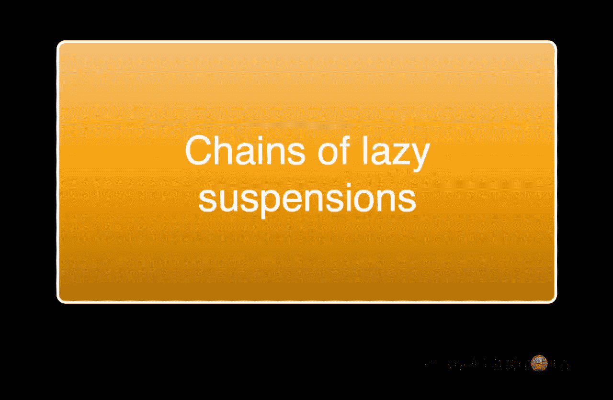

In lazy lists。Like in the in example， we have one lazy suspension。So we have one lazy suspension。

In the NS example。But let's show an example where we have multiple lazy suspensions。

So in order to do that， let me again show you the humm。Go back to the he problem we did last week。

So remember the he problem， let me just write the equation that is the main loop to theham problem。

 H is equal to one bar。Merch。Times。H。That's the first argument。

 and the second argument is another cult to mergech。

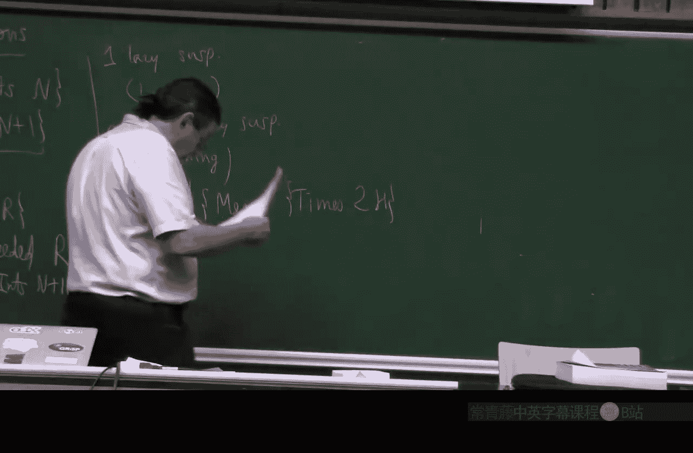

Times。3 H。ざ。5 H。喂。Two bracket the close。So this is the main loop of the me of the hate hamming problem。

And we can see that let we recapitulate。So we have lazy functions， mergech。

So the mergech function will basically do a case。This one is two。To get elements。

A1 is 2 of H1 bar T1 H2 bar T2。Then I'm not going to write the go code just show you the。

Show you the main loop because we'll use this。And the Times also has a simple loop。P statement。So。

 this is。H times n followed by。对。And。And inside the merch here， there's going to be a recursive car。

For example， P1， S2 or whatever， there's a recursive called in。Okay， so this is the equation。

So when this is started， when you've called this。😔，You're going to create five。

 let me see suspensions。So let me write that down now。Space。SoH。Is equal to one bar。A prime。

So all the hidden variables， I'm going to show them here， there are in the kernel form。

 hidden variables for all the functions the h prime is the first。Hidden terrible。

So each prime has a lazy suspension。Okay， this lazy suspension。Will be this merge call。给。So， let me。

See what's the best way？Let me do writing it like this。To show all the variables。Let me create。呃。

Let me unroll this， so the merger here has a variable times 2 H， which is T。

 which is given by the result of times 2 H， and M which is the result of the second merge called。

So the TV。Will be。Times to H。And the。Will be。Again， merge。我照鱼。The you will be。Times3。

And the V would be times。Okay， you can see that we have here a graph。Of lazy suspensions。

 so these variables here， I'm not going to write them over again。

 so I have H prime go to lazy suspension， this lazy suspension has two inputs。TM。This merge call。

 which means two other late suspensions， this one has two more， so there's five in all。Okay。

Now we're going to show what happens when we execute this。So now let's do。Rose， H。T that。1。

So this is going to display the second element， but this will cause。The lazy suspension to activate。

 So how does this work exactly。 Now we have this whole graph。

So you're going to see the activations will kind of percolate， they will flow through the system。

So the first day suspension that activates is this one is the merge。Okay。

 so if you look at the merch here。This one。He's going to activate rate。

So this one will execute so the body。We'll execute。Okay。here we'll execute。So H prime do1。

The weight needed here activates， I execute the body here。In its own thread， so this is the result。

 so basically I mean x h prime is equal to。The body， which right down here， that's one。two of。One8？

経中？H2。I'm writing with them small here。So I do this。You see that。I'm doing this。And its own threat。

 that's very simple， right？You see that then well now we have a kind of domino effect where。

We're going to trigger more or likely suspension。So we have a case stage here。Of S1 is 2。

 but what are S1 and S2？It's actually T and ever。That's one of is two。It's actually T and N。

 that we make a different color。Because the arguments of merge are T and M。

 so actually I have your T。And then。And here I want the first element of T。

 and here I want the first element of M。You see that， dude？So what happens is this case。

We'll need the first element of tea。And then we'll need the first element of M。

That means this case will trigger these two。Lazy suspension。So you see how it works。

 the body of the merch here。Has a case statement and this case needs more， it needs information。

 it's hungry， it wants information， so in order to get that information it has to activate these two lady suspensions。

Okay， so that will cause。That will cause two new A suspensions to be activated。

So it activates two lazy suspensions。So what happens is we have t now is equal to that。

 T is equal to times of 2 H。Which is this thing here。C is equal to。Case， and it's argument，hu？

I'm sorry， I switched the arguments here to the NS。The H is now the argument， So it's in the age of。

And then an element followed by。H prime。Then then there's a official call end。

This H is the same as the original H question。they。私あ自聞さし。So the question is。

 can you optimize this so that you reuse the same threads so you're not creating new threads of the time the answer is absolutely yes。

 you can do lots of optimizations you can of course reuse。Threads。For the recursive call。

 like for ins， for example， the recursive call there's a if you can actually program it directly using what needed in the same thread。

 so I'm not going to talk about these optimizations now。

 but it's clear that the overhead here where you create a thread for each lazy suspension。

That you can do a lot better by doing optimization，But that makes the code more complicated。

 so I'm not going to show here， or you can make it much more efficient。By doing that。

 okay and a smart system like CASll will do lots of optimizations。

So the laziness at the end of the day is not so expensive actually。

So let me go on now to explain how it runs here。So h prime will be bound to the body of the merge call。

 which needs T and M， this caused the T and M lazy suspensions to be activated now look what happens here we have T is equal to the body of the times。

And the case is now using page。But the H。Is known。So the E here is already equal to1。

And this age prime is the age prime， so this T， this body will not create any more activations。Okay。

 it will execute the body， but it does not have to activate any more lazy suspensions。

So the activation stops here。And this one does not activate。🤧な。M is again a merge call。

 so let me show the body here。InC the two arguments of this merge are U and V。

So let me write U and V here。So there's a body here which executes with U and B。Okay。

 we're to activate M。It's all thread。Now again， I have U and V which are needed。

 I need the first element of U， the first element of V。

So that means these two times calls will also be activated you see that？

But the Times call is reading H， so it will not activate anymore。

 so you can see how there's kind of a chain。I start with doing one thing here。I want one thing。

I do one small instruction here。One instruction。And this will trigger a whole chain of actions。

So this instruction relates you to this， this will cause these two to be executed， this one。

 this m will cause even two more to be executed， so all of the lazy suspensions are activated。

You see how the chain works， I need H prime。But executing this body will need more information。这一个な。

So there's like a shame。But activation， so all of these lazy suspensions get activated。

 they all run the bodies。And then what happens？Then then we get results。Okay， the T。It knows E。

So the E is going to be equal to1， and here it'll be two times。Two times1。

 so they'll do two times one。With a recursive call times。To H prime。So， here。Nice。Two times1。

 followed by times。To H prime。And then these two will also act。

So let me write down now the activations， the executions。And what happens？

So we're halfway done now in the execution， you can see this small thing。

Causes many things to happen， the first thing that happens is that all these lazy suspensions are activated。

 so that's the first thing and the second thing is now they all execute。So。

We will have T is equal to。2。B儿。Times。To H prime。Okay， let me write it like this， two bar T prime。

And T prime is equal to times。B prime。So the T will be a stream， which is twice of H。

Okay this is one thing that happens， the you here will do the same。We would have view is equal to。

Three bar you prime。A new prime is equal to。Times3 h bar， and finally we will have v equals5 bar。

V prime v prime is equal to times。F h bar h prime， sorry。

 so we have these three variable both bindings。That I've done and these three new variant T prime U prime v prime。

Then we have this mergech call。So we'll have any。Is equal to the result of this。Merge call。Well。

 in this case， if I have U and V。The result will be three。And I will have another recursive call。

Here。Merge。Well， here I'm actually going to the next element of U。

 but I'm not going to the next element of V， sorry to the U prime。3。Okay， and the final one， H。

Crime here。Will be。Now I'm doing the merge of two and three T starts with the two。

And M starts with three。So it'll be two bar。Let me write page double prime here。

And they will be again mate。A recursive call， So I'm using。Here I'm using the element coming from。T。

 so therell be T prime。But I'm still using and I haven't used the three yet。Okay。

So you see what happens。After first we do five activations。

 then we will do five variable bindings here， five。These one， two， three。4，5。

And we will do five recursive callss， times， times， times merge， merge。So when I do h prime。1。

 I start with five activations。They all execute the bodies in new threads。

 this causes five new variable bindings to happen。TU V and。A crime。

 and it causes five recursive calls to happen。And those recursive calls will create new lazy suspensions。

 so five new lazy suspensions are created。So you see a lot of things happen。Okay。So when I do。

 let me summarize this。When I do browses？H prime that1。I will start by activating。

Five basic suspensions。But they're actually to get order。I don't know in advance。

 so it starts by activating the merge and then the merge when it executes。

 it needs its arguments so it activates another merge and another times。

This merge needs its argument， so eventually five were activated， one after other。

Then it will bind five variables。And it will do five recursive calls。

Which creates five new lazy suspensions。So this is everything that happens when I do H。Prime dot one。

Okay。This is very simple thing， it takes me only one or two seconds to type H。Dot 1。

But a lot of work is done， okay， which is hidden inside and you don't see it。

Because it's all hidden inside， you don't， it looks like you have functions。Being executed simply。

 but because of the way needed in the threads， connections。

The activation happens in the opposite order， okay？So it starts。😔，By activating。This one。

 then this one， then those， and then the information comes back， I bind the five variables。

 and you recurs to call create five new lazy suspensions。So if I make the final picture， then。

Let we make the final picture。Here。After I do。Browse。H primeduct1。I will create。

 so h prime will be equal to1 bar2 bar h double prime。And this will create another legacy suspension。

Merge。Tea friends。诶。Because I have only used the tea， I have not used them。

So the T prime will create another lady suspension。Will be times。是。Pro。

And then the M will create another merge。Now look at's very interesting， I've used the tea here。

The two。But have not used the three of the five yet。

Which means that this merch will actually be the same as before。たま。H times 5。

So you can see it's possible maybe to optimize this。

 but here I'm looking at the perfect just the execution， simple execution。

So what happens is I activate them all。I bind variables。But remember， look what happens here。

 the T prime here， this is the two that coming here。So the T prime is2。The T is2 bar T primer。は sir。

That。So this one will have a new AC suspension， but notice I'm not actually using the U and the V yet。

 it's very dynamic， it depends on how the mergerch mech actually has different recursive calls。

Inside the merge， there's different reive calls， there's three possibilities。Either I use S1。

 I use S2， or if they're equal， then I use both of them。So there's different possibilities here。

 so it might be that I do a merge call here。Okay， with where I'm not using。した？オッ。So so here。

I have then a new five laser suspension。Okay， so this looks。Somewhat complicated， right？This looks。

Pretty complicated the way I've shown all these execution。But。

It's important to understand how it works。😔，Later on。When you use lazy in your career。

When you know very well how it works， you don't always have to go into this level of detail， okay。

 but right now when you're first learning it， it's very important to do this。

So I expect you to be able to analyze a lazy execution in this way， okay？How to how actually runs。

Of course， you couldn be lazy and forget about all that。Annotate your functions with's fund lazy。

 call them and that's it and it works， okay， it will work。But the execution might be lazy。

 but I don't want you to be lazy， okay， I want you to understand how it works。Okay， so that's。

How of the。The lazy。Suspensions。How they actually execute。No。A little bit later。

 we'll to see a bigger example， lazy Quickswordt or actually。It's more subtle。

 and it's very interesting how to see it works。 but it's important to see this in terms of。

The Hammon first。You can't always make functions lazy。谁。

So it's possible that laaziness doesn't help anything。Make some space。So， let me talk about。

Give an example of a monolithic。Versus an incremental function。

So a monolithic function is one where the laziness does not have any advantage and an incremental function is one where the laziness does have an advantage where you can compute things incrementally。

So the heming problem is a case where all the functions are increment， okay？So merge and times。

Are incremental。But let me give you an example of a function that's not incremental。

Or the lazy does not have an advantage， there's many functions like this， son。

So here's a simple example， let me do reversing elements of the lists。So let me write a function。

Reverse。Let me do it with an accumulating。Crameter， so how does the reverse work。

 when you're going to use that question？嗯，别啲。The the list is circular you're saying a list where the final element points back to the beginning。

 Okay I'm not talking about this kind of list now it's it's an like an infant list so circular list so the question is。

What happens when you have circular lists， a circular list is a list that looks like this。

 for example， one， two， three。Well。 where the L points back， so it actually looks like this。

 if you look at it。And you don't look at this， it looks like it's an infinite list that's always one。

 two， three， repeated forever。That's what it looks like。

Well the answer is this kind of loose works very fine in a lazy program， okay。

 you can use it with lazy programs。And sometimes it's good to use。

 but I'm not hooked to show it here， it's kind of outside the scope， okay。

 it's more kind of a more sophisticated use of。です。So that's another advantage of lazy that cycles don't give any problems。

Okay， so let me go back to reverse now， let me show you a simple reverse function， so revers a list。

Case of H bar T。Reverse and this will return T。H bar A。Okay， and I do。三秒。

So this is simple reverse function， okay？So if I call。Browse。Reverse。那家还。One， two， three。

 and I give the initial value new。This will display。3，2，1。That's reversed， you see it's very simple。

 you know this it's a standard kind of functional program。What happens if you may be lazy？

What happens if reverse is lazy？Well， let's take a look。What happens if we make a lazy reverse？

What about lazy reverse， so basically I'm going to add a fun， lazy reverse。Okay。Let me make a lazy。

A lazy reverse。Let me do something like this then。L is equal to。Reverse one， two， three。没有。

And here I have a lazy reverse， okay， lazy version。And then I do browse。L do one。Okay。

What happens now， it's very interesting to see what happens。So this creates an lazy suspension。

As usual， so we translate it as usual and it will work actually。

 but it will not give the result so nice as the other ones and you'll see why。

So this will create a lazy suspension， so I have L。And here I have reverse。1，2，3，6。

 so now I do browse L do 1。So this will activate the laser suspension。Okay。

 and it will do L is equal to the body of the reverse。Here， the case。嗯。Now， this is one sorry。

The argument here is one， two three。In nice way。Reverse of。wo three。One bar meal。Okay。

So it runs this。Okay， funny。So this is wood run， so H is equal to。Sorry。We haven't gotten it yet。

 so it's T and then H bar no。So this will run， the argument here is one two three。

 the accumulator argument is nil。This is A。So to be very precise， we don't know yet with TH and AR。

 so this is the code one to three with run， so this will actually call or make a recursive call。

Reverse of。T， which is two， three。One bar6。So this executing this code leads to this re crystal call。

Very fine。Now， so L is equal to this。Bookers have called。So what's going to happen here？Well。

 note that the L1 it's doing basically a weight。然 sell。

The dock operation here is doing a wait on hour。And this is what triggers the weight needed here。

Now this reverse recursive call is proof to create another lazy suspension。Right another suspension。

 which will do a weight needed on L， but the weight needed on L will immediately run。

So this will create。Lazy suspension。And the weight needed on L will immediately run。

 and the reason is because we already have a weight。Will not。Suspen。とで。

Which means that this recursive call will run normally， it won't stop。😔。

It's because we have a weight on L， but we still don't know the first value element， okay？

So the latest suspension here will immediately run。It activates right away。

Because the weight needed will not wait。Waiite means that L is not going to wait。

It's going to immediately go on because we have a wait to help。The weight on L， it's sitting there。

And it's waiting for an answer to say， okay， I want an answer here， I want this。I want L to be bound。

Okay， so we run， we have run this， L is still not bound。So we keep going and in fact。

 it will keep going and it will execute the whole reverse。

The whole reverse will be executed until the end。ok。Except there would be some more overhead。

 because of the late suspension。But it's going to execute the whole reverse。Because each time。

We activate here to suspension， and we execute， we're not getting a value for Elott。

We don't get a value for L。Until the very end， okay， until the whole thing is done。

So here in the middle， we're not getting a value for L yet。Okay， so the result is the home。

The reverse will execute completely。And we will have at the very end， L is equal to。Three， two。

 one at the very end。You have the whole answer， and then of course， L dot1。eight three。

Now we're fine， now the weight is happening。Okay。But it will actually execute。The whole thing。

 because each time we do an activation， it still does not bind out。You see that the reverse。

The lazy version of their verse， it's going to work， it works fine， but it gives no advantage。

So you see adding the la annotation will not make a bug， okay？That's nice。

 they will not have a problem， but it's not always giving you an advantage。So in this case。

 the reverse will execute the whole thing。Before it returns a value of value。And actually。

 it's kind of logical that if I have reverse。Elements and I'm asking for the first element of the reverse is the last element of the original list。

 okay， so it's clear we have to get to the very end of the list before we know the first element of reverse。

So。It's kind of hard to do an incremental version of reverse， how would you do it？

So it's not possible， so not all functions can be made incremental。

So we say that reverse is a monolithic。Because the laziness gives you no reduction in the computation。

So类。Does not reduce。The amount of computation。So in terms of recursive calls。

In terms of the number of recursive calls are done， all of them are done。

When I ask for the first help。So we say reverse is a monolithic function。Whereas verge times。

 other functions are incremental。So this is actually a property out of the thing we're computing on。

Reverse needs the whole list。Before you can give you the first element， it's pretty clear。

You can't really make it incremental。Whereas the merger of the times are naturally incr。Okay。

So you see that， so the lazy you have to be careful， it's not always giving you an advantage。

It will not give you a bug， you see the reverse it still works。The laser universeverse still works。

 of course it's going to have a bit of overhead here because each time it's going to be creating a thread and running away needed。

So it's going to be a little bit slower， but that's a constant factor。

 the complexity will not change。So it'll be a little bit slower， but still works。Okay。Okay。

So now that shows us a lot about lazy functions， let me make now a small break。

 five minutes and then we'll give you the。What's called。For the laziness。Because that isies。

 I will show you a real example of the power of laziness。

Where the laziness is actually able to invent an algorithm， so the quick sort is not monolithic。

It's incremental。But it's incremental in a very interesting way。

Because it's going to do some computations。Compute the first element or the first elements。

 not everything。And the what it does is actually very interesting。

 So we're going to see that after the break。

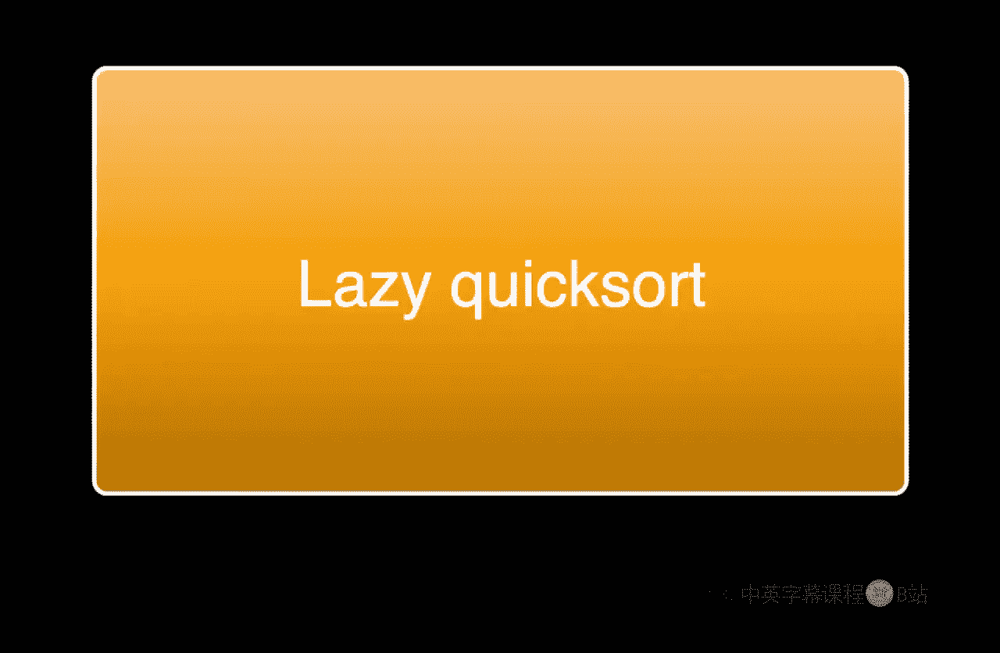

Let me now show you the lazy assortment here。But first of all， let me show you how Quicksort works。

 so Quicksortt is a sorting algorithm。That takes。A list of elements， it takes one element。

 which is called a pivot。Take one element， and then it splits the list into two lists。

 one which is all elements that are smaller， and the other one is all elements that are equal or greater than the pivot element。

So you get these two smaller lists， one is all smaller than the pivot， then one is all greater equal。

Then you recursively sort those too。And then you merge them， you append them together。

 and then you have the sort of the final So here I taking elements from L。

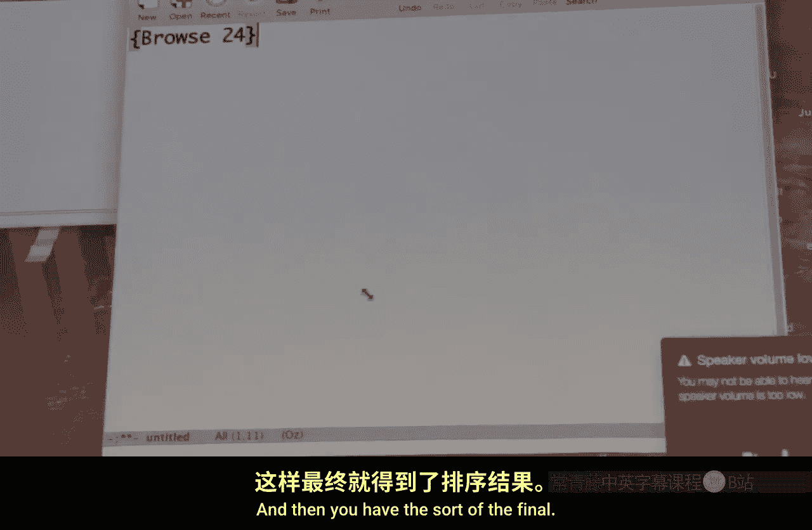

And if it's less than x， I put it in L1， if it's greater than equal to x， I put it in L2。

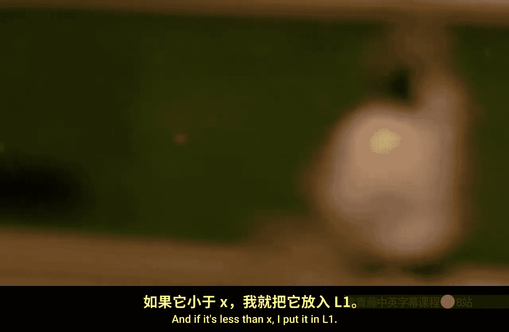

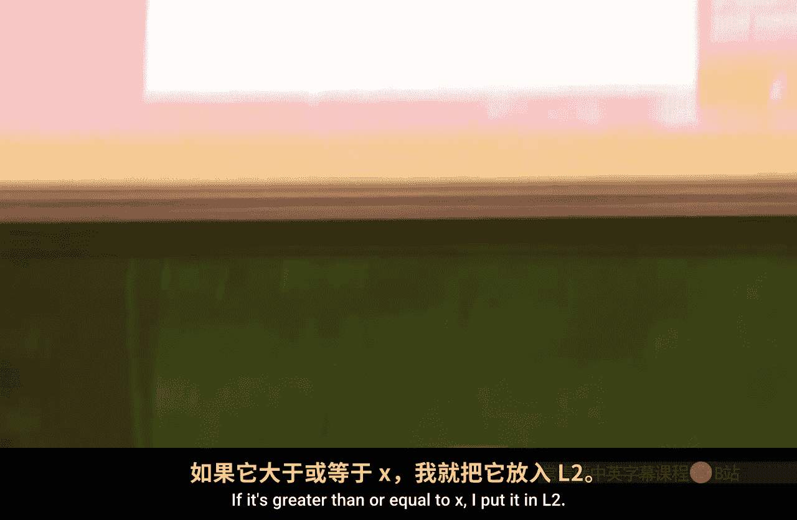

So， if。关。It's less than x then put in。one。Cos。L， it's greater than or equal， and I put then L2。诶。And。

Myel is then。Then I have L1 is to know。So it's a simple incursive procedure。

I traverse L and I put elements in L1 or L2。So putting an L1 is doing something like this is L1 is equal to y。

For M1， and then I have。Recurive call。Mmon。And 1，02。And here I put in L2， so L2 is y。And2。And。

It's no one。有。That's it。There's only one s state care， of course， which is what？What's the mistake？

I make mistake yes， and when it defines M1 is not defined so I have to declare M1 of entry exactly。

So everyone， I declared。So this is it， this is the partition， this is the heart of the pixel side。

Okay。So， I can。Show you an example of this now。So let me make a partition。So， I make a list。

Somewhere in the blue gear。And a pivot element then make four， L1， L2。Browse and1， browse L2。

So you can see how the partition works here。So 332 is all the elements less than four， and 7，6，5。

854 is all elements greater than equal to four， okay？Let me also define an。And function。

 which takes two risks and apps them together。so it recourses down the first element。

 the first argument and puts the x in the front， and then at the end of L1 it just returns L2。

 so it depends。So we need this for the quick sort。所的依据是什。Show that works。So here's a simple app。

 three four five， two to two， it apps them together， giving me one list， three four five， two to two。

Okay。So now that you make the actual Quickword algorithm。Hello。So I have to call partition。

 so I need a pivot element， I'm going to take the first element of L as a pivot。

I can also take other ones， but it is very simple， so x would be the pivot。Portition L X。sorry M。诶没。

E1，02， I have been declared here。And one。So I partition。So I take x as a pivot element。At partition。

 the other elements。Giving L1 and L2。Okay， then I do recursive call。This one is Quick sort level1。

This。Priend them together。诶。So this is the quick search algorithm。

There's a small bug in this algorithm。There's a small bug here？So first of all。

 we have to be careful。The recursive call always has to have a list smaller than the original。

 so L1 and L2 have to be smaller， otherwise I have infinite loop。So is it true here？

Are we guarantee that L1 L2 are always smaller than L in size？Yes or no。What do say。

So when you have recursive call， that's the first thing to check。That the recursive call is less。

 the size is less， strictly less。Is it true here？You check on people check one on people yes。

 so here I have removed one element from L， so M was already one element shorter。

 so that means an L1 and L2 are maximum of the size of M so that's absolutely right。

 so we are guaranteed。There's only one other small problem here that we need to fix is that pivot has to be part of the result。

 okay， yes。有点冇啊后咪就通啊系就六点钟过来。So。 there are optimizations possible。

 but I'm not going to show them here， so there are other somewhat optimized versions of Quickword。

But this is the most simple， straightforward version。And it's maybe not the best version。

 but it's the version I will show you because it will show you very clearly the advantage of laziness I want things to be very simple okay so I have to add。

The problem is that。I have to。X， I'm not allowed to remove it， so x has to be in between L1 and L2。

 so if I put x bar L2 in the append， then I keep the x and then I'm fine。

So this is a correct quick sort algorithm。有什么。诶。啊。There's still a bug in there， stupid bug。

 I have to declare as1 minus two， of course， here。Now it's fine， right？

See even small programs could have。Lots of subtle little bugs。It's good now， right。So I do like this。

Does't look very good， though。Three，2，3。Oh， of course， I'm very stupid， what did I do Iraq here？

laptop。The error is much more stupid than that，こて。Exactly。

 so the append has to append S1 and S2 not L1 and L2 Okay it's very stupid bug。Nobody sides。Strange。

See， small program full of bugs， right？Now it should be fine， right？After all that。

Are you confident now that it's correct？We saw many， many boxes to the programr。Wow。

 it actually seems to work， I have sorts。Okay。Now let me do a magic trick。I will make a lazyqui。

So let me copy this， so the partition actually stays the same， let me take a pen。

And quick search and make them lazy。So let me create a lazyend， El a pen。分利先。And a lazy quick sort。

问你先。L。I有 quick sword。Okay。Like good。诶。This。So。This is a lazy crson， so first I have a lazyiaend。

 so when I do lazy aend。It will not do anything until I。Neat elements， okay， fine， let me declare。

有的似系。And now I need to get our lazy Quick songss。Correct。So the quick thought。

When I do a recursor call L quickword L1， for example。

 this will not do anything until I actually need the result。Okay。So let me try something here。一啲听得。

Elll quick sort。Here's an example。Where else？So I called Elquizl。So this displays nothing。

 which is what we expect， it's a lazy function。Now， if I want the smallest element of the input。

I can do this， I can do browses， S1。And this will cause the lazy suspension to reactivate。

And the smallest element is one。Okay。How much work did this algorithm do？To get。

How much work did it do？That's an interesting question。

How much work did it do because to sort n elements。

 the algorithm takes n log n on average or even n squared if the list isn' in the wrong？What order。

But in the lazy version， how much work does it do to give me the first element。

 so the smallest element？Well， let's see what happens。So I do s dot1， okay， I want S do1。Here。

So let me go back and look at the code to the quick sort。So， it will。It will。呃。

Activate the lazy' suspension because the S dot1 doest weight on Eson， so the body will be executed。

I will execute the partition completely。So L partition Mx L1 will be executed completely。

Then I will create two more lac suspensions for the recursor called quickor and the Lend。Now。

 the L hand suspension will execute immediately because the weight needed is。

There's already a weight on S so the needed S will execute， so the Llopen will execute right away。

 and it will need S1， it needs its first argument that means the first recursive call to quit or will execute。

Okay， so I do a partition on the whole list。诶喂。After a little bit of work。

I'm going to call Quicksortt on L1。Okay， so you see what happens when I do browse S step1。

 I will do a partition on the whole list。And then after a little bit of work， I will。

Call quick sort of L1， the quick sort of L2 will not be activated， but the one on L1 it will be。

So that will cause a partition on L1 to happen。And that will cause a new partition recursively。

 and things get smaller and smaller and smaller。Okay。So let me show。Quickly on the board。Do now。

 let me make a picture of the board。What I when I do browse of。S1。As does one， the work that's done。

So basically I do a partition。So basically I will let me make the picture like this。

This is the main list L。And we'll partition it into L1。And2。Okay， this is the partition。

And then I will call quick sort of L1 recurively， only an L1， so this will do another partition。

Like this。L1 prime， L2 prime， and recursively， it it will only do the L1 prime。

Until we get one element。This one element will be， of course， the smallest element of the list。

It's clear the L1s are all smaller than L2， L1 primes are all smaller than L2 prime。

 L1 double prime is all smaller， so this one will be clearly the smallest element of the list。

 so how much work is this doing？So here I have。A number of how many operations？

So assuming on average that the partition divides the list into two approximately equal paths。

So that means the first step， I will do a constant times n because assuming the length tells the n is nL。

And then in the next step， I will do a constant。Times n over two。

 and then a constant times n over four。So the final result will be。All the way up to one of them is。

To C N I'm dividing the list into half each time。 that means it's bounded by。It's a constant。はい。

That means finding the smallest element of the list。Is order N。Which is exactly。

What you would get if you write a program that only does that。

If I write a program that gets the smallest element， I have to traverse all the elements。

So the quick sort。Is actually incremental。Here， because it's not n log N。

When I only need the first element， it's giving me only one。Element and its order。And okay。

 let me go back to。Screen here。So this is done， this takes。Order and。

WhatWhat if I want to be a little bit？诶。木。He say。各一份儿。I want the smallest two elements。

I have n elements， and I want the two swallowest ones。Well that's easy to do here。

 I just do browse s do1 and browse S do 2。1。As they quick sort。Will。Give me that。It's one two。Okay。

And I can go on， I can have the smallest three elements。But how much work does it do？😔。

To give me that。Well， if I want the second element。Somewhere here。

 I'm partitioning and I have two elements left。So if I want the second element， the smallest two。

 the amount of extra work is actually very small。Because when I partition all the way down。

 at some point， the list L1 here is going to be very small， it's going to have two elements。

 and those are the two elements。That one。So getting the smallest two elements is only a little bit more work than getting the smallest element。

Okay。What if I want more of smaller elements？F， what solves say four elements。It easy， I do。

That's the second one，2，2，2，1。So one， two， two， three。Those are the smallest four elements。

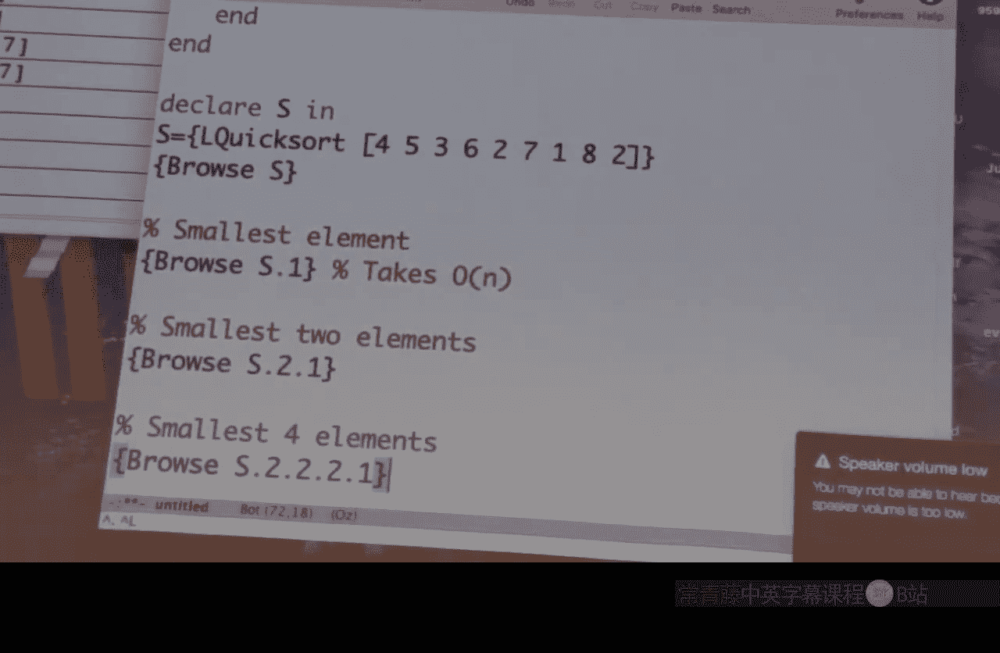

Okay， let me now go back to the。Board。

So in general now， what happens？If I ask for the smallest。K elements。Out of。And。Okay。

The slowest K out of n。しいと。TakePicture。How much work does it do？Okay。

 so let's say I want the smallest。K elements。Out of。ありがとうございます。that's easy when I write。

 I just do a touch。I do touch for n for K。How much work is it doing？

How much work is this algorithm doing？Well， we can actually figure it out。

Let me show you a simple way to figure it out， so here's my original list L and。

And I divided it to two。The way each system normally works is that these two are approximately equal and each one is doing recursively in quick sort。

 so this one't be divided into two and this one't be divided into two and so on。オケ？

And so this one will be divided into two。And so I。So that's how it works。

And each time I will have half here I have n and over two and over4， okay？Well。

 if I keep dividing into two， and each time I will do a recursive call to quick source。Okay。

 so when I have N over four， I'll do a recursive call to click so。

That's the reason one at some point I will have a very small list。Here。

 I'm each time you writing by two， which has K element。

Or actually the smallest value of n divided by power 2， which is bigger than k。

 but let's say it has k of。These are the K smallest elementss。

 so at some point when I keep dividing by  two， I will reach K。

And then I will do a recursive quick sort。对。I will do the recursive quick sort for k elements because I will need all of the K I want the smallest k I need all of them。

 so how much time does this recursive quick sort take will it takes K log K？

Just quick sort on K elements， 6 k on K。Okay， so how much time total does the algorithm take now。

 well we have to take k like k plus the time for all these partitions。

So the partitions will be bounded by n constant times n， so the total time will be n plus。K乐。

For getting the smallest K elements out of n。So if k is equal to1， if it's like a small constant。

 then this would be order n， if k is equal to n， then this would be n plus n log n。

 which is n log n okay remember complexity， so this is very reasonable。Now， how good is this？

How good this 10 plus k again， it's actually very good。

If I want to find the K smallest elements out of n。

An algorithm n plus k log n is actually doing very well。But it's even more than that。

Suppose now forget about Quickword， suppose I ask you。

Invent an algorithm to find the small K elements out of N， how would you do it？That's not so easy。

 it seems，h。Invent me an algorithm that does this。Well， the lazy annotation will automatically。

Invents the algorithm because it quicks sort is incremental。

And it's actually a very nice algorithm because you don't even need to know in advance the value of k。

If I ask you， give me an algorithm that gives the smallest two elements out of n well that's very easy。

 I just keep based an array of two elements， I traverse the list and I put the smallest two elements in that array and at the end I'm done。

But what if I need the smallest three， well then it's I have to do over again， right？Question。

一きましょうね。Right so you're saying using the laziness we have transformed the algorithm into a generator of results Yes。

 that's right， so if the it's incremental that's what we did so the more elements we ask。

 the more computation it does。Yes。But then the question is， how fast is your generator， okay？

But in this case， the generator is doing very well， it keeps all the information needed。

So that you can always add more to K。If I ask you， give me an algorithm for the smallest two out of n。

And you write me the algorithm， that's easy right， I have an array of two elements。

 I traverse my list and I keep updating the array， that's the simplest way。

 but what if after it's done I ask you actually know I also want the third one。And then okay。

 so I need to do again， but with an array of three elements again now。

 maybe I want the fourth and the fifth one， so you see if you don't know in advance。

That approach will not really work， whereas this approach will work。

 even if you don't know in advance， maybe I'm looking at the smallest elements until I find an element that satisfies a certain condition。

Well， this one will do the smallest amount of work for that。Okay。

So you can see that this algorithms actually。Do worked very well。You see that so lazy。Laaziness。

 if your function is incremental。It can actually be a very smart way of improving an algorithm。

So if you want to build an incremental algorithm。Try first to build a normal non lazy one。

 but try to make it as incremental as possible and then make it lazy。

And maybe you have already the solution。で。Okay， so that's just an indication of the power of laziness。

So here laziness has invented a smart algorithm。Okay。Do that。And in a later course。

 we're going to show。How to invent sed algorithms， more algorithms that use laziness。

So why are we doing all this， by the way， why are we trying to make algorithms as smart as possible with laziness。

 but the reason is is because they're all declarative。

They have all the advantages of thelarative program。Quest。Re the project one another。哦哦弄 the。

I' putting their ultimate there So now we have a producer consumer， well。

 not really because we have to know the end。Because of a partition。So you can't the quick sort。

You can't just keep feeding at new element more elements， it？You have to know the end。

 but that's normal because what if a new element comes in which is very small， okay。

 then all the previous results are not valid， so the quick sort here。

 you have to know the n has to be known in in fact of course the N。Not the case， but the end of。

In fact， a sorting algorithm， which does not know n in advance is actually not so simple because it might have to correct mistakes from earlier if new small elements come in up。

So that's a different problem。哇过你需要同钱吗。at least the咩。好，你你你你咁系除咗一直嘅咁佢嗰边诶。まし本化副さ結構ならない。没有。結出職者けれの。

来我我不听。So in fact so you can start getting results， yeah。

 you can actually use this as kind of a concurrence。Parallel form of quickor。

 that's another improvement you can start getting results。

Even if the rest of the algorithm is not finished yet that's another， I haven't shown that。

 but that also， and that's also an advantage of declarative， which I called concurency for Dism。

So you could execute the whole quick sort on multicore， for example。

 and you can start getting results， small elements， even while the other parts are not finished yet。

ThankHello。The data flow， you're saying it's pure data of flow， why is it pure， I don't understand？

我同法咧就。Yeah， so you're basically writing because all of the recursive calls to Quicksort can be turned into recursive agents using dataflow。

 yeah， that's true， which I did not show and I just show laziness。

 but another thing you can do with the Quick sortt is all of the recursive calls can be made it through concurrent agents。

And they can be run in parallel on multiple machines in a distributed system。

And the result is automatically correct， okay， so the declarative formulation。

 it lets you parallelize things as well， so that's in addition to the laziness。

Those are two advantages， the lazy and the concurrency。

 okay so there's no worries about concurrency here。

 you don't have to worry about locking or any kind of monitors。NoR conditions。

 there's no problems making this concurrent and running it in parallel。

That's a separate thing from laziness， so I'm saying that because of the question because here you can actually have it。

 which is both lazy and。You can run part of the system laly in the other part concurrently。

 if you want， so all of this with no race conditions。And which is。

One of the main advantages of the declared de Nala in currency for。Okay， so that gives a lot of。

I think a lot of， I hope， a lot of his tuition。So let me， we have just a little bit more time today。

能力。Take a step back now。So we've talked about。Lazy， we talked about data flow concurrency。

But it's nice to know exactly what it means， so I want to give you a precise definition of that。オッケ。

So let me finish today， but I won't be able to do everything。Actually。小。

Gre the function of programs that are concurrent。We've seen data flow， for example。

 the deterministic data flow。Wwhichch is a really excellent model and when you start building big programs in your career you should stay there as much as possible and you will be able to get programs that run your boss will be very happy you'll make lots of money anda cea so this is a very good model but what does it mean exactly？

I want to give it a exact definition。So。Remember？We have in functionalal programming。We have seen。

We have seen。The church Ro in Theorem。That means the result of the evaluation is the same for all reduction orders。

Okay。For all reduction orders， and this is why concurrency for Ws。It works， okay？

Works because of this。😔，This， we have seen。But we've seen it for lambda cut。Okay。

And our model is not exactly the same as lambda ca， so weve seen this， okay。

 this is something you see。But actually， our model is moral。More general， so in the lambda happiness。

 you give an expression， you reduce and it's done。Okay。So the lambda come do this。

We have initial expression。You reduce。And you get final expression。Okay。

That's none and the church also worked for that。But our model is actually doing more than that。

We have a model where you can have an agent。It's a stream of input。Stream input。And stream out。

And you can keep feeding elements and more elements appear。And this is a concurrent agent。

So we don't have one initial expression， you start with five plus five plus5 then 15 and it's done。

 one in expression and one final expression， so you have a beginning end here in our model there's no beginning and no ends。

You can keep giving information forever。And if you stop giving information。

 then the output also stops。So the thing is actually。There's no initial expression。

 and there's no final expression' completely。Incremental。问系。

That means it's not exactly the same as lambmbda calculus， it's a little bit more。

 exactly doing more， so this is the model we've seen in our courses so far。And。

I tell you this model is declaredlarative it's functional， deter termministic data flow。

 but I kind of had wave and did not actually define exactly what's happening。

Because the advantage of functional programming comes from church route。

Confluence is what it's called the same for all election orders and the result is the same。

This leads to concurency for dummies， but why exactly？Because we don't have initial funding。

 we have a completely incremental execution。So what I want to do now is give you a better。Definition。

Of。The gl of concurrence。It covers it it is。Allows for incremental。For incremental。Computation。

And it's still。Satisfying。The church Russell。The confluence。So I want to say a little bit more。

 so I want to show you more precisely what's going on， this model here。

 deterministic data flow is super powerful， super important。

 but it's actually doing more than lambmbda because it's incremental。So how do we fix that。

 how do we explain it？So let me just give you one concept， one idea。Is。Called partial termination。

In the lambda calculus， you start with an expression。and it's done， so this is termination。

Ittermininates。The computation is done。Sver。But we don't have termination here。😔，Because。

You give some information。And we've been always computing more information， okay？

So partial termination。It means that。You can have stops， you give some information。

On the input you execute。And then you have results， first results。

But then you can give more information。And then you have a new result。

And you can give even more information。And you get even newer zone。And you can keep going forever。

 so for example， if I have a stream。If I have an agent that calculates the squares， one，4 like this。

 I gave one， two， it calculates  one4。Now if I add information， one， two， three。It will be one for。

 one。If I now make one， two， three， four， then I will add 16。So there's actually。

Areas where the system is terminated but only temporarily terminated， so I give information one， two。

And it gives me one for， and then it stops。But it's not totally stopped because if I give more information。

I had three， it gives mores results。And then it'll be what for nine。And then it will stop again。

 so it could stop several times， so it has many terminations。I give information it terms。

 I can always give more information than it terminates again and again。So these areas。In the theory。

 they're also called。Ring points。Okay。It means I give information to the system。

 I let it run until it's done。And then it's done。This is here。

 but then I can give more information and then it starts up again。Until it's done again。

 so each time I give a little bit more information to the input。

 more information comes on the output。And each of these executions。

 each of these little sququily arrows here， is like a single lambda calculation， okay？

So you can have infinite sequence of those。And the system。

 we say it has partial termination because when you terminate， it's not fully terminated。

 you can always start up again。Okay。So that's the basic intuition。But let me stop here。

 so next week I'll make it more precise， and then I'll start showing more sophisticated algorithms。

オッケー？So this is giving you then a precise definition of the termist dictator。

So why do I want to give you this precise definition。

 well it's because I want you to write as many programs as possible that you're like this。

 that are appeared like this。And that don't use states。If you should put as much as possible here。

 then you have incredible advantages。So we want to make it so you have as much as possible your system is doing this。

So that's why we need to define precisely what it is。Okay， so let me stop here。

And so I will try to put the recording upon。You too。

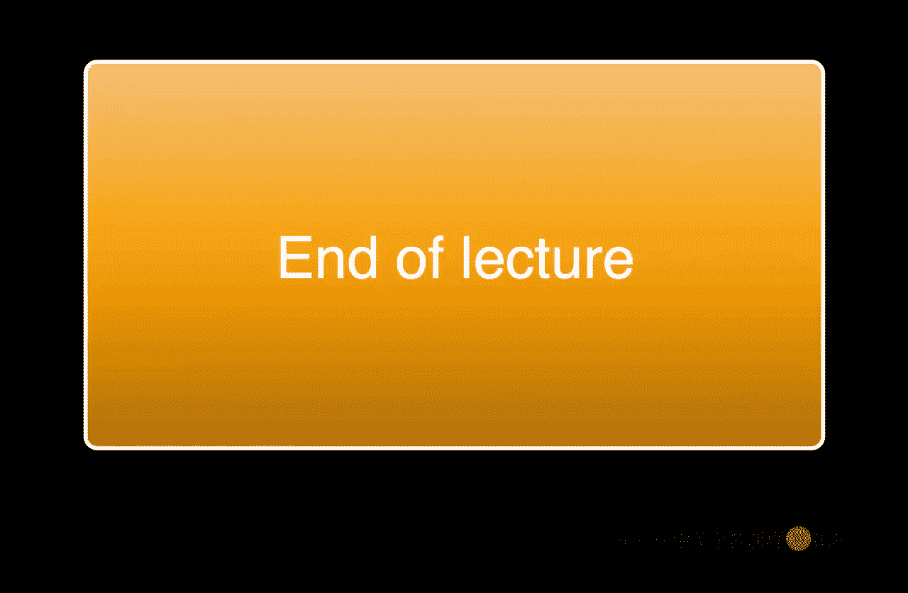