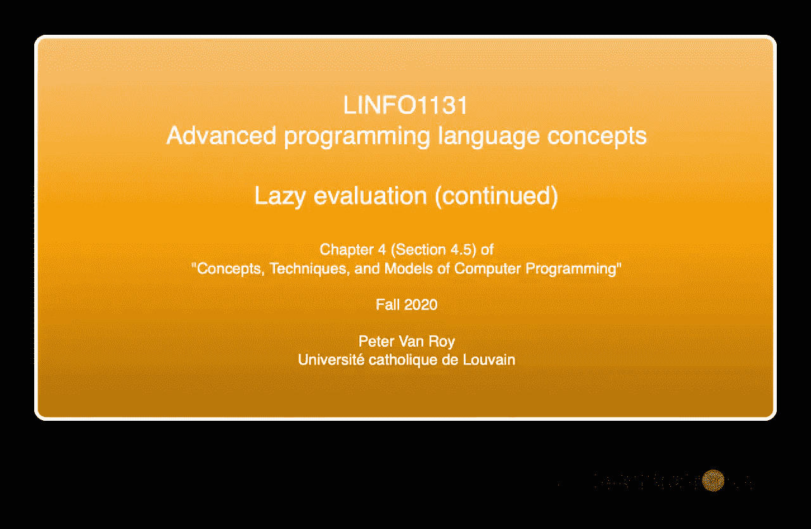
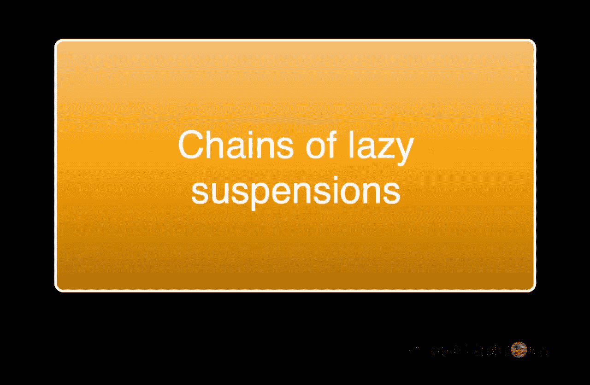
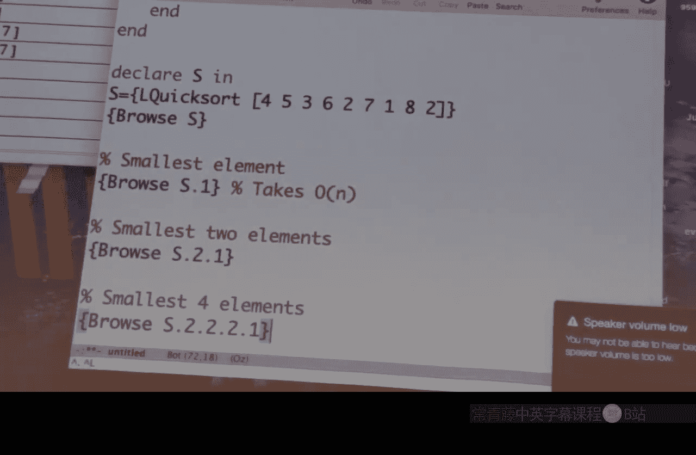

# 高级编程语言概念：第3讲：惰性求值详解




在本节课中，我们将深入学习惰性求值。我们将探讨惰性挂起的工作原理，分析惰性程序的执行过程，并区分整体式函数与增量式函数。最后，我们将通过一个惰性快速排序的实例，展示惰性求值如何能够“发明”出高效的算法。


## 惰性挂起

上一节我们介绍了惰性函数的基本概念。本节中，我们来看看惰性求值在程序执行时具体是如何工作的。理解这一点至关重要，因为仅仅在函数前加上 `fun lazy` 关键字很容易让人忘记其背后的机制。




惰性求值的核心是**惰性挂起**。一个惰性挂起就是一个**线程**，它正在等待某个变量的 `WaitNeeded` 操作。当一个惰性函数被调用时，它并不会立即执行，而是创建一个惰性挂起并附加到结果变量上。

例如，考虑一个生成无限整数列表的简单惰性函数：
```oz
fun lazy {Ins N}
   N|{Ins N+1}
end
```
当我们调用 `Xs = {Ins 1}` 时，变量 `Xs` 会附加一个惰性挂起。这个挂起的“函数体”就是 `N|{Ins N+1}`。

当我们首次需要 `Xs` 的值时（例如通过 `{Browse Xs.1}`），`Xs` 上的 `WaitNeeded` 操作被触发，执行其挂起的函数体。这会将 `Xs` 绑定为 `1|XsPrime`，并为 `XsPrime` 创建一个新的惰性挂起 `{Ins 2}`。

这个过程可以持续进行。每次我们要求列表的下一个元素（如 `Xs.2`），都会激活当前的惰性挂起，计算出一个值，并为列表的剩余部分创建一个新的惰性挂起。最终，我们得到一个流，其末尾总是一个等待被激活的惰性挂起。

惰性数据结构（如树）的原理类似，整个数据结构的“前沿”（即边界）都可能由惰性挂起构成。

**关于性能的说明**：每个惰性挂起都会创建一个线程，这确实会带来一定的开销。然而，在 Oz/Mozart 系统中，线程是非常轻量级的。虽然创建成千上万个挂起比直接使用变量更昂贵，但这只是一个常数因子，不会改变算法的复杂度。惰性的优势在于它只计算真正需要的部分，这对于处理未知大小的数据或构建动态、增量式的程序非常有用。

## 汉明数问题再探

为了理解多个惰性挂起如何协同工作，让我们重新审视汉明数问题。汉明数的核心方程是：
```
H = 1 | {Merge {Times 2 H} {Merge {Times 3 H} {Times 5 H}}}
```
其中 `Merge` 和 `Times` 都是惰性函数。

当我们执行 `{Browse H.1}` 来获取第一个元素时，会触发一系列连锁反应：
1.  首先，附加在 `H` 上的 `Merge` 惰性挂起被激活。
2.  为了执行其函数体，这个 `Merge` 需要其两个参数（即 `{Times 2 H}` 和另一个 `Merge`）的第一个元素。
3.  这导致这两个参数的惰性挂起被激活。
4.  第二个 `Merge` 的激活又需要其参数（`{Times 3 H}` 和 `{Times 5 H}`）的第一个元素，从而激活这两个 `Times` 的惰性挂起。
5.  由于 `Times` 函数读取的是已知的 `H`，它们执行后不会触发新的惰性挂起。

最终，为了得到 `H.1` 这一个值，我们总共激活了 **5 个**惰性挂起，绑定了 **5 个**变量，并进行了 **5 个**递归调用（这又创建了 **5 个**新的惰性挂起）。这个例子清晰地展示了惰性求值如何通过需求驱动，精确地执行最小必要计算。

## 整体式函数 vs. 增量式函数


并非所有函数都能从惰性求值中获益。根据惰性是否减少计算量，我们可以将函数分为两类。


*   **增量式函数**：惰性求值可以显著减少计算量。例如 `Merge` 和 `Times`，要得到结果的第一个元素，无需计算整个结果。
*   **整体式函数**：惰性求值无法减少计算量。要得到结果的第一个元素，必须计算整个结果。

一个典型的整体式函数例子是列表反转 `Reverse`：
```oz
fun {Reverse L A}
   case L
   of H|T then {Reverse T H|A}
   [] nil then A
   end
end
```
即使我们将其标记为 `fun lazy` 并只要求反转后列表的第一个元素（即原列表的最后一个元素），程序也**必须**遍历整个输入列表才能得到答案。惰性版本虽然能正确运行，但不会带来计算量的减少，反而会因为创建线程而引入额外开销。

因此，在应用惰性求值时，需要判断函数是否是增量式的。

## 惰性快速排序：算法“发明”

惰性求值最强大的特性之一，是它能将某些算法自动转化为高效的增量式算法。快速排序就是一个绝佳的例子。




标准的快速排序算法是：
```oz
fun {QuickSort L}
   case L
   of nil then nil
   [] Pivot|Rest then
      L1 L2 in
      {Partition Rest Pivot L1 L2} % 分割列表
      {Append {QuickSort L1} Pivot|{QuickSort L2}}
   end
end
```
如果我们将其改为惰性版本（并使 `Append` 也惰性），会发生什么？

当我们要求排序结果的第一个元素（即最小值）`S.1` 时：
1.  程序会对整个列表进行一次分割（`Partition`），得到小于基准的列表 `L1` 和大于等于基准的列表 `L2`。
2.  惰性的 `Append` 需要其第一个参数 `{QuickSort L1}` 的第一个元素。
3.  这触发了对 `L1` 的递归快速排序，而 `L2` 的排序则保持挂起状态。
4.  对 `L1` 的排序又会递归地进行分割和排序，直到找到最小的元素。

**关键洞察**：为了找到最小的 `K` 个元素，这个惰性快速排序所做的工作量大约是 **O(N + K log K)**。当 `K` 远小于 `N` 时，这远优于完全排序的 O(N log N)，并且与专门寻找前 `K` 小元素的算法（如快速选择）效率相当。

更重要的是，我们**没有显式地设计**一个“寻找前 K 小元素”的算法。我们只是写了一个标准的、声明式的快速排序，然后通过惰性求值，就自动获得了一个高效的、增量式的结果生成器。这展示了惰性求值在“发明”算法方面的强大能力。

## 总结与前瞻

本节课中我们一起学习了惰性求值的深层机制。我们剖析了惰性挂起的执行过程，理解了惰性求值如何通过需求驱动计算。我们区分了整体式函数与增量式函数，认识到惰性并非万能。最后，通过惰性快速排序的案例，我们见证了惰性求值如何将标准算法转化为高效的增量式算法，这体现了声明式编程的强大之处。

惰性求值，结合数据流并发，构成了一个极其强大的编程模型。在这个模型中，程序可以既是惰性的（增量计算）又是并发的（并行执行），而所有这些都无需担心竞态条件，因为程序的声明式本质保证了确定性。


在接下来的课程中，我们将更精确地定义这种支持增量计算的确定性并发模型（涉及“部分终止”的概念），并探索更多利用惰性求值构建高效、优雅算法的实例。