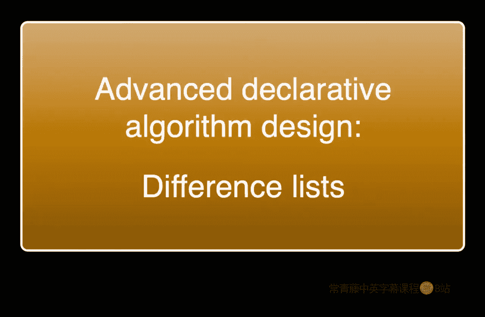
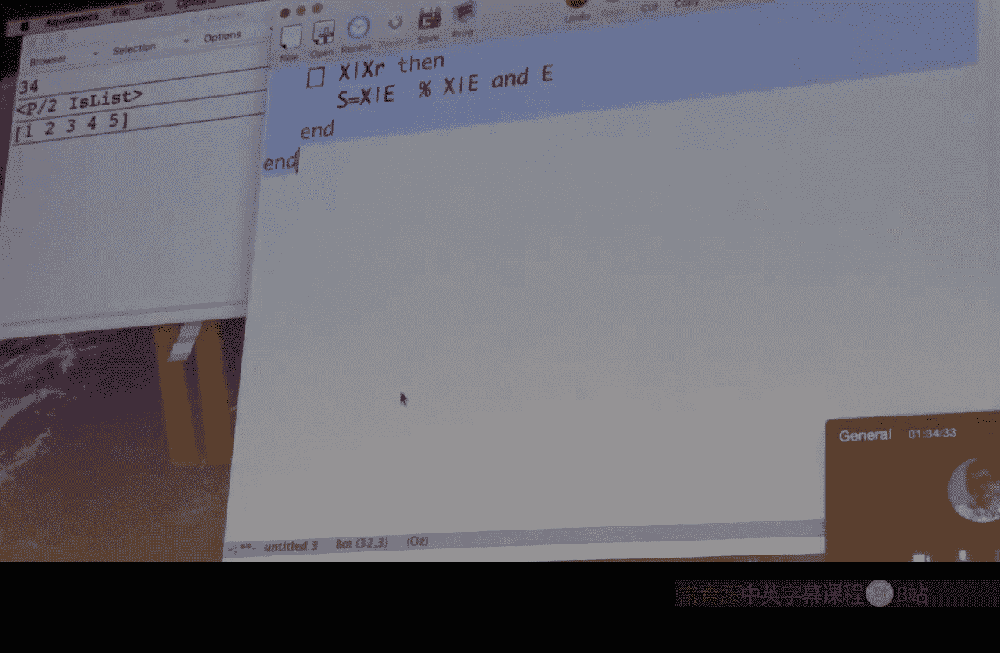
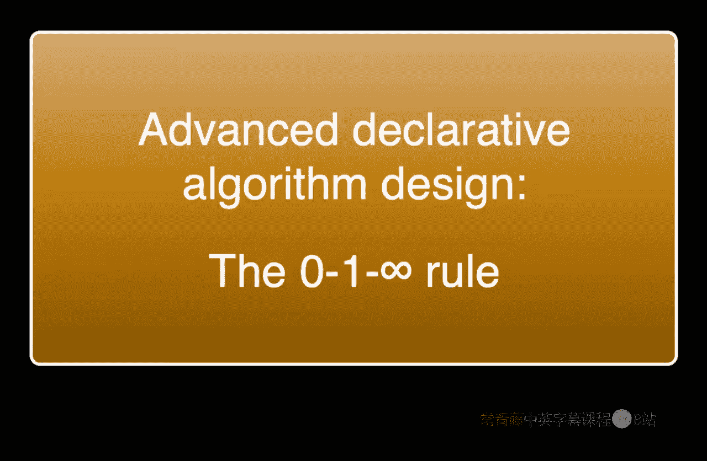
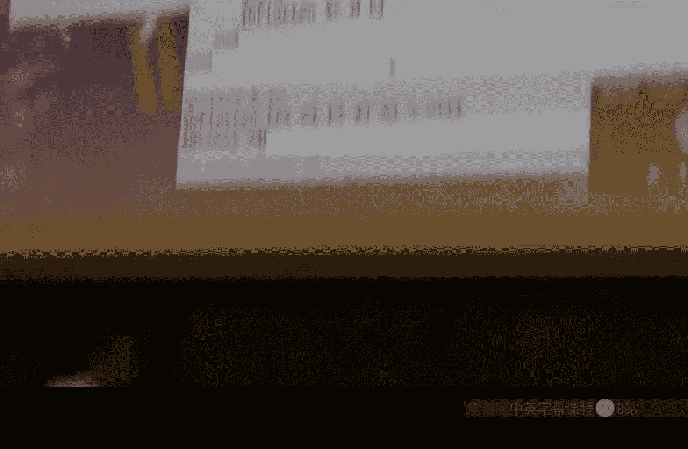
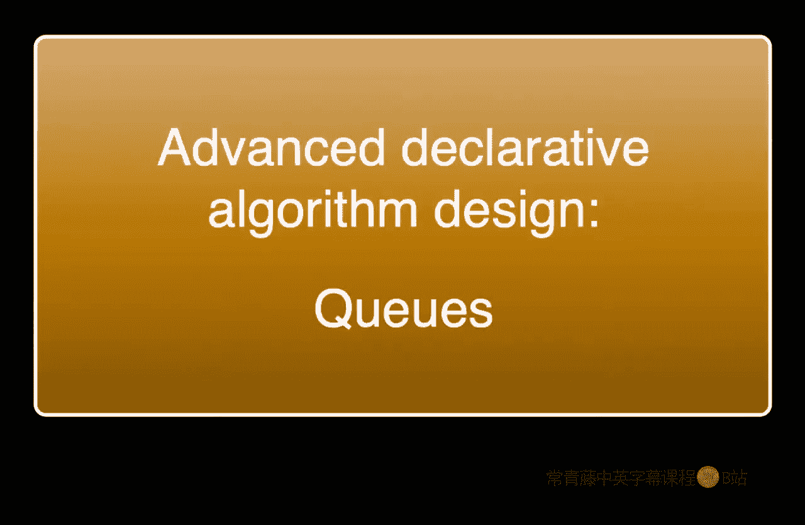
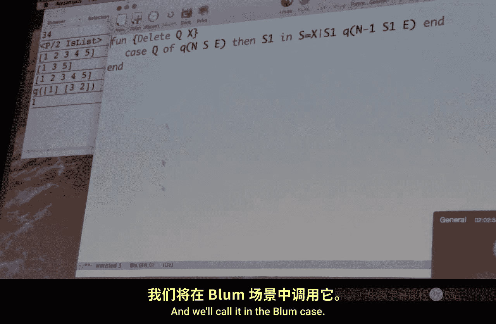
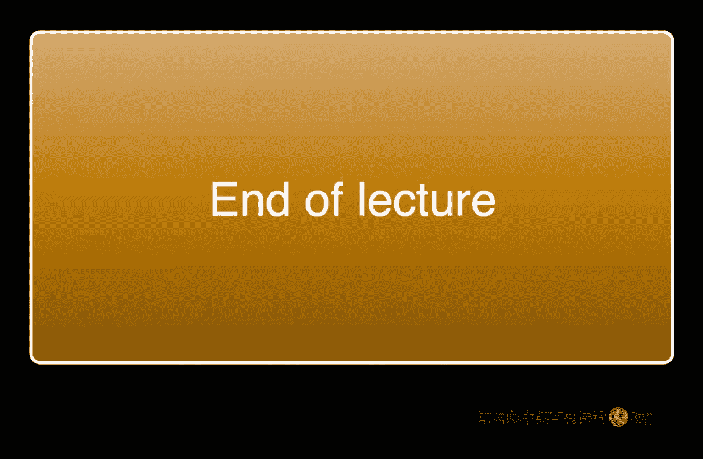

# 鲁汶理工学院【中英⚡高级编程语言概念｜LINFO1131, Advanced programming language concepts】 p03 P2 FO1131 Lecture 4 (2020) -BV1UDffBbEBZ_p3-

This course will be the final course on declarative algorithms and declarative programming。

So and I'm going to again explain why it's a good idea to write most of your program this way and show you again how powerful it can be。

So I'll start with giving an overview of all the difference。Declared pardence we see。And in fact。

 there's a lot of them。And I'll make a table， I'll show you a different programming languages support some of these。

 so you can actually download these languages and try them out。啊是。And then just like has school。Pro。

Even cloud tools like MeRuce will support some of these paradigms。

Then I'll give you a definition what it really is， okay？Belarative program。

Especially declared if the concur， since the concurrency is very important。

And then in the second part， I will show you more advanced techniques of making algorithms。

 so you have already taken a course on algorithms and。

 but I'm going to show you stuff here that you have not seen in the other course that in the other course。

The algorithms are all done in an eager， simple way。

 but now I'll show you more sophisticated techniques using all the。concepts we've seen。

 single assignment， concurrency， data flow and the lazy evaluation with that we can make even more smarter and more efficient declared algorithms so that I'm going to show you in the second part of the course。

All of this is in the book。So in different sections， 45，2，414，34，4，458。

 so I really encourage you to look at that。It's not just a lecture， this part。

 least things are also explained。In the book in different sections。

 and I think it will help you understand。So let me now explain。Delar the paradigmdox。

We have seen a bunch of them。In order to understand all these different paradigms。

 so we start with functional programming sequential， we add concurrency and data flow variables。

 the single assigned variables， then we add lazy execution。To understand all these different models。

 we will。Explain give you a good intuition by talking about the three。

Special moments in the lifetime of variable。And this will help you understand when you create a new variable。

This variable has a lifetime， it's created， eventually it's bound to value。

And then it's like mature variable， but there's actually three moments that are special。

The first moment is the creation of the variable。When you define the variable。

 when you do declare or local。Create a variable。Once you create it。

 you can put it inside data structures， you can pass those arguments， it's already。

And the second one is。Specifying the function that will。Give its value。The function。

That will give its value。If I do。X， for example， so this little x is a variable in memory it's not an identifier。

 and I can do x is equal to F or y。But here I specify the function， it's F。

But I don't evaluate it yet。😡，I just say which function it is。I just defined it。

And the third moment is when I actually evaluate that function。

So these are separate moments and in many programming languages， these moments are done together。

But it's interesting to see what happens when you separate。😔，对。And this gives us。

A bunch of different possibilities。Okay。So let me make a table of paradigms。

And how different languages do that？So this table is actually in the book on page 286。

 but I will give you some more information on the board。I will link to the bit more。Clear now。

So there's actually six。Six parts at this table。So in this axis。

 I'm going to say either I do eager execution or lay so lazy as with weight needed。

And on the vertical， the horizontal， sorry， I will do。T sequential。With values。

So values are constant。So this is just a sequential language with values， so this area。

Is what you have seen in courses on algorithm design。So the usual courses。

 usual programming languages like。Like Java， they sit here。They also have concurrency。

 but the concurrency is not done in a declarative way。So。You you say algorithm design courses。

So this is something like a standard functional program。

What it's usually called strict functional programming， strict this very similar concept to eager。

And difficult languages here are。Scheme and ML， which have very active communities。

 so these languages are very alive， lively and have many people using them。

But they are sitting there。Now we can have also sequential。With。But I call data flow variable。

 so these are the synized assignments there。So still sequential language， no threats。

But data flow variables。So this actually is basically。This function of pro alien。With they的说。

So what is that useful for？Actually， this lets you do interesting things。Taylor the person。

List functions。So it's sequential with values。The append is not going to be tail recursive because when you create a list。

 a pair， a con pair， they have to be all values in there。

 that means you can only create it after the recursive call， but if you have data flow variables。

 you can create the list the output before the recursive ball， so this gives you tail recursive list。

It's already an advantage here。So what language is doing that？

There's actually a language that does part of that。There's no language that。对对。Does this。

Let me tell you one language that does part of this。Prologue， which is a logic programming language。

 but not folk prololog， only deter deterministic subset。APrologue has a search。

 if you see the course of constraint programming， or if you followed my logic course。

 you see prologue。iss actually doing deduction， but it's actually doing search。

 but if you don't do search， if you run just deterministic programs and product that don't need to search the axioms。

 then it's doing this。Because product has these logical variables that can be unbounded。

So full prop has also searched。In addition， which I'm not talking about， search is another concept。

 a powerful concept， which I'm not presenting here， which is also very useful and in fact。

Modern languages generalizing that。This moves constrained programming。You progue in a smart way。

With more powerful relations， you get constrained programming， and in fact。

 this is a very powerful and useful paradigm， constraint programming is actually used。A lot。

 and in this department， we have big expertise in Constraint program。そうです。这都公司。Screen。

So if you're interested in that， if you're interested in really powerful declarative programming。

 you should take this course on constraintsstraint。

 especially since you have the advantage that in this department in UCL。

 we have some world experts on Mtraint program who do research and know this very well。

 people like Eve the Vi， PSs and Zig Fet Nson are very experts in this。

So this actually this constraint program is actually going in this direction。

 but adding very powerful search。Okay， so that's here。Now let's go to this third one。

Current language。With data flow theory。So this is our deterministic data flow that we talked about a lot。

And。The previous course。Theterministic data flow。And I also called this。Concurrency for dummies。

Because you can add threads wherever you want， this is a very nice， concurrent paradigm。In fact。

 this one is actually very well used， all the cloud。Tools。

 the big data analytics tools are actually using this one。I write map Puruce here。

 which is like the grandfather of all the cloud tools， which was invented by some people in Google。

of the 1990s， but all the moderate cloud tools like Apache Flink or the graph。Computation tools。

 they're all using this model， they're all concurrent and they all have。Da for variables， okay。

So now this is all the es， now let's look at the lazy guys here。So if we take a lazy。

If we add lazy evaluation in a sequential language。Then， we have。What's called lazy。

 it's sometimes called non strict。Functional programming。There's a very influential。

 nice language using this called Haskell。So if you're intrigued by that Haskell actually has a huge community。

 it's a lot of these people are mathematicians to using category theory， for example。

 so Haskell is in some sense a very powerful language using sequentially。But it's not concurrent。

 well， it does have concur， but it doesn't have clarity。不。So you can save。The lazy。

The laziness in Ha school is actually doing。Co routineing。

 which I'll explain in a minute so co routineing is。Almost like in currency。

 but there's no scheduler。The threads are giving control explicitly to other threads。

So let me say a few words about color teaming。Coers， so if I have a thread。One threat food。

So the execution is going from left to right here。So T one is executing。

And then it actually gives control to the other thread。Explicitly。

 so there's an operation that's often called yields。So it gives control to the other threat。

Then the other thread executes and the other thread does another a yield operation and it goes back to the first one。

Okay。So the threads are giving control， this is by the program， by the application。Is doing this。

There's no scheduler， it's the application。Is deciding when to give control。

 so you see this gives another responsibility to the program right this is sometimes called non preemptive。

Concur。Okay， so there's no scheduler。So it's deterministic， it's not non deterministic。

 scheduler adds non determinism， okay， so it's actually deterministic。

Because the programmer decides when to yield， it's not the schedule of deciding using some。

Magic hardware clocks or something。So this is not preemptive concurrency。

So laziness in a language like hasco。Is actually switching back and forth。Between the function。

 computing the value and the function needing the value， so when I need the value I do coing。

 I go to the other one and the first one stops。Okay。

 so laziness in highke school is a form of cover attain， so the unit of that is that it's。

Terminity also has， of course， disadvantages， you can't really write some programs in that。

Let me know show another one， this one。The concurrent na models。

So this is the model which we've called lazy determinist data as well。In this model， you can write。

Abounded buffer。Bounded buffer， which we saw two weeks ago。

 is actually combining lazy and concurrent。Because the producer and the consumer are not synchronized。

 really， so the bounded buffer， the producer can get ahead。都这是4点。Okay。

 so I have the producer and a consumer。Here's the abundanted buffer。Assumer。

 the producer can get ahead。That means it can do more values even if the consumer has not asked for them。

So that's a form of concurrency。In currency， the threads are independent。

So the tumorer can get ahead。Of the个。This is not possible in the language Ive has in Haskell。

 you cannot write a bounded buffer because the producer and consumer are executing in lock。Sa here。

 that means the consumer needs a value。Then control switches to the producer this could be the consumer。

 this could be the producer thread， consumer needs a value。Then the producer calculates。

 and then the consumer continues， it needs another value it add asks again。

 so control is switching back and forth in this kind of a language。Whereas in the。

This language lay to termministic data flow， both producer and consumer and concurret。

 that means the producer can get ahead。Okay， so that's an advantage and a disadvantage。

 so the advantage is you can build a bound buffer and it makes execution go faster the disadvantage is maybe the producer is doing too much computation。

The values that it computes here。It's not absolutely sure the consumer will ask for them。

In a language at Pascal， you're doing really the absolute minimum amount of computation。

So that's a power here， but the disadvantage is that maybe you want to get ahead a little bit。

To go faster， because then the consumer can immediately get the value。

But sometimes the producer will go too far ahead。Maybe it'll compute things you never need。So。

 but in practice， it's not usually a problem。Because there's a pipeline。But it's a risk。

 maybe one of these values takes huge amount of computation。But the consumer never asks for it。Well。

 this model will pay that price， whereas hospital will not pay that。Okay。

 so there's actually a place for both of these monthss。Okay， here's the middle one。

So this is what I would call lazy functional programming with data flow variables。

So the lat is without。With data flow variabless， this model is actually not so much used。

It's actually maybe less useful model than the others， okay？The other five were all very useful。

Here also you can do things like lazy cook sort in the final one here。

 so this gives you some notion of all of the space declared the paradigmise and you can see that many of them are supported。

By programming languages。So in this course。It's nice to see all of them。Okay。And in fact。

 the lazy deterministic data flow， some of the cloud tools。Are also using laziness。Okay。

 they're doing on thement computation， so this cloud。Area is actually moving down here。

 So if you take a course in cloud computing， you'll see that。The models。

 the paradigms that they use is actually sitting gear， okay？

Even though the course doesn't talk about it， it will help you understand what these。

Executions are doing。Okay。All of these models are declarative。

So that's the big advantage they don't have。Mutable state， okay， they don't use mutable state。

 They're all declarative。And the advantage of that， so there's many advantages of the。

 the advantage of that is that there's no race conditions in the concurrent programming you don't have to worry about the locking。

 it's very easy to parallelize also testing is very easy。

 you can test the different parts independently because they don't have a history， okay。

Language with an object oriented language like Java， the objects have mutable attributes inside。

 so the value inside an object depends on the history， all the previous calls。

 this makes testing very hard。In a language with states， this is not the case here。

 all these languages have programs that are easy to test。They're easy to build。

 you can build them layer by layer， you can build a function。

 test it separately from the other ones and use it forevermore and other places。

 so this is a huge advantage there's also advantage in distributed programming。

When you start building distributed programs。It's even much harder because you have failure。

Possible failure of nodes， the strength of this model is even bigger。

So one of the lessons of this course is that when you start building systems。

 try to stay in this model。And it's not so limiting。

 you can see the model has a lot of possibilities。Of course， you can't always stay here。

 you do need the other。State， beautiful state。Or port， as we will see， you do need the other ones。

Especially when you interact with the real worlds， you can't always stay in there。So， sometimes。

Sometimes you need to leave this model。You need more。

It's essentially when you have real interaction with the real world。对。You have to leave the north。

When you have。Timing user interface， a lot of events coming from outside。

 then you sometimes have to leave this one。But most of the code。

 that's actually only a small part of the。If you write big applications。

If you will see that you can stay a lot。Okay。So that's kind of a summary of all the different declarative paradigms。

Maybe there's more， I have no proof that this is everything， but it's already。

 it's what we understand today， okay？So let me know。

Go to a little bit more theoretical part of the course。Let me do a little bit of theory。

 so this course is mostly practical， but there's a little bit of theory。

 and I want to give you a more precise definition。Once' say what is it exact？

I want to be the more formal definition of this。Here I tell you these are all declarative。

 and have no race conditions and so on， but what does it actually mean， what is it actually？

So in the previous course。있어。A formal definition。In the previous course， we saw La cullus。

And we saw the church Ross or Theem。Which says that all reduction orders give the same result up to variable renaming。

All reduction， that means all execution orders。Give the same results。Up to variable renaming。

 but that's essentially the same。Okay， this is a form of determinism。This is also called confluence。

 people talk about confluence。I is coming from。Latin and Greek confluence。

 fluidence are flowing together， so basically the executions。

 even if you go different reduction orders， the result is the same so it flows together and this is called confidence okay so you can look it up。

Mikkipedia， if you want more detail。So this is the foundation of the advantages of。

So how does this work？It are models here。Because church Russer actually says。

You start with an expression in Lambda？You have an initial expression。Initial expression。

And you do reductions。And until you have a final one。

It cannot not be reduced more so the program is done。And this is the result。So true trusters。

 so here have steps。Reduction steps。And this is lambda calculus expression。

So the lamb detector this only has functions。It only has。Function definition application。

 so I'm not going to go over this again。 you saw actually the lambmbda cculus in the previous course。

 so you start with an initial expression and you do reductions end with a result。

So you're only doing one computation here。So there's no interaction with the real world here。

And so it's just one computation。But in our declarative models， we actually have more than that。Okay。

 we do more than this。So how does it work？😔，So， let me show you。How do we go beyond？

So we're actually using church Ruer as a building block。We're putting it together。

 but we're using it in a more general way。Okay， so let me just。Say， so were going beyond。

Viion Church roster。In our。Declaredative months。电那儿。I clearative paradigms。So how do we go beyond？

Well we go beyond in several ways， one might we go beyond？Is that we have。Partial termination。

We can have an agent。Which we give a stream to this agent， one， two， three。For example。

 it computes the squares。1，4，9。So at your truster， we have a mis expression and a fine one and it's done。

But in this agent， it's never done。Okay， so it's never。Actually， then。Completely done。

 because we can extend each street， one， two， three。4。Here we have one4。9。16een。Okay。

 so here we have our first computation， one， two， three gets one，4，9。

And church roster will apply here。But it's not finished， we can extend the input tree， one，2，3，4。

 we can add the four， so we have extended it， so all of a sudden it's not done anymore。

 we have new computation and we get 1，4，9，16。And we can keep iting。We can add another。Inこ。

So you can see the。Church Ruser doesn't really apply because church Ruer has a beginning。At it end。

You start with the expression and you compute and it's done， and so forth。

But here you start with an expression and it's done。

 but it's not done because you can keep it extending。Okay， so the way you can actually still fit。

Church roster are in there。By saying this is a。Partial。Termination， it's terminated。

But only temporarily， so one two three games， one， four， nine， it's done。And if we don't。

Then we don't get any up。So it's done。And in this case， church Russia applies from one to three。

 one for nine， we have perfect。Determinism confluence。But then we can add more information。あ元点。嗯。

We add more information so we get a new input expression。And we get new computation。

So we have more computation going on。So a more computation。

 the system activates again and starts running， but then again it stops and we have a partial termination。

Okay， again， and we can keep doing this。Forever， we can keep extending the tree。

 but each time we add some information。Theres some computation and the result stops again。

So we have partial terminations。Another way， another something times， this is called a resting point。

So a theory of programmingher languages， this when the system kind of rests， okay， gibit one。

 two three， it computes， and so it's done。Resting point。

But I like to call partial termination because it actually terminates。But not completely。

 only temporarily， okay？Like a temporary termination， so each step of this termrus still applies。

Okay， so this is one way where we going beyond true trust， we have this partial termination。C。

Should take a step back？I want to use the power of church trust in as much a way as possible。

But just computing one expression and giving one result。

It's not enough in real applications because I'm doing more， okay？😔。

So I'm going to use this as kind of a building block and do more use it to do more powerful forms of computation which are still confluent okay so the first one here is partial termination。

But that's not the only way。I'm extending。What's them the calculus。There's another extension。

I will call this one。Logical equivalents。 So you'll see why。Because the left the calculus。

Does not have single time in variabless。Has no data flow variables。It has only functions， values。

An application of functions。Here we have these data flow variables。Okay。So for example， I have。

Im doing， I have。Inputs。X。And why and I'm doing。X plus y for the function。Is addition， Okay。

 I'm doing an addition here。X plus y I'm doing x plus y。It's my function， that's the output。

But X and Y can be unbal。But in church roster， that doesn't exist。

 unbound variables are not existing here。So how do I take care of these unbound figures。

 also the streams if I have one， two， three？S， this gives me one，4。9。

Let's say T this S is an unbound variable if I bound S to4。For as prime。

 then I'm extending the stream and T will get down to。6スティ？

So I have these unbound variables in there。😔，But churchrus does not have unbound variables。

So what do I do？Okay。Well。We could take care of the unb variables。

So the way behind have the number variables is that we。And look at the possible values。You look at。

Possible。っぱいでます。I by very。Each time we find it。Each time we bind it。

We get a value and church officer applies if we have。3 plus four， if x is 3 and y is 4。

 then the true rosterer applies。Because we have values。But we can also have four and six。

 and we get four plus six。So there's many possible ways to bind them。

So we actually look at all the possible funding things。Okay。So we have the input。It unbed variables。

Okay， and we have the output。Also has unbound variant。诶。So， let me make it。So we could say。

So in order to b your truster， two outputs are the same。The same。So。Let me call these outputs。呃。啊，对。

C1 outputs。し2？It's the same。If they have the same variables。诶。For each variable。

Possible values are the same， so this is actually kind of the technical thing let me explain with an example。

Let me show you some examples of this。So here's an example。So， let's say I have。Two periods。

 eggs and one。Okay。And then I do computation。And I will bind x is equal to one。

And I will buy Y is equal equal the X。这不是我人。Reduction。But I can also do another computation。Okay。

I can say， for example， y is equal to1。And x is equal to y。For example， okay。

 or maybe if I do another computation， I get x equal1 y equal1。

So the result is actually bound variables here。But there's different possibilities， but in fact。

 they're all going to be the same。So what does it mean actually， you can see this in terms of。

Of logic， these are actually logical relations， x is1 and y equals x。So these are。Logical relations。

If I say x equal y。Then I'm putting a relationship between x and y， I'm say x and y are the same。

But I'm not saying what they are， they can be many different things。But then I have x equals1。

 so y is also equal to y。So with this one， so the values。The possible values。For x， x has to be。1。

And why has to be。我。So they're all going to be the same values。

So even if the variables are bound in different ways， they give the same values。

So this is actually a logical。这 this是。In terms of first order logic。

But I'm not going to give you a course on logic here。

 so this actually can be defined in terms of logic。

So the result of the program here is a set of bindings。Which I can call it a logical relation。

 but actually a constraint。是 what。先求。CThese are logical relations。ok。

But all of them get the same results。So basically， I can say if。Execution。G。C1。

 if one reduction order and C2， if there're other reduction order， then for all variables。

For all unbound variables in。呃。For all variables X。In C one。And2。I have the values that are possible。

For x and C1 it' equal to the values of Pro42。Okay， I don't want to give a course on logic here。

 but I just want to tell you that the result is actually the same。

 even if the variables are bound in different orders。

 the possible values for the variables are the same here that both x and y will always be。通完。

So basically what that means。And it doesn't matter if the result has unbound variables。

So even with unbound variables， the results are the same。你说这是谁？Okay。

 I don't want to say more because otherwise I would have to be with well， of course， on logic。But这人。

Basically。The idea is that the result here。The two results are going to be the same。

 the five initial expression。That might have data flow variables in there。

And then I do some reductions here。And I get a result here。This is就是说。

And I do maybe other reductions from the main expression。So if this have concurrency。

 there's many possible reductions。This is a result。

Then these two are actually going to be logically equivalent， they're not exactly the same。

But the variables in there are going to have the same values。

So the variables maybe are not bound exactly in the same way in there。But。

If you look at the possible values of the variables， they're going to be the same。Okay。

So because of that， we can still。Get a confluence result。Okay。 and now we can make a definition。

Of thelar of concurency。So you can say an concurrent program。Is declarative。

If the following condition holds。So we have a declarative of all executions。With。The same in books。

Either have two quotes either。对。All do not terminate。It doesn't dis still have infinite boots。Or。

They all reach。Partial termination。And the results are logically equivalent。Okay。

 so with this definition。Kind of capture this way we extend the church for。So we take an input。

 we run it。Either it goes into an infinite loop。パト。But if one execution goes intofaute。

 they will all go inute。It's not possible for one of them to go into an loop and another one to terminate。

Either they all do not terminate or they will all reach a partial termination they all end。

And the results are about the equivalent。Okay， so we get back this situation。

Where their results are all the same okay， so there's a termination and they logic。Okay， so that's。呃。

How we can define the cl of transparency。There's also a third。A third。

Idea that we need to talk about。That are declared say we have a large application。many is huge code。

 it's not all declarative。Some of it is not declaredlarative。

And there's a piece in here that's the narrative。And then there's a piece that is not declared。

And so there's different parts here。Now let's take a look at this part here。

There's a piece declarative and not declarative， well， this not declarative part is pen pain。

Because it's like contaminating everything。It makes everything nonde。

We have a big program and part of it is non deterministic。Then the whole thing is non deterministic。

 okay， inside here， this might be non deterministic。

Maybe there's a timer or some weird thing interactions coming in here and it's。It's not declarative。

Because sometimes it gives different results。Well， it contaminates the whole program。So。

That's kind of a pain。Because we actually want to use the clarity as much as possible。

So what can we do， even a small non deterministic piece inside will contaminate everything？

So but we want our program to be declarative so how do we fix this？Well， what can we do with this。

 well we can try to hide。done non tourerism。 so we can try to hide。Orcapsulate。Then non。

So that from the outside， still looks the them。So if you can make it so that this box from the outside。

 it still looks declarative， it still looks like this。They all give the same result。

 logic equivalent， even though inside they have this non deterministic bit。Okay。So from the outside。

Its。你对。So the idea is if we have a big program then。The lots have decative pieces。

And here's a non declaredlar piece。And maybe it's not deter deteristic。

 we can actually encapsulate it so it looks。Looks declared from the outside。Basically。

 we capture the。The non deterministic result， and we make sure it looks deterministic。在。

So then the whole program is declared again， even though there's a peace inside that's non declaredlar。

If you don't do this。If we don't do this， then declarative doesn't really help because it contaminates the non declarative with psycho virus。

 it contaminates everything。Okay， so for example， to show you an example of this。

 so let's say we have a。The error。We divide by zero。Well we have square roots of a negative number。

Which doesn't exist in real numbers， but we divide by zero。This is an error。

 error is not declarative。Because the program has undefined results。

 we cannot give a result for this。So the way to do this then is to catch the air。And。Fix it somehow。

Fix it and return。A reasonable result。So here we do things that we can do things like exceptions。

So the basic idea is to。Put a box around the errors so that from the outside it still looks。😔，Okay。

 so that basically。That's all I want to say from the theory point of view。

So from theory point of view， everything is built on church roster because let me just summarize that all the advantages come from this and it's a major result。

 it's like all programmingal languages。Are built a cup of lambda calculus。And with extensions。

But the lambda capitalculuist only does this， it has an expression and you reduce。

It's one computation。So the idea is we want to use the power of this as much as possible。

In real application。So。We have our declaredative models。

Extend church trust with partial termination and logical equivalence， and this lets us。

Have really powerful declarative programs， you've seen it lazy and current。

That do all kinds of smart things， okay？And then the final point is。

We still need non declarative things sometimes。Either non deterministic or programs with memory inside or weird stuff going on。

 errors， there might be a crash going on in there。And so we need to encapsulate。

So this is the final idea we can encapsulate the non declarative parts so that the program looks as much declarative as possible。

And if we do that， then we can actually get very reliable。

 very powerful programs to take advantage of。The， the effect。So let me give an example of this。

So mapP reduces a nice example of this。So methodth。Is a functional computation。

 you have an enormous list of input。Input list data。This can be gigabytes， huge。

We do some functional computation and we get an output list。

I'm not going to say exactly what it does， but it's purely functional。

 you do a map and you do a reduce， it reduces like a fold， it's the same。

And this is what Google used in the 1990s to calculate their page rank。So the way they did that。

They did a distributed implementation of this， so let me show you how it works。

 and then I'll show you how they make it completely declarative， So this is function， okay。

 this is declarative。So we have here a system， a distributed system。With many。Computing those。

Many computers basically need。A cloud。The data center。

So Google actually invented this concept in the 1990s。Because it data the。

The Pat computation is huge， okay this data is basically all the matrix explaining the connections between all websites and even the 1990s there were hundreds of millions of websites。

 so it was huge okay。So you had to make a parallel interpretation。

So we have here a bunch of computers here。These are all computing notes。

And they're all connected in a network， okay？Network。Networked computing notess。

And they're all doing this computation。And we can have hundreds， or' thousands of these， okay？

Of node because this is a huge data， and even today this is terabytes。Or petabytes。So 10 to the 12。

 10 to the 15， it's huge， so they're still doing this stuff today。

And many people are now using clouds， so we have this huge computation。

But it's simple because it's still function， it's declarative。That means。

If part of the computation crashes。嗯。If I have F of x。So x is a data input is a huge data。

And I compute f of x， okay， and it crashes。The system precious。入配。No problem， we just re executeute。

F of X。And we know the result will be the same。You tell， well， that's pretty obvious。

 that's only true because it's declar of。This will give the same results。Why。

 because the input is the same and the function is the same because it's declaredlar。

So this is a pure， declarative computation。And。In this distributedubed system。

 we have thousands of notes， notes can crash。That's a pain， crash is not declarative。

So how do we keep the whole thing running even if no crashes。

 well we use the property of thelarative program， which means that if we execute the same function again with the same arguments。

 it gives the same results。Okay。Church Ruler， the same input gives the same。

Or so it doesn't matter how we execute even， so this one， we re executeute F。

 but it can be executing in a different computer in a different way if we don't care。

The result is the same。So if this guy crashes， basically we put the computation， remove it。

So we detect the crash， we move the FOX computation to another node。

 and it changes a lot the communication and so on， but it's encapsulated， okay？

And the rest of the system will not even see the error。

Which means that the map produce will work even if the node are crashing all the time。

And it's very easy to implement。Because of the fact that it's declared， okay？

So this is a really nice example。Of the advantage of the clarityative and in a large scale computation like this。

 running on thousands of computers， that's the only thing that works， okay？

Non declarative is hard already on one computer， if you want to do non declarative on thousands of computers。

 you're dead， all these big computation in cloud， they're declarative。

And the reason is not because all the Google people are mathematicians or theticians and they like theories。

 no， the reason is because this is the only one that works and that you can debug and that you can test。

Okay。So and all the cloud tools today are。Descendants of matRduce and matreduce is the first one。

 I'd like to mention it。Because it's a simple one， today you have a huge set of cloud tools。

And if you follow the course of cloud computing， you will see many of them， but they all are。

Inheriting descendants of mass produceduce。And they will all be。Highly declarative。Okay。

And whenever they try to do something， not declarative， it's very hard， sometimes they try。

Because the tendencyancy is strong to do that， but it's very hard to build it so it works。

So all these large tools are mostly declarative and they will whenever there's a crash。

A non declarative thing， they will encapsulate it。And make it declare it again。So from the outside。

 it looks thelarative， so from the outside it looks like this。That's very important。

And then the rest of the system doesn't have to worry and you can keep running it as if it were。

对Okay。So cloud tools maybe the。The best example of why all of this stuff is important， okay？

Cloud Big Data analytics is now running a large part of society。

 companies are based on that these computations today in 2020。When Google started。

 it was only Google and no one had had data centers in the 1990s except for Google。

And they did Amazon， which came along as well， and a few companies like that， Facebook。

 they also needed this， but this was 20 years ago okay， where they invented this。

So it's kind of the victory of declarative programming in a sense， because in the 1990s。

 people didn't really believe that declarative programming was so important。

But now today everybody is doing。So what I' tell you in this course is not just。

Because I'm a theoretician and I love theorems， okay， although I do like good theorems。

It's because it's really practical and it works。So that kind of gives you the。A little bit of theory。

 but also an example to show the importance of the claims。Okay， so now I'll make a small break。

 after the break， we go back down from this theoretical heights of the I'll show some more practical algorithms。

 very smart algorithms， so we do like algorithm design， okay。

Like in the course of algorithm design that you followed。

 we're going to have a course on algorithm design。But first， they' make a smoke。まな。close。

Okay， so let me start again。So I'm going to do some algorithm design and just coding now。

That using some of the concepts we've seen。So the first thing I want to show you to introduce the ideas is a concept of a difference。

So difference list is like a list。 So remember， we have lists。 So we have list。 So here's a list，1，2。

3。And you can write it like this， one mark， two mark， three mark。 so let me write it like this。

So we know lists。This is our values。Well， a difference list is a。A representation。

A representation of lists。P list。As two lists。So it's basically as the difference of two lists。

So this list one to three nail， we can represent it as a difference。listist。

We can represent it as two lists。As the difference of two lists， so for example， one， two， three。

 four， and the list four。So one， two。Three，4， new。And for them。So these two lists。Or just lists。

But the second list is actually。Inside the first one， and if we take the difference between the two。

 we basically remove the second list from the first one， we get the list one two， three。Okay。

 so this is another representation of one， two three。Okay， so that's。Pretty simple， right。

 I represent the list of two lists， so why is that good idea？Well， because。The list。

 the second list does not actually have to be about variable， we can also present it like this， one。

 two， three。エス？An x for x is unbal。So have one，2， three。

 x where x is unbound and here we have the second list is unbound。

 and we don't know what it is yet could be anything as when we bind the x。But the same。Difference。

 we can make the same difference because it's the same variable， x and x。

That means this also represents the list one， two three new。So why is this an interesting idea。

 why is this a smart idea to represent the list like this？With an unbound tail。

And then a second variable。Because it's still the same list， one to three。

It's just a different representation， okay？So a difference this is just a representation of a list。

Why is this a good idea？Well， let's say we have the list one， two， three is a different list。

And we have another list， four， five。す。So we have two different lists here。We have L1 and L2。

 so L1 is basically the same list as1，2，3 here， L2 is 4， five，6。Okay， well。

Let's say we want to append L1 and L2。Okay， we can write like this， we can do a pen。One， two， three。

4， five，6。And this returns one， two， three， four， five， six。Very fine。

But we can also do the dependence on the difference to this representation。So we can also do a pen。

We can have the L1 that's a difference list。L2 has a difference list。

And we do the append and the result。Then call L as a difference list。So how can we compute L。

 the append of L1 and L2 has a difference list？It's constant time。If we say if I bind X。To。F， five。

 six， y then。I will immediately do the append。If I do x is equal to。4， five。Six y。Then I will。

 then L will be the difference list of the results， then L is equal to this L is one，2。Three， four。

 five。Six， y and if I combine it with y。I get the app。左哎。Is constant time。Now that's very nice， okay？

I can obtain two lists in constant time if I represent them as difference lists。

So that's a real advantage because if L1 is a big list。

The usual append function takes order and the length of L1。But if I represent as a difference list。

 I can。Do the append in constant time。That's a really nice trick。

 so let me show you a program that does that， I'll show you how it works in practice。

 it's actually very easy to use this。Of course there a limitationer， I can only do the append once。

 that's the limitation， I can append L1 to something。

 but if I later on want to append L1 to something else。

 then I cannot use the differences trick anymore and only works once。So the magic only works once。

But in many programs， that's okay。Because usually when you build a list。

 you will construct a list from small lists。So you will only need to build the list at once。ケ。

So usually that's okay。So let me now give an example color。Program。Does this。So let be。

Go to the screen here。Okay， so let me now give an example of this， let me write a flatten。

Function okay， for flattened。We'll take a list of。That might have lists。And returns。The list。

 which has all the internal lists。B up。So let me write a simple flat。Okay。

 so I write it in a normal way。And then I'll show you how easy it is to write it with difference lists。

Okay， so here's the regular flat。Okay， so I will。F。Not from the XS。And now I do a standard pace。屌就得啦。

Then I have X。X R。And。Ex。Okay， and the final one is when it's not this。stand your flatton， right？

Simple kind of a function。So how do we do it， well， if excess is mill， then it's middle。If it's x。

X R and X is not a list here。And it's going to be x。Bed by。Platin of Xr。

But the middle one is where you really have to do it's really a flat。

 because x is a list in the middle one， so I have to do this。X。诶。Sorry。不南。

XBecause x could be an nest as far as you want to。So this is a flat。You see how it works。

 so in the middle case， x and Xr are both lists。But in the flatten。

 they can be nested as deep as you want， that means you have to call flatten recursively twice。

on X and XR， and those two have to be combined。So I append them。fine。难位。Something like this。

 let me take this one。😔，Okay，1，2，3，4，5。 works fine。

So that's a nice definition right well I'm kind of annoyed on this definition because it has this pen call and whenever I see a pen。

 I don't like a pen because it's like an overhead thing okay。Copy all the list。The first。

So let me say， well。ILet me try and see if I can write it using a difference list。

It' essentially very easy。So do way and do it。それにつ。それ？Let me write a new version of flat。不是。Reult。

As a difference list。诶。So a difference list represents a list as two lists。

Which means the result is going to be two arguments。The result is not just one list。

 it's going to be two lists。So I'm going to do it as a procedure because I actually will have two output。

 the difference list is two arguments， so let me define it as a procedure to make it simple。

 but it's still doing just left minute。They covered flat。X，S。And now I have the difference list here。

😔，So let me give these two lists a name。Then Dick give his ones a name， let me call this one。S。

 and this is what E start and n。Start as the beginning of the list and end。So， two are。That's一。

And now the code is going to be almost the same。He like that。Have X for。あベス star。And then。

It's list X。嗯。And I have the final one。Okay， so the structure looks the same as before。

But the code is basically little bit different。So first of all， when x is nil。Well。

 what is the result， well in the original program， the result was nil。But Neil is an empty list。

 so how do you represent the empty list as a difference list？So I empty list。I to work on the board。

As a no， hydro represented has a difference list， while the the first and the second parts they should have to be the same。

 so S is equal to E。This represents。An empty list。As a difference。Okay。法律。What about now？

This one where I have to do the appendant of the two flattens。

 well let me do the two flattening calls and then I do the appendant。These Latin eggs。

And then the result is。A difference list。But I want to connect so S。

 so the result is the first part of the S， so let me make an S here。

Let me call the second argument M。It's R M。嗯。And to be clear。So you can see what I'm doing here。

SM is the flatten of X， and M is the flatten of Xr。 those are two difference lists。

 and the M is the same。Which means basically I've bound the two differences together。

 I've apped them， so SE is actually known to be the。You can actually。

ind ofI like to write it this way as a picture。So we have as'。ESo we have in here， so we have SE。

Is the append of？S M。And。并。You can kind of see it like that。 S is a difference list。

 SM is a difference list， and ME is a difference list。

So S is the append of Sm and N because the two ms are the same okay。Another the final one。

I have to add X to a difference list。So how does that word， well， I have a difference list。

With one element， so what is the difference with one element， it's the element。

Farer and then the second part。So L is going to be to x bar B。

So Se here is a difference list with one element。So the difference this is。So I have。QuE。And。E okay。

 the difference list， the two parts of the difference list are x bar E， which is S and E。

 so that represents just x。对。So here we now have a flatten， a Dflatten。

Which does the same thing as before， only noend。W the pen has disappeared。Okay。

It's a nice magic trick， right？

Let me show you that it works first。We can make it work。Okay， let me do because it's a procedure。

We have to call the procedure， so we have one， two， the same argument as the four， five。

The result is S mill， so this is a difference list。

S E but no one is preventing me but already binding the E there if I put an E there instead of mill。

 then I could bind it to other things later on， but if I want it to turn into a normal list that's not a difference list。

 I just make the second one equal mild。没得意。stayed here， what did I do as a mistake？1， three， five。Oh。

 I think they've made mistake somewhere。the。So 난 down那家 let don。我放松。这本。Oh， we can 이 a pleasure list。

어 우리거든。We mercy， so the error is that I actually have to do it flatten at the very end here I have X。

Flatin XR and here I'm not doing it anymore。So X is not so here so the theres bug here。

 I didn't actually copy this one right， I have to do a request call here， thank you。This guy。

 this guy is smart。So I have to do a flatton here。You have to do a D flatter。Of Xr。

And the x has to be put on the front of that，呃M。And I have to do like this。Sorry。

 the excess to be put in the front， not at the end。嗯。This是。So here I've put X in the front。

S is x bar m， and then the difference list me is the result。So this looks like it's correct there。

 right， isn't it？Okay。So my program has book。Ready to get。Yes。Okay， thank you for fixing the book。

So you see this is a very nice technique。And it's extremely efficient。It's like linked list， okay。

 it's like the linked list in。In Java。Only it's。Still declarative。

 so we keep still all the advantages of declarative programming。

But we can do like linked list where we can connect the two things just by making one change。

 which is the binding of the。Single binding of the secondella。

This is actually a very useful technique。And most programs that use lists。

Can be written with difference lists okay， I think in the book， there is an example of merge sort。

 mergech sort using difference lists。So you need to represent the list as two things that's basically and then make sure you do it right。

 you see but it's not really very complicated。Okay。So that's a difference list。

Let me not give。这。general。Statement on that。Okay，There's a general rule。

Let me give an interesting general rule because this shows you an example。

Which is called the01 infinity rule。Let me go back to。这。Spring。

So let me now show you just a simple rule because it's nice to have the rules that help you build good cr。

こて。So this is the zero one。Infinity rule。Whenever you have something。It's possible。

So whenever you have an operation。In a program。That's possible or not。

There should be three possibilities。It's either possible zero times。Which means it's not possible。😔。

It's possible infinite times。Like when you update the variable in Java。

You can do it as many times as you want。Okay， this is like updating variable。There's no limitation。

But then there's this very interesting case in the middle。

The third possibility is that it should be only possible ones。And then it's over。So zero times。

 this is like the notion of a value。As a constant， you cannot change it。

 so updating a constant is not possible。Whereas infinite times is like mutable states。

 a variable that you can assign。It made times to one。

But the one time is like a data flow variable and single sign。So the difference list is using this。

So what we can see is that。Doing once。gets part of the advantage of Mu state。

 and it keeps the advantages of the players。ok。So that me write that down。Toer。So the one time case。

It has gets。Part of the advantage。Of mutable state。You can have signed it， but only once。

It keeps all the advantage of declar the program。So it's very nice。Intermediate forms。

It's allowed lot you can assign it， but only once。If you want to assign twice。

 then doesn't work anymore only once。But you still keep all the advantages of theative the program。

 which is very good。So this is a very interesting。Intermediated point。Okay。

So that's the zero1 rule and difference this as an example of this because you can app them once。

 but not more。You can see it's already very useful。

Now let me show you another example。More。Sophisticated example using cues。It makes a space。

Another example of algorithm design。I queues。So Q is a Q， but a queue is basically like a list。

But it has a front and a back。オッケー。Okay， you can put elements in。On one side。

And you can delete elements on the other side。First， that's sit there。

You put elements in the queue and the first element that comes out。

 it was the first one that got put in。So how can we implement cues？In thelar this program。

The clearative paradigm。Well， the naive way of implementing it too。Is that the queue is a list。Okay。

I represent that as a list。Okay， so I start with an emptyQ， noil， I insert one。

I get the list one bar deal。Answer two。I get two， one， mil， for example， and search three。

I get three， two， one minute。I insert， so the insert is very fast here。

 I just put it to the beginning。But if I want to delete。I have three， two run new。

I can delete an element and it has to give me one。That would be the other side from the inta。

It's one， and then I have three。2。 and then I do two。3。没有责料。So how fast is this implementation？Well。

 the insert。Coopation。Its constant time01。But the delete operations。Is for and。

Because in the declarative model， the only way to access the last element of the list is to traverse the whole list。

 and then I have to update the list and I have to remove the last element。

The only way to do that and declare the model is to。Create a whole new list without the last。

So it's kind of。Expense。Okay。对。Now， let's try to do better than this。We want to do smarter with this。

😔，So the9Q is not very efficient。Of course， we can implement lists in Java using linkeded lists and then then it's 01 and 01。

 but we're not declarative anymore， we want to stay in thelarative。え。

So we want to do a declarative list。So better。For better， you。So he wants to go better too。So。

Let me show you a better one。Let me show you an amized。Constant time。这个。Aortize constantantine。

 so what does it mean amortized？Have you seen that already in of course？You know what it means。

 well in this case， lets say， if I do n operations。They will take order and time。

So I do n operations which can be insert or deleted。They take altogether， they will take order N。

That means on average， an insert or delete will be constant。

But it might be that a single insert or a single delete is expensive。まい。But。If I overend operations。

 it would be。She。So I will show you that。And amortize the constant time Q。

 and then I will show you the worst。Cー。Constant time。It's declared。So worst case is very good。

 that means each insert and each delete will be constantized。Whereas in the amortized。

 I will only have the constantine on average。If I do n operations， the total would be order n。

Whereas here， each operation， single operation will be order one。For certain。So the advertise queue。

Is implemented in strip。Function of program so no data flow variables needed。Whereas the worst case。

 I will use data for therapy。Okay。So you see that adding data flow variables。Gives me much better。

 a better result， so maybe amt is good enough。不是每笔账。Okay。So let me show you now the amortized one。

Aortized constant。This is actually already a kind of clever algorithm。So I have new Q。

Which returns an empty queue。So I will represent the queue as a couple of two lists。じない？

And I have an extra helper function called check。Pase two of。没包。人。Reverse。没。Okay， so this。

 I have little little help her function here called Sha。It looks at the cube。

And if it's the second element of the list is R， and if the first one is no， then it will。Basically。

Make the second element nil and put reverse of it in the first。So basically。

 I represent the Q in two parts。So okay， but let me first show you。

 and then I'll explain how the magic works。So I insert now an element in a cube。オ。So I have QFR。人呢。是。

Qえ。等会儿。 that's an insert， the delete。いベク？Ps to of。き。是。Sorry，F is equal to。X F one。所。我们。

I also have an empty is empty， but let me just do this insert。这这里。So I think this is correct。

So now let me refine it。不人。So this is good， compile everything。So now I can create a too。So， you。

Soq is equal to a insert。I insert。S。So I have a new queuee。Con serve one then two then three。

So this is the result。Now I can delete。So I do it the least，721 is the least。Q。1。Frows x1。

OkaySo this does the right thing， it deletes one。Okay， I insert。One， two， three。

And I delete and it returns the first。The first thing that was inserted。

 and it's amortized efficient。So how does it work？So how does the magic work， so this implementation？

Is actually going to be advertised。Constant times。Okay。So how does this work？

If have an idea how it works， let me explain how it works。So， if we go back to the。The board。

So how does that one？Gett me it amd。P in time， well， there's this magic check function。

So when I represent the Q， so the Q is represented here。As Q of。FR with F andR to two lists。In fact。

 the content of the queue。There's a combination of both of these， its thin。对。Reverse。到。Okay。

 so the actual content of the Q is a combination of these two， it's F plus the reversible R。

That means when I put elements in the queue。It's very easy， I just have to stick them in front of R。

And when I take elements out of the Q， it's very easy。

 I just have to take them from the front of the F。You see that？So insert。I just have to put。え？

Frit of。Because that's the very end of the queue。And to delete it。I get。From front of。对。

So these are all these are both comes to time。Well。If R F or not。

So insert is always constant time that because I can always do that。

But the delete will only work if F is not empty。See that， but I would like F to be nonemp。

So to make this constant time， F has to be done then。How do I make F non empty。Well， if it's empty。

 I take the reverse of R and I put it as the new F。Okay。See how it works， let me show the code again。

So in the delete function here。呃。Okay， actually， I'm removing elements， but there's this check。

So look what the check does here。The check is actually much makes the F none。If the F is empty。

Then the check function will replace it by the reverse of R， and it will make R。What are。So。

 but that's not always necessary， it's only necessary that f is none。

So you see the amortized trick here。Is that I take elements out of F and when F is empty。

 I put the R in there， so sometimes I have to do reverse。But what's the time I don't。

So this is unorized。呃。Cl the time。And it's purely strict functional programming。

 so that's a nice trick guy， no， isn't it？Okay。So said now let me show you even better。对。

A worst case。A worst case， Constantine chew。So this one is amortized。But it's strict function。

Which means that I have no data flow variable the。But if I add data flow variables。

 I can do it better， I can do worst case comes sometimes， just as good as。还是也是还是这个。

But with the advantage， it's purely the。Okay， so let me show you now。Let me do the。Worst case。Proant。

九？诶。Well， again， let me have my new Q function。This time I represent the cu。

And as a kind of difference to this。I represent it like this。X， X， X，X represents the MGQ。Okay。MTQ。

 but I have to add a third thing to zero。Otherwise， I don't know that it's empty or not， okay。

 because they're unbound variables， so you can't really check unbound variables。

 so I have to put a third。I have to put the zero there。

 so this is representing as kind of a difference。So I do insert。Q x。So here's the insert。So NSSE。

Okay。And basically I will put it at the end， so this is a difference list SE。

 so I have to make a new difference list。Or x is at the end。So that's actually very easy。

we' adding an element to the end of an if difference list。Plus one。理文。So here we go。Basically。

 S E is a difference list， but I have to put x at the end， so I need a new E， okay。

So I have e equal to x bar E1， so I'm basically appending x to the n。

 and the new difference list is S E1。Which has x at the end。And I can do delete。

test here I have to remove。An element from the beginning， so SE again is a difference list。

But after remove an element from the beginning of the differences to from S。Okay。So I have an S1。

 so I have to do s is equal to x bar S1。And then the new difference list is n minus1。Thats说。

See the nice trick that I'm doing here， so S is a difference list。

 but after remove an element from the side S， so I remove it， S is equal to S bar S1。

 so S1 is like one down one farther up， so the new difference list will be S1。

Notice both insert and delete our constantantine here。Because of the difference list。

And I using control。Okay。And I think I can use it exactly the same as Ba， so the API。

 so here's the original one。The amortized constant with new insert delete。オ。だ全に。Should we find out？

啊 bad。Quality。That's why I'm making a video。Okay， so the API is the same。

 so this one should work exactly the same as before， so let me take this code here。And we'll call it。

呃不让。

认民。P out this one。Let me now insert three elements。😔，Notice the result is looking a little bit weird。

 one， two， three， underscore， underscore， that's actually a different solicita。

And now I can delete the first element。That will me shouldn't give me one if everything is。One。

 so the result is exactly the same as before， so the API is exactly the same as before。

So the worst place Con Q and the amortized have exactly the same API。

Only the worst case is always order one， and it's using data flow variables。And the amortized one。

 the delete sometimes is order n。But it's amortized constantine， but there's no data fulfill。

So here you can see directly。And type at a complexity advantage of these data flow variables we're going from order n。

 I mean， amortized， but still if I do delete， sometimes it's order n， but in the second one。

 guarantee constant time。So far， I have not used laziness。

I can actually use those ins to even improve， make even better。Algothms。Okay。

But I won't do it this time， but I'll do it next time， but I'll just say。Laaziness。

Can make even improved versions of this， so how can you get better than worst case constant time that's as good as you can get right actually there's another improvement you can make。

You could make the。The data structure persistence instead of ephemeral， so that we explain。

So I have the notion of ephemeral。Versus。Persistent data structure。好。

So an ephemerral data structure means you can only have one version at the same time。

So if I have to Q。And I do an insert。I get another cu and I can do another insert。嗯。But at any time。

 I only have one version。There's only one version of the few。Persistence actually goes beyond that。

It's a very interesting property if I take Q1。And I do an insert。I get Q2。

 but if I take Q1 and I do another insert， a different insert。

 and here I insert one here I insert two， I get Q2 prime。This means that Q1。

Is I insert one in Q1 and I go at this， or I do Q。2 in。Q1 and I do like this， this doesn't work。

This doesn't work for the。For the constantantine curea， because I can only do one。やて。

And the difference。So to make it persistent and constant time。So to do persistence。

I will actually need to do。Lazy evaluation。So neither of these actually work。And persistent。

 both of these are basically conphemeral。Both of them are ephemeral because only one version can exist at the same time。

It doesn't work for two versions。In order to make it persistent， you can use lazy evaluation。

And it gives you persistence。Data structure that's a very powerful thing。

 it means you can use the data structure and like duplicate the data structures as many times as you want。

 and it's still constant time。So most data structures that you implement are going to be ephemerla。

 so a Q in Java。Will be eemmoa。Because you can only have one version， if I have a cube。

 which is an object。Attributes and I have date it， that's only one version。

 but I can't have I don't have two versions， so a queue in Java would be ephemeral and these two cues are also ephemeral so many data structures in real world systems are going to be ephemeral。

But if you want a persistent data structure， which means if you want to use your data structure in multiple versions。

Maybe you have two different users， maybe you have like a collaborative editor and one person wants to do changes to the document and the other person does other changes to the document and they have to diverge。

 then the data structure has to be persistent。Then this data， this technique will not work。

But you can actually make it work for lazy。And that's more magic， but this magic has shown into。

So let me stop here。So。There were no questions this week， maybe I was。Way to secure， I hope not。

But so I stop here if you have any questions？Ask， I will again， put the video on。AndYou。

At this time it's explained in the book all of this stuff is in the book。

