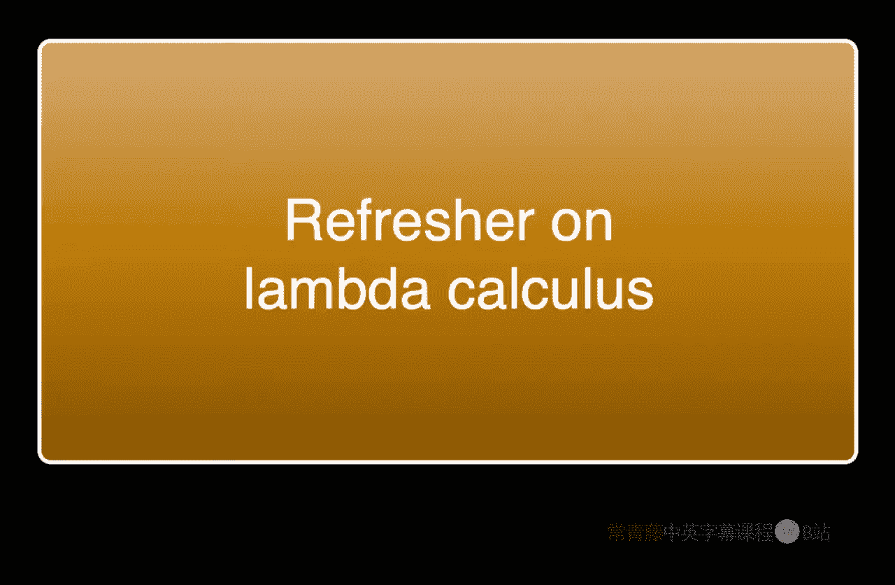
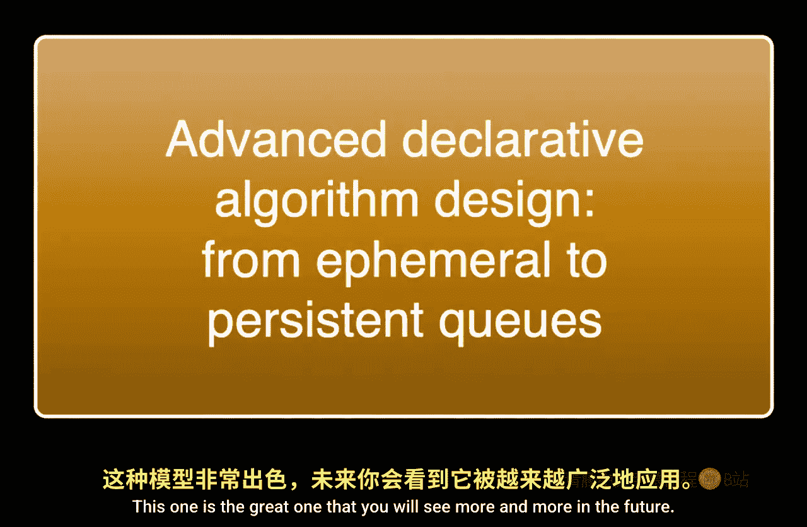
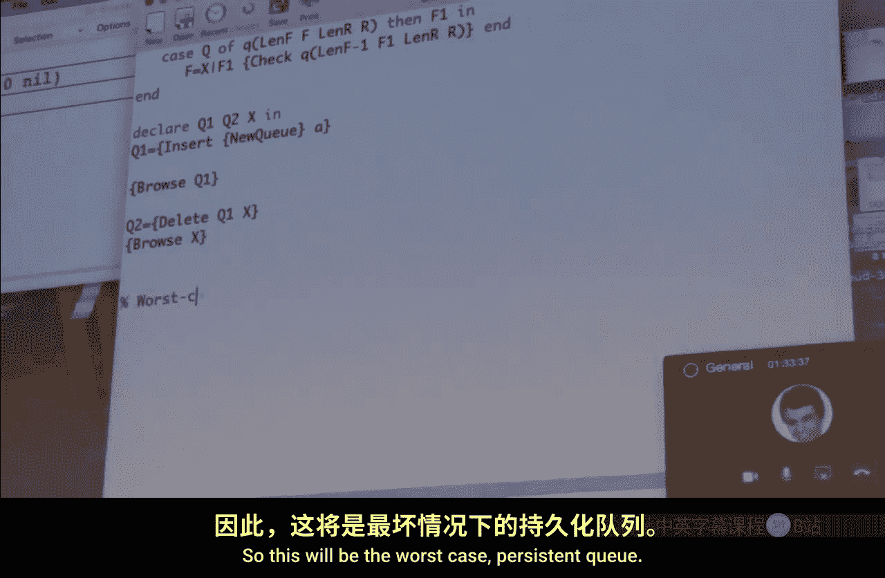
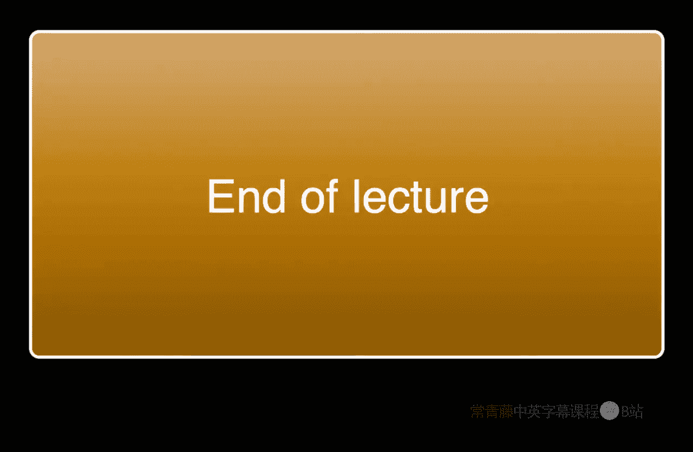

# 鲁汶理工学院【中英⚡高级编程语言概念｜LINFO1131, Advanced programming language concepts】 p04 P1 FO1131 Lecture 5 (2020) -BV1UDffBbEBZ_p4-

This course is going to be the final course on。Advanced declaredative programming。

And I'm going to start by。Refreshing a little bit last week。

 I have a question I went a little bit too fast last week。

Refresh you a little bit on the land calculus。And there's two reasons why it's important。

First of all， the Lambda calculus is inside all programming languages。

This is important whenever you learn any language。In the future or language from the past。

There's always a lens of capitallus in the inside。So if you understand this。

You will understand a lot about all language。And the second part is。The lamb of capital is actually。

A form of programming called Declarative programming。Which has advantages。

Real programming languages do more than that in calculus， they will interact with the real world。对。

Landda Calculuist defines a form programming that has some big advantages， so we want to stay that。

Then I'll talk about the clarity paradigms so I actually。

Went a little bit too fast on that last week， I'll explain more about the three moments in the lifetime of variables and how that defines all the they。

So when you learn a language later， or when you use cloud analytics， whatever。

 it's always going to be one of these。And then I'll talk a little more about advanced declar algorithms last week we talked about ephemeral cues。

And this week， I'm going to show a little bit more advanced technique using laziness。

That if you do persistent cues with worst case constant time。And finally。

 I talk about secure data abstraction。How it's possible to make it so you cannot cheat。

 cannot look inside。So what do you need for that， so this also is used by all programming languages to。

WeProect the data abstraction。

Let me give a refresher on the lambda calculus。So this is something that。Was seen in the course。

Andfo 1104。But it's very important and I understand that when you see it the first time it's kind of hard to really understand the consequence。

 so I'm going to say a little bit more this time I'll give you a quick refresher。

 so the lambmbda calculus is a simple model of computation。So it's a very simple language。

Which I only has two things。Function definition and function application。So landed term。

Its defined very simply。I see there a variable。Or。A lambmbda abstraction。

 so this is actually defining a function。Or it's actually a function application。

So T1 is a function and T2 is the argument。So here I'm saying function with one argument， here。

 creating a function with one argument。AndThat's it， and this is called an abstraction。

And this is called an application。So this seems very， very， very simple， extremely simple。

 but in fact， this model。😊，Is tuuring equivalentence。You can write all programs in this。

And this was known。A long time to ago。By Aman of church who defined the lamb the ccuists。

This was in the 1930s， so this the fuck comes。From the 1930s。Hes a logician。

Who was investigating computation， this was the period of the first computers。

But they were very primitive and you could not program them in those days。

But so Manju Church was a mathematician， logicly defined this。

 so this is actually tuuring equivalent and you can encode。Everything， all data types。

All control structures in here in the landda ca。ze把 you。Okay， so that's cute right。

 that's kind of nice to see that you can make something so simple and have it be completely very equivalent。

But it's actually much， much more than that。There's actually strong reasons why this is inside all programming languages。

 let me just give a simple example of the encoding first。So。Let's say we had。True， false。

And let's say we want to do logical operations。You can include other things too。

 like lists and wild loops and so on， but I wanted that so true I can encode it。As a function。

The returns。Of two arguments， x lamb to x lamb to y returns the first argument。False。

There's a function that returns the sentence argument。And n is a function of two arguments。

 let me call them P and Q。Which does an application。So P and Q are two arguments。

 but p is going to be a function of two arguments also。

 so the result of the n is P applied to arguments Q and P。So this seems kind of weird。

 but you can actually do computation with this if I now do and。True。False。

And I use the rules of the function applications。I can make some reductions。

 and this will actually give me the same thing as the false。So with this， you can actually do。

All computations。It's a simple example， you can encode everything。Okay， so that's kind of cute。

something so simple can really take the core of computation is in this。

 so any very complicated language。All the complex kind of arbitrary。

 it's all added for the comfort of the programmer on data types， control structures， water loops。

 if statements。lists。Numbers。😔，But， in fact， the the core。

It's just this function abstraction and function application。So why is this really more important？

Why is this really a core thing？Well， that was。So this was invented in the 1930s， okay。

 by Alons of Church。But there was another guy。F or landed。And this was in 1965。This took 30 years。

 okay realized that the lambmbda calculus。Is at the heart of all programming languages。😔，Why is this？

Well， it's not just because you can encode everything， it's because programming languages。

Languages do。Abstraction so one of the key features of a programming language is abstraction and you know already this very well。

 so for example， an example of an abstraction is an object。In a class。So an abstraction。

There's a box with stuff inside and an interface。That you can do operations。

Operations and here you have internal the definition。And these operations obey rules。

That means you can use the interface， rules of the interface without knowing how the definition works。

Okay， this can be very complicated code， it can be a million lines。

Of code and the operations can be very simple。So this is the key concept。

That makes big systems possible， okay？Otherwise， we would not be able to use。

Computers in the world in the world， as we do today。Otherwise。

 we would not have internetnet and browsers and Google search and all that kind of stuff because with this。

 you can have layered systems。And you can divide the work。We can have teams。Building large systems。

Where each member of the team knows one part。So an operating system I here has maybe 10。

 20 million lines of code in their huge number of libraries。Thousands of years or more。Tens。

 hundreds of thousands of many years of work in programming that。

And it's possible because of this concept of abstraction。

So how does this relate now to lambda calculus？We the lambda calculus。Has。Function。

 abstraction and application， and we saw this， this is called higher order programming。

Higher order programming means that functions are first class。Makeake them as arguments。

 return them as results， create them， and you do them， do any more things with them than you want。

 so the lambda calculus is only that okay， it's higher order and that's it。

So it turns out that with higher order programming， you can define all abstractions。All abstracts。2。

Or。Forms of higher order program。An object is actually a function。A class is also a function。

A componentonent， an abstract data type。Package， anything that you。

Consider some form of abstraction is a form of higher order so lambda cculus。

Really is the language of abstraction。

And abstraction is the key。All languages need this。If you don't have this。

 you could not make big programs。Even very simple languages have this。

Even assembly languages have abstract where you could define macros， for example， or procedure calls。

And use them。So all programming languages have this and the lambda calculus is basically the language of abstract。

So for that reason， it's at the core。Of all programming languages。

 and you can see it's a very simple core。It's very。

 very simple and very complicated languages you might get lost in their complexity。

Don't have to worry if the language is well designed， then you can see that。

Lambda cathe is essentially higher order programming and it's only higher order。

 it doesn't do anything else， function， abstraction application， but that's enough。With this。

 we can actually program code all abstract。So this we saw in previous courses。

 you can encode objects。Classes。Abstract data types， packages， components。Modules。

 whatever you want to call it， agents。You can encode them all using higher order program。

So this is the key reason why language calculus is so important。

 it's the language of abstraction and it's at the core of all programming language。

So that's the first reason。But there's actually a second。A second reason。

 which is connected to the first in a subtle way， which is called thelarative programming。

Second reason why that the capture is。Perfect。The second reason is。Declared the programming。

So the glare of programming basically means programming only。In the lambda calculus。Nothing more。

Because practical languages they extend to lambda calculus。

With features that are not part of the landda ccuulator。Practical languages。They extend。

The land the catch。It's basically the reason why is because practical languages interact with the real world。

 if you look at Lambda calculus， I don't see any interaction with the real world here。

 I have only an expression that I reduce。So practical languages have to。Interact with the real world。

So they need to extend the land detectorlus for that。For example， there are many。

 many possible extensions， for example， a hardware clock， very simple， a bit of a primitive。

That gives me the time。The hardware clock like that clock is actually。

not a part of a lambmbda calculus， it's giving me the real world time and each time I call the clock it gives me the current time。

 that's not a concept that's in Lambda calculus。Okay， but if you look， there are many other concepts。

Even things ci mutable statesins where you can assign a variable multiple times。

Is not mental happiness。And the reason is if I。A s variable， and I read the variable。

 I get the value。But if I read the variable later。I can get a different value if I did an assignment。

 that's not lambda calculus and lambda calculus， the functions always give the same。

Because the value of variable can change。😔，Okay， and there are other。Thanks， anytime you interact。

With the real world， other kinds of interactions you could。

See that it's not part of the Latin account， so they extend it。So finally， that's interesting， right。

 they have extend lamb the calculus。But in fact。There's a good reason to stay。You want to stay。

In the narrativeative programming as much as possible。

You want to stay in the lambmbda calculus as much as possible。

I want to stay in this little nice place as much as possible。

 and I don't want to rely on this kind of real world stuff because it kind of breaks all the properties of Lambda calculus。

ok。But the reason is lambda callu。Has。Strong property。They are very useful for programming。

And the main property is called confluence。So the main property。Of lambda calculus。

That makes it really。Use with programming is called confluence。It's。Proofed in。

Something called the church Ruer theorem。Where you can prove it。

 it's not that simple to prove actually。We prove it formally and for this calculus。😔。

The reduction of an expression。No matter in what order you do， the reductions。

 it always gives the same results。Up to valuable。So reduction of an expression。

Always gives the same result。Even if you do different reduction orders and can do you can see that if I do simple computations like n and so on。

 you can choose which order you do the reduction， you can see that。

 but the result is always going to be the same up to variable remaining because the variable names actually are not important。

Okay。So this is a very， very strong property。And this means that you。

You want to keep this property in real programs。The more you keep this property， the more things。

So this more advantages you get。So let me just give a main list， a list of some of the advantages。

There's these advantages in designing program。Okay， there's advantages in testing。Okay， much easier。

 there's advantages in concurrency。And distributed programming。So in designing programs。

The property is called， we can call it referential transparency。This is a property。

That means you can replace equals by equals。If I have x is equal f of y。And y is equal to G of z。

Then I can replace the wine by。GFCC， and it gives the same result。I can replace equals by equals。

I can replace an expression by another expression that's equal， y is equal to G of Z。

 I can replace y by G of Z and inversely。And I can always do that and it does not change the results。

So this means that many optimizations are easy， this means that I don't have to worry about calling a function too many times or only once I can call it again if I need to or not call it again and I can do optimizations where I replace computations by simpler so there's many。

Things I can do because of this。😔，Also， testing is very easy。Does the function。Is defined？

By its inputs。And by its out。It has no internal memory， no internal。Memory。

It's not like an object in Java。So a function is defined by its inputs and outputs。

 that means if you have a system with many functions， you can test each one of them separately。

And you don't have to worry about the history。So there's no history。😔。

If I take a Java object and I call it， I can change the internal attributes of mut states。

 real world。But lambmbda calculus does not have that， so there's no internal memory。

 so functions are very easy to test。They can also be defined separately。And tested separately。

 so testing is very easy， it's also much more efficient。Good testing。

And once you start building real programs， large distributed fall tolerant programs。

You really see the advantage of this。Okay。And a final advantage is concurrency。

That you don't have race conditions。That means no non determinism。

Rrace condition is another word for non determinism with the result can change what the reduction order changes。

 this is because of mutable state。We're going define if you assign two variables and two threads。

If I do in different orders， the result is different。Well， this kind of problem cannot happen。

In the 11th countries。In the left the calculus， we have confluence。So this is。

An enormous advantage for concurrent programming because if you followed the course on proven concurrent programs。

 I think Charlotte Peer has a course on that， you see it's quite complicated。

well this complexity goes away if you do lambda catch。

So the idea is you try as much as possible to write your program in。A declarative substance。

 which corresponds to lambda catchs。Okay， so you can see the lambda calculus is really a key。

key thing in programming。This one actually gave it a name。I called this。Conscurrency for dumies。

Because。In the past， people didn't realize this， this was kind of forgotten。

Because people were mostly using languages with variables that you can assign like Java， for example。

 so they kind of forgot this， it's funnier。How simple things can be forgotten。

 but now it's coming back because of the cloud， essentially， the cloud is forcing people。

To use the player。Paradise because it doesn't work。It's too complicated if you don't do。Okay。

 this simplicity really shows when you make good progress。

And it's completely practical and don't let anyone say that it's not。

You can have very old timer guys， not me， but other old timer guys。Who are grew up， for example。

 in Java， who do not see this。Don't listen to those guys。Okay， they're wrong。In fact。

 even Java now has lambmbda expressions， they real it's very strong。

 the pressure for declared programming is very strong。オッケ。Okay。

 so that's it for refresher lambda let we stop there that gives you the main motivation。

you see why lambda is important for two reasons why。

First reason it's at the core of all languages because of abstraction。

 and second reason is because it has very strong property。That you want to take advantage of。Okay。

Okay， very good。So that refreshes you， I hope。Gives you。A big picture of learned calculus。

Please take a look at the slides in the previous course or Zka La the calculus on Wikipedia if you want more information if you have questions。

Or some things are not so clear。 There's huge amount of information on this。

 This is a very fundamental thing。Let's take a look now at these declared paradigms。

So it play a paradigm。Is basically a language。Is a language that corresponds to lambmbda cs。

So thelarative means。That it's actually。In some sense， it's doing lambmbda。There are ways of。

Making the Lada easier to use for programmers。Like data flow and so on and adding data types。

But that doesn't change the properties。If it's doing lambda calculus， then we call it declarative。

Okay。So let me now try to classify all。To play to paradise。As far as we know now。

So in order to classify them。We have to see what are the different ways you can do computing and still do Lambda？

So the first。Point is that there are three special moments in the lifetime of a variable。

And this and with this， we'll do the classification。So one， this is so in Lada， one。

 we can define it， define the variable。Two， we define the function that gives its value。So hit x。

 for example， here we have F of y。We're x equal to F or y， but we still don't execute it。

 we only define it。And three， we evaluate the function。And by theory。

These three elements can be done separately or together。And this set is how you can classify。贝尔的。

So let me do some classificationation here。Make the table。

So this is a table of diplomapleotic paradigms， and we're going to define this table according to。

These three bullets。哎。So。The first， the simplest bit one is where all three are together。Okay， one。

 two， three， they're together。They're all done together， that means I define the variable and I。

Computd value at the same time。I do something like x is equal to 10 plus 10。

 and immediately compute it。So I don't have undone variables。I don't have lazy suspensions。

 I do all three together。Okay。So this is sequential， this is called sequential functional program。

So all three of them were together。This is eager， eager means that you evaluate the function right away when you define it。

All three together。And there's many languages that do this， most languages do this。

So in terms of functional languages， you can say scheme or ML will look like that。

Not Java because Java is not a lambda， it's not a functional a。

We're looking at languages that are doing landda。So this is the first one and it basically merges off three doesn them all at the same time。

There's no one variables， there's no latest suspension。If I now do。A slightly different one。

Where I define the variable and its function。At the same time。

 but I don't evaluate it until I need it。That's called lazy for evaluation you saw that done？

This is lazy。Pctional programming。There are languages that do this。

 the most famous language that does this。It's called Pescal。There's a large community of people。

Do task。They're very， very。The proud and。very mathematical。

 so this is a very powerful strong community of programming people， so you can look at this language。

But in this language。The defining and the variable and the function is done immediately。

 there's no unbounded variables。Okay。But the evaluation is done later。And that gives me this one。So。

 this is the。A sequential paradigm。I say it has value。Values are constants， values are not unbound，1。

2，3， the list 567， so this is sequential programming with values actually high school is not the functional part of high school has not been current。

Because this is actually doing co routine。谁。Now let's separate number one。

Let's make number one separate， okay， so one is separate。2，3。So here we have sequential。不。

Where you can have unb variables， let me call them data flow variables。

Which can be unbalanced here number one。The defining variable is separate from the function and evaluating the function。

Okay。This is。The declarative subset。Chapter two in the course book。Okay。

This isSo this is basically sequential functional programming， but with。Unbd variables added。

There's also a language called prola， which is logic programming。

 but only deter deterministic subset。Because Prolo has these failure。

Has unbummed with what they call logic variables。Okay。But it's only the commistic subidy。

And this has some advantages like you can do tailor recursive list and so on。Okay。

Now let's go farther。Let's separate everything。One， two， and three， all separate。不。

So we define a variable， we define the function， and later on we can evaluate the function when we need it。

Okay， so this is。Lazy functional。With。对就是。Actually。

 this paradigm doesn't really work because it has to be concurrent so this one is。Thank you。

Let me make them currentcur。Let me add threads， so what I'm doing now is adding threads。

For threads is still le。Ths what threats mean is that I have some control over the reductions。

In the big lambda expression， I have control， I say I do these， I do these。

 the threads tell me that I will do the reductions in some nice way， fair way。So threads。

The threat is control。Over。Proeduction order。So it' still have them， and because of church Raser。

 this does not change the results。Okay， result not changed。Because of the confluence preference。

The result of the computation doesn't depend on the threats， but if we add threads now。

Here this model where we have one。And two， three are together。

 this is what we called deter deterministic data flow。And if we add laziness。

This is what we call lazy deterministic。They flow。我。Read all separate。Okay。So this one。

Is what I called concurrency for dummies。The mapreuce model is doing this。

Because it's actually doing data flow and its concurrent the map reduce。

Computations are done on other nodes。And the main computation waits for the results。

 so there's a data of flow synchronization and the whole thing is concurrent and because it's functional。

 it's still confluent， so this is here。This one。The laser deterministic data flow。

 you can actually extend the cloud models to the， this is the most general one。

 this is really very high smoke。This one is not used so much yet。Even though it's extremely powerful。

Because。For historical reasons， but more and more， so cloud tools are basically moving to there to here。

 So the laziness is very important this is also called。Push versus。とま。

A push model is eager when I have inputs， I do the computation， so I push from input to output。

 whereas a pull model。Is when I need the output， I do the computation。

 so I'm pulling the inputs to the output so the control is that the outputs in the pull model。

And the control is at the input in the push mark， so this pull model is getting more and more。

Success now， so everything is going towards this model， okay， so this one is the future model。

This one is。A great one that you will see more and more in the future。

NowNow let me show you some more unadanced。Delar the algorithms。So we have powerful concepts。

We have data flow variables and we have lazy suspensions with this。

 we can actually make very efficient algorithms that are still declared。So。And it's kind of subtle。

 that's why I had one to explain it。So basically， we want to stay。Inside。

They declared the paradigmdise as much as possible。And we want efficiency， of course。

 efficient elevator。We want both of these schools。And we use the powerful concepts。

That we have in the declarative paradigmds。And there's basically two of them。

 well of course there's also high order， which is's two new ones， which is data flow variables。

And these suspicions。So with these two concepts。With these two。

 we can actually make very surprisingly。This is actually very powerful， very efficient algorithms。

 but people before didn't think it was possible， people thought you need universal states。

 but you don't with these concepts if you're smart。So there's a very interesting book。

Which is called purely functional data structuress。So if you're interested in this。

And you're interested in the power of laziness。If you're intrigued by this and actually。

 if there's still research going on， then I recommend this book， this is a book called。

Purely functional data structures。Bye。Chrisポかさん。So this is not part of the course。

 it's not the syllabus for this course， but the examples that I give。

 I will give some of the examples that be actually taken from this book。

But the book goes much farther， it does has many very。Clever and smart。Ideas。So if you want。

 you can actually take a look at it， I can pass it around。It。So let me explain now。

 let me give a little bit of summary。A summary， and then I promise。

Then we will make a break and after the break， I will write a code again。

We go away from all the philosophy and we go to code the summary of the advanced。

They clear different algorithms。So it depends on the paradigm。

If we have sequential functional programming。We can make， as we saw last week。Im amortized。Eemal。Q。

So amortd means， as we saw， explained also last week， that sometimes the operations are slow。

 but if you take too many operations， then the average time is fast。Okay。

Now if we add data flow variables。We can do better。We can do worst case of federal few。

Which means that all operations。Our constant time。And we saw， this is what we saw last week。

So ephemeral here means that you only have one version of the data structure。

That means if I have a queue and I do an operation。

 then I'm not allowed to use the old queue is not available anymore。

 this is what most of the times this is very common， okay， most data structures that you use。

Will be February。Okay。Now， today I want to go even farther than this。I want to go to lazy。

terministic。Da of flow。So here we add data flow， the lazy suspensions。

 we add lazy suspensions and we can do better then we can do。Avertized and worst case。Persistence。

This means that we can have many versions。So this means that if I have a queue and I do an insert。

 I get another queue， but I can take the original queue and do another insert。

 and that gives me a third one and I can add multiple versions in the system。

And this can be important for。Collaborative for applications when you have many。

You need to keep track of many variations。So for example。

 a system like GitHub where you have repositories， you can have many versions of these repositories。

At the same time。So if you want to program something like this， extremely efficiently。

You can do it in the declarative mind。By using lazy suspension。Okay。So。These two the。If we cus。

 we saw them last week。But this one I want to see today。This one we're going to see。

So after the break， I'm going to do some smart programming with lazy suspension。

And when you understand this， you will become gurus in lazy programming。

This is really the most clever way of using。The power of laziness。And it's such simple idea。

In our model， all we needed to do was add weight needed。One small concept we add。

And the result is we can do very sophisticated data structure and it's still declared that we're still inside the Lambda。

 the place where we want to stay as much as possible， let me now do some algorithm designs。

So we're going to start with the algorithm that we did。我取这。The code that we do。Go do。So， this is。

You can see now the code that we saw last week， you can see we have a queue which represents as toppled with two lists。

You can do insert and delete delete， so the queue is represented as a list one it list is the front of the queue and the back of the queue but reversed。

So when we insert。Elements。We put them in the back here。OkayAnd when we delete elements。

 we take them out of the front。So that's very fast， right， The only problem is that the F。

It's sometimes empty。So we have this check function here。That when。IfF is empty。

 it basically moves F into R into F by revering。By reversing it。

 so you can see that the insert and delete is basically constant time。

Except that sometimes we have to move elements from R to f because otherwise we can't build deletes and that's what makes it amortized。

See how it works up。So that's the advertise。So that'此。Try to do a little bit smarter than that。

So let me go back now to the board here。So we have this amortized。FMal Q。Which uses。

It is data structure。As far。Which basically。This represents the Q， so the Q is the same as a pen。

 the value of the Q is a pen F reverse author。This is the content of。这是不对的？And when we insert。

We put it。Here we add it to R and the is we remove it to。From F。So these are constant time。

 except that sometimes we have to move elements from R to f because when F gets empty。

 you can't do the anymore。So this is what makes it amortize。We have to sometimes do this step。Okay。

So we want to make this one persistent。We want to make it amortized。Persistence。

That's the first step。And after that， we will make its worst case for system。

So let me first explain what it means to be ephemeral and to be ch。

Let me give you a better definition of that so you can see。

The new thing that you get is when you have a persistent thing。The new property that you get。

W thats very strong， we can have multiple versions。

Now this is something that's normally very hard to do。In a language like Java。

 it's very hard because the only way was to copy the whole thing。

So let me explain first what is ephemeral。First is persistity。So many data structures are ephemeral。

But sometimes you need them to be persistent。Let me explain， so in my femoal data instructor。

 let's see I have a queue。It has a value， Q1， I do a the operation。They get a new queue。オッケ。

And I can do and delete and whatever， and I can keep going。But at any time there's only one version。

 so when I do an insert on Q1 given Q2， I'm not allowed to use Q1 anymore。

 so this is very normal most biggest structures with mutable states are going to be，宣府。

But let's say I want multiple versions， like in GitHub where you have multiple repositories。

 I can make a clone of a repository， I can do operations， somebody else can get another。

 can make another version， okay， so you can have many versions。So here， for example。

 if5 Q1 and anyone insert。I get Q2， but let's say I take Q1 and I do another insert。

I get keep too crime。Okay， and now I can keep doing operations。And here I have two versions。

Now I have two versions existing at the same time， okay。

 at the same time I have these two versions and they're both coming from Q1。

If you write the Q and Java， this is not possible in an easy way， you have to copy the OQ。

 which is expensive。So we want to do this efficiently。Now。

 the ephemeral amortized cube that we did here is not going to be efficient when we use it persistent way。

So this amortized ephemral cube is actually not an amorized persistent cube。

 you can take the code we did before and use it in this persistent way。

 but it's not going to be efficient。Because assume that you have here an order and operation。

Check operation and do a delete。And here you also in order add an operation。

If I have another version。You prime maybe again or end so you can see I have now。Three operations。

 four operations， and three order n， so it's not amortized anymore。

 that means because I can do these order n operations in the different versions。

seeSo this is not ever。Any so this version， this code。So the previous code。Is not。

Don't to work because it doesn't have the ammett complexity， in fact it's much worse。こたです。

So how do we do， how do we make it better？Okay。Well， the trick is do the reverse。

In the lazy suspension。This is actually a good idea。嗯。

You do the reverse in a lazy suspension and when you need。You need it。Then it's evaluated。Okay。

 this is good。But the problem is。That you have to create the lazy suspension in advance。Okay。

 so the advantage of this is that same the same。Computation works for all versions。Okay。

The same I created I suspension here。And if I do the lazy suspension in here。

 the result will be also visible here and here， so I only have to do it once instead of many。

 many times。The same computation works for all versions， but the problem is。

You have to create it in defense。We have to create a lazy suspension。In advance。

We have to create it before we do the split here。So we have to somehow。No， the latest suspension。

 the creation and events。Okay。So that's the problem， how do you create an in advance？

So here's the trick。And then I'll show you the code。

The trick is we'rell do a little bit more instead of doing the cube。

Instead of doing the Q with F and R。We make it a little bit smarter。ok。

we make it a couple of four elements。The length of S， S， length of R。到。

So we still have these two lists， f and R， and we still have to move elements from R to F。

But now we want to create this in advance， so in order to create an advance。

 we keep track of the length。This can be done very efficiently。The length。

 we don't want to compute the length of f by traversing the list so we keep the length in the topple and whenever we add an element to R。

 we increase length R and whenever we remove an element from F， we remove。

One from length F to keep track of the length。Okay。So。So we have to create it through reverse。

Create the lazy suspension in advance。Basically， the idea is that you created in advance。

And then several steps later， it's computed。But it's still reverse， aren't。

 the lazy suspension is going to do reverse and reverse is expensive， remember it's monolith again。

So between the creation。And the evaluation。We have some steps。

These steps have to pay for the reverse。So basically this is how amortized computation work。

 the reverse is very expensive。So we don't want to do them very often。

 so the trick is that we create the ACE suspension first， which is very efficient。

 it's not doing reverse yet。And then some steps later， we actually do and the number of steps。

Will be big enough that it pays back for the reverse You see that if the reverse has reverse of n elements。

Then in amortized， we can only do one reverse every end steps。

So one trick is that it's like it's called the banker。The bank their approach。To advertised。Algorim。

The banker approach means that I need to buy a house which is very expensive。Well。

 every month I put small amount of money in the bank。And when I have all the money， I buy the house。

 okay， so if the amortized the average price of the house is very small， even though it's expensive。

So this is like that， reverse is like buying a house， it's very expensive。ok。

So you need to do lots of monthly payments to pay for that expensive operation。

 so this is the banker approach to Hamor time。不后对。I don't know if in another course。

 you actually saw techniques for building advertised algorithms， did you see any techniques？

If someone asks you to make an advertised algorithm， how do you do it。

 have you seen that in the previous course， no， well then you see it here， okay。

 you've seen an advertised algorithm， you know what it is。Right， okay？

But how do you make an amortized algorithm？Well， amortized， it's like real life。

How do I buy a car which is costing 20，000 euros when I don't have 20，000 euros， well。

 I make a loan and then I pay back so amortized。It's amortized over certain time。

So here I'm going to do the same。I do this reverse， which is very expensive。

But by the time I do the reverse， I want to have enough money in the bank that I can pay for it to see how that works。

So I create the reverse in advance。And that every time I do a step in the。In the queue。

 I'm paying for the reverse， okay， and then when I actually do the reverse。

 I have to do it only when I have enough steps to see how the idea health works。

This is called the bankers's approach toBuild amortized。あ后。this is what I'm going to do here。

 I wanted to create this reverse in advance。It's a lazy suspensioner。

 but then eventually I want to do the reverse。But I only want to do it when I have enough money in the bank。

Okay。So we great， so how do we do that？So。Here， let me show you now how we would。Do that。So remember。

 in the previous code， we have this check function。That moves elements。Roves elements from R to。

We keep this function， okay。We'll keep this function。And instead of doing- so in the previous case。

 we had the following code。The new Q would beQ of reverse。2。没有。So we get Q from nll。

 we go from Q nil R。So this is in the previous case， when the S is empty。

We do reverse R move and we make it the new F， okay。And now we do something similar to that。

We have two。Then F。Okay。人2号。Okay， now we want to move R。最爱。

But we're not moving it when half is empty， we can move it anytime。So we have learn FF。And we move。

 we want to move R。So that means we get this。We get learn F。Plus。Then R so since we moved R into F。

We have now， instead of F， we have an append。Oh诶。With basically the reverse。How far， okay， like this。

 let me write it like this for now because we're going to make it lazy。

And then the length of R becomes zero and R becomes。没有。So you see how we're doing it now。

 then we make different colors。So we want to move R into F。So the new R is going to be empty。

And this here on the left is the new F。So the length is going to be length of f plus length of R。

 okay， you see that。But the value of s is going to be the append of f with the reverse of R。Okay。

 but we're going to make this lazy。It's a laser time。So it's going to be a basic call。

Let me show you what the card looks like， it's append of F with。

We're going to put the reverse inside a lazy。Suspection to make the growth any raise。

That means the reverse is not executed right away。诶。So the append of F and reverse R。

But we put the reverse our United suspension because we don't want to execute the reverseersr right away。

 the reverse is monolithic， but we don't want to execute it right away here。

We want to execute it later when we are paid for it。Okay。So we do this step here。

We move R into F and。We do a few steps。And then we do the laser with the banker's approach。

 so with this we do it in advance。And then after a certain number of steps we do。对。Okay。是了。

Let me show you now the code for this。Then I'll explain how to work。

So let me go back now to the code。So let me make the code as a modification of the previous example。

So then me take this previous example。And we got fight now， this is going to be the。Advertise。

Persistent。So we now let me update this， so it's going to use this。New tuple with four elements。

 that means the initial Q is going to be zero， nl， zero nl。

And then there's going to be insert operation， the insert is then f。人儿。一个是人。

So the insert is going to do very straightforward。It's going to put the x also with the R。

 which means that lamb of space is the same。And then are。Heres plus one。

Okay that's pretty straightforward right， you see the insert is' almost the same as before。Okay。

And the delete also is going to be very similar as before。So again。

 we're going to remove the x from F。And we're going to。Let me。Easier， so the the。人 have。inus1。

 F1 and length R is going to be the same。So you see insert and delete are。Pretty simple。

I'm just updating the L the lengths。But the trick is in shit。The trip is here the check。

 So let me know check。So I'm not doing a check on new。I'm doing a check then。Lent R， R， okay？

And I have some condition here。Magic condition， I won't say it yet。Here， instead of doing reverse。

 I will do the code that I've showed you。Or and you。主是。I knew Daisy。F。And then here I will do no a。

This is an interesting。This is the I'm creating a lazy suspension for the reverse。I'm calling it。

 but of course it will not execute yet， but reason is I want to do the。

I want to do the reverse later today。So you see this tricky use of laziness now。

Do you see what I'm doing here？哎。If some condition is satisfied。

 so I want to do things in attendance， then I will move R to F。But I do lazy。

So that means that I go from L F to L F plus。They are like this。The new R is going to be zero。

And here I will do an append of reverse。好。pen because the old value of f is not0。

So I paint the old value of F with reverse R， but all in a lazy suspension because I don't want to execute right away。

I don't want to exit this right away。It will be executed later。Okay。It will be executed。

When I meet the value of F and there's nothing there， then it would be executed。Okay。

 so you see this。We just have to figure out what the budget condition is now。Okay。

So what's this magic condition？Okay。So we need to pay for the referral。

So the problem here is that the lazyend is very efficient。

 it's going to do whenever I need an element from F and we'll do one iteration。

 it's not monolithic it's incr。But the lazy reverse there is actually。M。When I do the reverse。

 I'm going to pay big ton to do the whole reverse。So I want to do the reverse。Only after some time。

So how do I do that？Well， the trick is。I'm going to make the。The elements of F。

Pay for the reverse of R， so the R has a certain length。And。And when I do reverse。

 I have to do order and operation。ok。So that means the banker's method says， I have to have N。

My euros in the bank when I do that， and how do I get n euros in the bank while the F will pay？

 the F's are doing operations on F。Okay。So the check function will。So when do I do it？Okay。

It's a little bit so that me put in the condition here。Then I'll explain how it works。😔。

It's a very simple condition。It's the length of F。Is less than the length of R？

Then I create the basis suspension。So how does that work？Well。It's basically doing things in advance。

So the we play。So basically the idea is。Did make。I have to write it down， I'm sorry。

 I have to go back to the board here。So let me explain now。How do I do this？Pinion event。

 the vendor approach。So the idea is that R。Is。对。And reverse R。Is expensive。So the idea is to make。F。

系。42。But R as an operation and elements。That means we have to。Have also have N elements。Okay。

So the idea is if you look at the。The color， then go back to the cover here。If you look。

 the insert will increase R okay， and the delete will decrease。So basically we want。Rf。

To be approximately the same size。Right the effect this， then we write it on the board we want。

To make this work。So let me write it here when。Do the。是。TheLa， when do we create？The lazy append was。

They have to do it in advance。Bank your method。So that so that。你赔。For the reverse。Okay， so basically。

We make。F pay for。R so when a size of F is approximately equal to the size of R。Then F is big enough。

ok。When I have la of f less than length of r， then in fact。

 what happens is that r is just one bigger than f。And the reason is that insert delete is always changing R&F by one。

So as soon as R becomes。Once bigger than F， then we create this lazy suspension。And。At that point。

R and F are about the same size， so that means when we start deleting elements from F。

 we're paying back the R you see because R and F are about the same。Let me just make it like that。

I know we can run this thing。啊。Did find as time。え生す。That's me pen right， Lu correct。XS exits over。こし。

Now we can define a queue， let me make some cues here。So Q1 is going to be。也没有。

It's supposed to be insert。呼き？Then we add an element through A。对。This。1。See here。That就。

You can see that I have put an inserted element。So。And I have actually already done a lazy。

I've done a lazy。Moving to EA。You see that there's one element in F here。On the one。

 but it's underscored。 So that's a lazy suspension。 It's not there yet。Fide do Q2。Q1。

 and I remove it inside of X。Then I actually will do the lazy execution， you see it there。Where。是没意。

诶。Okay。So basically， you can see it has exactly the same API as before。So and it's going to do these。

Lazy moves from A to。Okay。Okay， so let me know。Do one last step。Recommend you try this code out。

Let me now go back to。对。Board and not the final step。So if this amortized persistent tube。

 we have this monolithic reverse。诶。Can we get rid of that？Rverse is of pain。

Now we're going to be very even more clever here。So in this amortized persistent cube。We have this。

We have this reverse。it's still monolithic， that's a pain。That's still a pain。

 so that's why it's still amortized， okay， can we get rid of it？Kind we get rid of it and we have it。

 it's like this， so we have this code here， Elpen。Oh。F。And lazy function。Reverse。2。对。Okay。

 so what we have is this， we have a lazyierend。And we have also this lazy suspension doing reverse。

And basically， this is doing the same as what we did before， it's doing a pen。Of F。Reverse。

 but it's doing it at the right time because it's lazy， we create lay suspension and we do it。

 so we have the trickiness of late。But the problem is this reverse is still monothing。

This reverse is still very expensive， can we get rid of it？And the trick is， yes。

 there is a way of getting rid of it。Basically。Basically， we combine。Combine the event。

And the reverse。The idea is to write a new function。

That will do combined the pen reverse whenever it doess one step of a pen。

It will do one step from reverse。So it works like this。😔，We want to define a new function。

ALa function。hich I would call。A。Which will combine the append reverse。

That means each time it does one step of the app， it would also do one step of the reverse。

 so we make the reverse incremental。By mergging it with the pen。Okay。

So let me show you how it works in terms of the code， so here's the reverse。

Let me do it with thempcculator。Okay， let's say we have a fun。Reverse。RA。Case are of Li。Otherwise。

Then。The verse are to。被。So this is the reverse and it's monolithic because the only way to get the first element is to go all the way to the end。

But you can see it's doing step by step， it's taking one element out of R。토多。

Now let me show the lazyend。And then we'll see how we can combine this。Can you right like this？

K as of then。没。Otherwise。う。人。This is just an amazing depends。Very simple。

So you see how this is working and traversing down F。I I'm putting the X here。

But here I'm traversing down R。And I'm putting in the X's here。

Now what I want to do is I want to merge these two functions。make the reverse part of the。

Uses another code here。Okay。So this one will traverse F。And return B， okay， let's lazy pen。

But we don't want it to return B， we want it to return B with the reverse of R at front of it， okay？

So， let me make it。A change here。So instead of B here， we want to put another element in front of。

Okay。The best way， too。They the right it here on the left。So we want to do like this now。

So now we're going to combine these two。😔，Daisy L up。Riv。

So we have all three arguments now we have F。え。R， and then there's a result F R and the result I will call it B。

So now we will keep all three arguments as and R， and the result is B。Okay。

So now we will take an element from F。And then from over。We do like this。嗯。2。Why。す。人。

So here that the reverse takes one element from R， okay。

 the appendage takes one element from F here we take an element from R and an element。け。问没。

To this part first， so you see how we combining the two now if we make colors here the。

We take an element from F。Here， and this is part of the append。

 you see that the F is doing the append。We take far。We take an element from R。

And the R is doing the reverse。So we're doing the append， this is the append here。And the reverse。

In what function？是 that。It's clever enough， isn't that clever？Of course， we have to。Finish it。

 so R is always going to be a little bit bigger。The F F can be smaller， so at the very end。

 we will have。A pairair。With new。Okay and。The last element here。And thisor turns。不。

So instead of going having one function that goes down R and another function that goes down to F。

We make a single function that goes down both F and R。And this function is incremental。

So each time we do a step of the lazy append， we're also doing a step of the reverse。

So that means we essentially make the reverse incremental by piggybacking it on the。Okay。

Isn't that clever？Pll it's clever。Were these two basically。

mererge together and it works because the length of F and r is much similar。

 so F is always going to be one element less than R because they're always increasing by1 and the condition for doing the check is that R is bigger than F but there always be one bigger。

Okay。So we know for sure that r is just one bigger than F。So that means at the end。

 we know that when F is nu， R will have one element in there。Okay。This is an example of。

Sophisticated algorithm design using the layers of programming。It's clever， right。

 you admit it's clever， it's nice。Isn't it， and because of this。

 we will have a worst case persist system？九。So now I can write the code for this。Let go back to the。

They let me copy this book。で。Put down here。So this will be the worst case。

This this compute？We have to define this。类似。还有。ApplyApp hand reverse functioner。

 this is a new helper function that we've defined。 we've invented it。

 it's basically combining the appenda reversea。2机。Here we have our case statement。

So we take the F and the R together。And we remove it element from each of them， one from F。

And one from power。That's right there。I don't want to make a bug because I want to demonstrate this。

还啊。To。21。So here's what it's doing both。😔，Where it's doing one step for the append and one step for the reverse。

And now we have the edge where we have a no。喂い。Like this and the other result is just why。😔，B。

And that's the lazy app breath， and that replaces this whole thing here。This will held at forever。

哎 our。No， I think that's right，Make sure you do。So the final function。

 the check function is actually pretty simple。It's lazy append reverse。It's done at the right time。

 basically when r is equal to f plus1。And it uses this merged function。哦。You could have to。

 of course， compile this one。Here。And now that we。I saying before。

It's basically running exactly the same as before。Except now that it's completely incremental。

So that the code would be worst case。This。Rose Q1。So it's the same as before。

And the leads will work the same as before， so basically it's doing exactly the same as before。

 except that the reverse is somehow merged inside the append so that the whole thing is worst。

Persistence efficiency。Okay。Okay， so this is an example of。Real。They declared the programming， okay？

This is not a toy example， this is a real example， and you can use it for many more sophisticated data structuress and cues。

 the same approach， so this approach of merging monolithic。

Functions into incremental to make them incremental is。Very common and it works a lot。So with this。

 we have a worst case。Persistent Q。The code is there。Let me show you the。国果では。

So here we can see now the lazy appenddo reverse and the definition of compute cube。

 so the code is very small， see， it's very compact。But it's very smart。

And understanding how this piece of code works is not completely trivial。

 I think you agree with me on that。It's pretty clever。Okay， so let me stop there。

So this gives you an example of。Really sophisticated， advanced， declared Bel。

So the reason why we do all this effort。Its because the whole thing is still declarative。

 so if we want to run this program concurrently or if we want to do testing or if we want to have a big program that uses these techniques。

 all the advantages of declarative are kept here。That's the reason why we want to do like this this is still a pure。

 declarative program and extremely efficient。So you can see when people tell you。

 if people tell you that declarative programs are slow。s not true。变死当多嘅出求。Okay。

But you have to be smart。But these techniques exist， you can take a look at the code， so this book。

 for example， gives you many examples。There's similar kinds of techniques。Okay， let me stop there。

Thank you very much， so I hope you appreciate this beautiful code I'm showing you。😊。

And they induce effort to understand real health。

