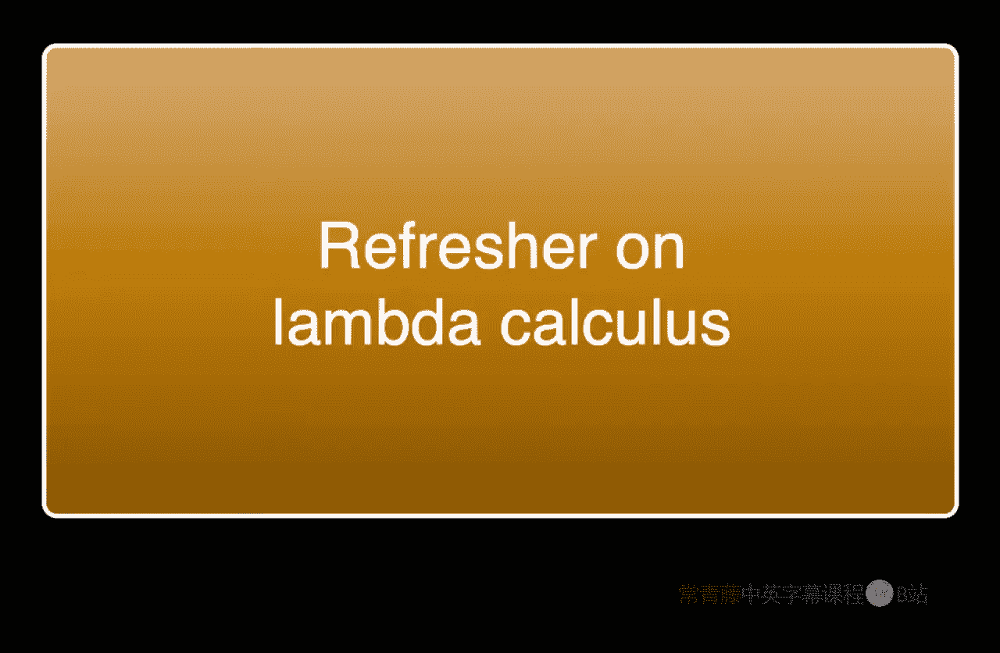
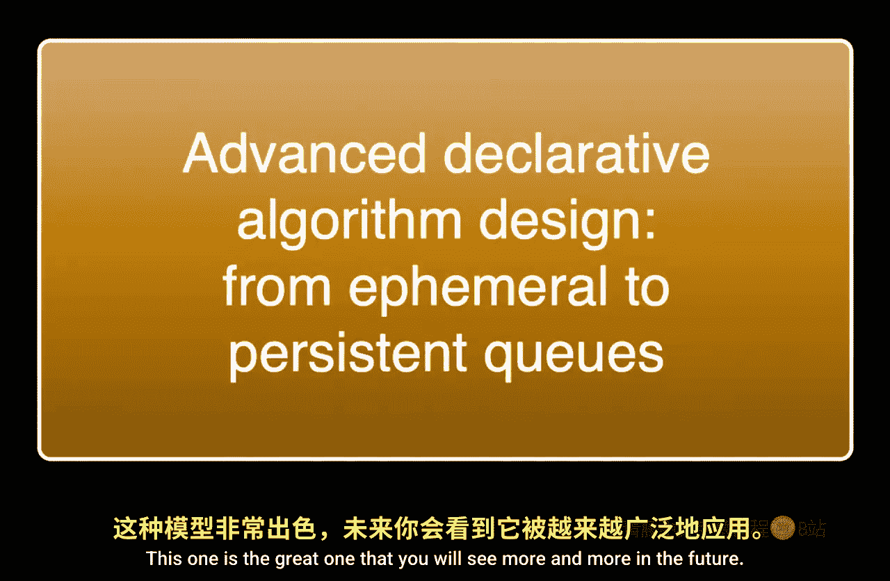
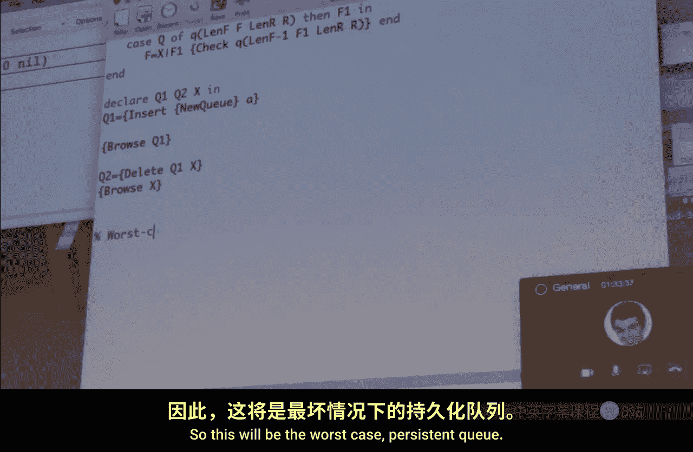

# 高级编程语言概念：04：高级声明式编程



在本节课中，我们将要学习高级声明式编程的核心概念。我们将从回顾Lambda演算开始，探讨其在所有编程语言中的核心地位及其作为声明式编程范式的优势。接着，我们将深入分析声明式范式的分类，并学习如何利用惰性求值等高级技术，构建高效且具有持久性的数据结构。最后，我们会探讨如何实现安全的数据抽象。

## Lambda演算回顾 🧮

上一节我们介绍了课程的整体结构，本节中我们来看看Lambda演算的基础知识。Lambda演算是一个简单的计算模型，它只包含两个核心概念：函数定义和函数应用。

一个Lambda项可以定义为：
*   **变量**：例如 `x`
*   **Lambda抽象（函数定义）**：例如 `λx.T`，其中 `T` 是一个Lambda项。
*   **函数应用**：例如 `T1 T2`，其中 `T1` 是函数，`T2` 是参数。


尽管看起来极其简单，但Lambda演算是图灵完备的。这意味着你可以用它来编码所有数据类型和控制结构，从而编写任何程序。

以下是一个简单的编码示例，展示如何用Lambda演算表示布尔逻辑：
*   **真值**：`true = λx.λy.x`
*   **假值**：`false = λx.λy.y`
*   **与操作**：`and = λp.λq.p q p`

通过函数应用的规约规则，计算 `and true false` 最终会得到与 `false` 等价的结果。

Lambda演算之所以是所有编程语言的核心，主要有两个原因。首先，它本质上是**高阶编程**，即函数可以作为参数传递、作为结果返回，并可以任意创建和操作。通过高阶编程，可以定义所有形式的抽象，如对象、类、抽象数据类型和模块。**抽象**是构建大型软件系统的关键，而Lambda演算正是抽象的语言。

其次，Lambda演算定义了一种**声明式编程**范式。实际的编程语言为了与现实世界交互（如处理可变状态、硬件时钟等），会扩展Lambda演算。然而，尽可能保持在Lambda演算的范畴内编程具有巨大优势，这主要得益于其**合流性**属性。

合流性（由丘奇-罗瑟定理证明）是指：对于一个Lambda表达式，无论以何种顺序进行规约，最终都会得到相同的结果（至多变量名不同）。这一属性带来了诸多优势：
*   **设计优势**：具有**引用透明性**，即“相等的可以替换相等”，便于进行等式推理和优化。
*   **测试优势**：函数仅由输入和输出定义，没有内部状态或历史依赖，易于单独测试。
*   **并发优势**：没有可变状态，因此不存在竞态条件和非确定性，极大地简化了并发编程。

因此，Lambda演算不仅是计算的理论核心，其声明式范式也为构建可靠、可测试、可并发的程序提供了强大的实践基础。

## 声明式范式分类 📊

上一节我们探讨了Lambda演算的核心地位，本节中我们来看看基于Lambda演算的各种声明式范式如何分类。分类的关键在于观察变量生命周期中的三个特殊时刻：
1.  **定义变量**。
2.  **定义计算其值的函数**。
3.  **求值该函数**。

根据这三个时刻是同时发生还是分离，我们可以对声明式范式进行分类。以下是主要的分类：

以下是主要的声明式范式分类：



| 范式 | 变量定义 | 函数定义 | 求值 | 关键特性 | 示例语言/模型 |
| :--- | :--- | :--- | :--- | :--- | :--- |
| **顺序函数式编程** | 同时 | 同时 | 同时 | 及早求值，无未绑定变量 | Scheme, ML |
| **惰性函数式编程** | 同时 | 同时 | 之后 | 惰性求值，值均为常量 | Haskell |
| **确定性数据流** | 分离 | 同时 | 同时 | 包含数据流变量（未绑定变量） | 声明式子集，Prolog（确定性部分） |
| **惰性确定性数据流** | 分离 | 同时 | 之后 | 包含数据流变量和惰性求值 | 未来的云编程模型 |
| **并发确定性数据流** | 分离 | 同时 | 同时 | 包含线程控制规约顺序 | MapReduce模型 |
| **并发惰性数据流** | 分离 | 分离 | 之后 | 变量、函数、求值三者完全分离，最通用 | “傻瓜式并发”，未来的高级模型 |

**顺序函数式编程**是最简单的形式，所有操作同时完成。**惰性函数式编程**推迟了求值，直到需要结果时才计算。**确定性数据流**引入了**数据流变量**，允许变量先声明后绑定值。

当我们引入**线程**（即对规约顺序的显式控制）时，就进入了并发领域。由于合流性，并发不会改变最终结果。**并发确定性数据流**模型（如MapReduce）在实践中非常成功。而**并发惰性数据流**模型结合了数据流变量和惰性求值，提供了最大的灵活性（例如“推”模型与“拉”模型），代表了声明式编程的未来方向。

## 高级声明式算法设计 ⚙️

上一节我们分类了各种声明式范式，本节中我们来看看如何利用这些范式的强大概念来设计高效的声明式算法。我们的目标是**在保持声明式范式优点的同时，追求极致的效率**。我们将重点关注两个关键概念：**数据流变量**和**惰性求值**。

利用这些概念，我们可以实现非常高效的数据结构。以下是根据不同范式所能达到的算法复杂度：

以下是不同范式下的队列算法复杂度：

| 范式 | 复杂度目标 | 持久性 |
| :--- | :--- | :--- |
| 顺序函数式编程 | 分摊O(1)时间 | 短暂性 |
| 顺序函数式编程 + 数据流变量 | 最坏情况O(1)时间 | 短暂性 |
| 惰性确定性数据流 | 分摊O(1)时间 | **持久性** |
| 惰性确定性数据流（优化后） | **最坏情况O(1)时间** | **持久性** |

**短暂性**数据结构在操作后，旧版本不再可用。**持久性**数据结构则允许同时存在和操作多个版本（例如Git仓库），这在协作和版本控制场景中至关重要。

我们以一个队列的实现为例。一个简单的函数式队列可以用两个列表表示：`F`（前端）用于出队，`R`（后端，反转后）用于入队。当`F`为空时，需要将`R`反转并移动到`F`。这个反转操作是O(n)的，使得单次操作可能很慢，但**分摊**下来每次操作仍是O(1)时间。然而，这个队列是**短暂性**的。

为了获得**持久性**且保持分摊O(1)复杂度，关键技巧是**提前创建惰性求值的反转操作**。我们引入一个“银行家方法”：昂贵的反转操作就像买房，我们需要提前储蓄。我们在`R`的长度刚好超过`F`时（即`len(R) > len(F)`），就创建一个惰性求值的“反转并追加到`F`”的承诺。此后，每次对`F`进行的出队操作，都相当于为这个未来的反转“支付”一点成本。当最终需要执行这个反转时，我们已经通过多次出队操作“储蓄”了足够的成本来支付它。这样，所有版本共享同一个惰性计算，分摊成本得以维持。

但上述方法中的反转仍然是** monolithic**（整体性）的。为了达到**最坏情况**O(1)时间，我们需要一个更巧妙的技巧：**将反转操作与列表的遍历（追加操作）合并，使其增量式进行**。

我们不再分别实现`append(F, reverse(R))`，而是定义一个合并函数 `lazyAppRev`，它同时遍历`F`和`R`：
```oz
fun {LazyAppRev F R}
   case F of nil then R
   [] X|F1 then
      case R of Y|R1 then
         Y|{LazyAppRev F1 R1} % 同时消耗F和R的一个元素
      end
   end
end
```
这个函数在每一步消耗`F`的一个元素（用于构建结果列表）和`R`的一个元素（`R`的头部正是`reverse(R)`的尾部元素）。由于我们总是在`len(R) = len(F) + 1`时调用它，因此它能完美地交错进行，使反转成本分摊到每一次出队操作中，从而实现了最坏情况O(1)时间的持久性队列。

这个例子展示了声明式编程的威力：通过高阶函数、数据流变量和惰性求值这些纯声明式的构件，我们能够设计出极其高效且优雅的算法，同时保留声明式范式在并发、测试和推理方面的所有优点。

## 安全的数据抽象 🔒

本节课中我们一起学习了Lambda演算的核心地位、声明式范式的分类以及利用惰性求值设计高级算法。最后，我们简要探讨**安全的数据抽象**。

安全的数据抽象意味着模块的内部实现被完全隐藏，外部代码无法通过任何方式（如反射、内存访问）“窥视”或“作弊”。这是所有现代编程语言保护模块化、维护不变性和保证系统完整性的基础机制。实现安全抽象通常需要语言运行时提供隔离环境、严格的类型系统或封装规则，确保用户只能通过定义的接口与抽象交互。



## 总结 📝

在本节课中，我们深入探讨了高级声明式编程。我们首先回顾了**Lambda演算**，理解了它作为所有编程语言**抽象核心**以及**声明式编程**基础的双重重要性。接着，我们基于变量生命周期的三个时刻，系统地对**声明式范式**进行了分类。然后，我们重点学习了如何利用**数据流变量**和**惰性求值**来设计高级算法，并以实现一个**最坏情况O(1)时间的持久性队列**为例，展示了声明式编程在保持纯度的同时达到极高效率的能力。最后，我们提到了**安全的数据抽象**作为构建可靠大型系统的基石。


通过本课的学习，你应该认识到声明式范式并非只是理论或“慢”的代名词，而是提供了一套强大、优雅且适用于现代计算（尤其是并发和分布式环境）的编程工具集。