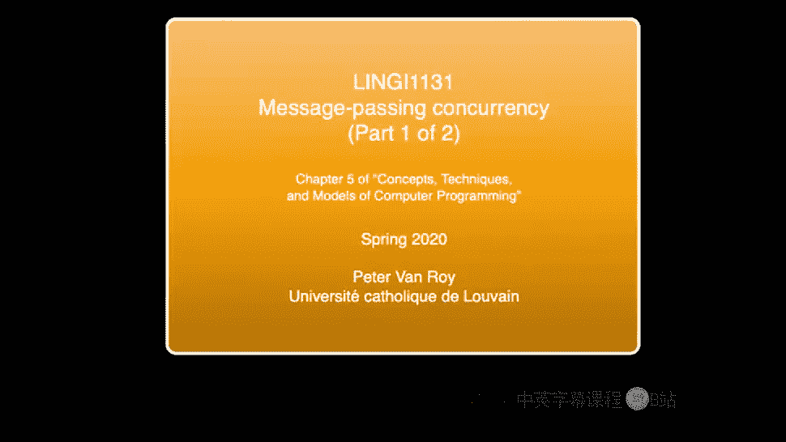
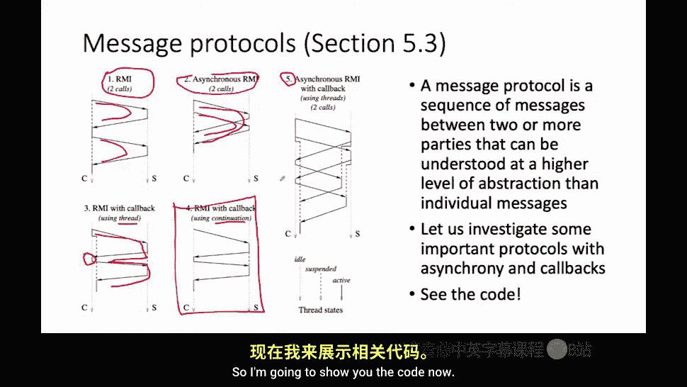
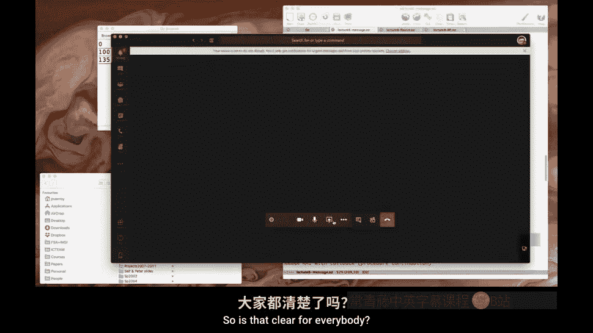
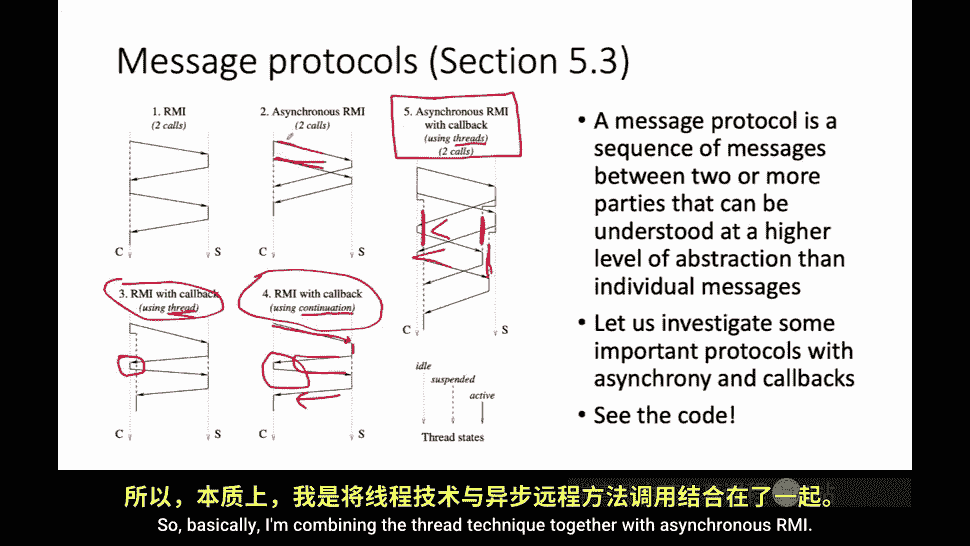
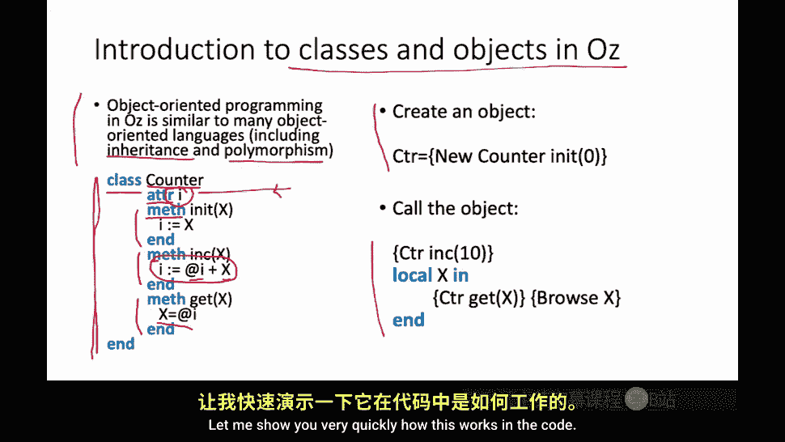
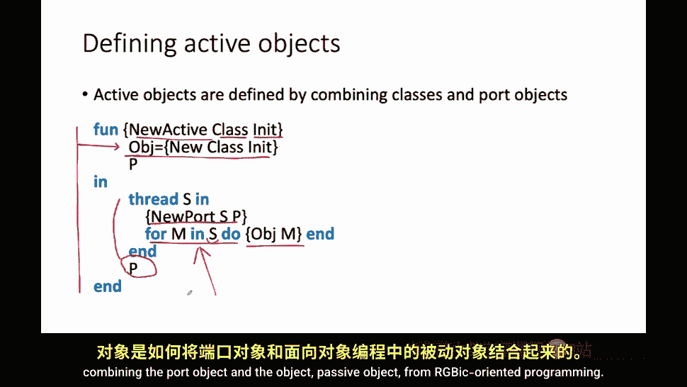
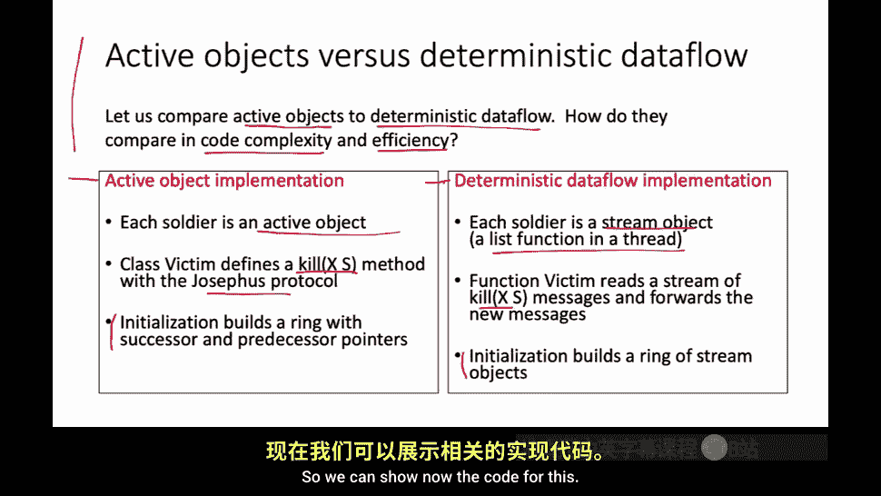
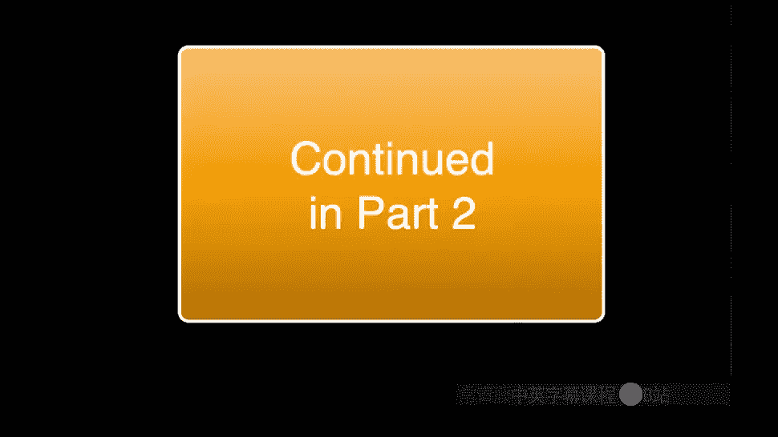

# 鲁汶理工学院【中英⚡高级编程语言概念｜LINFO1131, Advanced programming language concepts】 p05 P15 GI1131 Lecture 8 part 1 (2020) -BV1UDffBbEBZ_p5-

Welcome to the course， So I'm going to start now， so I'm going to record this course using Cammtasia separate software because I don't don't understand how it works in teams。

 doesn't seem to work very nice。 So this is the first course 1131 given through Team。

 So I'm going to teach this course by showing slides by also by showing code If you want to ask questions you should ask questions on the chat。

And I will look at the chat occasionally to answer the questions when I'm showing in slides。

 I don't see the chat， so I can't answer immediately。

 but I will make breaks every five or  ten0 minutes to answer the questions。

If there's something wrong， if you can't hear me or you don't see the slide。

 please unmute your microphone and yell and I will try to fix it because I cannot see if you're seeing the slides or not。

 I don't have any feedback on that it's a wonderful Microsoft Teams interface。

So I'm going to start the course now we can't hear you anymore your microphone is off a thank you。

 my microphone is so now you can hear me， right？Yeah， so let me repeat， so if you have questions。

 please write the questions in the chat。And every five or 10 minutes。

 I will look at the chat and answer the questions because I cannot see the chat while I'm showing slides so but you can always unmute if there's a problem。

Unmute and yell and tell me there's something if there's something wrong。

And I will record the course using Cammtasia。So it's a separate software which will record everything。

 the screen and my voice， so I hope that that works very well。

So let me start now by doing the slides。

So let me show you now how the course is going to work。

So today it's a course on message passing concurrency， it continues the course from the last time。

So the last time we started already talking about message protocols。

 so I'm going to finish that by giving some more information about how to do callbacks and asynchronous callbacks。

And then we'll talk about active objects this is combining object oriented programming and port objects in message passing together to have the power of both。

And then I will show a very interesting problem called the Flavius Josephus problem and this way we will compare active objects and deterministic data flow。

 so they look completely different when you program with them。

 but actually what happens can be very similar so it's really interesting to compare those two。

 so we're going to solve Flavius Josephus using both of those。

And then I'll talk about how to design multiageent systems if you have lots of these active objects talking together。

 port objects or active objects， it's very complicated。

 it's extremely concurrent so you need a very good technique a method for doing that so I will explain that here。

 very good technique and then I will apply it in a really big example of a lift or elevator control system where you have users pushing buttons on elevators going up and down there's many elevators。

 it's like in a hotel where you have many， many elevators and many。

 many floors and all the messages are going in the same time it has to work。😊，Okay。

 so let me start now。So let me talk first a little bit about message protocols。

 so we continue what we talked last week。 Remember we defined port objects。

So a port object has a port。A thread and a transition function。 So here there's a port。

Here there's a thread， and then you have this transition function F。

 So the idea is that you're inside the thread， you're reading the messages。 So this loop。

Procedure will read all the messages and each time it sees a message am arriving。

 it will apply the state transition function and define a new state and keep going。

 notice that loop is tail recursive， so this is very efficient technique and the port and the loop are running in the same thread。

So this is an object that runs in its own thread and you send messages to it。

So with this we define many things， so we defined already some message protocol。

 so here I'm showing a diagram of the some of the message protocols we saw。

 so last week you saw the simple one RMI where you have two round trip messages。

We also saw asynchronous RMI where you don't wait， the two round trips can be happening at the same time can overlap。

And we also start an RMI with callback where the server has to。Call the client back。

 The problem is that the client should not be blocking when the server is calling the client。

 So we did that with a thread。And today I'm going to show you another example of RMI callback using another approach called Continuation。

And then we'll talk about a more complicated one， which is asynchronous RI with callback。

 combining the callback and the asynchronous， giving a more complicated protocol。

So I'm going to show you the code now， so let me switch to the code。

So I'm going to switch now。To the code。First， let me see if there's any questions。

Is that okay for everybody， it's very clear so far we're still just continuing from last week so to get everybody warmed up so early in the morning。

 so let me now do a screenshot here。So here now you should be seeing a window with the Oz code and a window with the browser。

So here we have now the code I've loaded in the code to make things simple for a port object。

 so this code I will put on the Moodle when I've finished editing it。

So we have here to find the port object， so here is the port object。嗯。

I've also defined a port object that is stateless that just receives messages and does something but has no internal state。

 it's a little bit simpler， its for the examples。And we showed also last week some of the protocols。

 so the RMI protocol， so you have a very simple server which receives a CAC message to do a computation with x is the input and y is the result and it just does some computation okay？

And the client in the first example does normal synchronous RMI in the second example。

 the client does。Asynchronous R I。 So does the two sends right after each other note that the send does not wait for the result。

 It sends and then it's done， and the message travels in the system。 and at the afterwards。

 it waits for both results， Y1 and y 2 at the same time。And then we did also a callback version。

 remember this one where I was tricking you last time。The RMI with callback。

 so the server has now to send a Dlta message back to the client to get a special value D。

And then it uses that to。Change its computation。 If you look at the server， I sorry， the client。

 the client sends the message to the server。And then it does its own computation with the y result。

 but this one， this z equal y plus 10 is going to wait。

So that means the client thread is waiting here， and that means the client cannot。Handle the delta。

 so that's buggy because there's only one thread， so the fix for that there's several fixes。

 the first fix is to add an extra thread， so the y z equal y plus 10 here。

 we put it in its own thread， so the weighting will happen in this thread and not in the client main thread。

This works because it is declarative because it is deterministic data flow z equal y plus 10。

 these are all single assignment variables， so it does not matter when they're computed okay so we can put them in a thread and it's still correct。

And then the server can send the message delta and get the Delta value。

So this is a version that requires creating a thread， so that's where we stopped last week。

Now we will continue and I'll show you another version， which is called record continuation。Here。

 so suppose you have a system and threads are very expensive。

 so you do not want to create a new thread， then you use another way to do it and the other way is called continuation。

So a continuation is a data structure that encapsulates what has to be done。Later， after。

So what happens is now we will take the client message。

 so the client will still send a message to the server。But the second part of the client。

 So the y equals E plus 10。 So remember the client。 So let me go back to what the client does here。

 The client does two things。 It sends a message to the server and it does a local computation in the continuation method。

 this local computation is split and it's put in another message in another method。

 So if you look at the connuation version， You can see that the client method now is split into two。

 you have the send。And in the work message， it's the only。Thing。

 and the y equals z plus 10 is done in another method。 and I call it Kant Y Z， the continuation。

 So Y and Z are the arguments you need to do this。 So the way to that works is that the client sends a message to the server。

And the server then sends the deelta back for the callback。

And this is fine because the client after doing the sand it's finished。

And then the server at the very end will send the account message to the client。

 It will send the continuation back。 And then the client does the work。 So basically， client sends。

Message to the server， Cc message， server sends Dlta back and forth。

 and then the server sends a continuation so that the no extra thread has to be created。

 So let me show you how this works。And then we'll do some questions。 So let me define the。

Poor object here。So I compile this。So I go now into the continuation version。

 notice the server is now different because it this has to send a continuation。

 so let me define the server。Let me define the client。And now we can execute the client。

And you can see here on the browser window， 135。01， which is the answer。

 so the answer is coming back。So this is the callback with record continuation。

So let me go to the share not see if whether there's any questions。

 so that is that clear for everybody do people have questions on that？

It's okay。So you see no extra thread is created there。So let me now go back to the slide。

So what we did now。We did like this， we did RMI with continuation。

 so the client sends a message to the server。The server does something。

 it sends the Delta message back and then the server sends the continuation message。

 so notice there's no extra thread created here in the client。

 so this does not require thread creation， but it has the disadvantage that you have to rewrite the server。

 the server has to know that。Whereas in the old one or my width callback using thread。

 the server was completely the same as before， you just create an extra thread in the client and the server doesn't see anything。

Okay， so that's another method， so this method is used when threads are expensive。

Now there's a final one。Called asynchronous RMI with callback。 Here， we want to do asynchronous。

 So two messages leaving right next to each other， and we want to do callbacks to each one does a callback。

 We want to combine the two。 So this gets more complicated。 So how does this work。 Well。

 let's use a thread approach。 So each time the server does a computation。

 it will create a extra thread。 So these lines here， these dotted lines。In the diagram。

 these extra out lines are extra threads， so the client will create an extra thread and each server call will create its own extra thread for waiting。

So basically， I'm combining the。Thread technique together with asynchronous RMI。

This one。I will leave for you as an exercise， the answer is in the book。

But I encourage you to take the code for asynchronous RMI and for RMI with callback using Tread and to combine these two。

To make the asynchronous RMI with Colbe。Okay。So let me go back now to the main window。

And look at the chat so do you have any is that question， so I'm asking you the to exercise。

 not right now， but after during lab session。

Okay， so that's how message protocols work。So， let me know。Continue。

 so now I'm going to continue with the slides。So now let me show you a really interesting concept。

 which is called Act objects， and this is becoming more and more popular。

 many systems now closure go， other systems have these active objects。

 and they are compared to the regular objects， which we're going to call passive objects。

So what we want to do， so remember we have port objects。Which you can send messages to them。

 and they have a state transition function F。Okay。So it's not object oriented。

 it's a state transition function defining the behavior， whereas in object oriented programming。

 usually you will have a class。A class defining the behavior and not a trait transition， but a class。

 and the class can use very interesting concepts such as polymorphism and inheritance。

 So this is a very powerful way of defining abstraction。 so we want to combine these two。

The the port object idea and the object toiented idea。 So this is where we get active objects。

 So an active object is a port object， but the behavior is defined by a class。

So I'm going to show you that now and then I'll show you really the advantages of active objects。😊。

So in order to show you active objects， let me give you first a very quick introduction to objects in Os。

 classes and objects， it's very similar to objects in other object oriented languages it has inheritance polymorphism you can look at chapterpt 7 in the book We're not going to talk about all the possibilities of object oriented programming in this course I just want to show you how to define an object in usz so here's a simple class so it has a keyword class the class is called counter it has an attribute with a key attribute and methods with key method。

 so the attribute is I。And then here's a method initialization， a method ink and a method get。

 so the attributes are actually like cells internally each of these attributes will correspond to a cell so you can do reading and assignment。

 so for example here's an operation that you can do。😊，So I gets the value of I plus x。

 so you increment I here get x will just bind x to the value of I。

 so this is a simple counter object okay so we can create this object and we can call the object。

So this is the object oriented part of Os。 Let me show you very quickly how this works in the code。

Okay。So is that okay if anybody questions everybody， okay， so let me go now to the code？

So if we go now， we go farther。So notice here I have defined a counter class， class counter。So I can。

Compile that。So I compile it， we can create an object。And then we can。Display the value。

 So I do local x， so I do a get x here。Then I do browse X。

 so here I can display the value of the object you can see it's zero in the browser。

 if I increment the object by once by 10， then the result will be 10 if I increment again。

The result will be 20。 so so this is a very simple kind of。Regular object。 Okay， good。

 so that's the start。 Now let's see how we turn this into an active object。Okay。Okay。

 there's a question in the chat， why do we use colon and equal instead of equal in the method someone already answered because it's a cell。

 Yes， because attributes。Because the attribute I is actually。Ac cell。

So I call an equal value of I plus1。Okay。This is， this is。How objects。Work。Internally。

All attributes ourselves。So the attributes ourselves because we want to assign them so we consider objects to be always having mutual mutable states。

 sorry， so they're very similar to Java objects just with different syntax， okay， so they are cells。

So， let me show you now the。Coode。No， I'm sorry。 I go back to the。To the slide。

Let me go back to the slide here。

So here here we have then a simple object， but this object， we actually call it a passive object。

 so what you call up to now everywhere in all your courses from last year and so on。

 what you call objects， we now call them passive objects。

And the reason is that they don't have thread inside。So objects in Us and many other languages。

 we call them passive because when you call them from a thread。

 it's the calling thread that goes into the code， so if you look at the part the diagram on the left here。

 I have a thread T1。This thread is executing instructions， assume the thread does counter increment1。

It then executes this method in one inside the object。

 so this method is executed inside the thread T1。So that means the object does not have its own thread。

 It executes in the thread of the collar。 So if I have a second thread， T2 calling the object， Well。

 the T2 will execute the code。 So if both of them are calling the object at the same time or almost the same time。

 both of those threads will be accessing the object code。Almost at the same time。

 so things can go weird， okay？So this can lead to bugs， which I show you。

 So the calls are synchronous。 What it means is that when I call the method ink1。

The thread goes inside and it only comes back to T1 after the end of the method。

 so that means the thread code， the color code is basically waiting until the call comes back。

 so the color synchronous。So this is how passive objects work Act objects are different。

 an active object which is on the right here， has its own thread internally， a counter threadread。

 it has a specific thread dedicated to the object。😊，The calls now are asynchronous。

 if I do ink one call， it will send a message to the object and the thread CTR will execute it。

And if the other one sends a message， the other threat T2。This one。

 the thread T2 I will also execute it because the threads。

T C TR will execute the methods sequentially。 Okay。

 there's only one thread that can touch the code of the object， Its T C T R， no one else。

That means the two method executions will be done one after the other。

 and that means they will never be bugs when you call it for more than one thread。

 So basically the idea is that you have you attach a thread to the object。

 and this is a really good way of making objects that work in concurrent system。

So let me show you why passive objects give bugs， so on the left we have code for passive object on the right we have code for active object。

So here I create a counter， initialize zero， I have two threads。

 each thread will increment the counter。And then I also will display the value of the counter。

 Now the question is， what will be the value displayed here？Actually， it depends on the scheduler。

 okay， if if this browse executes first before these two threads get executed。

 then the value will be displayed will be zero。If the browse gets executed at the end。

 after these two threads are executed， the value will be2 because we have two increments。

But the left hand code has a bug， the value can also be one even after both threads are finished。

Which is weird， I'm incrementing the threads one and one should be two。

 right well because of the interleaving。Of the scheduler， if the scheduler makes a bad choice。

 the result will be one。So the corner on the left is buggy and to see how it works。

 look at this instruction， I gets I value of I plus1。 there's actually two operations here。

 there's a read and there's a right。Now， T1 and T2 will both execute this instruction。Okay。If。

The scheduler is kind of bad guy。 it executes T1 until it gets the value of I。

 and then it puts T1 to sleep。It's allowed to do that， and then it starts executing T2。

 and it completely executes T2 so T2 will increment everything。And then it comes back to T1。

 Well T1 still has the old value of I。And so it will put one into I。

 even though T2 is already incremented。So the results would be one and not two。So that's a bug。

 it should always be two when both threads are done。So passive objects are not concurrency safe。

Whereas in the right。It's always correct。So you see the code looks almost the same。

 The only difference is that we create the object as active， new active。 So we do two threads。

 we increment， we read the value。 This will always display two after these two threads are done。😊。

Because the two calls are executed sequentially inside the counter because the active object has its own thread。

So active objects are really nice things， the only reason people do not use it before but because people were thinking threads are very expensive。

 okay， objects are small things and threads are expensive。

 but actually threads are not so expensive if you do them right。

 and so many systems today are using active objects。Okay。

 so here now I'll show you how to define the active objects， It's very similar to new port object。

 except that we first create an object， so we have new active， we give it a class。

 we give it in it an initial method， first we create an object。😊。

Which is just a regular passive object。 So inside an active object there's a passive object。

 and then we have a thread with a port。And as before we have a loop。

 so 4M and S will actually be an infinite loop， it will read all the messages on the stream S。

 and it will call the object one after the other sequentially in this thread。And the result。

 of course， is the P is the name of the active object。

So you see how active object is combining the port object and the。Object。

 passive object from algebrato into programming。

Okay， so let me go back now to。The sharing。So I don't know if you have any if any questions。Okay。

 so the question is about muttics， mutual exclusion。

So muttex a mutual exclusion is let me explain mutual exclusion is you define a piece of code and you put a mutex around it so that only one thread can execute so if you put a mutex around the passive object。

 you will get a similar effect to an active object okay so but the problem is that it's more complicated because you have to worry about how the lock。

 the reentrance of the lock so we will talk about that later in the course okay when we talk about shared state concurrency will talk about how to do muttex and reentrance okay。

So it's another way of doing thing， of doing something similar to active objects。So let me go now。

Back to the slide。嗯。To the slide。Now let me go to the next part。Now you've seen active objects。

And they're very nice actually， because they're completely concurrency safe。

 you can use them and you can do things like asynchronous message passing and so on it's very easy。

 so active objects are very nice in concurrent system。But we also saw deterministic data flow。

 so I want to compare。Deterministic data flow with active objects。

 which are like very different ways of doing things， but it's really nice to compare。

 And I compare them using a very famous problem called Flavius Josephus' problem。😊。

So there's a really nice story attached to this problem， so Flavius Josephus was actually historian。

😊，He was actually a Jewish historian， but a very smart Jewish historian。

 He managed to become Roman citizen。 So in the first century AD D。

 there was a worse in the Palestine area， the Jewish Roman wars and of course。

 Rome was his incredible， very superpower。 So Rome was winning。 so he was losing。

 and he was in a cave with fellow soldiers。There were 40 soldiers there。So they were lost。

 but they wanted to keep their honor。So they decided to commit suicide in a very， very curious way。

 They stood in a ring。And they count to three， every third man， so one， two， three。

 this guy commit suicide， then one， two， three commits suicide and they keep going round and round。

Until there's only one man left。 and then the one man commit suicide and they're all dead。 Okay。

 so Josephus was there。 He did not want to commit suicide。 Okay， so he was very smart。

 somehow he was the last survivor。 Okay， so he managed to figure out where to put himself。

To be the last survivor and so he came out and he became a Roman citizen and he wrote a famous series of memoirs which you can still read today。

So let's go to the Joseph's problem now， we have N soldiers。Standing in a ring and K hops。

 So for Joseph， it was 40 soldiers， and there were three hops。So we define a protocol to compute。

The position of the last survivor。 So we have a message which I call kill X S with two arguments。

So X counts。The number of live objects traversed， so each time you pass a live object you increment。

 and S is the total number of live objects remaining， so whenever an object dies， you decrement S。

So you start by giving kill one n to the first object， so you're traversing the first object。

Now when an object I receives this message， it obeys the following protocol。

 so if the object is alive and s equal1， it's done， it's the last survivor。

 there's only one i object remaining。If it's alive， and x mod K is0， so you start one，2，3。

Three month three is zero，  four， five， six， Mo three is zero， then it becomes dead。

And you send kill x plus 1 S minus-1 to the next。So if it's alive and x k is different from zero。

 then it does not die， it sends kill x plus 1 S to the next object。Okay。And if it's dead。

 it just forwards the message。 So dead objects are kind of like zombies， Okay。

 so that's the protocol。And now we're going to implement this protocol。

But maybe I go back now if you want to see， if anybody has。Is that clear any question on that？Okay。

 on the Flavivis Josephus。 So we're going to implement this in both the。

We're going to in both the deterministic data flow and the active object version。So。

 let me show you now。Let's go back to the code。啊。Here。Okay。

So we're going we're going to implement this in both。

 so you're going to see the code for both and it's really interesting and I'm going to ask you to compare so how we're going to compare the complexity of the code。

 how hard it is to write， also the efficiency when you execute the code。

 so is the terministic data flow very efficient， are active object sufficient， we want to see？

So in the active object implementation， each soldier will be an active object。

 and there's going to be a kill method which defines the Josephus protocolcol。

And in the initialization， we build a ring。A ring with successor and predecessor pointers。

 because we have to。 it's important when an object dies。Okay。It has to it's going to be dead。

 so this ring is going to be built Now in the deter deterministic data flow。

 the soldiers will be as before agents， which are called stream objects。

 So just a list function in a thread it will read a list a stream。

And the stream has kill messages and it will compute a new stream with kill messages。

 so basically it reads kill messages and it outputs new messages and I build also a ring of these。

Okay。So we can show now the code for this。

So let me show you the code for this。

So here， for Levius， I will put it also in the Moodle。So I use active objects。

 so here is my first my active object。Absstruction。

So here is an active object version of Flavius Josephus。Here is a class。Call victim。

This class has some attributes， identity and a live flag， the step which is how many steps K。

 the last， which is a global variable giving the last survivor and the successor node。

 So in this version you only need successor node because you're only traversing the ring in one direction so here I have the kill method you can see it's very simple。

If alive。So if the node is alive， then I do this。If s is equal to1。

 then the global variable last will be equal to my identity and it's done。If。X modd step is0。

 then alive is false， and I send a message to the successor。Which is kill x plus1 S  -1。Otherwise。

 I send X plus1 S to the successor。 and if it's not alive。

 I'm here the else I send kill message okay now。Then I have an initialization here。

So here in this initialization， you can see here I'm going to use arrays。

 so I have not defined arrays， but array is basically a record with cells。

 so it has n fields and you can update them。So first you create an object， so a dot I。

 which is the Ih object of the array， is a new active object。And you initialize it。which is identity。

 the number which is I， the step K， and then there's one global variable last。

 so all of the active objects will share this one global variable and one of them will bind it at the end。

Now I connect them into a ring。So A。 I， the successor is A。 I plus1， I have a set successor method。

And I also。Have to connect the n with one。 So the successor of。A A dot n is a。1。

 and then I send the first kill message to A。1， and that's it。And it runs so we can run this。

Show you how it works。 And then we show you where that。Josephus put himself in the ring。

So we'll do something which he did almost 2000 years ago or maybe yeah， almost 2000 years ago。

I think it was around in the year 70 when he did it。So here's the initialization。

Now we can actually check this， Josephus 5，2， So we have five。Objects in the ring。

 it's actually number 3， which is surviving。 Now， if now let's take the Josephus case。

 I have 40 soldiers， and we do every third one， and the result is 28。

 So he managed to put himself position 28。 but I'm sure that during the the counting， he was very。

 very sure that they did not make any mistake。 Okay， Now we can also run it for other cases。

 For example， if we have 1000 soldiers and we do every 100 soldier。

You see it takes a little bit more time here。876。Okay， so this is an active object version。

So you see how it works， right？Let me see if you have any questions on that。So。

Is that okay clear to everybody？No questions， okay？So， let's now look at the。An optimization of this。

 This version is actually not very optimal， so we will improve it。So the problem with this version。

The problem with this version is that the dead objects are still in the ring。

So if I have a thousand objects。And I'm starting to remove them， turn them into dead objects。

 I still are traversing them， so I'm going to do a lot at the end。

 most of the traversibles will be dead objects。So it's not very optimal。

 so let's do an optimization of this， which I call the short circuit version。

So let's remove these dead victims from the ring。 So now we're actually modifying the ring during the execution。

 So we we will remove an object。 That means we have to update the successor pointer。

But it's not enough to update the successor pointer because if we remove an object。

 we have to update。The successor pointer， but the successor pointer of the predecessor node。

 the one just before which is pointing to me， okay so it means we also need predecessor nodes now。

 So if we want to do this， we need both successor and predecessor finally。

 let's put them in successor and predecessor node， we have two methods set set predecessor。

And our kill protocol is slightly changed now because when the node becomes。Dead。

 so if x mode step is0。Alive is false。 Now。 Now we will， with these two messages。

We will update the ring。 So the successor。So my predecessor， so no。

 I send to my predecessor a new successor， so I have a note here which has a predecessor and a successor。

 so the predecessor has to bypass me。And the successor has to bypass me in the back direction。

So the predecessor has a new successor， which is my successor， predecessor， said successor successor。

 and the successor has a new predecessor， which is my predecessor and then that they bypass me okay in both directions。

 so I'm removed from the ring。And then I send a kill message。Now this will solve the problem but。

We have to think carefully now what happens if the kill message goes around so fast？

That it comes back before the predecessor and successor messages are done。

 What happens if it goes around so fast that it。Tverses the ring。

 and it comes back before the ring is updated。 What happens if that that happens。

 Can the scheduler do that。So if the scheduler can do that， then this code is not correct。

Then we have to be very careful， okay？It turns out that this code is correct。

 And the reason is because。Stream objects or active objects have a PIfo property。

 That means if I send two messages to the object inside a thread。

 the first one that I send will arrive first， the order will not change。

 And the reason is that when I do ascend， it immediately puts the message in the stream。

So the second send will be after， so the first send will arrive first。

And if you do look at that here， I'm sending messages to the successor object。This message。

Will arrive before the kill because this successor is called before the kill， okay？Also。

 this predecessor message。Is sent before the kill arrives at the predecessor Okay。

 so if I send a message to the predecessor to send a new successor， the kill messages go around。

 eventually it reaches here。But this。1 will be arriving after because this one is already sent。

 So if you reason on PIfo message of property， then you see that this is actually correct。

 The kill message， when it arrives。The ring will be already repaired， okay？So this is correct。

 now we can define this code。So let me compile it。We have a slightly different initialization because we have to initialize both the successors and the predecessors。

 so let me define Josephus2。5，2 should be the same。 It's three also。100， 1100。

You can see that it's faster， actually it's a lot faster， okay？So， let me go back to the。Chat。

Is that reasonable， does anybody have any question on that？You see how it works。

 so we did first active object naive。Where it goes round and round。And then we do short circuit。

 so the dead objects are removed from the ring。Okay， there's a question。So first question， what does？

Read PEC mean and preEC， so predecessor。So pre is an attribute。Containing the predecessor。Object。

Okay， and at pret reads。Gives a reference。To the predecessor object。Okay， so pre。

In the object in the victim is an attribute， and the at sign， which is read of preed。

 gives the reference to the predecessor object。 So in this， so in this code。Active objects。

Are defined as。Procedures。With one argument。So， they have。Same syntax as。Passive objects。

So instead of doing send to the active object， I put the sand in a procedure。

 So the active object looks like a passive object。 So the active object。 So instead of。We do。Where。

So the idea is that we define a one argument procedure。Object with which internally does the。

 the reason is just to make active objects look exactly like passive objects。

It's because passive objects are called。Like that。So we want the active objects to look the same in the code as passive objects。

 So we don't want to actually do the send explicitly。 It's inside the procedure。

 So that's just a detail to make them look the same okay。So。

Let me show you now the code for the deterministic data flow version， and then we compare them。

So here's the deterministic data flow version。So this code now is doing the termministic data flow version。

It actually looks quite a bit different from the previous code， we have a function here， victim。

Sorry， so the protocol is actually defined here in this function。

Victim XS is an input stream which contains the kill messages， and this function as an output stream。

So we have a case excess of kill XSR， so we read a kill message and here we have the actual protocol it's kind of similar if s is equal to 1 I'm done。

 so last is equal to I， so last is a globalm variable and then I'm done。And I return nil。

 that means that this output stream is terminated。Otherwise， if x mark k is0。

 then I output kill x plus 1 S minus1。Okay， and the object dies。So I don't do recursive call。

 I just output the input stream Xr。 So the object is only alive if I do a recursive call。 Okay。

 so if x mod K is different from 0， then I output kill x plus1 S and I do a recursive call because the victim is not dead yet。

 It's still there and it still continues to read things Okay， so this。

Where the version where I'm not doing the recursive call。

 this actually removes the victim that the victim disappears， okay？And at the very end， when the。

Result is new， then the。The input is n， the output is nil， that means if the input stream terminates。

 the output stream terminates and it's done， okay？And now I have the initialization where I have a pipe。

 I create， I actually connect all the victims together， so let me show you here the main call。

So the victim looks like this， it's a thread。A thread and calling victim。

It has input I and it also has the output， you don't see it， but it's a function。

 so it has an output and the pipe function connects them all in a pipe so pipe is a higher order function。

 so here we're combining deterministic data flow in higher order。So the pipe is defined like this。

 so if you look up with the pipe。You go from L to H， so the low to the high value from 1 to n。

 for example， so if your L is bigger than H， you're done， so there's nothing。

 otherwise you take F X L， which is one pipe element。

And then you call pipe recursively to make the rest of the pipe。

 So basically making the elements all one after the other。 So you see this code is very。

Concentrated the higher order makes it very compact， it's very powerful。

 and the stream also is very compact。So let's run this。Code。

 and it should be giving exactly the same result as before。So with five and two。

It keeps three as before， with 40 and three， it will still give 28。And with 10 and 100。

 it will give 876 like before， so this one。Is about half the number of lines of code as the active object version with short circuit。

 So this one is already doing a short circuit。 The short circuit is just this is replacing the recursive code by this。

 You see that this code is very dense and compact compared to the active object version。

 The efficiency is about the same。If you look at 100，1，100， if I execute this。

 you see that it comes very quickly if I run it here in the previous one。It's also about the same。

 you can measure the time there's really no significant difference because they're both doing essentially the same operations。

Okay。So this is actually a very interesting comparison。

 you can see that deter deterministic data flow is actually a very compact。😊，Way of writing programs。

 especially when you combine it with higher order。Whereas the active object version is more。

 you can see it's more code it's about twice as much code。

 it's more code for initializing and it's more code because you have to do all this work。

 you have to do all this work extra work in connecting and disconnecting things okay so so the deterministic data flow is actually more compact less lines of code Of course deterministic dataflow has its limitation that you can only use it when you have deterministic。

Programs if you have a non deterministic program， you cannot do it。

 and then you have to use an active object version， but Flavius Josephus is a deterministic problem。

There's only one， it's always the same result in the problem。

 so there's no problem in doing it with the deterministic data flow。Okay。I that okay。

 does that give you some idea of how the two are connected？Okay。So now let me make。

 it's now almost 9，30。 Let me make a。Small break。About five minute break so I will just stay in the meeting。

 just stay there， I will turn off mic and video but the meeting will be there if you have any objects then questions sorry please and put the questions in the chat and I'll try to answer them after the break and after the break we'll go and we'll see how to build big multiagent systems with huge number of agents talking together so these are really the real ones that you want to build。

Okay， so now we make a small break。

