# 鲁汶理工学院【中英⚡高级编程语言概念｜LINFO1131, Advanced programming language concepts】 p06 P14 GI1131 Lecture 8 part 2 (2020) -BV1UDffBbEBZ_p6-

Let me start again after the break， so now we're going to talk about multi agent programming。

So let me go to the slides。So if you look at the slides， so here， okay， there's one slide。

 remember explaining the short circuit protocol we did before Favius Josephus。

 so you can take a look at that。That explains it now we're going to talk about multiagent programming so multiagent。

 that's when you are building big systems with agents which can be active objects or port objects or stream objects which are deterministic data flow objects agents which list functions in a thread。

It's also sometimes called concurrent components。Because they're like building blocks and they're sending messages to each other。

So the program is a collection of agents with internal state that send each other messages。

So theministic data flow， what we saw is actually a restricted version of that。

 it's a form of multi agentent programming that is deterministic okay but in real vigor systems you can't always make it deterministic so in general it can be non deterterministic。

So with port objects， we can go beyond deterministic data flow design programs with non deterministic behavior。

 okay？When programs interact with the realroad， remember the client server example。

 the reason why it's non deterministic because it has a timing requirement。

It has to react to the first message。But it doesn't have any control over that。

 it depends on the human using it。But that means it has to react to both and because of this timing requirement。

 the program is forced to be non deterterministic okay so with multiagent system we can have this kind of behavior and then we're going to show a system。

So now I'm going to show you the basic principles how do you do a build a system like that Okay。

 this is actually very complicated， and I'm only going to show you some of the beginning principles of this。

So it's very complicated so you have to be rigorous if you do messy stuff here。

 your program is not going to work， okay， you have to be rigorous because it's so complicated because of all the interleavings。

So let me define some concepts， so in our examples， a concurrent component。Is。

A procedure with inputs and outputs， remember the full adder， remember the an gates and the or gates。

 okay？These when you call them， they create an agent。

 so when you in this procedure it creates a component instance which is known as the is the agent。

 okay so the component is kind of like a class， it's a template， each time you call it。

 you create a new instance which is kind of like an object。So remember the full adder procedure。

What we did in the digital logic， you have full adder with three input streams and two output streams。

When you call that， it actually builds a new full adder。Agent， okay。

And there's four basic operations when you build a system like this。

There's one which I showed which is called instantiation， creating a new instance。

 this is like creating an instance of an object from a class。

 an object orined programming here it's creating a new agent from the component。

You also have composition where you're building a component which is combined from other components。

 so the full adder has gates inside it， so that's composition then you have linking。

 you connect the components together and I actually call it wires， there's three they can be streams。

 they can be port， but I can in the general term it's like building electronic circuits。

 their connections are kind of like wires and there's different kinds of wires。

There's one shot or many shot， a wire that you can only I send one message。

 so a single assignment variable is like a wire you can only bind once。

So it's one shot whereas a port or a stream， both of those。

 you can send many messages on it okay so that's different kind of wire is also one source or many source in a stream it's deterministic。

 so only one agent can write the stream many can read， but only one can write。Whereas in a port。

Many can write like in the client server， so you have different kinds of links and your connections will be different depending on the links。

 The one source links are deterministic。 The many source links will be nondeterministic and then the final one is restriction when you connect components together the wire。

 maybe you want to hide it from the outside， you're building a components out of small subcompons like the full adder。

 you're connecting them to wires together， but those internal wires， you don't want to see them。

 So it's kind of encapsulationer， you restrict their visibility。

 So you're basically building the system out of small components， connecting them， hiding。

 making bigger components and so on like that。オケ。So。

I mentioned that the different kinds of wires or links that we have。

 so there are many kinds of links and there's many kinds of software that lets you build these systems that show different kind of links so we are going to use the following links so the one shot links which are the single assignment variables which I also call data for variable the many shot links which is the streams。

 remember streams， now stream is just a special case of a link remember the streams we talked about these are all deterministic so the one source one sender links are deterministic okay。

So the termministic data flow only has this kind of link。But we also have non deterministic links。

 the many source links。So many many shots， many source， that means you can have many senders。

 but you can also send many messages。Okay， so a port is like that。

 anyone can send a message that's many source and more than one message can be sent from anybody。

 that's many shot， okay so it's non deterministic because any source can send a message。

So multi agent programming will use a lot of these， so all the links。

 all the communication and airlineang is like this by default， okay。

Now you see that were we're not using all the possibilities。So one shot。

 many source links is actually not very useful if I have many possible senders。

 but only one message can be sent。That's kind of weird， okay。

 so we're not going to use those in our examples。Okay， so here's a simple example。

 so this is the full adder， remember the full adder。😊，So if I make a picture of the full adder here。

 I have input streams。Three input streams and two output streams noticeice it's shown all the examples I'm doing composition because I have gates internally each time I call these gates I create a new gate okay。

 I have seven gates internally， I'm doing restriction because I have these local links。

 these local wires that you don't see from the outside okay and so I'm doing instantiation and restriction here。

And composition。And each time I call full adder， it will build a new full adder component。Okay。

So see how it works。So now we're going to see how to build systems。

Notice it's hard because of all the possible interactions anybody can send message to other guys and messages can be coming in all the time。

 it's extremely concurrent system it's kind of messy， so you have to be very careful。

So here is a methodology that I'm going to show you。

 which is you start with an informal specification and then it gets more and more precise。

 so you have first make a description of what you want to do。😊，Then you define the components。

 so the kinds of agents and what messages and what they do。

 then you define the actual message protocols between them。And then here， this is actually。😊。

A key part， you define state diagrams for these components。

 So this is basically where most of the work goes into these state diagrams。And then you implement。

The implementation is actually very easy。 The coding of the state diagram is almost automatic。

 and you have actually software， commercial software that lets you build state diagrams。

 and then it generates Java code or whatever code， C code。Automatically okay。

 so the implementation is actually easy， so the state diagram is where it's the hard part。

And after that， you can do verification and testing。 and you have to do both。

 So verifying is actually proving properties of the code。

 Testing is running it in different scenarios。 and usually you see problems。 so you have to go back。

Somewhere go back and change things Okay， so this is the basic idea and' I'm going to show you a big example that uses this。

We're going to show， I told you here the state diagram is very important， okay， state diagram。

So we're going to build state transition diagrams。😡，So the states will be these circles。

And there will be arrows connecting them， state transition。So you want to。Build an agent。

 so internally the agent has a program， but it has a state。And when a message arrives。

 it changes state。So you want to figure out all the ways that the state can change。

 so you enumerate all the states and all the messages it can send and receive。So basically。

 you have to make sure that each state can receive all messages and we'll see that in the example。

So this is a kind of finite state， automaton， so they have a finite set of states and a set of transitions。

And whenever a message is received here， received message， and the bullolean condition is true。

 then it's able to do a state transition and it will eventually do that transition whenever the message is received and the condition is true。

And it couldn be non deterministic if you're more than one message。

 you might have more than one arrow， well in that case it's free to follow whatever  area it wants and it should still be correct。

Okay。So that's the basic idea that's the basic approach this is all very theoretical now we're going to show a real example of this I'm going to show you the real code and it's going to do actually fairly complicated stuff okay we're going to follow the design methodology we're going to build the state transition diagrams this is the lift control system。

😊，So let me go back to the sharing if you have any questions on this。

Is that clear what we're going to do now？So we're going to build a lift control system and if you ever build a hotel or an apartment building。

 you will see that there's lots of lifts or elevators in there and they're going up and down and people are pushing buttons。

 they have to be controlled somehow okay so that's what we're going to look at。

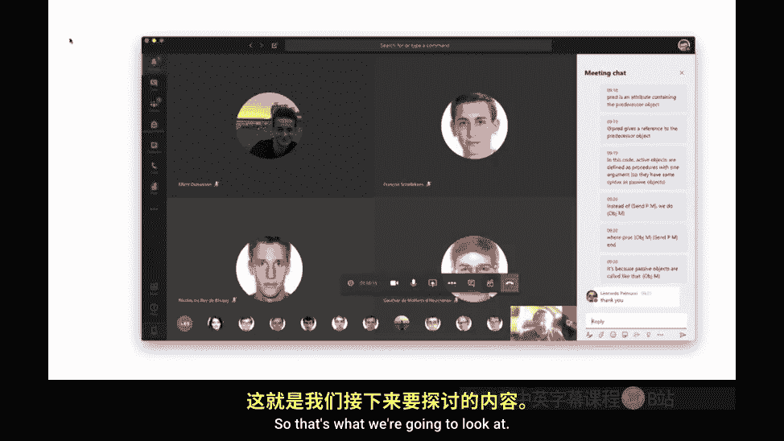

Okay케。呃。So， let me go back now to the。To the slide。 And then after that， we' show the code。

 But first， we have to talk about the design。So the real work。

 the real thinking is actually the design， it's not the coding。 codinging is easy。

It's the building of the state diagram is actually where this example is complicated。

 and then the code is really easy once you have the state diagram。

 you can just write it automatically。Okay， so we're going to show you this system。

 this is actually in the book， you can look at section 5。5。So we're going to show you the design。

 also the implementation， so we'll start with the informal specification in the methodology。

We're going to show you the components， the protocols， then we will show you the state diagrams。

There's actually three components， there's the controller。

 so the controller is attached to the motor that makes the lift go up and down。

Okay so it's basically a lift shaft if you want to。

 it's like a cylinder inside the building where the lift goes up and down and there's a motor and the controller will move the lift up and down。

 then there's the floor。 so when you walk into hotel and you go in front of the lift Theres there's a door with buttons so that is also an agent when you press that button you will send a message so you have the floors and then you have the lifts themselves so the lift moves。

 it can arrive at a floor， it will send a message to the floor saying I arrived the doors will open you can walk in and once you're in you can also press buttons so you can send messages to the lift also from inside so you have these three。

Fundamentally， different components。And then we will write the code and we will test it and show you how it works。

So here's a picture， kind of a schematic diagram of how it works， so I have here a controller。😊。

And here is a lift， so lift can go up and it can go down。And then there's floor。These floor agents。

 there's also users， users are human beings， usually so the human being can walk up to the floor and pushes a button。

 So when a human pushes a button， it's sending a message。

 the human agent is sending a message to the floor agent Now we will not model the internals of the users except that they are sources of messages okay the users at least will be sending messages。

 but we will model the internals of the other the floors， So here there's N floors。Okay。

 here there's three controllers， so three lift shafts。

 but there can be any number of them so if you go to a big hotel， you can have six or more of them。

 so I've been to these big conference hotels and you have 30 floors you have six lift shafts and huge so there's lots of stuff going on Okay so this is the overview of the different components。

So here we'll now see how these components send messages to each other。

 so now we will define the protocols， in this case the protocol is actually fairly simple。

So there's several protocols， a user can send a call message to a floor。

 this is what happens when the user presses the button on the floor and we're going to do a simple one。

 sometimes you can ask for up or down calls but here we're just going to do a call okay just to keep it simple。

 could be up or down it will not change so much， but I don't want to complicate too much the code it's already going to be kind of subtle。

So the floor。Sendent a message to the lift， so the floor will send a call F message to a lift。

And the F is coming from floor F， so the floor is where all we have numbers or names。

So the floor sends a call F message to a lift， that means it tells the lift， please come to me。

So of course， the lift can receive many of these from many floors， okay。And when the lift arrives。

 it sends an arrive message back to the floor with a one shot。Link and acknowledgement。

So that which is the one it's allowed to leave。 So when the lift arrives。At the floor。

 then the floor is allowed to open the doors。 It's very important that when you open the doors。

 there's actually lift on the other side。 Okay， and so that's an important property that you would have to prove that when the floor opens the door。

 it will only open the door if there's a lift standing there。 and never if there's no lift okay。

 and then eventually the door is closed。 So the floor manages the doors。

And when the lift is allowed to leave， the floor will bind a， so act will be a one shot。Link。

 it only needs to do one message。 So there's no need to make the complicated thing or port。

 A single data flow is fine。 It just tells lift you were allowed to leave when it binds that。

 So this protocol has three messages， a call lift。Eventually， a lift arrives。And sends me an arrive。

 and then I tell the lift you're allowed to go。So that's the most complicated protocol actually。

There's more messages when a user goes inside the lift。Inside the lift there's also buttons。

 so the user is allowed to press buttons when he or she is inside the lift for going to the floors so the call messages can also come from users。

And it's telling the lift go to that floor。Okay， so the call F message can come either from a floor or from a lift。

And then the final protocol is the controller protocol， so the controller。

 the motor actually makes lift go up and down one floor at a time， so we model this in a simple way。

嗯。The lift sends a step message with a destination floor。

To the controller and the controller moves one floor at a time and sends a message back when the lift has stepped by one floor and tells me you are now at floor F。

Okay。And if it's the， the lift then sees I'm at floor F， it does whatever it has to do。

 and then it sends another step message to go to another floor。

 but the controller is only moving the lift one floor at a time。Of course this can be optimized。

 you can have the controller move several floors。But doing one floor at time is nice because while the lift is moving up。

 more messages can arrive， okay？But if the floor is moving many， many。

 if the lift is moving many floors without stopping， it goes from1 to 10。

 and if it set floor 3 and moving up and a message comes from floor 7， if it's moving。

 it will not stop。It will go to 10 and come back down。 So we're not going to model like that。

 We're going to model that the lift actually goes one floor at a time。

 So if you're moving up you're in floor 3 and someone presses floor 7， then the lift will actually。

Stop also at floor 7 before stopping at floor 10。 Okay， so this is the lift components。

And their protocols。So let me go back now to the。To the chat。Does anybody have any questions。

 is it clear the kind of system， you see， it's kind of a complicated system？Each of these components。

 floor lift and controller， will have internal state and receives and sends messages and messages can be coming all the time。

 You see that？Okay。So let's go back now。 Let's go now to look at。How we design it？Okay。

Let's design we'll start with the simplest protocol， which is the controller。

 the controller is the simplest one。The controller has two states， the lift is either stopped。

Or it's moving， running， moving upward down， whatever， it's running， okay？

And here we have the states。So the lift is either stopped at a floor。Or it's at floor F and moving。

 Okay， so the the F here is where it stops at。 So the F is important when it stops， okay。So the lift。

 the controller can receive a step message from the lift， so notice this is the first state。

 I receive step message if F is equal to dust， the destination that I want to go to。

And I'm already at floor F， then I do nothing， okay？So this is like a no up。

Now if I receive a step message， so the left of the bar is a receiver and F is different from desk。

 then I have to do something so it has to start the motor in real life it would have to start the motor and move up or down。

 we're going to simulate that by a timer。We're going to start a timer and we're going to make the timer go 5 seconds。

 5，000 milliseconds， CID is the controller ID， it sends to a timer。

And then it starts the timer and it also defines a new floor that it's moving to。

So if it's at floor 5 and it moves up， it will go to floor 6 if it's at floor5 it's moving down it goes to4。

 so if F is less than this， then it will go to F plus1。 So it's if I need to go up。

 I go up by one floor。Or else I go down by one floor。So then I'm in the state running。

And it's staying there， it's in the state running and F is the floor I'm going to， okay， the new F。

And I'm running。And nothing happens until I receive a stop timer message。

So you see the start timer will actually eventually send a stop timer message。

So that means I've arrived so when that happens， I will send the at message to the lift。

 so each controller in the state knows， of course， of its lift， this is the lift ID。

So when I receive a stop timer， I say I'm now at floor F and I go back into stopped。

So you see how it works， the lift sends a step message。

The controller moves either up one floor or one down one floor。

 and it sends a message back when it arrives。So now you have to check， is it this state diagram？

Is it complete， Are you missing anything， this is very important when you build a state diagram。

In each state， will it receive all possible messages Well。

 the step message is received when I'm stopping。The step message here。

 I have F equal D F different from S， so this is all the possible step messages。

 this is okay When I'm running， I can only receive one message stop timer。So when it's running。

 it will not receive a step message， okay， if I send a step message to the controller and the controller is running。

 it will ignore that it will not receive it and it will only receive it when it's back in the state stopped。

Okay， is that reasonable， Yes， we don't want the controller to receive messages when it's moving。

So when it's moving， it will not handle step messages only when it's stopped。

 So that's very reasonable。 Okay， you see how it works there， the controller。

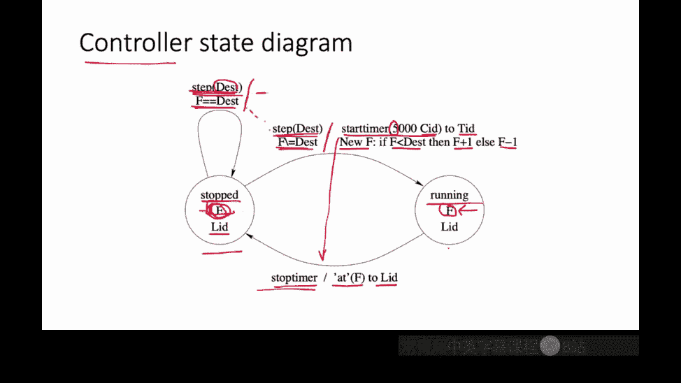

So let me go a second back to the。Back to the chat， so you see how the controller works。No questions。

So you see that it's actually。Not so complicated， but you have to carefully think of how the timing works。

 okay？

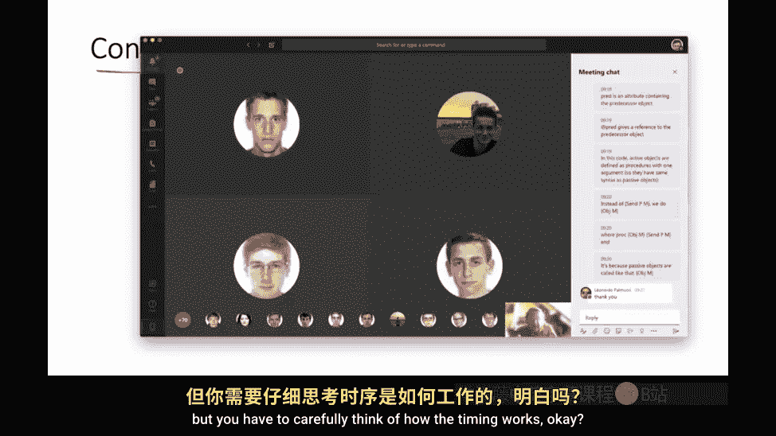

So let me go back and continue now， notice we have not written any code yet。

You don't write code until the very end in the stgger。

So first we have to worry about the state diagrams， so here's the controller。

Now we let's look at the floor， which is a little bit more complicated。

So here's the floor state diagram。The floor， it has three states， not called。

 This is like an idle state， it's sitting there。Nobody has pushed any buttons to doing nothing。

Somebody comes up to the floor， presses a call button。So the call message receives a call message。

And then it sends call F to a lift， which one？😡，Now we actually have a choice here。

It can actually do something complicated， which lift does it call？Here I'm calling a random lift。😡。

It just sends a message to any old lift， Maybe there's six lifts just sends to one of them。

But in a real system， maybe it will first send a message to the Lyft saying， where are you。

 it will get their replies back。 It would figure out which one is closest。

 and then it'll say a message to that one。 Okay， we can do smarter things。 But for this one。

 let's just do a simple thing。 It's sending two random lift。Then I'm at the called state。

So the called state is when someone is calling a lift and I'm waiting for a lift， basically。

 I'm waiting for the lift， okay？So what can happen in the called state。

 What messages can I receive here， Well， I can receive and arrive when the lift actually arrives。

 I can also receive a call again。Okay。When someone presses the button， maybe someone else。

Maybe I'm pressing the button 10 times and I hope it goes faster， you know， so。

 so the call message can come in。Any time here in fact So if the call message drive and I'm already called。

 then it's a no up。 Okay， I have to do this。 If I don't do this。

 then my system is buggy because the call message will be just sitting there， okay。Okay。

 I'm waiting for the lift Eventually the lift will arrive within a one shot acknowledgement。

 Now I have to model the door opening。 Okay， so normally what happens is the floor will connect to the door motors。

 it will open the door motors and the door motors have some kind of security they will stay open for a certain time and if there's a person going in and they're trying to close it open again。

 So there's some mechanism there， but I'm going to simplify it。

 I'm going to say the doors will open for five。Seconds， so again， I'll simulate it using a timer。

 whereas if you want to really build this using a microcontroller。

 you'll have to actually connect to real motors Okay， so I actually send a message to the timer。

And then I go to doors open。I have also my acknowledgement in this data。

 so I'm waiting for the doors to close so that I can tell the lift to leave so the act is a message going back to the Ly saying it's okay to leave okay。

So different things can happen now here， this is a complicated state actually。

 if there's a stop timer。That means the door has closed， act as unit， the lift can leave。

What happens if if？A second lift arrives。During the first one。

 maybe there's six lifts in the building， one of them has arrived doors open， second lift arrives。

 what do you do。Well， I'm going to simplify this。 you could manage them separately。

 I will actually merge the two one shot messages， so this a equal act will actually bind the two variables together so that the both lifts will leave at the same time it's just for simplification。

 but you could manage them separately okay， so just to make the code simple。

 it will just treat if there's more than one lift arriving， they will all be leaving separately。

What happens if the lift has arrived and I press the call button it's kind of stupidup enough。

 there's a lift arriving， the door opens and I press call。Well， I have to handle it， so I do nothing。

 okay？Also， there's a final case， What if I'm not called？And a lift arrives。How can that happen？

The floor is sitting there。 No one has pressed the button， but the lift arrives。

It's because someone inside the lift wants to go to that floor so the arrive message can come also from not called。

So there we also have to start the timer again and open the doors okay。

 so you see we have to go through all the possible messages in all the possible states and we have to do something reasonable for all those cases。

Okay。

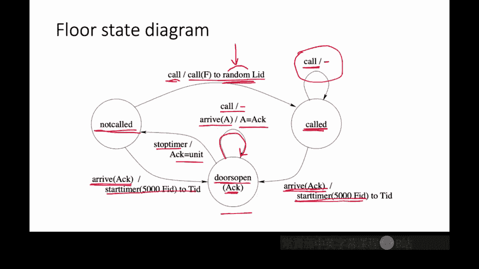

Let me go to。The sharing now。Is that okay， Does anyone have any questions on this。Yes， slides。

 the slides will be on Molo， they're already there。Yes。

So I have made some small improvements to the slides。 I will put the improved version on the Moodle。

 but essentially it's the same。Right after the course， I put the final slides。

 but the slides are not saying everything。There's a lot of things I say。

 I'm talking that are not explicitly on the slide， but it's important。

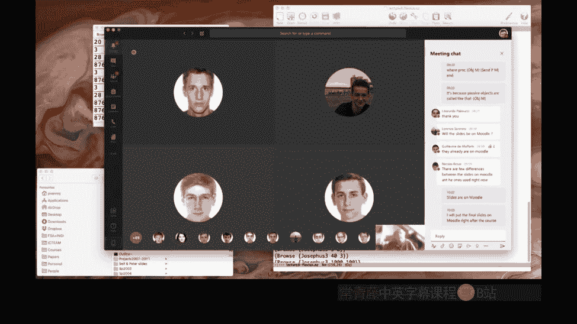

Like， for example， that you have to， every state has to be able to treat every reasonable message and you're not allowed to forget that every state in the floor has to handle the call。

 So that's an important thing you have to think about when you build the state diagrams。 Okay。

 so remember， it's not everything is on the slides。 Okay。

 and there's also the code which I will put on the moodle to。Okay， so let me know。Continue。

 notice we're still not writing code。We are still just。Looking at state diagrams。

 so when you build these multiagent systems， that's your language。

 your language is state diagrams and your tool is pencil and paper。

 there are software that let you build draw and build state diagrams。

But the most important tool is still the pencil and the paper。 Okay。

 so now we go to the most complicated of the state diagram， the lift， the lift itself。

 The lift is complicated because it has to go to many floors。

 and maybe it has to stop on many floors。So it stops， so the lift has an internal。

List of floors called the scheduleule。I call it the schedule。

 which is the list of floors that it has to go to。 if it gets all these call messages from different floors。

 it remembers that。 and so it has a list of floors it has go to It also has a variable saying is it actually moving。

So it's actually。If the schedule is different from themil。Okay。

 if the schedule is different from new。Then。

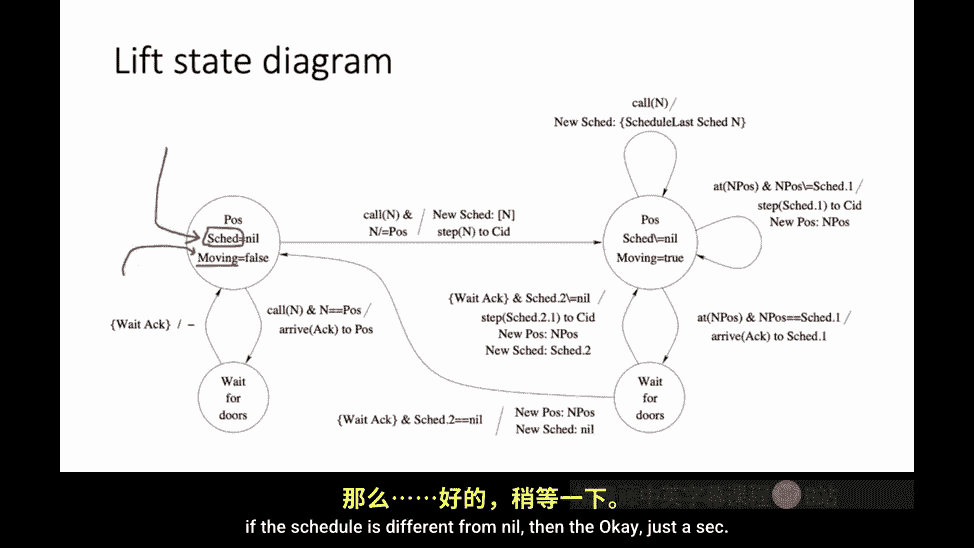

Okay， just a sec， there's some noise here， let me get rid of the noise。I'm not sure why it's noisy。

Okay。So let me go back to the slide now。

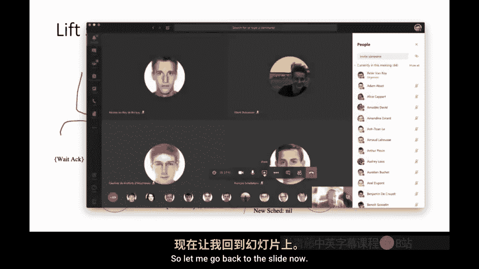

Okay， lift state diagram。So this one is actually a little bit complicated。

 so you have the schedule here。Which is the list of floors that it has to go to。

 you have the position， which is the floor where it's at right now。And many messages can arrive。

So for example， it can receive a call message to go to F N and N is not the same as the position。

Then it will define a new schedule， but since the original schedule was。Nil here。

 it will just be a list N。And it will send step N to the controller since I have to go to that floor。

And then it goes to the moving state。 So this moving state is the one where everything happens in a lift。

 okay。So what happens there's many possible messages that can come in this moving state， one is。

 what if it's moving and I call it to a floor。The lift is going to floor five。

 but I press a button saying call seven and call nine and call 10。Well， I have to add them。

I have a function called scheduleedule last here， which takes the schedule and the new floor and computes a new schedule。

 so now this function I have different possibilities。What do I do if I have to go to floor 1，5 and 6。

 then I say 7。Well， by default， I add it at the end of the schedule。

 but I could be smart I could try to put it somewhere in the middle if the lift is moving up 1，2，3，4。

 and I ask for7， maybe it should stop at 7 before going up to 10。

Or else it goes to 10 and goes back down to  seven。

 You see there's different possibilities so this function。

We'll define how new floors are added to the schedule。 So let's just add it to the end schedule last。

Okay。And now different things can happen， I have sent a step to the controller。

 I will get an@ message。If I'm at a floor and the floor is not the first element of schedule。

 a schedule is a list， it's not scheduled at one。Then I keep moving。So this is like a while loop。

 you see。If I make a step。And I go to a floor。But it's not the floor I want to go to。 I'm at floor 1。

 I have to go to floor 7。 When I go to floor 2， It's not 7。 So I keep going 3，4，5，6 until I reach 7。

 So this is kind of like a while， okay。This kind of a state。Okay。

 now if I get an at message and it's the same as the floor I need to go to。

 then I stop well I wait for the doors， I go into this special state called wait for doors。

 so am I' at the floor， I don't move anymore， I'm waiting for the doors。Okay。And。

I wait for the acknowledgement， so this is the one shot message that's bound by the floor act。

So it'll tell me when I'm allowed to leave， so I'm waiting for the doors to close okay so when the door is closed。

 when act is bound， then wait A will tell me and wait for A。And if schedule dot2 is not new。

 that means I have to go to more floors， then I go back。To the moving state。

 whereas if scheduled that2 is new， then I go to the。Moving false state， okay？

So the new schedule is scheduled at two， so it's the rest of the list。And then I do a step。Schedule。

2。1。 So basically to the next floor I have to go to， so you see it's kind of like two nested loops。

Here this is a single inner loop going to a given floor， and then there's another loop here。

Whi is between the moving and the wait for door state。

 which goes from each floor to the next until I get to the end and the schedule is n okay。Now。

 what kind of state can arrive here in the wait for door state。

 We assume no messages are treated here， except for。The weight act。The message that lets us leave。

 okay， we assume no other messages in the wait for doors because there's no reason the wait when when the lift is sitting there waiting for doors。

 it's only waiting for the doors， nothing else， so any other messages that call messages will only be handled when it gets back into the moving state okay？

So once it leaves the weight four doors， weight act， weight act。

 it either goes back to moving true or moving false。Notice also for moving false。

 it's possible to open the doors if the list is lift is sitting at a floor。And I press the button。

On the floor， the doors have to open， so the doors can also open when the lift is not moving。

 okay when the schedule is nil。So this is the actual state diagram。

Of the lift notice that you have to make sure that all the possibilities are handled the call messages can come in any time。

 here's a call， there's a call， the at messages depending on the values。

 also the weight acknowledgeknowledments， the one shot messages， call N call N can arrive here， Okay。

 so you have to handle all of that。Okay， now once we have this， we can actually write the code。

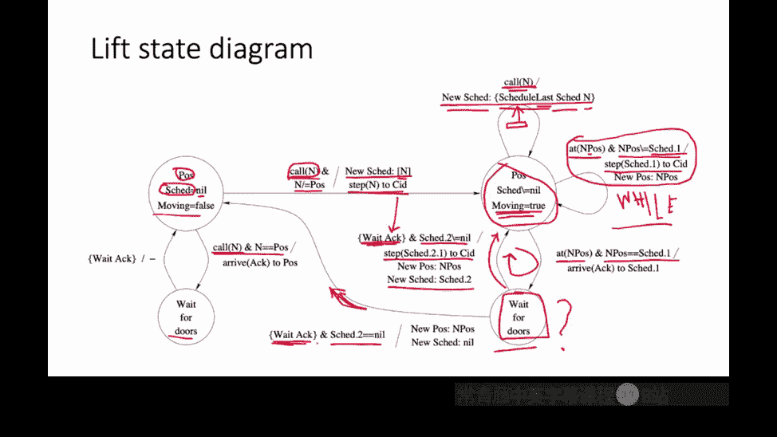

So。Is that reasonable anybody have any questions on that？

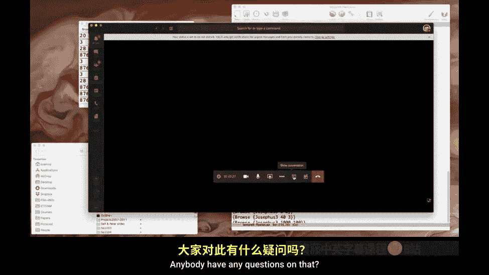

Okay， so now when you have the state diagrams and we look at them and they look right。

 we can actually reason about them too。Now we can actually write code and the writing code is actually easy。

It's pretty easy it compared to the rest， let me show you how the code works。

So now I'm going to the screenshot again， let me show you the lift here。

So this is all the code well I first I will I'm defining the port objects。

So here's the lift control system。Okay。So the first I have for my simulation， I defined a timer。

So the timer is a stateless port object， it receives start timer message。

And then it basically delays and sends a stop timer message back， okay。

 so it's just so that I can run my simulation。But now let's take a look at the controller here。

So here's the controller。So each controller will have its own timer。A controller is a port object。

Okay케。It has a state。So this is its syntax fund state motor FLID。

 it means it's the same as saying fun with a state and then doing state case state of state motor FLID。

 so I'm assuming the argument is a topple with three。Subarments， Mo， F and list ID。

Case motor of running and stopped。Now I have a nested case。So I have a nested case here。

Let me write down here what it is， snicistic case。And there's two ways to do it。

So the nested case is state， I have a case on the state and I have a case on the messages here the top level case is the state and the other ones of their messages。

 so I have to do both message state。Case plus。Message case I have to handle all states in all messages。

 so that's just the translation of the state diagram okay so here I'm translating it if the message if the motor is running and the timer is and I get a stop timer message。

 then I send the at message to the lift and the state turns into stop。Okay， if the motor is stopped。

And I get a step message， if F is equal to D， then it's the same。If F is less than this。

 then I send a stop start timer and the state becomes running F plus1。Otherwise。

 I send a start timer and the state becomes running F -1。

 So I'm assuming it takes one second to go from one floor to the another。

 That's very fast for a lift。 but just for the simulation。 Okay， so this is a translation。

A direct translation of the state diagram。And if there's any bugs in the state diagram。

 there's going to be bugs here， okay， this will not fix any bugs。

 so this is not this is just a translation of what we already know。Okay。

 and then we have also the floor， the floor is more complicated， as you can see。

So let's do like this， so the floor also has its own timer because of the doors for the stimulation。

So here again， I have a state， the state is called， it's either not called。

Called or doors open with the acknowment to leave。So that's the top level。

 then I have another case here， arrive。Or call。And in the CA states， I can get arrive。Or call。

And in the doors open state I can get。A stop timer， an arrive or a call。

 Notice I can get arrive or call in any of the three states。 and I have to handle all of them。

 if you miss one。It's a bug， okay？So here， if the state is not called and I receive a call。

Then I pick a random lift here， Lran， it its lifts dot1 plus OS R mod and width of lifts。

 This will pick a random lift， so lift is a topple of all the lifts。I will send to this lift。

AThe number of the floor and the state becomes called。Okay。And in the other ones。

 if the state is called and I do call， then it does nothing。 The state is still called。

 if the state is doors open。And I do a call。感恩。The doors are already open。

 so I do nothing and the door stay open， okay？If I am not called， then the state is arrive。

Then the doors have to open so I send that timer I'm assuming the doors are going to open for two seconds。

 to state our doors open。If I'm called and I do arrive， again， I start the timer， the doors open。

And if the doors are open， and I get an arrive。That's the second lift arriving。

 I will actually bind the two together so the two lifts will leave at the same time。

 that's for simplicity。In a real system， each lift will have its own。

Timer each door has its own timer， but I don't want to make it too complicated。

And then in the doors open state， there's also a stop timer message。And then I do act as unit。

 so that's the one shot link that's telling the lift that's allowed to leave now。

 so unit is just a constant， it has no special value。

 it's just a constant that I use when I don't care about the value， it's unit。Okay。

 and then the state goes back to not called。See how that works？So， let me go to。Here。

What happens to the call message in the wait door state？Are you talking about the lift。

 Are we talking about the lifts？Let me go back to the state diagram then。Okay。Yes。

 let me go back now to the lift， so the question is what happens to the call message in the weight door state？

So let me go back to the lift state diagram to answer that。

So I think the answer on the chat is correct， but let me repeat for everybody。

So here we're in the lift state diagram， here we're in the wait for door state。

 so what happens if there's a call message arriving and the lift is in this state？

Well the lift will not， this state， this state does not handle the call message so that message is not handled here。

 it will basically wait， it will stick around until it's allowed to be handled so basically it will be handled only when I'm back into the moving state okay so when the lift is when the doors are open and it's waiting for the doors to closed。

If you try to send message to the lift， it will basically ignore them。

 but the messages don't go away。Messages are never dropped in this such a system。

 it's very important when you send a message， it will either be received。Or if it's not received。

 it will still be in the system until it's received。 so messages are never dropped。 Okay。

 so in the wait for door state。If you do call。Then， it's basically ignored。

And when the lift goes back to moving， then it will handle the calls state。

 So this is what we want to。 We don't want some states。

 the lift is like it's busy and we don't want to handle all states。All messages in all states。

 and in fact， it's not a problem here。If we do a call and the doors are open。

 there's nothing Lyft can do anyway。 O， the waiting is not hurting us。 in any way。

 you might want to handle states， messages in all states because otherwise the system will be slow or deadlocked。

 but here there's not a deadlock， because here we know for sure that it will go back to the moving states or itll go to the moving false data。

 it will always go back to one of these two other states。And then it will handle the call message。

So there's no problem with handling the call messages and so they're ignored in the call。

And the wait for door state， okay？Okay， so that hand， I think that answers the question， right？

There was also some discussion。Messages are never discarded， okay。

 theyre never put back in the stream， they are sent and they stay until they are received and that's it there's no discard。

 there's no timeout， okay？They're cued until it's received。Now。

 so each of the objects has one incoming cu， and it has to handle the messages in the order that they arrive。

 okay， it it will do them in that order， that's how port objects or active objects work。

Now not all systems are like that， actually airline is more flexible。

 it is able to handle messages out of order， it has what's called a mailbox。At each process。

 all the messages come in the mailbox and then you pattern match on the mailbox so if you can find a message maybe later messages。

 and then the earlier messages， if you don't pattern match。

 they will just stay okay So that's a slightly different way of doing it and you have to be careful depending on the system you use which way in this system I'm showing here。

 all the messages are coming in order， and they have to be treated in order。 that's the simplest way。

 whereas in airline， there's actually a mailbox that actually makes things a little bit more complicated。

 But for some applications it simplifies things。So that's how it works。

 we will see that with Earlline there's a mailbox， so in the book in chapter 5 there's a section on Earllan which explains how the Earllan mailboxes work if you want to see that。

 but we'll see that also later in the course。Okay。Okay， now。Let's show the code running。Okay。

 let me go back to the so now let's compile all this stuff so if it's all correct it should all run。

 let me define the port object， So here we see we're building all the abstractions from scratch Nothing is hidden。

 you see everything what happens from the bottom all the way up to the top。Okay。

 I'm compiling the timer。

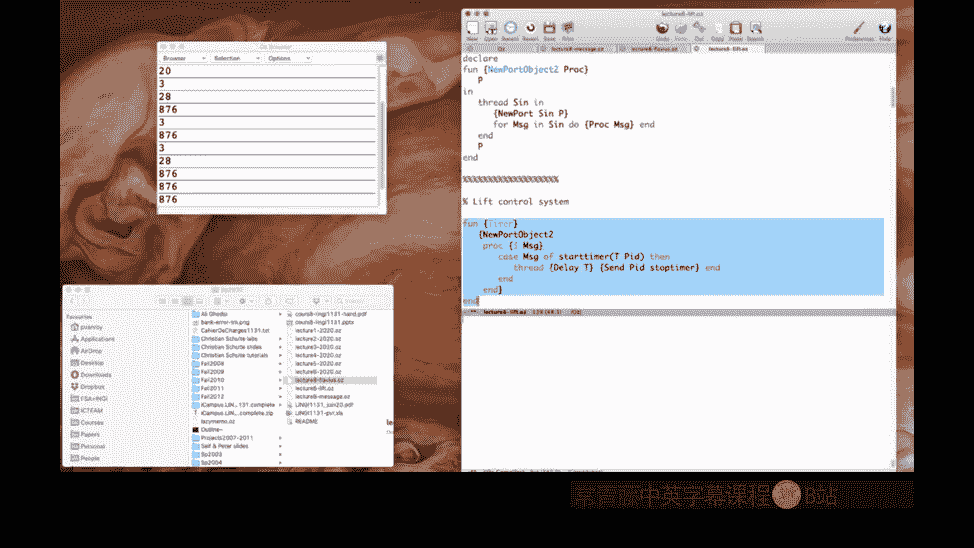

sorry， I have to do a declare， somehow I move the declare here。

I sure hope there's no more bugs there。So declare， I think it wants me to compile everything at once。

 let me put a declare here。Let me define the controller now。Let me define the floor。Okay。

Then there's the schedule last function remember I told you when a new floor comes into a lift it has to decide where when to handle it。

 is it going to be handled at the very end first come first served or if it's going up maybe if it's already going up it should stop there so we you can have different kind of smart scheduling functions。

So now I define the lift。Okay， everything is fine here。Yeah， sorry， let me define the lift。

So I hope no bugs came into this。I have now I have defined another procedure called building。

Which combines everything。So building with N floors and N lift LL lifts。

 it outputs a floor tuple and a lift tuple。And it creates a lift tuple and a floor tuple。

 it creates all the lifts and a controller for each lift。

 and it creates all the floors and it gives the correct argument。

 so the floors have to know the lifts and the lifts have to know the floors Okay so the building procedure handles all that bookke。

And now we can actually run it， and I'm just going to show a few examples here， how this thing works。

So Im building， so let's say I now I have a building with 10 floors and two lifts。

 let's say I'm on floor nine and I do a call。So if you look at the browser。

 the lift is now moving up to floor9。Eight， nine， open doors。Close doors， that's it。Okay。

 but we can do more things， let's say we go call four and call one。

 it's completely concurrent so you can send messages anytime and it should be doing the right thing。

 okay？So you can do many things， normally it should be working fine， but you have to test it。

 of course。According to the way we designed the scheduler。

 everything is organized around the schedule of the lift。Okay。

 and if you handle correctly the schedule， then everything should work correctly。Okay。

So let me go back now to。The slides。

So， here。And I'll put the code on the Moodle so you can actually run the beast yourself and see how it works。

So you have basically the implementation。Is done when you have defined all the state diagram。

 so we have three components。Create floor FID with number， nu。

 create lift LID with number nu and create a controller CID with initial state in it。

The controller doesn't have to have a number because each lift has its own controller。

 which is like a local to it。And now now you have to test and verify。So now we have an actual system。

Testing， run the system and in actually stress the system with many scenarios and verification。

 you have to reason about the system。And in a real world system， you will find problems。

 maybe it's just incomplete， or maybe it's not connecting right to the real world。

 then you have to go back to an earlier stage in our methodology。

Maybe sometimes all the way back to informal specification， you have to redo it。Okay。

 so here's some possible verifications。Prove the following property。

 The lift will always eventually stop at a floor that is part of the lift schedule。

So if there's a floor in there， you have to prove that these loops。That state， the state。

 will eventually always get there。Or you can prove the following property if a call F is sent to a lift。

 then the lift will eventually arrive at floor F。That's a very nice property， okay？

Even if you have many other states happening。So this is the kind of thing you have to prove and you can prove that using the state diagrams。

 and actually， there's a course。 you can use techniques like model checking to prove that there's a course on verification by Char of Peure。

 which tells you how to。Prove things like that， given state diagrams， okay？So to conclude。

This methodology， I want to emphasize three pillars of software development。

 and you have to do all three if you're missing one of these。You will be dead， okay， it's design。

 test and verify。And in this kind of a system， multiagent system， which is very complicated。

 the need for these three is very important， so design you have to make a sound system structure so you need a clear methodology for design。

Test， you have to run it on many scenarios， including stressing corner cases and verify your reason on the code or on the state diagram and to prove that properties are done。

 and these are complementary。So tests can verify things that are not easy to verify。

 whereas verification can do things that are very hard to do certain kinds of corner cases。

 very hard in testing。Leaving out any of the three is dangerous， okay？So， that's。

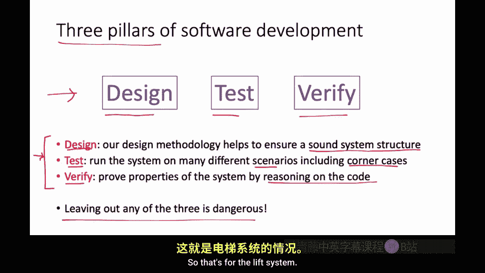

For。Lift system， so now all you have to do is practice， okay？Okay so that's the course for today。

 I don't know if anyone has any final question for today's course。

 so I recording this on Camtasia so I will the Camtasia videos。

 I will put them on YouTube might take a few days because I think they're big okay。

And you will see everything there。

And also the code and the slides will go into the Moodle。So。

That's all I I will stick around for a few minutes if you have any questions。

 so there's a question when is the project so will we are working on the project。We we will try。

To do it。To give you。The project give you the。The announcement before the Easter vacation。But。

 we don't have a。Guarantee on that okay， so normally you will have two weeks not counting Easter vacation。

 but people like getting it before because that gives you more flexibility to manage your time so you're allowed to look at it during the Easter vacation but you don't have to so we are working on it we'll try to give you an o before Easter。

Okay， have any any other questions or anything， so I will stick around for a few minutes if you have questions。

 but the course is done now， so thank you very much。

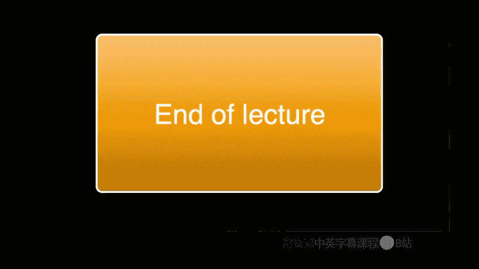