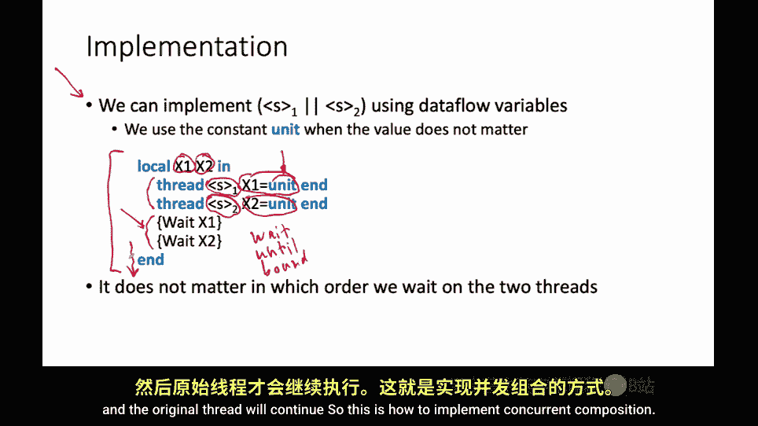
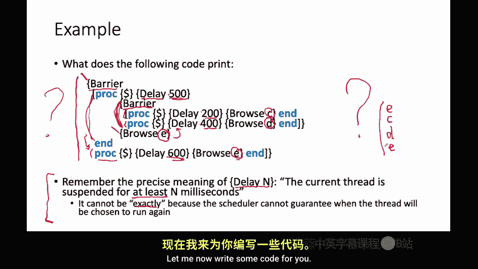
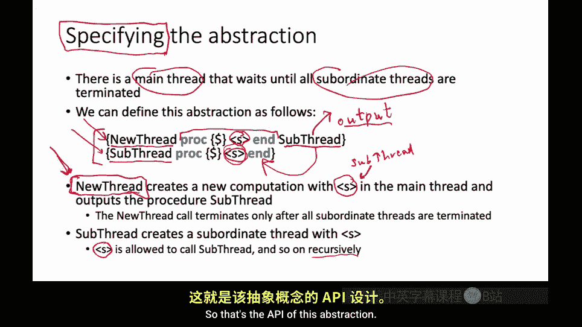
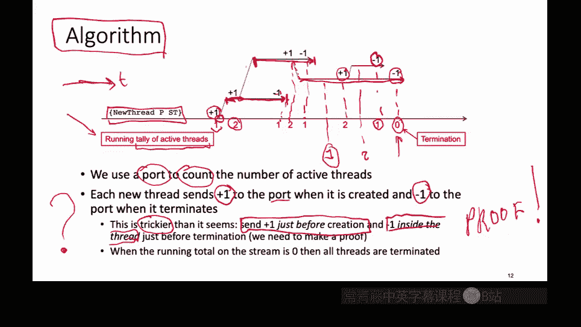
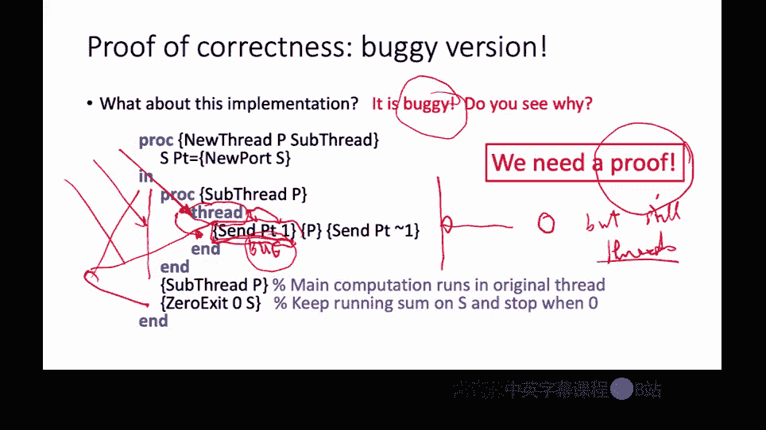
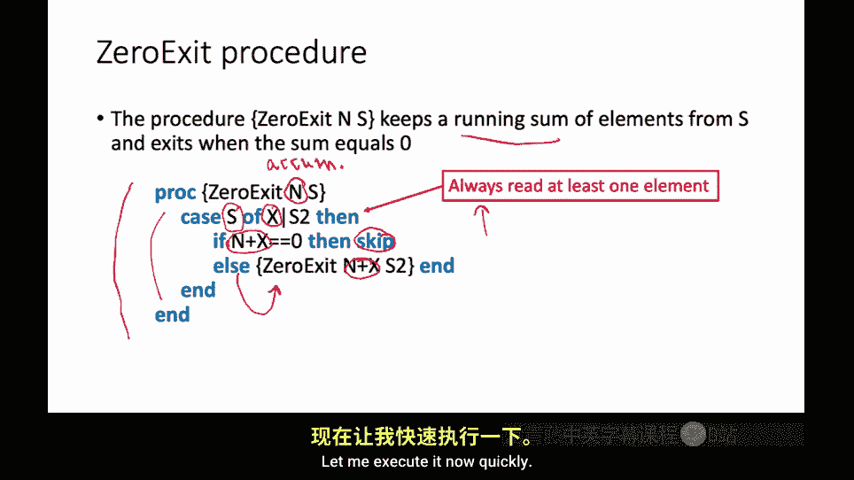
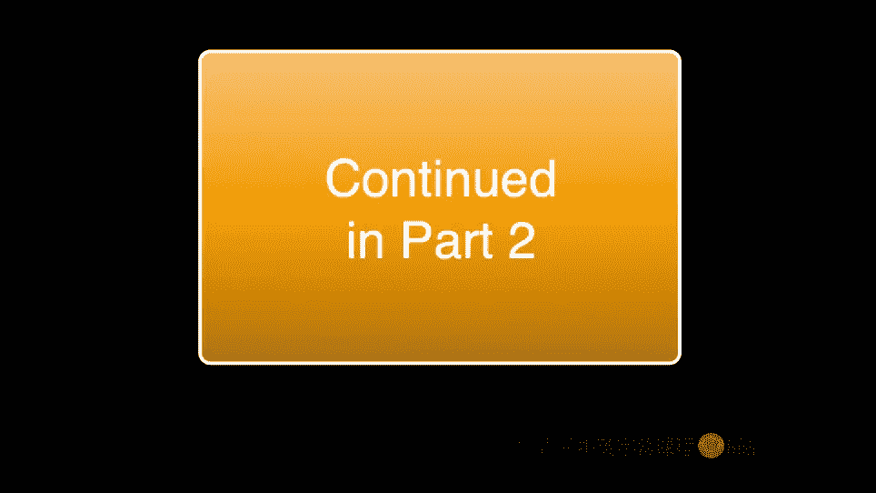

# 鲁汶理工学院【中英⚡高级编程语言概念｜LINFO1131, Advanced programming language concepts】 p07 P13 GI1131 Lecture 9 part 1 (2020) -BV1UDffBbEBZ_p7-

Welcome to the course 1131 on today April the 1s， so it's not joke we're having a real course。

 so today's course will be on the best way to build concurrent programs。

 which is deter termmininist d data flow with ports。So let me start by showing some slides。

So we're going to show。How to build concurrent programs in a way that makes them as easy as possible。

So we know building concurrent programs is hard。In multi agent programming， which we saw last week。

 we built the lift control system， you built the state diagrams。

 you have to make sure that all the messages can happen anytime。 So this is difficult okay。

It's difficult to do this in general when you have a lot of agents。But on the other hand。

 we saw before another model， the deterministic data flow， which is actually much easier。

It's actually so easy that you can add threads wherever you want。So the question is。

 can we somehow get the advantages of deter deterministic data flow？And still do general。

Distributed programming。So deterministic data flow has limitations， but can we。

Keep those advantages of it and do general。Concurrent programs。This is possible。

 so what we're going to see today， so this gives us the best way to write concurrent programs。

 the best way that I know of， the best way to make them easy to write， easy to understand。

 easy to prove correct is you start with the deterministic data flow。

And you use it as much as possible。But you cannot use it everywhere。

 Sometimes you need to do other things， sometimes you need ports。 Remember the client server。

 we had the client server application。Here two clients and a server。

 there can be millions of clients。 So this program。

 most of it can be written in a deterministic data flow。 The There's only one port is needed here。

Right there where the server receives the message， this whole program。

 it might have millions of lines of code。 It only needs one port。 So this is the approach。

 So usually youd only need a very small number of ports。

So today I'm going to show you how to do this with some practical examples。

 we' going to give some designs that use this approach， and then you'll see how it works。

So the first example I want to give is called concurrent composition。

 This is an introductory example to get your neurons warmed up this morning。So。

Let's recall the thread statement。 So when you do thread and you create a thread。

 and this thread executes independently。 Okay， this other thread executes independently。

So with these two instructions， we have created two independent threads。

With two instructions and the original thread continues。

 so we have three threads they're all independent。But sometimes this is not good enough。

 Sometimes you have to wait。 Sometimes the original thread。

Creates two threads and it has to wait until the two threads are done， maybe it does subtasks。

 it does some worker task， and it has to wait until the task is done。

So this gives us a new operation called concurrent composition。

 So I introduce this notation for it here with the two vertical bar。

 This is a notation that people usually use。 This creates two threads。

And it waits until both are terminated。 So the instruction S3 will only execute when S1 and S2 threads are done。

So this operation is called concurrent composition。

It's in opposition to in sequential composition here we have created two concurrent entities。

 two threads， and we wait until they're done before continuing。So let's see how to program this。

So we can actually implement this using the single assignment data flow variables。

So here's a piece of code that implements this。 So we introduce these two variables x1 and x true。

 x2 will use those to wait to synchronize。And so we create the two threads。

 so we execute S1 in the first thread， but when S1 is done。

 we'll do x1 equal unit and when S2 is done， we'll do x2 equal unit and in the original thread we wait。

Until x1 and x2 are bound， so the weight operation。We will wait until。Bound until x1 in x2 are bound。

 We use this special constant unit。 It could be any constant。 but the constant unit。

 we use it to say that we don't really care about the value。

 We just want to know that there's a constant。 So there's a constant that allows us to say that。

 which is called unit。So these two weight statements will wait until both threads are done。

 and the original thread will continue。When both subordinate threads are done。

 So this is how to implement。And current composition。

Okay， let me go just for a second back to the chat。To see whether everything is fine。

 so everything is going fine now， remember that if you don't hear me if there's a problem。

 please unmute and tell me so I can fix it， so I'm assuming everything is going okay。

So let me show now how to implement this。 We're going to write some code。

 Let me go back to the slides。And show how to build an abstraction。

To implement this。So we go back now。To the slides， so this is an example。Is verbose。

 we don't want to write this kind of code all the time。

 so we're going to build an abstraction now to do concurrent composition。

So we're going to use higher order programming to implement a general form of concurrent composition where we have N instructions from S1 to SN。

And we can write these instructions in the language using higher order as procedures。

 so the instruction S1 will be an anonymous zero argument procedure here。

So this is something we can give as an argument that we will define a procedure。

 I will call it barrier。Because concurrent composition is sometimes called barrier synchronization。

 The idea is that if we have a whole bunch of threads， so these are all the threads。

 then we wait the original thread。Waits until all the other threads are done。

 So it there's like there's a kind of barrier， a wall。

 It waits until all the subordinate threads are done， and then it continues。

 So it's also sometimes called barrier synchronization。 So let me call it barrier。

And the argument to barrier is。PS， which is a list of statements。

 so a list of zero argument procedures。So barrier is actually very easy to write using higher order abstractions。

Here， the PS argument here is given， we first do a map， and then we do a for all。So the map。

Here we'll take each of these procedures and apply this function。

So you see the P argument is going to be a procedure。So we will create a thread here。

Thread and in this thread， we will execute P。We also have a local variable x。

 and we will do x equal unit。Inside the thread， after P is done。And then finally， we will return X。

 So the result of the map is the map will create threads for all the procedures。

 and it will set up all the variables and it will return a list of all these variables。

 So you see the map is doing a lot of good work here。😊，And then we will have this four statement。

 this is basically a for all， this will execute the body for all the elements of xs。

 So for each variable x in xs， so here I'm introducing x so here it's like a local statement I'm introducing x I'm defining it and the4 will create weights we'll do weights for every x in xs。

 so here we're doing all the weights。So we create the threads， we create the data flow variables。

 and then we wait。So notice this barrier can be written 100% completely using deterministic data flow。

So let me create this now， but first let me show you an example and then we'll write some code。

Here's a piece of code。Running barrier， but it's nested。So here we have the top call of barrier。

 which has two procedures， the nested call， which also has two procedures， notice they have delays。

So the top call of barrier will do two things。 The first procedure will wait for 500 milliseconds。

 delay 500。And then it will create two new threads。 The first one waits for 200。

 The second one waits for 400， and the first one will then browse C。 The second one will browse D。

 And when both of these are done。The barrier， then we will browse E All of this is going on concurrently with another procedure that will wait for 600 milliseconds and then browse E。

So the question now is， what is this program going to in display？オ。Now， to。Figure that out。

 remember what exactly what delay means。So I've told you delay n means to delay the current thread for n milliseconds。

 but it's very precisely it's for at least。And milliseconds， not less。 it could be n or more。

 because it cannot be exactly n， because the scheduler cannot guarantee。After the thread is runnable。

 when it will actually choose that thread， there might be other things going on。 Okay。

 so all we can say is that it's at least。But most of the time， it will be very close to it。

 but not guarantee。 So assuming that the delay will be very close to that time。

 So delay 500 weights very close to 500 milliseconds。 What will this program display。

So you have to figure out all the delays， so what's the first thing that it's displayed？Well。

 after 600 milliseconds， it will display E。After 500 plus 200， it will display C。So that's 700。

And after 500 plus 400， which is 900， it display D。 So it should display E first。And then， see。

And then D。And then this one must come after the other because of the barrier。

 so it will display another E。 So this is most of the time it will display EC D E。Okay。Let me know。

Write some code for you。 I want to make this thing work。In real， real life。 So let me go back。

 first of all， to see if you have any questions on this。

Is this understandable so far can I so now I'm going to write some code？Okay。

So now I'm going to go to the screen。Here。And I'm going to write the barrier synchronization and I'm going to。

Show you how it works。Oops。So it's a procedure barrier。That has a list of procedures as argument。

First， we do a map。So the map will take all the procedures， the zeroro procedures。And it will。

Create a thread。 Let me do it piece by piece。 It will create a thread with each procedure。

 then it will。Mark the end by binding to unit。And here we have to declare X like this。And finally。

 the function returns x。Okay， so this is the map。And now we will do a for loop。

 we will take all the x's in Xs and do a weight for each of them。So this is barrier synchronization。

Okay you see it's very simple with higher ordernessa。

 you see that programming languages that support higher order。

 there are many of them functional languages typically。

 and even today now Java also will support it in Java 8 that makes it very compact。

 higher order lets you build abstractions in a very compact way。

 so I compile barrier now and now which's just see an example of barrier synchronization。

So let me try it now barrier with some procedures。Let me first do。

Let me try barrier with three statements。So let me do here a first one。Delay 100。Browse a。

In the second one， let me now be a little bit smarter here， a little bit more tricky。

 Let me create a nested call to barrier。Like this with two barriers。Okay。

And now let me do a browse of。B。Let me done our third one。Browse of C。

 let me now do a little bit farther。Let me nest again。

So I'm going to try to make you think a little bit so early in the morning。Delay。50。Where's the？

Delay 150 browse。咦。Let me make a little bit wider like this。And now， let me put a browse。If。

Let me put here before this barrier。 Let me put in a little delay here。25 milliseconds。

So here we have now an interesting piece of codes。That will create lots of threads。

And at the very end here。I will put a browse。6G。So when I run this。What is it going to display。

 so I'm going to assume that the delay will be almost the right value that will not wait much longer。

So after 100 milliseconds， it will display A。嗯。After。How much after 200 milliseconds。It will display。

See。😊，Okay。At the very end it will display G。 I know that the G has to come when everything else is done because of the barrier synchronization then here。

 what's going to happen here， I let me do a browse。A cheer。 So after。

If I look now at this internal barrier。This browse H will be after 25 milliseconds。Okay。

 and what about these guys？So the F will also be after 25。So they're both 25。

 which one will be first， well that depends on。The scheduler rules。

I have now the completely internal one， so D will be after 75 milliseconds。Okay。

And E will be after 175。Miseconds。So this is。The order in which these guys are going to be done。

 the B will be after。The B would be after。呃。F and H。For sure。

 because of the barrier synchronization here。The B has to come after this barrier。

So the first two should be H and F。 Which one will be actually printed first， Well。

 it depends on the scheduler， depends on how the threads are created。 Typically。

 the first thread that's being created。 So this。This thread is created a certain time。This thread。

Well， so these two thread， this thread will be created first。Before this thread。

 So that means the scheduler will give it a time slice immediately。

 So probably the F will be first if I'm reasoning。Right？

Unless the scheduler has other things going on， there's no guarantee of all this。

 so I execute this now。So you see what's happening here， H。 okay， I made a mistake with F。 You see。

 I made a mistake。 The F will guarantee me after D and E。Because of the barrier synchronization。See。

 it's not so simple， so the F is guaranteed after DNE， so H is displayed first。And then D。

75 milliseconds， and then a 100。And then E175， and then F F comes after D and E， that's correct。

And then B comes after F and H， that's correct。Okay。

 and then C 200 milliseconds and then G at the very end， you see this is correct。

So you see that you have to be a little bit careful when you figure out when things are executed。

 You also see that you can use delay to force certain order or something use delay to。

It's not really force gently。Advise。The scheduler。For an order。There is no way。

It's very hard to force the scheduler， actually。Because the scheduler。

 there might be other things going on in the system。AndOnce the threat is runnable。

 it might not run immediately， it could run a little bit later。Okay， so you see how that works。

Is that okay， Any questions on that？Okay， let me there some questions。 One question。

 I have not clearly understood what the barrier exactly does。 Well。

 what happens is the barrier has input statements，1，2，3， up to n。 It will create n threads。

And all the threads start running。And then the barrier will wait until all those n threads are done。

 So the original thread， the one that created the n threads will wait until they're all done。

 So it's like a creating a barrier， a wall。 The original thread will only go on when all the others are done。

 okay。So this program， so the barrier itself， so there's another question。Is this non deterministic。

 The barrier is deterministic。 It's not non deterministic because the behavior is completely always the same。

The barrier will continue the original thread when all the others are done， It's always the same。

 There is no variation。What will vary is the speeds of the threads， of course。

 the barrier is guaranteeing synchronization when all the threads are done， but that's all it does。

Internally， those n threads will be running at different speeds between themselves and the scheduler will be free to choose them in any order。

 According to the rules。 Okay， so they will be given time slices。 When you create a thread。

 you start by giving that time slice。A piece of the processor for 10 millisecond。

 And then when the time slice is done， it goes to the next thread unless the thread stops earlier and then the scheduler immediately picks another thread。

 So you see the scheduler has a lot of freedom。To choose which thread executes。

 So you can see how we have an interesting program。 The barrier itself is deterministic。

 but it's creating threads， which will maybe be non deterministic。Okay。So it's a little bit subtle。

 but it's important to understand how it works。 So let me show you a slide。嗯。Here。

Okay， so we have created this higher order abstraction， okay？So the barrier will actually wait。

Until all these instructions are done， they all execute in their own threads。And the threads。

 once the threads are created， they're independent to the speeds can change。

 But the only thing you synchronize on is that the threads are done。 So that's deterministic。

 but the threads internally will still be non deterministic。 Okay。

 so you can see here the order in which it's displayed。Is most of the time going to be deterministic。

 And this is because the delay itself does not actually guarantee an exact time。 It only gives you。

A minimum， a lower bound on when the thread will execute。 Okay， so this is our first example。

 This is barrier synchronization， which is also called concurrent composition。

 And notice this is completely written in deterministic data flow。Okay。So this example。

 we don't need ports to write barrier。 It's completely deterministic data flow。 Of course。

 inside these threads， you can do anything you want。 maybe non deterministic things。

 but the barrier abstraction is deterministic， okay。

So let me go on now and go a little bit farther than this。Okay， okay， there's another point。

Some some programming languages allow defining new syntax。

 Some languages let you define new syntaxes， some typical of the functional languages could let you do that。

 So we could actually define a new instruction called Conk and concurrent composition。

 And we define a translation of this into a call to barrier。

 You see where each one of these instructions turns into a zero argument procedure。

 So this could be invisible to the programmer， So the programmer then has a new abstraction that he or she can use for writing programs。

 Okay， so， and this is a deterministic。Abstraction。

It introduces no non determinism because it is written using deterministic data flow。Okay。

 so this is not possible in Aza and Az， you can define new syntax like this。

 but there are languages that let you do that。We let you define new syntax， a language like scheme。

 for example， has something called macros where it could define such a new syntax， okay？

Well let me go on now？And go a little bit farther than barrier。Okay。

 we'll now look at when the number of threads can be。Variable。So the concurrent composition。

 the barrier， we have S1。To S， N。Notice the N， we know the N statically。

 it's the length of the list argument to barrier。 it's known in advance。Okay。

 in the concurrent composition， we know when it starts， how many threads we will create。

 We will create n。Threads here。Okay。So let's go farther now。

Assume now the number of threads is not known that during the execution， we can create more threats。

Assume we have a computation that can create new threads dynamically。

 That means we can create a thread。And inside that thread， we can create another thread。

And maybe more recursively。 So the number of threads， we do not know them in advance。

 and we want to synchronize on the termination of all these created threads。

You see what we're doing here。 It's much more dynamic than concurrent composition。 We build a thread。

 We create threads， maybe we create a few threads， and each one of them is running a program。

 maybe creates more threads， and those will create even more threads and more and more and more。

And we want to synchronize on all of those shreds terminating。

 and we do not know how many there are in advance。You see， we're actually very ambitious here。

 This does not seem very easy to do， okay。So new threads。Can themselves create new threats。

 So you'll see， this goes much beyond the regular concurrent composition。

New threads can create new threads。 It's like the thread statement， you know。

 when I do thread and the S。Can also create threads， of course。

 But now we want to synchronize on all of these threads terminating。

 And we have no idea how many there are in advance。 And there could be hundreds， thousands who knows。

Ppends on the execution。 It could even be non deterministic。 how many threads are created。Okay。

 this new abstraction。The new one， we want to build now an abstraction to do this。 Okay。

 dynamic concurrent composition。 We cannot write this one in the termministic data flow。

Because this one actually is non deterministic， the number of threads。

Might depend on the scheduler choice。 It might there might be and the order in which the threads are created is not known in order to write this abstraction。

 we will actually need a port。We can write this using one port。So now I'm sure you're curious。

 how are we going to write this amazing new abstraction， and one port is enough。

Though everything will be deterministic， except for the one port。Okay， so let's see how we do this。

Well， first of all， let's define the abstraction exactly what it means。

 let's specify our abstraction， give the API of the abstraction。

And then we will see how to define it。So basically， there's a main thread。

There has to be a main thread because there is， it's where we synchronize。 So we have a main thread。

And all the other threads are subordinate threads。 So the main thread will create some threads。

 and those might create even more and so on。 All those threads are subordinate。To the main thread。

 And then the main thread will wait until all the subordinate threads are done。Okay。

 so we can define it as follows。 We have a procedure called new thread。 It runs in the main thread。

And it runs this instruction S S can do anything。And then there is another procedure called subthread that creates the subordinate threads This is actually an output of new thread。

So when we run new thread， we will define also the procedure subthread。And inside S。Inside S。

 we can call。Sub thread， if we want to create subordinate threads as many as we want。Okay。And。

Its also can be done recursively。 The S instruction call subthread and the argument of sub threadread can also call subthread。

 okay。So sub threatreread can be called inside either of these two instructions S。

And then the main thread that calls new thread here。

The main one will wait until all of the sub threadreads are done。

 including the sub threadreads that are created during the computation。 Okay。

 so we don't know how many。 It depends on S。 the instructions that we execute。

 We can be creating many， many， many threads。 but new thread will wait until they're done。

 So that's the API of this abstraction。 So let me go to the chat。

So is that a clear API？Is that API clear， we will define the procedure new thread。

And this procedure will create another procedure called subthread。

 and then we're allowed to execute subthread inside。The statement S。 and also inside the statement S。

 that's part of sub threat。 Okay， it can be called recursively as deep as we want。

 You can see that this is a very powerful abstraction， okay。

And there's no way to do this without a port。Is that clear how this abstraction works？Okay。

So now let me go back to the slides and explain how we're going to do it。

 Let me now show you the magic algorithm that will actually implement this powerful abstraction。

 okay。😊。

So you can you understand that this is actually a very， very strong abstraction。

 It's doing a lot of powerful things。 So how can this work。

The way to make it work is by using a port。And the algorithm is as follows。

 so let me show you the algorithm of the abstraction and you'll see how it works。

So here the time runs from left to right， each of these lines is a thread。

We start by calling new thread here。Okay。So what happens， Well， let's say。

 let's say we create another thread here。 So we have another a second thread here。

And it terminates there。 But during the execution， maybe it creates a third thread。

This third thread maybe runs farther than the second one， maybe the third one terminates here。

 but before terminating it it creates another thread。

 so you can see threads can create children that live longer than themselves a thread can create a child thread。

And then it terminates， but the child thread can go on and it can create more children threads。

 so you can have lots and lots of threads， even though the parents maybe are terminated already。

So how do we keep track now， Well， we want to count。The number of active threads。

 So we're going to make a tally。 So count。We're going to count dynamically the number of active threats。

 So how do we do this？Well we'll use a port and each of these threads will send。

Plus 1 or -1 to the port。So a thread will send plus one to the port when it's created。

 so then the plus one appears on the stream， and if you count。

 if you keep account of all the numbers on the stream，This willcrement increment by one。

And when the threat terminates， it sends1 to the port so that the count will be reduced by 1。Okay。

So the idea is that here when this thread is created。We will send plus one， so the tally is one。Okay。

 sorry， the telly is one， what creates one no， the telly will be one here。

 would create another thread， the telly will be two with these two threads。

This thread will be reduced。 The tally will be one again Here we， we again have a plus one。

 Here we have a -1。 So here at this point， the tally is still one。 There's one thread here again。

 we have a plus one。 So the tally is going to be 2。Here we have a minus1， so the tallia is 1。

 and here a final minus1 and the tallia is 0。So we keep track of this number and each time a new plus one or minus1 appears on the stream。

 we increment， we keep counting until it reaches zero and then we're done okay so we need a way then of keeping the running total of the numbers on the ports。

So that's the basic idea。Actually， it's not so simple。

 It's a bit tricky because you have to be very careful exactly when you send the plus1 and the minus1 to make sure that you don't have an error in the count。

Okay， the idea is to send the plus one just before the send thread is created。

And the minus1 inside the thread just before the termination。So we will see that this works。

 so how can we be sure that this works？Actually， we need a proof of this， okay？

We will reason on this。 We will make a proof that this actually works。

 We have to reason using induction， okay。Otherwise。

We could have a bug and I'll show you how tricky it is。

 so the send and this plus a minus1 has to be done exactly at the right time for this to work。Good。

 let me go a second back to the chat。

Okay。So is the idea of the algorithm clear？That we will use the port。

 So all the threads we create will know the port and will be able to do send。This is okay。

 It's n to one。And they will send plus 1 and -1 at different times。 And then in the main thread。

 we will be following the stream and。Adding plus and minus1 until it reaches 0。

 and when it reaches 0， then the main thread will synchronize。

 then the new thread call will terminate okay。So you， you see the idea how it works。 Okay。

 well let me go back now to the slide and explain a little bit more how we're going to program this。

So this is the basic idea， so we keep the running total。On the stream。

 but we have to do it in a very precise way to make sure that nothing goes wrong。

So here is the basic implementation。Of it。Okay， so we have the procedure new thread。

Subthread here is an output， so here is the procedure subthread that we're going to define。

 so it's actually an output。So we will create a new port。

Notice the argument to new thread is this procedure is actually the statement S。

 so the port I'll call it PT port， so there's no confusion between the procedure and the port and the stream is S。

Okay。So how does it work？While the procedure subthread will send one。

Just before cradating the thread。Then it creates its。Subordinate thread。 It runs P in there。

 And when it's done， it will send a -1。 Notice the， the -1 in Oz is actually tilde。

Because of the parser in Oz is because of the generality。

Camel also does the oh Caml also does a similar thing。 So this is a minus1 in us。

 So it will send a plus one before。And a -1 inside the thread。So that's the procedure subthread。

The main computation will then start。So now we do one call to subthread。

This one call will use the original P argument， and it will run in the original thread。

 So we'll start by doing a cent plus1na。 This will start by doing a cent of one。

In the original thread here。And it will immediately create a thread， and then it will run zero exit。

So zero exit is a procedure that will。Read the stream and keep running sum and it will exit when it finds when the sum is0。

 okay， but otherwise it keeps running， it keeps running until the sum is0。So this is the definition。

Is this definition correct？We will have to argue make a reason about that。

 Is this definition correct， Notice theres some subtlety here。

 The send is done before the thread creation， and the send of -1 is done inside the thread。

Is it correct？Who knows？Here's another version。So this is the original the version that I show you here。

Now let's look at this second version， which is a little bit different。What about this version。

 So here， the send， we do a send of plus one。We do P and then we do a send of minus1。

But both of the sins are done inside the thread。So what about this definition， is this one correct？

Actually。This one is buggy。 Okay， this one is buggy。So this is a bug。How can we know？That it's a bug。

How can we know that something is wrong？Well， in this definition。It's possible for zero exit。To stop。

 even though the sum is， even though there's still threats。

 So it's possible for the running total to be 0， but。Still。Thread is running。This is possible。

 so this definition is buggy， how is that possible？Well。Assume that。Where。Creating threads。 Okay。

 we create a thread now。And then we send a plus one。But before。We send the plus one。

 the thread already exists。So that means we've created a thread。But the thread is not。

For this short time， the thread is not。Showing up on the stream。

And that means that maybe the stream goes to 0。But this thread should make it plus one。

 but it will only make it plus one after the plus the with sent。

 But the send is coming after the creation。So it might be that zero exit will exit。

 even though there is still a thread executing。Okay， so this is buggy。

So we really need a proof of this。 Okay， so what I want to do now is to show you how to prove this。

 Okay， if you really want to understand， I would suggest you make a scenario。

A precise scenario with threads and show why this problem， this version is buggy。

You can actually show why it's buggy by doing that。 Okay， so we need a proof here。

So you see that， you see this is not so simple a this problem。I showed you two versions。

 one where the send is happening just before the thread creation and the other one where the send is inside the thread creation。

 and the second one is actually buggy。So we have to do some reasoning on this。

We have to actually convince ourselves that it's correct。 so it doesn't seem to be easier。So let。

 let's show how we do this reasoning now。

This reasoning actually is going to use an invariant。So we need a proof。Okay。

 but we're going to make a proof now。And we're going to make a proof using invariance assertions。

Now we already talked about invariance for loops and so on。

 and you've seen invariance in other courses。I am sure that some of you are not convinced that invariants are really useful in practice。

 Maybe you've seen them on toy programs and says， yeah， yeah， yeah。 they don't really help。

I dare you to show that this program is correct without an invariant。 here。

 we really need the invariant to convince ourselves。

 And this is a concurrent program because of the scheduler， because of the interleaving。

 things can happen in many different orders。And all of those orders have to be correct。 Okay。

 so I don't see any other way of convincing myself other than reasoning， using an invariant。

So let's do an invariant。 So let me make an invariant here in red。The sum of the elements on S。

Is greater than or equal to the number of created threads。So I'm creating threads。Okay。So， actually。

 it's。It should be the number of active。Created threats。 when the thread is terminated。

 then it will no longer be counted。 So the number of active threads。

 So then the sum of the elements on S is greater than or equal to the number of active threats。So。

 this is an invariant。And we will show that this invariant is always true。We will use induction。

To show that it's always true。And if this is right， then sum if the sum is0。

Then the number of active threads is less than or equal to the sum。

 so the number of active threads should be active active threads will be 0。And that means we're done。

ok。So we will use induction。So the base case。So we will look at execution steps。 so it starts。

 the program starts executing， and it will do steps。In the base case， in the very beginning。

In the very beginning， it's true。Because both numbers are zero。 okay。

 there's nothing on S and we have not created any threads yet。And then there's the inductive case。

Well， what do we have to worry about？ Well， in general， we have all possible execution steps。

We have to worry about all possible executions。 This seems to be very hard， but， in fact。

 it's not that hard because there's only four possible steps that could change the truth of the invariant。

Which I'll show you， okay。So we'll see that in the next slide。And finally。

 the invariant assertion is a safety property。 That means it's something that is ensuring that the program is not something incorrect。

 We also need liveness。 We also need to make progress。Okay， and this is。

We start by sending one to S so that we are actually able to。

Contiinue the execution without stopping immediately。But let me now look at the inductive case。

There are four possible actions that can change the truth of the invariant。

So these are the four actions， there's only four things， oops。Four things that can change the truth。

But sending a plus one， clearly， starting a thread。

Because we're talking about the number of active threads， sending a -1 and terminating a thread。

 These are four actions that could change the truth value。 Now， remember。

 the invariant says the sum of the elements is greater than equal to the number of active threads。

 Okay， the sum。On S。Greater than equal to number of active threats。That's our invariant。

So if we send the plus one， well， of course， it can only increase the sum， so it's not a problem。

If we start a thread。We start a thread。That means we're actually increasing the number of active threads by one。

Okay， this actually also keeps the assertion is still true。

Since there is a cent of plus  one that is following it。 now， notice。The scent， this is the。

This is the start of a thread。 This is aend of plus one。

 Both of these are happening in the original thread。

That means this send will happen before the thread creation。Okay， so when we start a thread。

It must follow aend of plus one。So the send of plus one has given us a margin。

 So when we do the send of plus one。Before the send of plus one， the invariant is true。

 We send plus  one and we get an extra increment。And so starting the thread will also increment this。

 So we've incremented S and we've incremented this。 So that means the invariant is still true。

 So you see it's very important。That the send。And the thread creation are both done in the original thread。

 That means that the order of them is known。 Okay， that the send of plus one must be before。Okay。

 now let's look at the send of minus1。So the send of minus1， let me show you the code here。

The send of -1 is done here。And then the thread is terminating just after。So， the send of -1。

Actually， when we do the send of -1， the thread still runs little bit before terminating。

 but it does no work here。Nothing， no other actions are done。Okay， without loss of generality。

 we can assume that it terminates just before the sending of minus1， because when we send minus1。

There is no work being done until the thread actually terminates。That is an empty execution。

 so it doesn't really matter， so we can assume that the thread termination occurs just before a sign of -1 without loss of generality。

 So that is correct。 You see， it's a little bit subtle， but it's clear。 And finally。

 terminating the thread is not a problem， of course。

You can see why the scent of plus one must be done outside of the new thread。

 because both the scent and the thread creation have to be done in the same order。

 They're both done in the original thread。 Okay， both。In。The original thread。So， the order is known。

Okay。So you can see how it works， you can see why that this has to be like this。

Okay and then there's the zero exit procedure。This is the final thing and then we're done。

So you can see in the zero exit procedure here， so zero exit。呃。Keeps the writing sum of elements。

So n is an accumulator actually here。Hes a running some。It takes an element X from the stream。

It looks at n plus x， if n plus x is0， then it's done， no recurive call skip。

 otherwise it does a recursive call with n plus x。So notice this always。Reads at least one element。

 It will always read at least one element。 So that means when we do an initial call，0 exit of0。

Then it will read one element。 So you have to read this one element， which will be plus one。

 and it cut keeps going until it's 0 after that。 So if you look at the code here。

You look at the call to zero exit here。It starts with zero。

But because it always reads at least one element， it will keep going starting from the plus one okay。

So， that's important。So let me now， actually。Execute the beast。 Okay， after all this。But first。

 but it's actually almost 9，30。 Let me。

Now， let me execute it now quickly。So I go back to the chat。So you see。

 you understand how this has to work。How， how that new thread has to work and how that the sum is done。

So you can understand。It's very important to the definition of subthread。And when。

 exactly when it does the send of plus 1 and the send of -1， this is super critical。

So let me show you now some code here， Let me write some code。So now let me do。Dynamic。

Concurrent composition。So new thread。So it takes a procedure argument and it will return a subthread as an output。

 so subthread is an output procedure， so it will create a port。So there's a stream， the port Pete。

 I will call it PT， as I said before， Newport。And I will create now a procedure。

 notice I don't have to declare subth I'm defining subthread here。So this is actually an outputer。

This， this。Bins the output。AVariable， which is the output sub thread。

Because it actually defines the procedure， you see that。And then I can actually create。

The first procedure， this is this this P， actually。Creating it。And then I call0 exit。

 still have to define 0 exit here。 So 0 exit，0。This。Don。So， the。Coode of subth is critical hereer。

So subthread is going to do this。 the basic idea is this， it's going to do thread。

It's going to create P inside the subthread， but now it has to do a cent of plus and minus1。You see。

 it's extremely important that the scent。Is done。Outside the new thread。It has to be done outside。

 That's super important。Okay， and the send of -1。Has to be done inside。

 but thats's less that's also very important。 has to be done after this termination。

 This has to be done inside。So it's using a tilde， which is minus1 and R。

 this must be done inside the new thread。Both of these are very important rules。Okay。And also。

 I need to define the zero exit procedure。So，0 exit。N S。 So N is an accumulator。

 I have to always read at least one element。So。Now， I read X here if。N plus x。Is different from 0。

Then I do a work Christ of call。N plus X S 2。Okay。Like this here I I。

 the definition is a little bit different from what I showed in the slide。 So if n plus x。

 so the writing sum is different from 0。Then I do recursive call。 If n plus x is equal to 0。

 there's no more recursive call and the0 exit terminates。 and this0 exit is defined before the in。So。

 it actually will define。The procedure。Will declare the zero exit。So it's not like this subthread。

 which does not declare subthread because it's after the inner。

 the subthread is actually binding this argument， okay。So this is the definition。

 So this complicated。Very powerful abstraction can be defined like this。

 Notice this is very dense code。 So I'm using higher order here。 I'm using data flow。

 synchronization， and I'm using ports。😊，In this。Programr。So I can show you an example of this。😊，Okay。

 so let me define our call New thread。But first， new thread will actually。Create an outputer。

 So new thread。And now I will， I can define some statement here。 It's actually not a list。

 It's a single statement。So I will can do something like。Let me do something simple subthread。

Here also have a procedure。Delay 100。Growse a， and。Like that。Another thread。Okay。Delay 200。Browse B。

And then another subth， I have do at least one recursive subthreadat to show you that that。Browse C。

Okay， like。This。Okay make sure I'm calling it right here。

 so new thread has a single procedure argument。Which is the statement。

 so subthread will be bound by the new thread call， so these subthreads will do the right thing。

So this one has a procedure that will delay 100 and then browse a， let me put a simple browse。

D at the very end here， the second subth。We'll wait 200， then browse B。

And then it will wait 50 milliseconds and browse C， browse D， and at the very end here。

I can browse E so the idea is that the E will be done at the extreme end of everything so that new thread will actually wait until all of the sub threadreads and you can see you can nest as many as you want and you can even do if statements to decide whether or not to do subthread okay。

So let me run this。D A， B C， E， if you look here， D AB C， E， is that correct？

I will leave that up to you to figure out whether this what this thing should print and whether it's printing right。

 okay。So let me go back to the chat now。So， here。So， is that a。

Understandable is that reasonable notice you should go back。

 I'm going to record this this I'm recording it now you should go back and look at it and think very carefully about the proof of this concurrent program because it's very useful to understand this It's very powerful and you could be able to use this in many other programs so I'm going to do now a small break I'm going to wait for a few minutes So what I'm going to do is I'm going to mute my microphone and give you a small break and then we'll continue。

