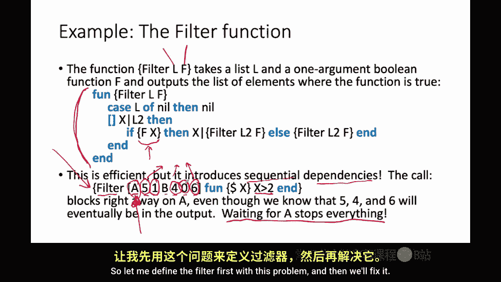
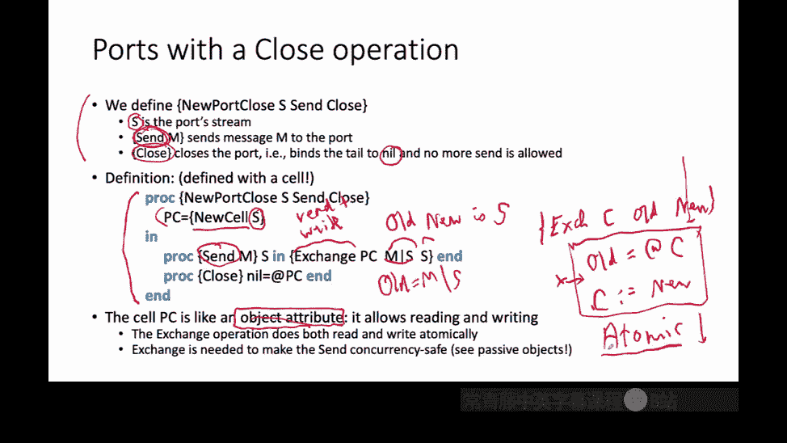
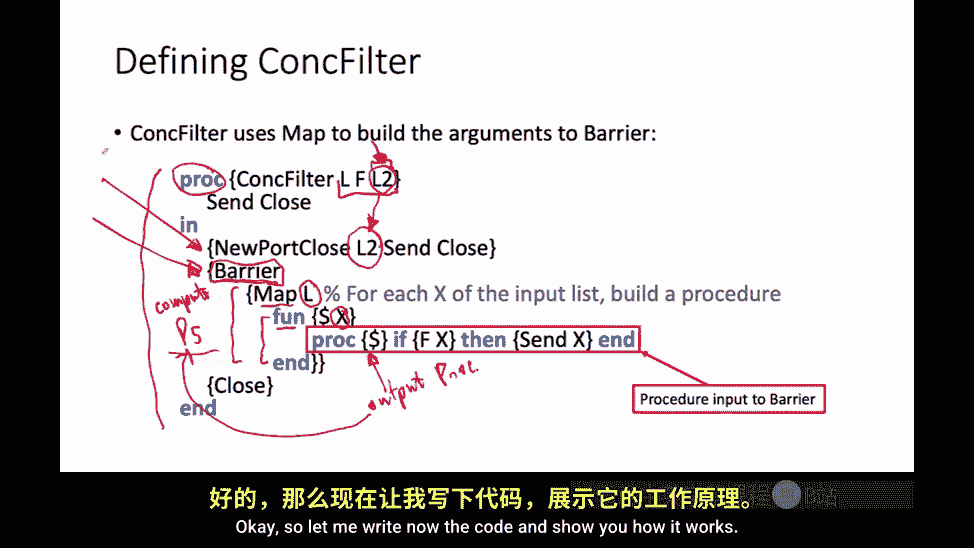
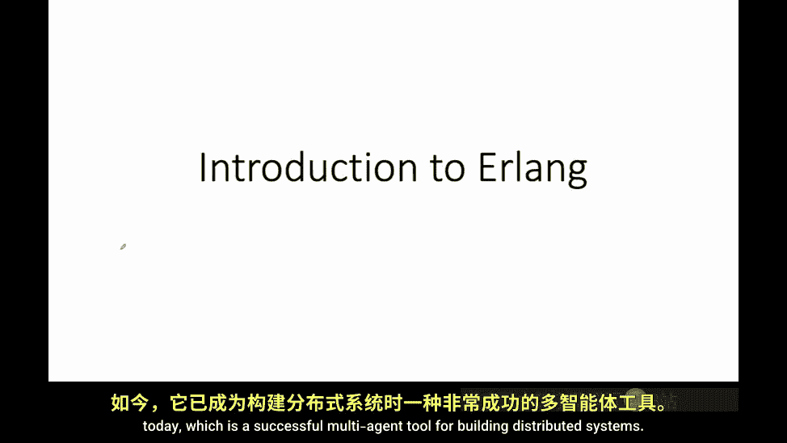
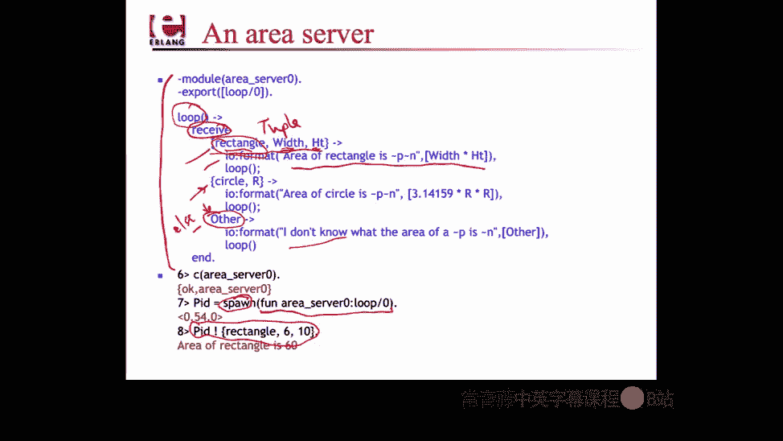
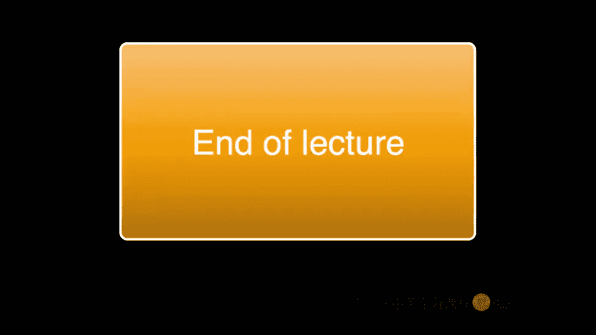

# 鲁汶理工学院【中英⚡高级编程语言概念｜LINFO1131, Advanced programming language concepts】 p08 P12 GI1131 Lecture 9 part 2 (2020) -BV1UDffBbEBZ_p8-

Let me continue now after the break。So now we're going to look at another example of using ports。

 and this one is a simpler technique。Which is removing sequential dependencies。

 So let me go to the slides first， show you what I'm going to do。

So this is a technique that you can use in many programs to make them more flexible。

So if you look at。A sequential program， basic idea is that all the instructions are executing in order。

 that's clearer， so there's a dependency， so they will go one after the other。

 so a later instruction can only execute if the previous one has executed。

But that might be a problem。Sometimes it can introduce a useless dependency。

 maybe one of the instructions blocks， for some reason， variable unbound， whatever。

 And so the later instruction cannot execute。But maybe that's kind of a useless block。

 Maybe those two things are not related。 and there's no reason for the second one really to wait for the first one。

 So this is a useless dependency and maybe we want to get rid of that。Okay。So now we。We can add。

New threads。And we can remove depend penencies so we can use what's called concurrency for dummies。

 okay。And to remove some of these dependencies。 Now， this doesn't always work。

So here is so we will need a port to collect the results。 So here's an example of a function。

Called filter。 It's a standard kind of a functional program。 You have a list L and a one argument。

 Boolean F。And you will only output the elements for which F of x is true。Okay。

 so this is a typical kind of functional abstraction that we're going to use that can be used a lot。

 but it introduces dependencies Okay， it introduces。Kind of useless dependencies。

 So here's an example。If we do filter。A 5，1， B4，0，6。

And the function is testing whether x is greater than 2。So the A is an unbound variable here。

Why is it unbound？ Well， it might be computed by some other something else。

 We maybe we don't know it yet。 So there's some weight we could have to do here。

But this filter function will block on the A。Right away。But actually， that's kind of。

Annoying because 5，4 and 6 are already in the list。 And we know they're going to be in the output。

 We know that 5，4 and 6 are greater than 2。 They're going to be in the output。

But we won't calculate that yet until a is bound。 So the unbound a introduces a dependency。

 So waiting for a stops everything。And also the one and the zero。

 we can also immediately eliminate them。 They won't go on the output。 we can already know that。

Without waiting for A。So this is a problem。So let me define the filter first。

With this problem and then we'll fix it。So is that that clear。

 the filter function is of actually a quite simple functioner， so let me go now to the code。

So here let me define a filter。Declare function， filter LF。 So this is again。

 is a higher order function。Case L of H bar T。If F of H， then H goes to the output。H filter Tf。Else。

 it does not filter T F with no H。And then we have the note case。So this is a simple filter function。

 and it does the right thing， okay？We can do something like。Browse， filter 1，2，3，4，5。

 And here's a simple function。X。Greater than two。And it prints 3，4，5。 that's clear greater than2。

 But if we have variables in there。Filter a2， three，4，5。Fun。We have the same as before。

But now we have this A， which is unbound。So what is this going to display？Think about it。

 When I feed this， what will you see here on the left， on the in the browser window。

You will actually see。Nothing， because the main thread。

 executing filter and browse will block inside of filter。 It's this A here。In fact。

 where will it block exactly， It's when the function tries to do a greater than2。

 So the greater than operation here。Inside filter。 So here。

Will block when it sees an unbound variable。So that's exactly where it's blocking。 So I run this。

And nothing is displayed on the left。Nothing at all。

 And I can get everything to display by doing a equal one ping。 And then I see 3，4，5。

 So everything is stopping because of the A， which is kind of a pain。Okay。

So you see that and you see maybe we want to keep running。

 even though some of the variables might be unbound， we want to remove this dependency。Okay。

So let me show now how we can do this。

So， let me go back to the。Slide。So okay， so waiting for a stops everything。

 so we want to get rid of that problem， okay。So we want to write a new version of filter。

That doesn't have this problem。We will write。And I will call it Conk filter， concurrent filter。

 We will build a new version of filter and we' use two building blocks。

 So I'm going to use the concurrent composition。So I'm going to actually use barrier in there to make it work。

 and I will also use ports。So asynchronous channels， those are the two building blocks we will use。

But ports with a closed operation， which adds new。To the end。So far， when we used ports for streams。

 we never close the ports， but now we want the port to close the stream to make it a list to put n at the end。

 so we'll have ports with a close operation。With this， we can write Conk filter。And this。

 when I run it on this list， A 5，1， B 4，0，6， it will immediately return5，4，6。

 and then wait for further。And it will immediately eliminate the one and the zero。

 so it doesn't have to do the computation anymore。But the problem， though。

 this this is going to work fine， but introduces another issue。

 These elements will be returned in any order。 Okay。

 the five will be returned before the four and before the6， but not always。

 because they will be running in their own threads。 You see， we remove dependencies。

 We make things independent， but independent equals。Concurrency。

And concurrency means we don't know the order。 So there is an automatic tradeoff here。

 when we remove sequential dependencies。We introduce。Independence， which means concurrency。

 which means non determinism。Okay， so there is a essential trade off。

Between removing dependencies and nondeminism。 So because of that。

 these elements actually could come in any order，6，5，4。And also。

 it depends on when the variables A and B are bound。嗯。If a is bound later than B。

Then the B will output first。 If a is bound first， then the a will first。

 So we will introduce this non determinism， okay。So that's unavoidable。

 so if we want filter to be deterministic。Then we have to accept sequential dependencies。

 but in many cases we don't care about the order， we may not care， it's not important。

 and then we can remove dependencies。Okay。So in order to do that。

 we need to define ports with a close operation。We define ports where we have a send。To the stream。

 So S is the stream， the send and close， which will bind the tail to Neil。

 So this is an extra operationpo。 So far， when we use ports。

 we didn't do close because the stream is going on forever。 But here we will need to close it。

 So actually， I will have define this for you。 using a cell。 So a cell is like an object attribute。

 It allows reading and writing。Assignment。So I'm not going to explain completely how this works except that I create the cell。

And the cell will is like a variable that you can assign an update like an object attribute that we saw in the passive objects。

And the cell will always contain the end of the stream。The send will add。

And it will use an operation called exchange， which does read both read and write。In one operation。

So， the。Exchange will bind old to。This argument， which is M S， and the new one will be this。

So the exchange reads the old value and updates， So exchange。She。Old new。Is like this。

 It's like old is equal to the result of C， the value of C。

 like an attribute and the C will get the new。But this is done。Together。

It's atomic that means the scheduler is not allowed to stop in between for the scheduler。

 this is one operation。The scheduler will do everything or nothing。

 so this is called an atomic operation， the scheduler cannot break it into two。

So with this， we are guaranteed that this sand will always work correctly in concurrency。

 Remember the errors for the passive objects。 Remember， we had a problem with increment。

 while using exchange is one way to fix that problem， making things concurrency safe。

 So using this port， we can define conk filter。But let me first， let me now write the code for this。

If this is， so there's a question， if there's a cell， this isn't functional programming any more。

 You are completely correct。 We are using the cell to implement a port。 And anyway。

 a port is not ports are not functional， and cells are not either。You are completely correct。

 This is no longer functional， and， in fact， Conk filter is non deterministic。

So that means it's not functional any more， because the results can change the order。

 It's not always the same result。 You see the trade off we're doing， where we remove dependencies。

 We introduce non determinism。 So we're actually leaving the pure functional environment。

In this case， maybe it's okay。 Maybe we don't care about the order of the results to filter。 Okay。

 if we don't care， then we are allowed to relax a little bit the functional because we want to remove dependencies。

 You see， this is a trade off。 when you make your own programs， you have to decide。

Do we want to keep it completely deterministic and functional？

But you might have extra dependencies if you do that， or can we remove。These。

 are we allowed to remove these dependencies， but then it maybe becomes not functional。 Okay。

 thats completely right。So let me go now first。 Now we will define Conk filter。But first。

We will define ports with close operation。Because we will need that inside of Conk filter。

So a procedure。 So a new port close。 We have a stream S。 We have the send operation。

 and we have the close operation。 Okay， so we will create a。Port。

So let me call it would create a cell。 sorry， which contains the end of the stream。 The S is the。

Taale of the stream。Always， okay， starts out by being S built when we bind it。

 it will move on forward。And then we define the two procedures send。And close。Okay。So basically。

 that's how it works。 Let me now fill in the blanks here。

 So the send is going to do an exchange operation。It's going to。read。The old value。

 so we'll need to get a new local variable， so we will bind the old value to M bar S。

So this actually extends the stream， and then it will set S as the new value of the end of the stream。

So this is actually doing exactly what the sand of a port should do。

And then the final close operation will actually sorry， I have to make the name of the cell here。

And clothes will actually bind。The end of the cell to nil。 But once you do a close。

 you're no longer allowed to do sense anymore。So this will define a port with a close operation。

 So let me now give an example of this。Newport close， S。 send。Close， so this will create a new port。

And let me browse S。So S is an unbound variable。 Of course， I can do send a。Puts A there， send B。

Puts B there。 and if I do close， sorry with the capital C。It will bind toil and it's done。 Okay。

 so with new port clothes and various synchronization， we can define the conk filter。Okay。

Is that clear for everybody。So let me go back to the slides now。

And to show you explain how the conk filter is going to be defined。

So we have now ports with the close operation so we can define conk filter。

 so here's the idea for conk filter。So let me compare Kong filter with the original filter。

 so filter LF。Will all these Fx will be done in the same thread？So Conch filter LF。

Will run each f of x in a separate thread。 So that's the main difference。

 Each F of x we run in its own thread。 So if x is unbound。

 then it's that thread that will block and the main thread will not block So if F x returns true。

 then we send x to the port and x appears on the stream。

 and the port stream will be the functions output。And when all the threats terminate。

 we close the port， this is why we need barrier。Okay， for all the elements in the input list。

 we run note on a thread。But we have to know when it's all done because the output has to be a list。

 there has to be nil at the end， so we use barrier to detect when all the threads have terminated and then we will do it close。

Okay， so barrier has procedure arguments， P。 So we have to create these procedure arguments。 Okay。

 so for each x in the input list， we have to execute this。Okay。And barrier will create the threats。

 Okay， so for each X in the input list， we have to execute if F of x then send X and。 So the in。

 the argument to barrier will be this procedure。 Okay， it will be。Proc dollar。

 F F of X then indexex and end。 So we have a list of those procedures。 So again。

 we're going to build， use higher order programming to build this。

 So here is the definition to conk filter。 So again。

 this is a very nice example of a higher order combinations of things we do with higher order。😊。

So you see how it works， we have one call to Newport close， we have one call to barrier。Now。

 I'm writing this as a procedure because I need to access the output。

 So you see the usefulness of the kernel language。 Now， a function is just a。

Procedure with one extra argument。 We need the L2 because that output is actually the stream of the port。

 okay。So we need to access the output。So first we create a port， new port close。

 and then we do barrier。Now barrier takes a list of procedures， so we will compute this list。

We will compute。The input。To barrier。 So we will do a map here。For each element of the input list。

 we will build the procedure。So this in the red box is the procedure。 So this function。

Will be run on every element of the input list， and it will output this procedure。Okay。

 which is FFF X indexd end。 So this is the procedure。That is going to be part of。

The input to barrier。 So you see， we actually will construct the list of procedures。

 That is the input to barrier。 Note， again， this is an extremely higher order。

 and this is a very dense program。 We're actually doing very powerful manipulations。 Okay。

 And so then barrier will do the rest of the work for us。😊。

Burrier will create a thread for each of these procedures。

 and it will synchronize on all of those threads being done。Okay。

 so let me write now the code and show you how it works。

So again。Let's see if anyone has any questions again。

 it's important to study carefully how Connk filter is written because it's a really interesting example of building an operation using higher order building blocks。

Okay。So let me write now the code for this。So， here's a definition of。Ck filter。

So I define it as a procedure because I need to access the output。Of it directly。

 So you see why it's important to have this kernel language。Ability。

 this lets you access things that are normally invisible。Okay。

 so I'm going to first call new port close。And this is L2 is going to be the。The stream。

 so the output of con filter is the stream， send close。I have to actually find them。

 declare them now， send。Cllotheose like that。So here I've created my port with a close operation。

 and now I do a barrier。Brier wants a list of procedures as input。

 so I'm going to create this using a map。Okay， and a function。Like this。I like。

 Ill do it sort of like this。 So I will write this in a minute。 Okay。

 let me first show you the skeleton of the code。Here。And then I will do close。

So Bar is doing a lot of work for AA， it's creating a thread for each of the procedure and it's synchronizing on all of those threats terminating。

AndBut then we also need this map because we need to construct the input argument to barrier。

 which is a list of procedures。 So here we will return a procedure。Okay， a zero argument procedure。

And inside this procedure， we will have the what we want to do。 F F of x， then send X and。Okay。

 basically， that's it。So this is Conk filter。That's using the newport clothes and barrier。

And now we can actually run it， show the example。Let me run using A and B。So， let me run。Browse。

🎼Conk filter， A 2，3， B，5，4。6ix， whatever like this。With a function， x greater than2。

So this is now Con filter， notice that there's some unbound variables here。So I run this。嗯。And。啊。

Okay。And it's not displaying anything。And the reason is that the barrier is waiting for the list to be terminated。

Actually， I should run it like this。I think I need to run Kong filter。In its own thread。Okay。So L。

It's equal to this。So here we get 3，5，4，6。 noticeice that the con filter itself will still wait for all things to be done if we now bind a。

 if we bind a to 100， it will appear because it's greater than2， if we bind B equal to1。

Then it will not appear。But the output is new， notice the output now is new because the stream is terminated。

 okay？So。The kk filter， in order to take advantage of the reduced dependencies。

 you have to run it in its own thread because it's also waiting for the whole list。Okay。

So that's the conk filter。Is that。It's clear how it's working。

 so you see we're actually using a lot higher order。

We're using determinizing operations where we can， like barrier， or concurrent composition。

 And we're using ports exactly when we need to create things without worrying about the order。

 because the ports， the sends can be done from many threads。 So when we need to collect things。

 we can use port for that。 with this， we actually can build。

Complex abstractions using a combination of deterministic data flow imports。Okay。

 so let me now make a little bit conclusion on that part。 Let me go back to the slides now。

Okay， so now let me conclude on this part and then after that we'll talk a little bit about Erling。

So basically， we've seen。How to build so the idea， the question is how do you design concurrent programs。

 So this has been a big theme of the course up to now。

And so far we have seen three what I consider good ways to build concurrent programs。

 we started by seeing deter deterministic data flow， including the lazy version。

 So this is the best way if you can use it， but of course it has limitations if you need nondeminism。

For example， if you need nondeterminism to express timing requirements。

 then you will might need to have a program be non deterministic。

 then you cannot do it in deterministic data flow， the example we showed is a client server。

But the termministic data flow is widely used Nowadays。

 many cloud analytics tools are implicitly using this。

 things like Apache Flink or Spark or other tools。 So this is actually a widely used paradigm nowadays。

 This was not true 15 years ago， but it's true today。The second。

Approach that we saw is multi agent programming。 This is the programs when you have many agents that have to talk to each other and you have a huge amount of non determinism。

 Okay， there's lots of non determinism。And this was true for the lift example。

There was a huge amount of nondeminism。Coming in from outside， anyone can push buttons on any time。

 I can push buttons in the floors。 I can push buttons in the lifts。

 and any time a floor or a lift can have a button pushed。 So this will create messages。

 So there's a huge amount of nondeminism。So this is a fully general approach。

 but actually it's quite a bit harder to program， you cannot use functional programming techniques。

 we have to use the state diagram approach that we saw last time and you have to reason about the internal state of the agents so we have stateful agents communicating with asynchronous message and we have to use state diagrams。

 so this approach works well。And I'm going to talk in a few minutes about the Erlang language。

 so we're going to see an introduction to Erang in this course。

And we're not going to do much Erling programming， but I'm going to show you Erlng and see to show you exactly how it connects to this。

 Erlng is a really good example of an industrial tool that uses multi agent programming。😊。

So that was the second one， the third one is what we saw today。This， in my view。

 is the best all round way of doing concurrent program if you're completely free。

 if you're not connected to legacy requirements， then this is the approach I recommend by far as being the best。

So you write most of the program as the deterministic data flow as much as possible and you add ports。

Exactly where you need them。 And usually you only need a very few ports。 Okay。

 I've shown several examples of that。And so that's by far the best approach。

 You start by writing a deterministic data flow and you own the a ports when you cannot use deterministic data flow。

 Okay， so this， in my view， are the three。Good ways to build concurrent programs。 After the break。

 we're going to see another approach。Which is called shared state concurrency。This is much。

 so there's two ideas here， monitors。 So this is how languages like Java do concurrency。

And then there's transactions。So this is actually。Quite a bit harder than the other techniques。

 So transactions are actually an extremely good idea。 So I recommend them。

 whereas monitors is a very bad idea。I will consider them as being deprecated。Unfortunately。

 many legacy tools are still using monitors。 and so this is tools that are very old， like Java。

 which is already coming from 1988， so it's already 30 years old okay。

 so if you have the choice do not use this approach， but we will see it in this course。

 you will see this after the break， and you will see， you will understand completely why it works。

 but why it's not recommended。 Okay， so this is the。3 good approaches Now。

 Now I want to give you an introduction to Erang。Before we end the course today。

 Erling is a really nice system， and I even suggest you can download and try out Ering。

 so I'm going to give you a practical introduction to Erling。Today。

 which is a successful multi agent tool for building distributed systems。

So simple introduction to Erling。 So Erling was developed by the company， the Swedish company。

 Erickson。And the actual the people developing it were a group around Joe Armstrong。

And this was developed actually around the same time as Java。

 So Erling and Java are about the same age， and the Erling was developed for telecommunications application。

 and there's a lot of history around this， a lot of interesting stories around this that I might say in some time when if we have time。

So there was a lot of stories of how Er Lang was almost killed by Es and。

 but managed to survive and flourish because of how useful it was。

 So the Earlling system was released。 It's called OTP Open Telecom platform。

And it is supported by Ericksson Company today， also by an organization called the EarlLling Ecosystem Foundation。

 and there's a large user community and you can download the system and run it on www。Eang。

org so this you can do and it you can use it interactively and so on。So how does it work？

Earing programs consist of。What they call processes。 but a process is exactly a port object。

 as we saw。So we saw remember the port objects， they have an internal thread， they run。

 and you're reading messages and executing them。So they're slightly different。

 there is two differences， first of all， there is no sharing。

Whenever I send a message to an airline process， the message is copied。 So the。

Processes are completely independent。 That's very important。 It means if a process fails。

Then the other mos will not fail， okay， so Erling is designed for fault tolerance。

 so the processes are completely independent。The second point is that they don't have streams like port objects。

 they have a mailbox。And the difference is that you can access the mailbox by pattern matching。

 That means you can check whether certain kind of message。

Is in the mailbox and take it out of the mailbox so you can receive the messages out of order。

Whereas in a port object， you have to treat the messages in order of the arrival in Erling。

 you can take the messages out of the mailbox in any order as long as they match。Okay。

 so but other than that， it's extremely close to the model we have seen everything that we say about multi agent。

 you can do it with Erling。And finally， Erlng has support for building distributed systems。

 So systems that run on network computers， many computers communicating that are reliable。

That keep running even if there's failures and long， long lived so that the program can keep running。

Even though it has pieces of failure。It has invented a very interesting approach to building these systems called Let it crash。

So the idea is that if part of a program crashes， Erling will not try to avoid the crash。

 it will encourage the crash， it will say crash， and then another part of the program will recover。

 so you do not try to avoid crashes but you recover from crashes and it has very interesting support。

 it has failure linking that means if you have two earlyling processes。And if you link them together。

 if one of them crashes， then automatically， the system will send a message to the other one so it can recover。

 so the processes are linked with the failures， okay。And also you have supervisor trees。

If I have a bunch of processes doing a work， I have another process on top， observing all of them。

Which is the supervisor that if any of the lower processes crashes the supervisor in informed and it can do something to fix it。

 So this is actually very simple and extremely effective approach。

 because of the share nothing philosophy。 So you see Erling is really。

 really designed for these building fault tolerant long livedve systems。

 And one of the famous examples is the Erickson AxD301 ATM switch。

 So ATM is a way of communicating by building virtual circuits that's used in telecommunications。

 So it's called asynchronous transfer mode， So AxD301 is a very high performance ATM switch It has 1。

7 million lines of airlineline code in there。 It also has a million lines of C code for lowlevel stuff And Erickson claims and this is。

Something that really is making people open their eyes。 availability of 99。9999999%。 So 99。

 So availability means。What is the probability that when I access the system， it's running。 So 99。

79s availability， that is the probability that when I access the system at any time that I can actually use it。

 that the system is available。 This turns out to be 30 milliseconds of down time in one year。 Okay。

 a year， which has 30 millioncon， which is very small over a year， only 30 millisecond。 Now。

People are doubting this number。How do you measure that number， But in any case。

 it's extremely reliable， extremely available。 Okay。

 it's one of the most available systems because it is completely built using this Erl philosophy。

 So the Erling is a very successful way of doing this。😊。

And let me now give you a small introduction to Erang， let me show you some slides now on ErLng。

But I go first to the chat。

So is that。Okay， so we've seen the three ways of building good ways of building this concurrent programs。

 deterministic data flow， multi agent using port or active objects and deterministic data with ports。

 So the third one is the best all round way， in my view。 So as a teacher of a course。

 I have to teach you the best way。 in my view， this is the best way。And the second way。

 the multi agent is actually very successfully used in earm。

So there's actually a very large industrial community and many systems。

 cloud systems and telecom systems are using EarlL， especially when they have to be reliable。

So let me now give you a quick introduction。

To Erang。Using a talk coming from an airline company。Called Earl Solutions。So， this is。

So I have these slide are also in the middlele， so this is a quick。Introduction to Erlng。

 when you see this top， you can actually start using Erlng。

So what are the important concepts in early？You'll see many of the concepts we' see in this course come back。

There's no assignment， only pattern matching， so in fact， EarlL is a single assignment language。嗯。

All variables immutable， so it's single assignment。There are case expressions with pattern matching。

And also airlinelang is functional， that means functions are values， like in a functional language。

 like we have seen， you can do higher order and airline function literals。

There is no global variables， so you only have。Processes or poor objects talking。

 there's no global variables。There are no statements， the only expression。

 so you're always computing functions。An airline users， they call this actor。

 so an actor is a port object。Okay。And Erling， also called this。process。

They can send and receive messages。 and then there is the leted crash philosophy where you don't try to avoid crashes。

 but you recover from them。So just a very quick introduction to Earlang。 So there's integers。

 unlimited size， floats， strings and double quotes。 So a string is actually a list of ASI values。

 So far it's actually very similar to us。 This is actually very similar。

 It's a symbolic language at Tom Adams。And it has actual lists。 Now， if the。

 if the values in the list are ASI values， then it's a string。It has tuples。

And it has also a special value called binary， which is actually a kind of a bit vector value。

 So this is used very useful for defining networking protocols so you can treat binary bit vectors immediately okay。

And now， operations， arithmetic。You have integer division remainder operation， comparison operations。

 notice the funny symbols for。Equality and not equality。嗯。

You also have Booleions notice and also and or else here。

And then you have special operations for bit vectors。

 So Erling is very good for building network protocols， so they have the bit vector support。

You also have pattern matching in Earl。So this actually looks very similar to what we have seen here in Oz and also very similar to functional language。

So pattern equals expression。It can be a constant variable or a structure。

And airline has lists and tuples。So here for example， this is a pattern， we have the atom OK。

 we have the variable stream， notice Erling has the same convention as Os。

 the variables have uppercase and the atoms have lowercase and actually this is because of the historical reason。

Is because the first early implementation when they design it was implemented on top of prologue。

 which has this convention。 So this convention is maintained。

So Erling is a single assignment language， so basically inside of an Erling process。

 it's completely functional。We also have case statements。

 so you can recognize this as very similar to the case statement we have seen。Okay。

 we can have sequence expressions。And so here we have can have multiple expressions and we take the value of the last expression。

Okay， that you evaluate。And of course you have semicolon， you have funny syntax。

 you have to separate them by semicolonons。You have if expressions。

 if is interesting because it doesn't really have an else， it has what's called guards。

So this is basically an if with multiple choices。And it will evaluate these guards。

 these are boolean expressions， okay？So。So for example， the guards are tests。Type tests。

 Boolean operators， bitwise operators，rithmetic relational。

 So here's a set of functions that you can use in guards， absolute number， head of a list。

 tail of a list。 and then you can do other things like。Noode， trunk， whatever。

So lists now lists can be different type values， so again。

 Earll is similar to us and that it's dynamically typed。It's a dynamically typed language。

 which means the type is known only at X runtime。We also have in airline。

 an interesting concept called a list comprehension。

 This is a way of defining lists that's very similar to mathematics。 We have some expression。

 and then we have a generator。So will'll show you examples of that。So here， for example。

 if we have the list N， which is 1，2，3，4 5， L is 10 x times x plus y， such that。X is N。 Y is n。

 and x is less than y。 So these are actually generators。

And this will create a list according to a kind of declarative specification。

 So that's very interesting and functional languages have that too。So we have list operations。

 head of the list， tail of the list as usual。Okay， length of the list。

And the system will show now some operations， so I'm not going to show all of them。

 you can create lists here， the sequence operation will create a list of elements one to 10。

And there is an interactive interface。 So if you download the airang and install the latest Erang。

 which you can do by going to W W Werang dot org， you can actually run this。

 and you will have a full functional airang system， and you can build。😊。

ComVery large earlyling systems already。 So the all these examples are using the the interactive interface。

 So here， for example， the all operation in the list module。

We'll take a Boolean function and will'll check if this is true for all elements of the list。

This is false。Because the land elements are not all pair even。Here。

 any will check if it's true for any at least one element of the list。 This is true。

 There is at least one even element in the list。And then some example of list comprehensions。

But let me go just a little bit farther now， I'm not going to go to all of the。The detail， So the。

Slides will show you。Many examples of how to run airlineland code， multiple generators。

Named functions。 so we can define functions。Using patterns， Okay， we also have anonymous functions。

With a special syntax。 And we use recursion。 So this is very similar to the。

Functional programming model we have seen。So servers， so this is the definition of a process。

 so this is like the loop inside of a port object。So it receives。

 it's like taking an element from the stream。It does something and then it does a recursive call。

So this is very similar to a port object， notice that the recursive call is always lasts。

 so Erling also encourages tail recursive functions okay。So here's an example that we've saw already。

 here's a factorial that is not tailor recursive。 So in this slide you see that you have to put the multiplications on the stack here。

And if the stack is too deep， it will crash， it will go too deep。

The idea is to use tail recursion because tail recursion is like a wire loop。 You can see that the。

That it's explaining that here。T recursion you never run at a stack space。

 So you can see that Arling uses a very similar philosophy to what we've seen in this course。

There is a simple trick for making functions tele recursive they say with accumulators。

 this seems very familiar to us。 Okay， so here is a version of factorial using an accumulating parameter。

 and then it turns into a wild loop。Okay， there is actually a web。Book。

Called Learn you some Earlang for great good， which I highly recommend if you want to become a proficient Earll programmer。

 So this is available on the web for free。So you can look at that。

 learn you some earling for Red good。There is also IO。

 so I'm not going to go to all of the details since we're almost done here。Just want to go。You can。

 of course， do file I O。 So here's an example。 So in Erlum。

 you basically create modules and you export。s this module defines a simple function。

 and you can call it in the interactive interface。Now let's look at messages。Okay。Message passing。

So Erling has no global variables， it's only。Processes or port objects sending messages。

 there's no global variables。Okay，Because global variables is bad。It's a major source of error。

 so the earlyling philosophy is no global variables。

Concurrency is done by passage messages between what they call actors。Oops。

 which is a very lightweight。Press。So to create a new process like new port object。

 Erling has a function called Spwn， and you give it the state transition function。Basically。

 the function might be anonymous。So a simple example of this。

 so the send operation is an exclamation point called Bang。So let me show you an example。

Of this very quickly。So receive is a mailbox。So it basically。

 you do receive and it will automatically。Take a message that matches from the pattern or block。

 if it does not。Each process has a mailbox， especially attached to it。

 so this is corresponding to the stream。If the mailbox is empty， it will block， if it is not empty。

 it will find the first pattern that matches if it finds9， it blocks， okay， if no pattern matches。

 it will block waiting。Okay。So here is finally a simple。Process。So here we have a loop。

That receives three， two different kinds of messages。 So these are tuples。This is Tuple。

Rectangle width height， so rectangle is an at with height are variables。

 and it will print area rectangle is width times height。

 and the other one is this and if it receives anything else，So this is like an else。It will say。

 I don't know because the variable matches everything。 So here we actually spawn。

An area server with this function。 And here we send in a message。

So here we have actually created the server。 Okay， let me stop here because it's 10，30。

Okay， I'll talk a little bit more about airline。In the after the break。 So also。

 you're going to be receiving the project。Soon， you're going to be receiving the project。

 I have to talk to the。Okay。Okay， so， so I'm going to end the course for today。

 I see there's one question。The question is related to the previous slide on slide 23 on port the close for the port object。

Is the nu equal？PC。So， PC。I struggle a bit to understand the nil equal read PC。

 Is this equivalent to read PC cone equal nil。 No， it's not the same。 So actually PC is a cell。

And F PCC is the value of the cell。Which is。The end of the stream。It's an unbound variable。Okay。

So if we doing。PC equal nu will bind the。The end of the stream will bind this variable。

But will not change the content of the cell。So， the cell。Still contains this bound variable。

But doing。PC colon equal。Now will change the content of the cell。It will not。Bin the variable。

Which was the old content。Okay。So basically， the cell。Contains a variable。 It's a box。

Contain a variable， if I do。Add PC equal new。I will access this variable and bind it。

But the box will still have the same variable。It still contain this variable。

So variable will be bound。But the box is still containing this bound variable。

 so I'm not changing the content。But if I do colon equal。This。Changes the content of the box。Okay。

 it doesn't bind any variables。It only changes the content of the box。 So the box。

 which used to have a variable， now contains nil， but the variable is still in memory somewhere。

 It's just the box no longer references that variable， okay。

So the two operations are completely different。 If I do read PC equal nil， I am binding the variable。

 but not。Changing the content of the box， where if I do PC colon equal nil。

 Im changing the content of the box， but I'm not binding the variable。Okay。I hope。

Does it make it clearer？Okay， very good。So the course is now done， it's now 1030 already。

 I will stick around a little to answer questions if people have questions。

 Thank you very much and have a good rest of week and Easter vacation。

