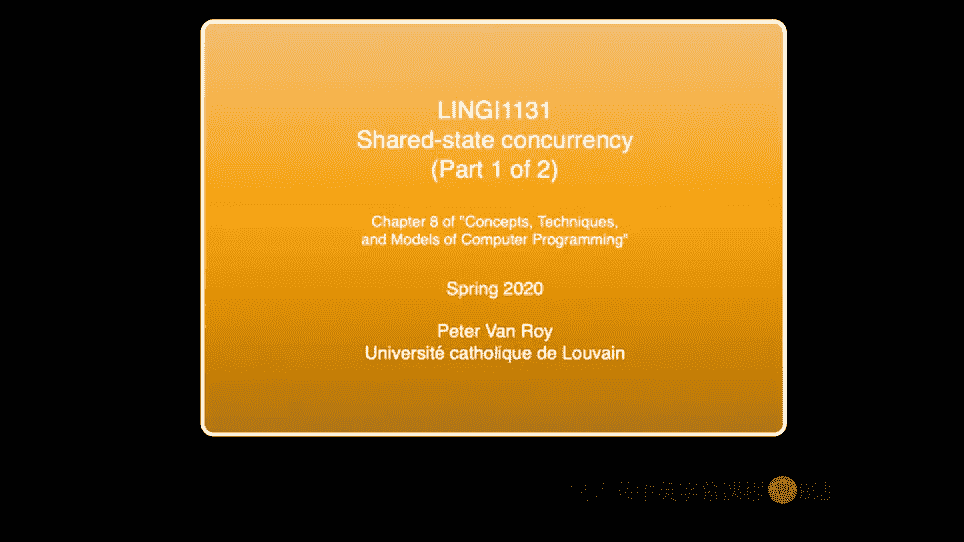
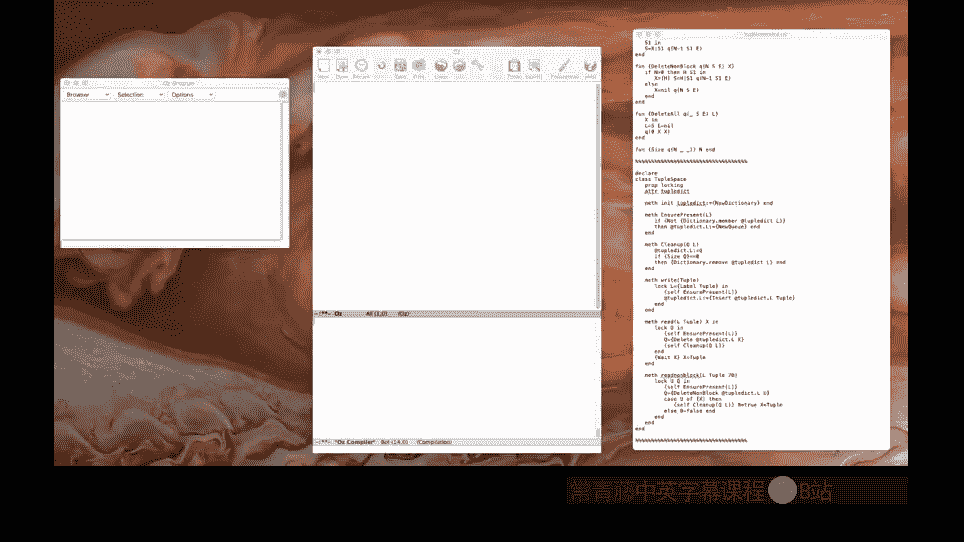
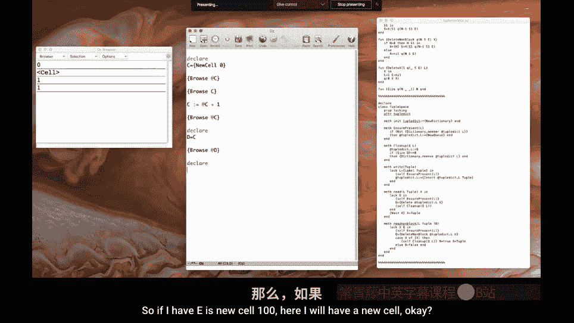
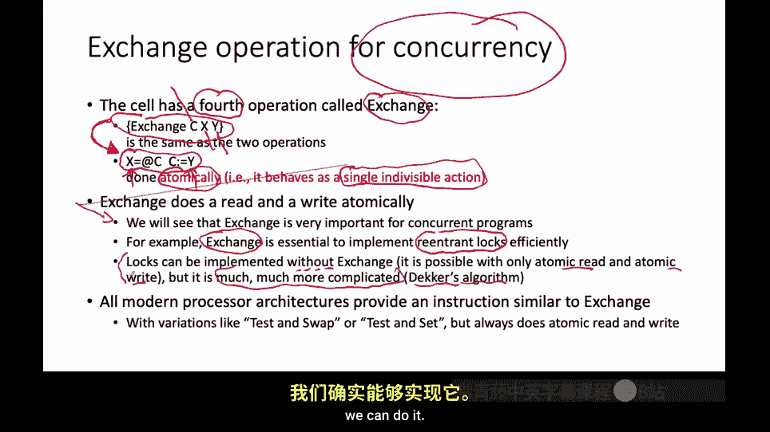
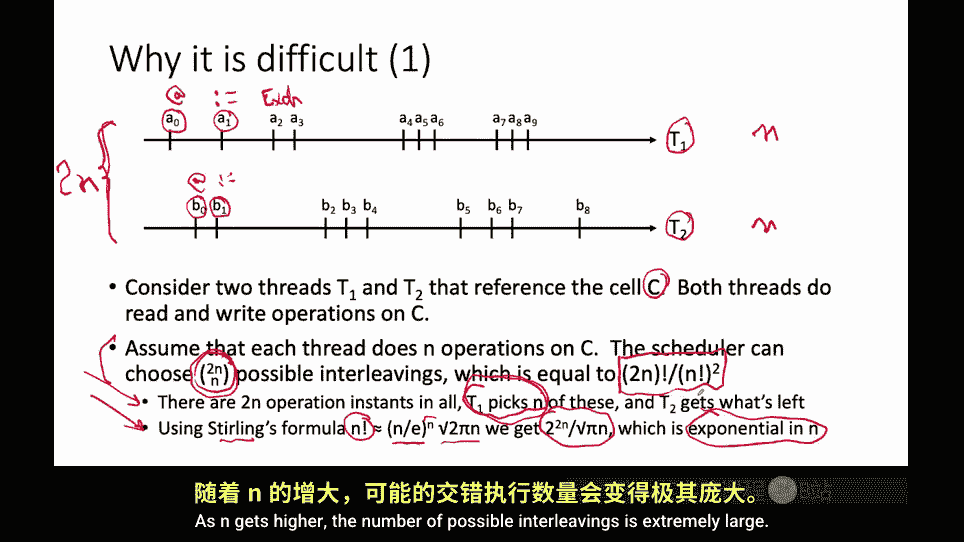
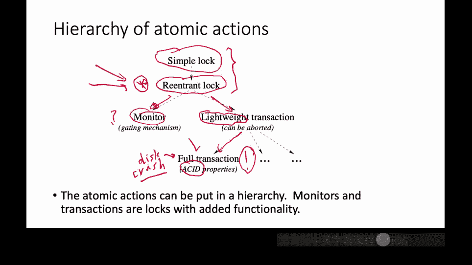
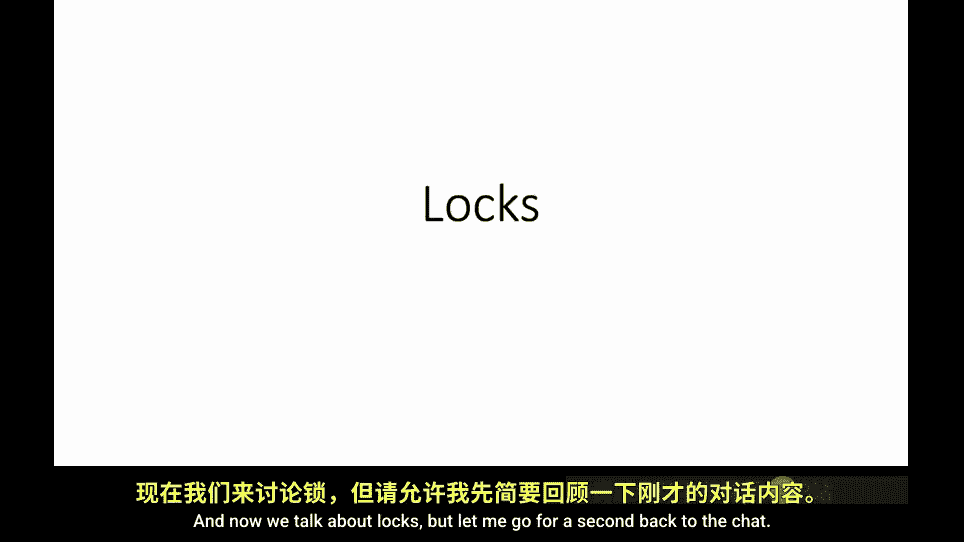
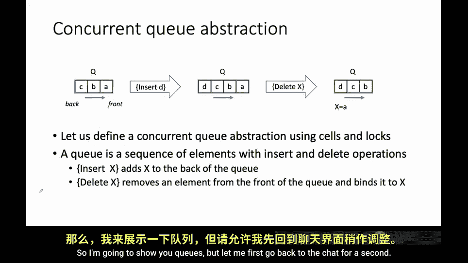
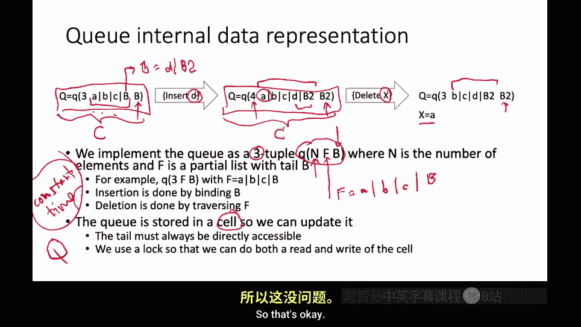
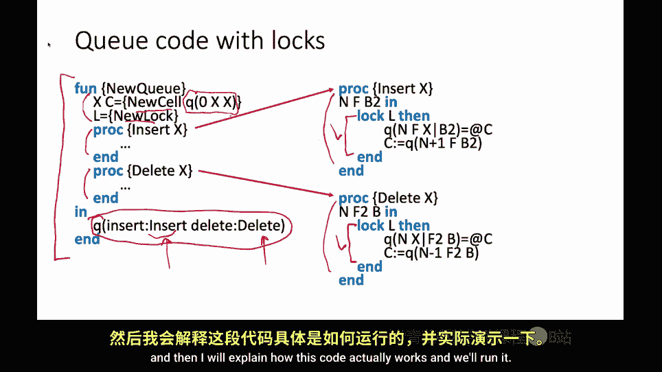

# 鲁汶理工学院【中英⚡高级编程语言概念｜LINFO1131, Advanced programming language concepts】 p09 P11 GI1131 Lecture 10 part 1 (2020) -BV1UDffBbEBZ_p9-

Welcome to the course of 1131 this morning after the Easter vacation。

 so I'm going to give the course like before I'm going to show slides and I'm going to write code and every five minutes or so I will go to the chat and answer any questions you have。

So if there's any problem， please immediately speak up if there's a problem with the slides or with the microphone。

So let me start now。By presenting a slide。

Mmmm。So today we're going to talk about shared state concurrency。

So shared state concurrency is a way to write concurrent programs and we've seen already some ways。

 in fact we've seen three good paradigms just a refresher first one is deter deterministic data flow This one is really the best because you can do concurrency for dummies you can add threads anywhere you want with no problems and it keeps working。

 but you can't do it all the time though。Then we've also seen multi agent programming。

 This is where you have port objects and active objects sending messages to each other so you can have large systems where you have these guys sending messages。

And finally， we have seen deterministic data flow with ports， so this is the best all round paradigm。

 so this is taking the deterministic data flow and using it as much as possible and adding ports only exactly where you need them。

 but nowhere else。So these are the three good paradigms we've seen before。

 so that's all very nice but today we will see a fourth paradigm in fact this is the hardest one of all。

 this is called shared state concurrency and it's actually a used very much probably too much for historical reasons so the idea is that we have threads and we also have a concept called cells which we are mentioned but I'll go back into which is mutable state variables that you can assign multiple times。

😊，So there are three important techniques， concepts that we build here， they are locks。

 monitors and transactions in order to master the complexity of shared state concurrency。

So lockX is what you do when you access concurrent data structures。

 if you have a data structure accessed from many threads。

Then you have to make sure if two threads go in there。

 they don't mess things up so that the lock makes sure there's only one thread at a time inside。

 then you have transactions， which is for databases。

 so it's like a lock except that it also handles failure if something crashes。

 the transaction will restore the state。So that nothing goes wrong ever。And finally。

 we have monitors， this is what you have to do when you have actually objects。

That are called for multiple threads。 But this is a very complicated concept， monitors。

 And in my view， they should be deprecated。 If you want to build new programs。

 you should not use them， but lots of legacy programs are still using them。 For example， in Java。

 theyre used all the time they called synchronized objects。

So let's talk a little bit about shared state concurrency。 And in order to do that。

 we have to first introduce the concept of state。 shared state means that there is some upable。

 mutable information that's shared between threads。

 So shared state concurrency is based on the concept of。Mutable state。

 These are variables that can be assigned multiple times。

 This is something we didn't really see really in this course yet。

 because it's not actually very easy if you want to really make complex programs。

 So we didn't see it。 We did not emphasize it。 But now we have to talk about it。

 because shared state concurrency is based on mutable state accessed from many threads。

 So many languages are using these kinds of variables。 Of course。

 you know that you have much experience with this。So we are going to call this concept。Se。

 I'm not going to call it a variable。Because the word variable has a lot of meaning。

 It's an overloaded word。So in mathematics， variable is a placeholder for a value inside an expression。

 if you do x squared plus y squared， x and y are called variables， but in fact， they don't change。

 they represent values。In computing， a variable can be many things。 It can be an identifier。

 you write X， a variable in memory， what stored what we saw in the semantics and variable stored in memory。

 or it can be a cell。So there's three kinds of things that are called variable。

 So we will call these things cells。 And whenever I say variable， I will mean a。

A constant single assignment variable in memory。Okay， so let's talk about cells now， so a cell。

Is actually not such a simple concept。There are actually two things there when you have a cell。

 you have the name of the cell， the identity， and you have the content of the cell。

 so it's like a box。You have a name。😊，N and you have a content， and then you can change the content。

So for example， the name stays the same， but you have a new content to D， so for example。

 when you do an assignment， the original content is destroyed and replaced by a new content。

So the name or the identity is also sometimes called the address。

 So if you look at memory and processors， you usually have 64 bit words。Which have an address。

 So those are actually cells semantically， because you can update them And the name of those boxes is actually called the address。

 Okay， so this is。It's a terminology。And the content of a cell is just a variable。

 so a variable in the single assignment store。So we will add three operations。

To the kernelnal language for cells。We create a cell。

 you have to create it explicitly in a language like Java whenever you declare a variable。

 actually you are creating a cell but here we will create the cells explicitly。

 so if you do not call new cell， you will have no cells。

 you have to call new cell if you want a cell。So this creates a new cell with initial content A and C will be bound to the name of the cell。

And then we have two operations。On cells， we have the assignment and we have the read operation。

 So the assignment， we will use a colon equal notation。 This is replacing the cell's content。

 and the read allows a variable represented by Z to be bound to the content without changing。

 So this is very similar to what you see except that everything is explicit。😊。

Create the cell explicit。 we assign explicit， and we access explicit。 you。

 if you have a language like Java where you do something like I equal I plus1。Well。

 there are many things going on here， the I on this one， the left one is assignment。

The right one is a read。Okay， and this equal sign is not actually an equal operation。

 so we will do something like this。We will have a different notation。I。Coon equal。

 that's the assignment and the add sign here gives you the access。

 the read of I and the I represents the name of the variable。

 So the notation that you see in Java is actually a shorthand that can be confusing because it does not give the actual meaning of the concepts。

 so we will do that in this course we really want to understand， so we will make everything explicit。

Okay， so let me give you some examples of using cells。 So what I'm going to do now is go to the。

Do some code。

Let me go quickly to the chat。So if you have any questions， is that okay。

 so I will now go to the screen of the Mozart system and I'll show you how cells work。

It's very simple at something you know already， in fact should be something you know already。

So here。We I can actually create the cell。So for example， C is equal to new cell of zero。

 we create a cell with initial content zero， let me compile this if we browse。

The content of the cell， the at sign， then we will see the value0 appear on the left。If you browse。

See， that is the name of the cell， and you see the browse will actually represented as cell。

Because the name of the cell is a constant that you cannot print out。

 it is a unique special constant in the system。And then we can do operations like C gets excess value of c plus 1。

So if we do this here。We will increment the content of the cell。So you see it's very intuitive。

 something you know already， if I not do declare D equals C。D here is not a new cell。

 It's going to be a reference to the same cell。So if I do browse content of D。

I will see the content of C， because D and C are。Having the same name， they name the same cell。

So if I have E is new cell。

100 here I will have a new cell。Okay。So if I do browse content of E。I get 100。

 and now I can actually compare the names of a cell。 C and D are the same cell。

 The names are the same。 I compare them here， C equal D。I can also compare maybe different cells。

 so C and E are different。Cells， so they it's false。Okay。So let me now go back to the slides。

 So is that， is that clear， Of course， the code， I will put the code on the Mole after。

 So let me show now。

More in with the slide， what the cell is。The cell is doing。

So here also in the slide I show some cells， so here x is a cell， see x is the name of the cell。

 so this is actually the box。And then I do an assignment。

 y is equal to x or y and x are both having the same name。Here。So if I do an assignment to Y。

 it will actually assign the same x， you see this is exactly like pointers。

 if you have known in or references in Java or in C， the name of a cell。

 the address is actually very similar to a pointer， but we give it semantically a very clear meaning。

So I have to explain now the exact semantics of cells。

 so we have extended the kernel language with these three operations。But to make the semantics。

 we have now to extend the memory。 So we have already our single assignment store， Sigma 1。

 but we create a second store called the cell store， which contains cells。 So here's an example。😊。

So sigma 1 contains variables， X， Y， Z， T， U， V W， and the variables can be bound to values T is equal to 10 X is equal to this funny Greek number C。

 which is actually the name of a cell， it's a constant y is equal tozeta which is also the name of a cell。

 and then sigma 2 is the cell store。Where you have a cell X whose content is T and another cell Y。

 whose content is W。 So let me make this clear with a picture。 Let me do now， X is equal to new cell。

0。So what this does is， let's say， assume we have a little variable， little x。

 which is corresponding to the x。 this will be。Now， bound to the name of the cell。

 So this can be the Xy。 I write it as a Greek letter because it's a special constant。

 It's not a number， and it's not an atom。 It is a semantically special， unique constant。

 Assume now the 0 is going to be。😊，There's a variable A， which has the0。

 We will now have the actual cell store， which has a pair in it， which is x colon a。

 So you see the cell is not just one thing in the semantics。 It's several things。 It's the name。

 a variable bound to the name。 It's the actual cell， which is the pair。 and， of course。

 the content here is a。So。Let's see what happens with operations if we do x column Z。

With x corresponding to little X and Z to little Z。

 then the little x colon and T will be updated into the cell store。 So the content。Can be updated。

And the excess operation of y， so the y corresponds to a little y。

 but the little y here has the content of W， so this will return the variable W。

So you see how cells work， so there's no confusion。

 so I don't expect you always to write down cells semantics， but if there's any confusion。

 then you can always make it clear by using the semantics so cells are a basic concept of mutable state and we have introduced now three operations。

There is actually a fourth operation。A fourth operation。Which is especially。

Designed for concurrent programming， this is an operation that probably you have not seen in a previous course。

 because usually this operation is not given to the programmer。

 It's an internal operation that's used to manage concurrency。So this operation is called exchange。

And it looks like this。So we have a cell C。And we have it has two arguments。

So it's not like assignment or access， which have one argument each， but it has two arguments。

 x and y， and it behaves。Like two operations， so it's exactly the same。

As reading X and assigning Y as the new value。So why is this special， why is it special。

 the single exchange operation is just doing a read and a write。So why is this a special thing？Well。

 because it's done atomically， that means that the scheduler will never stop in the middle。

 it behaves as a single indivisible action in the system， it will be done everything or nothing。

 so the scheduler will either stop before or after it will never stop in the middle。

 so the two read and write operations are really fused together into a single atomic operation。

 and this is very important for concurrent programs。We will see that。

So when we implement in a little while， we will implement a concept called reenterrant locks。

 we will see that with exchange， we can have an efficient and simple implementation of this concept。

We can implement them without exchange。But it's much， much more complicated。

 There's actually an algorithm called Decker's algorithm， which you can look up。

 which shows you how to do locks without exchange， assuming we only have read and write。We can do it。

 so conceptually， we don't really need exchange， but it really makes concurrent programming much simpler。

So we will have this fourth operation exchange。Note that this operation， I'm not just inventing this。

For for this course， all processor architectures， the Intel core I7， whatever。

 all of the arm processors， they all provide instructions that are like exchange。

 they usually have funny names like test and swap or test and set or compare and swap or there's other variations。

 but it always does two things， atomic read and write。

 So the exchange operation is extremely important it's so important that the architecture provides an instruction。

For implementing it efficiency efficiently and this instruction， of course。

 will never be stopped in the middle。 the scheduler in the processor will do the instruction completely atomically。

 so this is a critical thing for concurrent programs and we will use it today in the course。Okay。

 so let me go back to the chat now。So is that clear so I've introduced cells， which is mutable state。

 this is something that's very simple that you know， in fact， and but I introduced a new concept。

 which is the exchange， which is atomic read and write。

 which is especially important for concurrency， as we will see。Okay， for everybody。

So let me go back now to the slides。

。So the exchange operation。 Okay， so now let's talk about shared state concurrency。 We have threads。

 and we have cells。Okay， and this can be done in many languages so when see， for example。

 the language C， you have the Posss thread standard。

 which maybe you have experience with in other courses， you use it。

 you have other languages with threads and Java you have threads and also state。

 so now let's use it okay。So shared state concurrency， we're going to use threads and cells together。

And this is actually extremely popular， it's used all over the place， all major languages。

 for example， Java D++， will you be using this paradigm for concurrent programming？

So you might think because it's so popular， it must be great。 Para， wonderful。 Actually。

 this is not the case。 Java and C plus plus are actually quite old。😊，Languages， C+ plus in the 1980s。

Java is late 80s。 So these languages are actually very old。

 despite their popularity and shared state concurrency。

 we understand now is not the best way to do concurrent programming。

 I actually showed you already better ways。But we will learn it， because it's extremely popular。

In fact， the real problem is monitors， locks and transactions are both。Useful and important。

 It's that monitors are actually not so useful。 They're actually very difficult。

 But let's explain why shared state concurrency is hard。

 So shared state concurrency is actually a hard paradigm。And let me explain why it's hard。

So let me go now into a particular execution， so here we have two threads， T1。N T 2。

They have a shared reference， or they each reference the cell C。 So they， it's a shared variable。

 A variable looks's updated by both threads and these。Operations， a 0， a 1， B 0， B1。

 These are thread operations。 It could be reads。 It could be。Access it could also be exchanged。

 They are operations on the threads， on the thread C。 sorry， on the state， the variable C。

So the two threads are doing operations on the shared cell。Now。

 how does this work assume we have n operations here and N operations there， n in each thread。

Each thread does n operations on C。That means there are a total of  two n operations。

And the number of possible interleavings is2 n choose n。 So this is a combinatoric。

 This is the number of possible ways of picking n objects out of2 n。

So we can prove this because here we have a total of 2 n instances in time when operations are done。

T1 will pick。N of those。For its operations， and then there's n operations left and we give them the T2。

That means T1 picks n out of 2 n， so the total number of operations is called2 n， choose n。

The number of ways of picking n items out of2 N。 we can compute that。

 This is actually equal to2 n factorial divided by n factorial squared。

We can compute the value of that by using a formula for approximating the factorial。

 which is called Sterling's formula。 So n factorial is approximately equal to n over E where E is the base of natural algorithms。

 So it's n over e to the power n times the square root of 2 pi n。 So if we do this computation。

 we actually get this number2 to the power to n divided by square root of pi n。

 So this is exponential and n。Okay， as n gets higher。

 the number of possible interleavings is extremely large。

Now， that's a problem。The number of possible interleavings of the shared state is an exponential function of the number of operations。

Now that's a problem， Why is it a problem because all interleavings？

Must be correct If you want your program to be correct， every single one of those has to be correct。

Even if there's an extremely small number， maybe there's only two that are wrong out of 10 billion。

 that's too much。The system will break， given the high speed of computers running a gigahertz。

 the scheduler will not fix this scheduler timing。 you cannot rely on it because it depends on the environment of the program。

 if other things happen in your computer。 This will change the scheduler timing。

 so you cannot use scheduler heuristic to avoid bad interleaving is a very bad way to do it。

You can say， okay， well you can do testing。There are so many interleavings testing can only check a small fraction of them。

 Well maybe you can do verification。 There's actually a really nice course on model checking。

 which is a very interesting technique， practical technique for verification。

 a course given by my colleague Charlotte Biishcher。

 but this also breaks when you battle exponential numbers Okay， so these two are not enough。😊，Okay。

 you have to be clear now， testing and verification are still essential。

 I'm not saying don't do them。 Okay， you must do them。But they're not enough。

The only way to make a concurrent program correct is to make it correct by design。

 We have to design it up front so that we know become from the design that all interlavings are correct okay。

Is that okay， Let me go for a second back to the。To the chat。Is that okay。

 did anybody have any question on that？Isn't this type of concurrency better in performance？

 So there's a question， isnn't shared state concurrency better in performance？

 That's a really good question， because。That depends on the efficiency of threads。

 It used to be the case。 Yes， that if threads are very expensive。

 then you want to reduce the number of threads。 And so shared state is very natural。 You have large。

Programs that are sequential with some shared state。 But this is not the case anymore。

 If you look at current languages like go or closure or airlinel。

 they have extremely efficient threats， so。Actually， it turns out it's not true anymore。

 And also in terms of the Internet， many programs are actually distributed。 So they're running on。

Separate computers。 In that case， shared state doesn't really work because you have to send messages。

 The computers do not have shared state。 So you are forced to use message passing。

 and you cannot simulate shared state。 So the simple answer is it used to be。

 but it's not the case any more。 And nowadays， threads are very efficient。Second question。

 since interleavings depend only on the number of operations in the threads。

 Isn't this a problem for every paradigm？ Yes， you are correct。 It is a problem for every paradigm。

And in fact， I didn't emphasize， but if you look at port objects or active objects， for example。

 you will see that the port object internally executes each method sequentially one after the other and it does not interleave them。

 so in fact you also reduce the interleavings， I have not emphasized this for port or active objects because it's more natural to talk about sequential in its own thread。

 but in fact you are correct， we are not interleaving the the executions。

 so we are actually reducing the number of interleavings。

Yeah so we have a comment so the language go uses a concept very similar to the ports of Oz。

 yes so go is a recent language invented by Google which is very much message oriented and you can see that go is moving away from shared state concurrency and is moving toward message passing。

But still， many programs are doing message passing。Okay， let me go back to the slides now。

Okay， so the number of interligs is exponential， so how do we do it？Okay。

 actually this goes to the question that one of the questions that was asked。

 designing correct concurrent programs managed to manage the interleavings。

 We need to reduce the number of interleavings so that we can handle them so that we can check all of them so that there's only a small number。

And there's actually three ways。Main way is that people do this。

Two of them are paradigms that we saw before。 First one， deter deterministic data flow with ports。

 Here it's the paradigm。The programming paradigm is restricted， it becomes functional programs。

 and what's so interesting about that， well it's really funny。

 but all the interleavings give the same result。That's because of the design of the paradigm。

Of course， that gives you limitation， so you have to add ports。And in the ports， you have to check。

 of course， all the interleavings。 but the number of ports is small。

So the number of interleavings you have to check is reduced。 Okay， and in the second paradigm。

 it's a similar idea。 You have message passing between port objects。 So internal to each port object。

 it executes in a single thread。And in fact， the methods are executed sequentially in that thread。

 they don't interleave。So we only have to read some about interleavings between methods and not between primitive operations。

 So this reduces also interleavings。 And then what we are going we're talking about today。

This is what we're going to do today， we have now shared cells。We are going to build。

Large atomic operations。 We' are going to group them together。

And to also reduce the number of interleaving。 So locks。

 monitors and transactions will enormously reduce。 And in fact。

 to a similar level as the sequential methods so that the interlavings is between。

Operations on the data abstraction。 Its between method and not between primitive operations。Okay。

 so we've seen already the two previous ones。 Now we're going to look at。This one。

 atomic action on shared cells， so how does that work？We're going to group operations together。

 So if here we have a cell， for example， we have operations， many operations。嗯。I'm writing them here。

 We grouped them into a single atomic operation。 So the what it means is that the atomic operation。

 the scheduler will never stop in the middle。 It will either stop before or after。

 That means we don't have to worry about interleaving of the primitive operations。

 we only have to worry about interleaving of the big。Operations。

So the basic concept for this is called the luck。In French Viro， Al luckch is a large atomic action。

Which groups together many smaller operations。 It makes it a tumc。And then in addition to the lock。

 we have two refinements， which are called monitor and transaction。So monitor is also called in Java。

 they call it synchronized object， but in fact， it's exactly。The same as a monitor。

So a monitor and a transaction are also locks， but they do something more than locks。

So a monitor extends the lock with a way of threads to wait。

 so if you have multiple threads doing working together， sometimes the thread can work。

 sometimes the thread has to wait。Before it can go back into the lock。

 So the the monitor is able to manage。These kinds of weights。 So， for example。

 if you have a bounded buffer。If I put an element in the buffer， then it's okay。

 If I remove an element and the buffer is empty， then the thread that removes has to wait until another thread puts an element in there。

 So the threads are kind of collaborating。 And the monitor has these ability to make threads weight。

 So that's the monitor。 This is actually quite complicated。 We'll see this next week。

And then there's the transaction。 This is used for a database。Like banks。

 this is actually used in cases when you can have failures。

That means crashes where robustness is important。 So it's used in critical applications like banks。

 So your bank account is protected by database information that is changed using transactions。

So the transaction has two possible results， so the normal result is called commit。

 this is when it does the work， but if there's a crash。Somewhere in here， something crashes。

 it's designed to restore the state。So it will not corrupt the state。

 It will not make something incorrect。 It will be as if nothing happened。

 So the abort will have the same state as the initial state。Okay， so this we will see in two weeks。

 so monitors and transactions， we're going to see them in separate lectures because there's a lot of things to say on both of them。

But both of them are very widely used and can let you build large atomic actions， okay？

So it's kind of a hierarchy。So the basic concept is called a simple lock。

 which I'll talk about in a few minutes。This is extended then to a concept called a reentrant lock。

 This is actually the most used one。 All practical locks in systems are actually going to be reentrant locks。

And then monitor is an extension of a reenttrant lock。 And then transactions。

 There are different kinds of transactions。 So a lightweight transaction is an extension of reentrant lock。

 but there's also a full transaction， which has something called acid properties。 So this is able to。

Survive， even if there's a disc crash。So a full transaction is very useful and very important。

 So the full transaction is an important concept that is not deprecated。 I don't like monitors。

 They're not easy to use， but full transactions are actually extremely useful。

 and we keep using them today。Okay， so this is how they're going to work。

 So today I'm going to talk about。Locks， so you will get the main idea of how that works。 Okay。

 let me go for a minute back to the。To the chat， if you have any questions。

So is that is that clear so in fact， all paradigms are reducing the number of interleavings and in shared state。

 the basic concept is called the lock。 So you group many primitive operations together into one large atomic operation and then you have monitors and transaction which extend the lock with more functionality。

 but the basic concept is the lock okay so let me go。😊。

Back to the slide。So now， now we have atomic actions， Okay， this is what one big atomic actions。

 In fact， it makes it's very usually very easy to understand if you choose them well。

 they will coincide with abstraction boundaries。That means if you have an abstraction like a queue or a list。

 a stack or a dictionary or some kind of data structure， you will put this inside the lock。

That means the lock corresponds to the operations of the data abstractstruction。

So this makes it very easy or actually relatively easy to reason about it。

 So if you want to prove correctness， you have to prove that each atomic action is correct。

Because you have to assume that atomic interactions can be interleaved in any possible way that you have these atomic actions。

 but they are abstractions， operations like pushing something on a stack or popping from a stack or updating some data structure。

So these can be interleaved in any way。But this actually is much easier than interleaving primitive operations because there is an invariant assertion。

So， for example， if you have a stack， you know that the stack content is the same as the number of push operations minus the top operation。

 And this is an invariant assertion。 You just have to show that if the invariant is true before。

 So we have here some atomic actions， let me。Write them down， a1， A2， A3。And they're executing。

 So each atomic action is executing。 It's like it's sequential because the scheduler we not stuck in between。

 So we assume that the invariant is true before。And then we have to show that the invariant is true after。

 So this is much easier。 We have some logical assertion that's true before。

 We have the code of the operation， and then we have to show that the abstraction is the invariant is still true after。

This actually is usually fairly straightforward because the abstraction is doing normal。

 reasonable things。 Okay， so this is the first part， the invariance。

This is showing the program will never do anything correct。

 There's also a second part is that the program makes progress。Okay， this is the difference in fact。

 between two kinds of property， safety and liveness。

 so safety means the program will never do anything incorrect。

Whereas liveness means the program is actually going forward， it's making progress。

So like driving on a street， safety means that you are obeying the traffic code so you will stop at the red lights and you will always ride in the right way according to legal traffic rules。

But it does not mean you reach the destination。 So liveness means you actually will go and reach the destination。

 Okay， so you need both。 but this actually is very practical。

 This now becomes practical with large atomic actions， okay。And now we talk about locks。

 but let me go for a second back to the。

To the chat。So is that clear？Okay， there's this question。 Are semaphorees considered as monitors。 No。

 they're not。 A semaphore is actually a mechanism that you can use to build blocks。

 It's a very primitive concept。 A Semaphore。 A semaphore is a mechanism to make sure that only one thread goes in。

Side the lock。And if there's no thread and if the thread leaves in another thread can come in。

 whereas monitors have something more。monitors。Do much more than semaphorees。They have。

A cu of waiting。Threads managed by the monitor。Itself， so whereas the semapho is just。

Managing the exclusion is managing going in the luck。 The monitor has another kind。

Of waiting threads， These are the threads that are collaborating。

 So a monitor is actually doing much more， but we'll see monitors next week。

 So I'm not going to talk about semaphore， because a semaphore is a very primitive concept。

 It's one of the early concepts。And。I'm going to talk about。Locks。

 and I'll show you how to implement locks。Of course， there's many of the variations of this。

 but I will consider a semapho to be an early concept and it's just a variation unlocking okay。

So I'm not going to talk specifically about Sephos。

But because locks is kind of subsuming the stmophore。

 let me go now and talk a little bit about locks。So， lux。So a look。Is a language concept。

 We add it to the language。And it guarantees that only one thread would be running in a given part of the program。

 So this part of the program is called the locks。Critical section。 Okay， that's the terminology。

 So it's， you guarantee that only one thread will be inside the critical section at any time。

 So if a second thread。Is running and tries to enter the critical section at the boundary。

 it will stop。 It will wait at the boundary until the thread inside leaves。

 so there's an entrance boundary and an exit boundary。

 And whenever the thread traverses the entrance or the exit， the lock will do something。

So if there's no threads inside， then you can enter。 if there's a thread inside。

 you will wait until the internal thread leaves。Okay， here on the right， I've shown an example。

 so this is code， so here is a critical section。This is one critical section。

A critical section does not have to be。A single connected piece of code。

 it can be separate pieces of code protected by the same lock。

This is reasonable because when you write an an operation or an abstraction。

 you might have different pieces that have to be protected that only one thread can be in the several pieces。

 so a critical section guarded by a lock does not have to be continuoustiguous。

 often it will be does not have to be。 so here we have a single lock。Protecting two pieces of code。

 so the critical section is actually the union of these two pieces of code。Okay。

So we will define an abstraction。Okay， actually， the Oz language provides syntax for lockx very often。

Languages will give you some syntax to make it easy to use locks。 So we define the lock abstraction。

 We have three operations here。 We create a lock。So we have a function， you call it。

 it returns a lock， so L is a lock。You can test whether。The content of a variable is a lock。

So this returns true if L is a lock otherwise false， and then the actual lock itself。

 the locking operation， there's a statement called lock L。

 then statement and so this will guard the statement with lock L。

 so statement is part of the critical section of the lock。

Note that you can use the same lock and you can call lock L more than once。

So the union of all of the locks are the critical section。So what is the semantics。

 so if no thread is in any statement guarded by a lock， then any thread can enter。

A thread will suspend if it tries to enter while there's another thread inside。Okay。

 and then there's a very special property called reentrancy。 So if a thread is inside the lock。

And it tries to go inside again。So it has done lock L。And then it's running the statement。

 and somehow it does lock L again。 Well， then it's allowed to enter again because it's considered its already inside。

 It can enter again。 This may seem very strange property。

But this is extremely important when you build data abstractions using locks。

 So all practical locks will have this property called reentrancy or thread reentrancy。Okay。

Like I said， the Luxe statement can be called in different parts of the program。Many times。

The lock will ensure that at most one thread is inside any of the parts that it guards， okay。

 so that's the semantics of locks。And now will'll start doing some programming with Los。

 So I'm going to show you cues， but let me first。

Go back to the chat for a second。So is that reasonable。

 so the lock lets you put any statement inside and it's guarded and that is called the critical section。

And you can create as many locks as you want。 So each lock will guard a separate statement when you call lock L N。

So locks are。Things， datas， values in the language that you can use to protect statements。

 and you can do， you can do many clever things with locks。 The lock is a value。

 So you can pass it as an argument to a procedure if you want。

 you can actually dynamically create critical sections。 if you want， usually you don't。

But the lock is a new kind of data type in the language that lets you protect things。Okay。

 but let me show now an example， so I'm going to show you example of locks and then we will implement the locks and you will see exactly how we get the lock to work。

😊，Okay， so let me。呃。Just a sec。好。Let me go back to the slide now。

So here。Let's now I'm going to implement and then as an example。

 I'm going to implement a data type called a concurrent Q。

And we're going to implement it using locks。So what is a concurrent Q。

 so a Q is a sequence of elements？With insert and delete。So it has two sides。

 It has the back and the front， you can insert。In the back here。

And you can remove or delete elements。In the front。 So basically， it's。A line of elements a sequence。

 you put elements in on one side， you take them out on the other side。So you can see it's kind of。

The opposite of a stack， Whereas a stack， you put the elements in on one side and grows。

 and you take them out on the same side as you put in。 But in a queue， the two sides are different。

 You put the elements in on one side。 You take them out on the other side。

So here we have a queue with ABC in there。Assume now we insert D。Well then the Q will be A， B， C， D。

 if we now delete X。So x will be the outputer。 Then we will remove the front， so we remove the A。

 and we will bind x to a， and the Q will contain B D。

 So you can see elements go in in one side and go out on the other。

 So and we have two operations insert x and delete x。 So usually x will be a value。

 but delete is on the x is an unbound variable， and it's bound to the value coming out。

So insert is like an input and delete is like an output。 That's concurrent queue。

 Now I'm going to give you an implementation of this using single assignment variables。

 and then we're going to implement it using logs。 So I'm going there's many ways to implement this。

 you can do arrays， whatever。 The problem is that the size of the queue is actually。Dynamic。

It can grow depending on how many elements you insert。

 So it's not really a good idea to implement with an array。

 You have to implement within a dynamic data structure。

 So I'm going to implement it with a list using a list data structure。

Okay so here's the internal data that I'm going to use， I'm going to represent the Q as a tuple。

A topple with three elements。N is in。An integer， the number of elements in the Q。

And F is going to be a list。So if there's A， B and C in there。ItThe list。

 but the list will not end in nil。 It will end in an unbound variable。Which is the tail end。

And this tale， I will call it B。So you can see I'm using now single assignment variables to make a simple implementation of Qs。

 you don't have to， you can do it other ways， but this makes the queue very simple if you do like this。

So if I want to insert into the queue， so here on the left， I have a queue。A Q with three elements。

 A， B and C in there， And B is basically the back of the Q， and it's unbound。

 So the element to the Q has A， B and C。Now， if I insert D in the Q。I will bind B。

To D and a new variable B2。So I will have this and then I will replace the B by B2。So the new。

Tupple is this one， and the three becomes a four。So I will replace the tuple by another tuple。

You see， so now I've inserted。If I want to delete。The an element from Q， then I will。

Take out the first element of F。So that's a， and I will replace that by the remaining elements， BCD。

And the second， the back is the same in that case。So insertion is done by binding B and deletion is by traversing F。

 So these are constant。Time operations。 That's very interesting。So because of single assignment。

 I can implement， insert and delete in constant time if it would be a list。

 I would not be able to do that， because when I when I add an element。

 I have to create a new list by appending and that's。Proportal to the number of elements。

 so because of single assignment， I have an efficient implementation and you can implement this in a similar way in Java。

 for example， by using linked lists to simulate the single assignment。

So the Q elements here are stored in a cell。So the Q here is stored in a cell。

And the cell is updated。Each time we do an insert and a delete。Okay， so that's why we need the lock。

 we will be doing read and write operations。And so you have to make sure that the scheduler will not stop in between。

 Okay， so that's okay， let me go for a second back to the。

The chat。So is that clear， so Im using I'm implementing the queue。

 so I actually have a kind of a smart implementation using single assignment。😊。

Which is kind of like a linked list so that I can have constant time， insert and delete。

 So I'm giving you an efficient queue。 You can actually use this queue in your own programs。

 So it's a very， it's a nice queue okay。For the queue。 So let me now。Show how I'm going to do this。

Now using locks。Okay， let me go back to the slides。So here is so the representation。

 now I'm going to code this。So I will have a function。Call new Q。 And whenever I call new Q。

 it creates a new Q。 So this queue will be actually a record with containing the insert and delete。

 So each time I create a queue， I will create new insert and delete operations。

 So you can see that the queue actually behaves like an object。Here。

 because the data is internal to it。 And I have two methods which are insert and delete。

 So this is similar to an object。 It's not an abstract data type here。And internally。

 the Q will have a cell。So the initial queue is empty。So that is the topple 0 xx where x is unbound。

 and I will also create a lock。Then I will have insert and delete operations。Okay。

And they're defined here。Notice that each one of them will use the lock。

Notice that the lock is protecting two different pieces。 That means if some thread doesn't insert。

And other thread tries to do delete that delete thread will wait until the insert thread is done Okay。

 so you see it's very natural to have a critical section that has different parts of the program。

 Okay， so that's how it works。Let me go back to the chat now。And I will give a small break。

 and then I will explain how this code actually works and will run it。

Okay。So you see the basic idea。I'm using lock to protect the insert and delete because they're doing cell operations。

 Read and write， and I don't want the scheduler to stop in the middle。

 The insert should be done atically and the delete should be done atomically Okay， so it's 930。

 Let me make now a small break。5 minute break。 So I will mute my microphone。

And I will keep all the connection open。 So， and in five minutes。

 I will start again and will write some code。

