# 鲁汶理工学院【中英⚡高级编程语言概念｜LINFO1131, Advanced programming language concepts】 p10 P10 GI1131 Lecture 10 part 2 (2020) -BV1UDffBbEBZ_p10-

Let me continue now。 So let's take a look at the the queue。

 So let me first explain quickly how the insert and the delete are working， the code。

So I go back to the slide now。So here we have the insert。

 so the insert is doing this funny operations here。Let me show you how it works by presenting a Q。

 So let's say we have a Q where we have N and we have A， B， C。呃。呃。Let me put a variable here。呃。嗯。F。1。

 F 2， F2。So let's say this is our Q with A， B and C， and we will now first do this。

That means we will bind this to F。So this is the F， and we combine this to x。B2。So what does this do？

So notice that F2 is the same here。 So I'm binding F2 to X B2。

 That means the new the new operation will be Q。And then the here I will have F in the output。

 so that's A， B C， and then I will have F2， but notice F2 is equal to x B2。

 so that's going to be equal to dx if I add or BB2。And then notice that I will put B2 here。

So notice I have actually added D。 So basically by binding the back。Here I bind the back。

I've added it。And I have to do an assignment now to put the new value of Q。

 and of course n becomes n plus one。So I have two cell operations， So I put them inside a lock。

 So the delete。Show you how the delete works。 but let me just show very quickly here I have。

 I will this x bar of2 will be bound to。The front of the queue。So if it's ABC with something F prime。

 then this will bind it to x bar F2。 So you see the x gets bound to a and the F2 goes to the rest。

 So this will actually get the first element。Of the Q。 Okay， and then I will create a new。

Output where F2 is going to be just the。The the。Initial value without the first element and the back stays the same。

 So this removes the。 So here I will have x is equal to a。 Okay。

 so this is how the insert and the delete work。 I can actually write the code here。

Let me write the code for you。

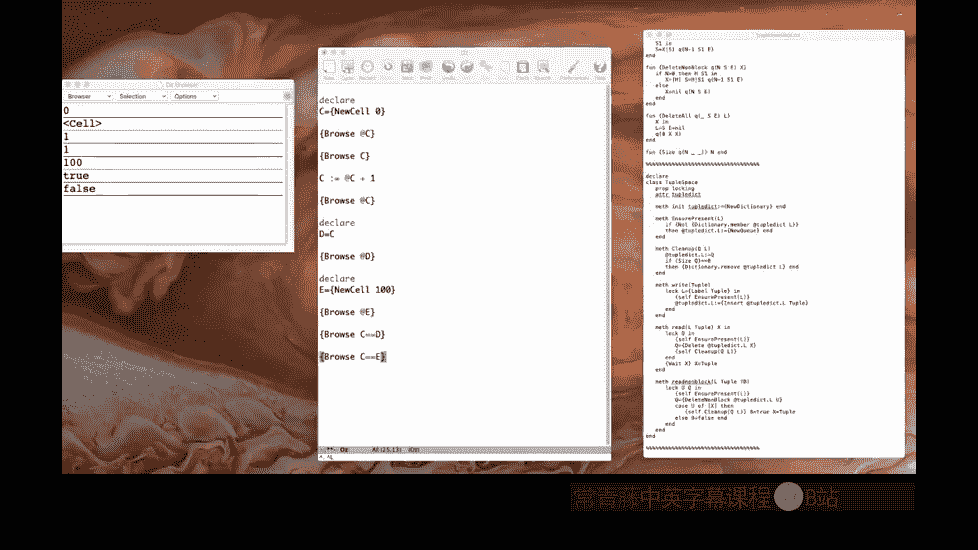

So is that okay？What happens if the queue is empty and we call elite。 That's a very good question。

 I will answer that question in five minutes。 Okay， this is a good。Question。Just answer。Minutes。

 there's actually a slide on that。 What happen if the Q is empty and we call delete it。

 So it depends what we want there。 So I will answer that question in five minutes。

 But let me go first to the。

The code here， let we implement now a queue。

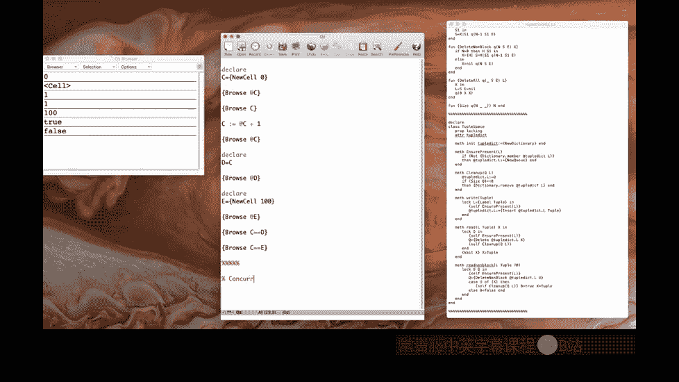

Concurrent Q。 So I will create this new Q function。Now。

 cells and locks are part of the system so I can create a cell immediately and will also create the lock。

New lock is part of the system。 Okay， and now I will have the insert。

Let me first write the skeleton of the code。Delete。And then I return a tuple。

 iss actually a record with the insert and delete operations。Okay， so this is the Q。

 Now let me do the insert operation。 So the insert it has to do a lock。Okay。

TheDe also has to do a lock。 Let me first put in the lock。Okay， and inside this lock。

 I will now read this cell， which contains the queue， and then I will update。So。So reading it。

 I will actually do a kind of。Pattern matching， I will bind。The topple。To the value of the cell。

And then I will update the cell。To give you the new value。 So the new value will be n plus1。

Then F is the same， but I've bound the back here。 you can see that B the this was actually the back。

 I've bound it to X B2。 So the new back is B2。 Okay， of course。

 now I have to declare the new variables that I've used。 So I have to put in the new identifier。

 So N I'm using n。I'm using F。I'm using B2 x as an argument。Okay， so that's insert。

And now the delete。Operation。So here again， I have Q N， but now I need to traverse the front。

 So x bar F2 will be equal to。The front。 so the x will be bound to the first element。

 F2 will be bound to the remaining elements。And then I update the new content here。

 I have now n minus1 F2 is going to be the new front。 You see the x is removed from it and I have B。

 Of course I have to declare some identifiers here N， F2 and B， I think thats that's all long。

So this is my cu and it's using。One cell and one lock。 Okay， I hope I've done it right。

And now we can actually use it in different threads， so for example。

We can declare Q is equal to new Q。Here we have a queue。And then we can do。Insert。

 so we have our Q dot insert。We can do a， put a in there。嗯。I think I've made a mistake。

What is wrong here。Consert。 of course。Very dumb。 The new cell is not0。 It has to be a tuple 0，0 x x。

 Okay， you see that I fixed it。 The initial value is not 0。 Of course， that was completely stupid。

 It has to be an empty Q。There。So I read I fix it now。New P， now I insert a。And now I can delete。

Q dot delete x。Browse X。Okay。And this will give me a here on the left。 Okay。

 and the insert delete can be called from multiple threads。So you see how it works。Is that clear？嗯。

What happens if the queue is empty and we call delete？Okay， I will get to that。

 There are some people doing guessing what the answer is。One person says it will cause deadlock。

other one says it will I think it will wait for a value the Q that looks like H bar T so that it will wait。

Okay， so we'll see now what happens。Actually。What's going to happen is something。

Very smart because of single assignment binding。Let me first explain why we need reentrancy。

 and then I'll explain what happens if you do delete on an emptyQ。

So I actually already explained why we need reenterency。 It's sorry。

 I didn't I explained why the critical section can consist of two parts。

 but I did not explain yet why that when you enter a lock。And your insight。

Sometimes you have to enter again the same lock。And here's an example of why you do it。

 Let's extend our Q abstraction。 So let me now implement insert2。

I want to put two elements in the queue， tongueng to， X and Y。

But I want them to be together and nothing in between， so I call insert x and insert y。

 but the scheduler can always stop in between。Okay， if I do this， because insert x。

 insert y or atomic， but insert2 is not atomic。But I want X and Y to be in there at once。 So I。

 for example， the Q models people waiting in line， two people arrive。They're friends。

They both go in the line。 I want to guarantee that they will be next to each other in the line。 Okay。

 so I want to guarantee that the scheduler will not stop in the middle。 How do I implement that。

 Well， I have to use lock。So I put in a lock， the lock L and insert X and y are now protected by the lock I have now one big atomic action。

But we have to be careful here because when we go in。And we enter this lock。 When you call insert。

 there's another lock。Inside the insert。In there。So what should happen？ Well， logically。

 we are already in the lock。So if we try to go in again， it should be okay。

 it should be acceptable because we're already in， and that's what a reentrant lock does。

Reenttrant means that if you're in the lock that you're allowed to reent， yourre reentterrant。

 you're allowed to enter again。 Sometimes it's called thread reenttrant lock。

 Sometimes people put the。Word thread before。 That means if you're， if a thread is inside the lock。

 it can go again。 you can see that this allows us to build abstractions in an easy way。

You see that we can build insert2， we can use the lock， we can add more locks。

 and everything is fine。Because the lock is reenttrant， Okay， if we're in the lock。

 we can go in again。So the lock has to beentrant， all the locks in practical systems will be reenttrant。

 so locks in Java synchronized objects， for example， they are reenttrants。

 so all practical locks in real systems will be reentrant。Okay。So that's the first thing。

 but now let's come to the question what happens when you do delete on an empty queue。

 actually our implementation is very smart in this case。

What you want to happen in our implementation， you can actually delete elements before they are inserted。

 so the number of elements in the queue can become negative。So if you do delete X on an empty queue。

The cube will have minus1 elements， so what does that even mean？It means that we have a placeholder。

 so the X will be in the queue。 and the next time we do an insert。We insert A A A， for example。

 then that will be the element。 At that moment， x will bound to A A A and Q will have zero elements。

 So it's like a a debt promise to that the next element we insert will be X。Okay。

You can actually verify this。By running the L X on an emptyQ。

 So this is an advantage of single assignment。 So single assignment has many advantages。

 It lets you build agents that have no memory leaks and tail recursive list functions and so on。

 This is another advantage。 It allows you to do many operations without blocking。Okay。

 so I would suggest as an exercise。

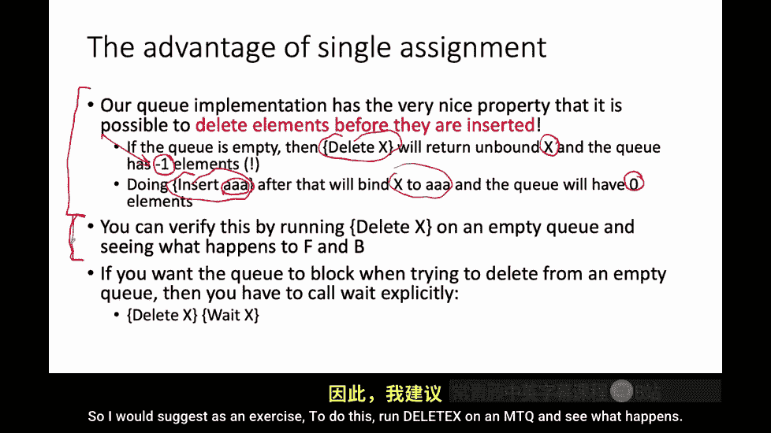

To do this， run delete X。On an empty Q。 and see what happens。 Okay， what F and B。

 noticeice that they will be bound， of course， But how they will be bound。

 will actually create a placeholder， In fact， the the if you put elements in a queue。

 then elements come into the front。 But if you delete elements from empty， the delete。

 the negative elements are put in the back。 Okay， they will fill up the back。

 And when you start inserting， it comes back to the front。 So this is anrop of single assignment。Now。

 if you don't like this property， if you want the queue to block。When you deletete from empty queue。

 So if you build a queue without。This property， if you build a Q where the the it has to have0 or more。

 then you want the Q to block here。 you will have to do it explicitly。

 You will have to put an explicit weight X。 So if x is unbound here。

That means the element is not yet inserted。Then you will wait。

 So the weight X will wait until the operation is bound。 Okay， okay this。Property of。

Deleting before inserting is not essential to the course on concurrent systems。

 It's a property of this very nice Q implementation。

 So this is actually a very nice Q implementation。 So I'm not going to spend so much time explaining exactly how it works if you're curious。

You can investigate and I can talk to you about that after。

 but I would like to continue talking more about concurrent system， okay。So， let me go back to the。

The chat。So it's actually very nice queue implementation， okay？

So there's a whole bunch of discussion on this， it seems that people are very interested in this。

So there's a question， is it possible that after insert X？

Another thread managed to execute insert before insert Y is executed。 Yes。

 that's the example of reentrancy。 Yes， if you do not have an extra lock， that's what could happen。

It seems very difficult but not impossible， that's important。In concurrence systems。

 nothing is impossible。 O， If you think that the scheduler has to do exactly the right thing for the bug to happen。

It will happen。 Okay， you can assume the worst。It will happen， okay。So in a computer。

 many operations happen per second， the queue can run millions of insert and elite per second。

Any weird thing， don't worry， it will happen。 You can assume that it will happen， okay。So。

 let me now。

Go on。Let me show you another。Another implementation。Let me show you another implementation。

 remember that I talk to you about exchange。The exchange。Does a read and a write atically。

 We can actually implement our queue with exchange because we're only doing one read and one write。

For the data。 Okay， so whenever we do an insert or delete， we're updating only once。

So this is a very simple data structure。 we're not doing many things。 we're doing just one update。

 which means that we can implement the queue， insert， and delete using single exchange operations。

Notice that this is actually very efficient， okay， because we do not have to create the lock。

Enter the lock， leave the lock， and then do the two cell operations。

 We just need to do one exchange operation。 Okay， so if you look at the implementation here。

 the exchange。 So this is will be bound to the old。Content。

And this second one is actually the new content。Okay。

So you can see that it's doing both the read and the right。 There is an interesting point here。

 The M， the new value here， which is n plus1。 This one has to be done after。The exchange。

The addition， the n plus1 has to be done after the exchange。 Why is that， Well。

 if you try to do the addition before the exchange。The N will not have a value yet。

 because it's coming from the exchange。 So the addition will block and the。Insert will block。 Okay。

 it will have a deadlock， in fact。So。The way to do it correctly is to first do the exchange。

 This will bind n， and then we put in an unbound variable as M， and we bind it after。

 So you see the addition has to be done after the exchange。

 Otherwise the system will deadlock because。The n is not bound yet and the same for the delete when you do n minus-1。

 okay。So this is actually a very efficient。C， if you want to implement a queue in your programs。

 this is actually a very nice way to do cues。 It's a very powerful queue that lets you insert and delete in constant time。

 It lets you delete before inserting and still be correct。😊。

And it does not need locks because it's using exchange。Okay， so this is a powerful concurrent。

Q of course， if you want to do insert2， you will still need a lock， of course。

You can't it's not going to do magic if you want to do insert two， you will be doing two inserts。

 and that means two exchange operations。That means two operations。

 so you will need a lock because otherwise the scheduler can still stop in the middle。 Okay。

 so if you want to do insert2， you will still need a lock， okay。

But for the simple and certain delete， you will have a very efficient。Operation。Okay。

 let me go back a second to the。

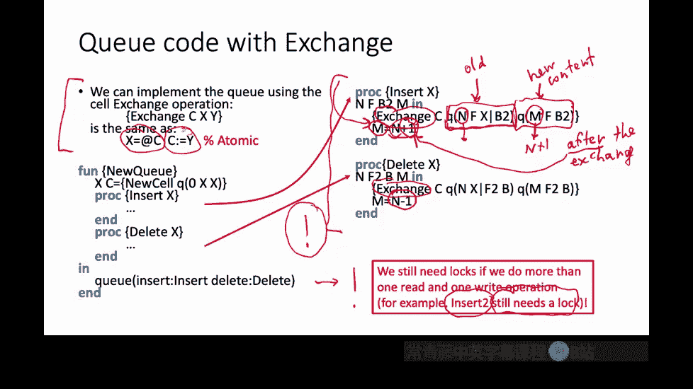

To the chat。Is that iss that reasonable so you can see now you get already one example of why exchange is so nice。

 okay why exchange is nice， but we will see a better example of exchange in a few minutes when we start implementing the locks。

😊，Okay， so now what we're going to do， I've showed you an example of how to use the locks in the concurrent viewue。

 Now， we're going to implement the locks， and you will see what goes on inside the lock。

 The magic of the lock。 You'll see how it's done。😊。

Okay， so we're going to implement the lock now。Implementing locks and we'll start by implementing simple lock and then reentrant locks。

So the way we will implement the locks， the locks， a lock can be implemented using a cell。

And the simplest way by far is by using an exchange operation。

 so the lock will need the reenttrant lock actually needs two cells。

 but a simple lock that is not reenttrant， can be implemented with one cell。

So we will use a very powerful technique。😊，Called。Token passing。

So the way the lock works is we have to guarantee that there's only one thread inside。

 How can we guarantee that Well， we have a special data item called a token。

And we guarantee that there is only one token in the whole system。When a thread goes in the lock。

 it takes the token。When a second thread tries to get in。It tries to take the token， but it cannot。

 because there is only one token。So it will wait。And when the first thread leaves the lock。

 it passes the token to the next one in line。 So then the waiting thread gets the token and goes in。

 So the thread needs to get the token to get in in French。 It's called the ajuto。

 So you have a thing which exists only once。And that thing will guarantee that you have exclusion inside the critical section。

 Okay， so token passing is a very powerful technique， in fact。It's used also in real life。

If you go into a store or you go to Brussels Middi station and you have to get in line to buy a ticket。

 then you press a machine and it gives you a number and you basically wait until your number is called。

Okay， so you have a line of people waiting Here you have a similar thing。 You will have a line。

 a queue of threads， waiting for the token。But only one thread will actually have the token， okay？

If a thread tries to get in， so there's only one token in the system。

 if it tries to add in without a token， it waits， and when a thread leaves。

 it passes the token to the next guy。So how do we implement the token。

 we're going to implement the token， there's many ways to implement tokens。Okay。

 if you want to implement this in Java， you can do it in one way or in C。

 but we are going to implement tokens using single assignment。

 you can understand we have this very powerful single assignment concept。

 so we're going to implement tokens using single assignment。

So here is a simple lock with token passing。So the token。Is actually going to be stored in a cell。

 and we're going to use this special constant value so。

The idea is that if you have a bunch of threads trying to get in。

So let me make a bunch of threads here， all of the threads want to get in。

And each thread will get two variables。😡，It will have an old one and a new one。

And then the next thread will have old one and new。And this one will have old and new and so on。

And we were8。And explain how it works then。Old a new。So the new value。

Of one thread is equal to the old value of the next thread， okay。So the in order to get in。

The old one has to be bound， so this is the token。So when T0。Comes。

In so the lock is here of a procedure。 P here is the statement。So the P。

 it's actually going to use higher order here。So the P is going to be a zero argument procedure that contains a statement。

So how does it work Well， I use exchange。To get the token。Okay， the exchange gives me the old value。

And then I wait。I wait until it's bound。 So the token means that the variable is bound。

 So here I will do a weight。A old。So the first thread that comes in T0。The first one。

It gets the old value， which is equal to unit。😡，He's very happy。

 very happy because he has the Too and he goes in and he executes P。Now， the second thread。

We'll try to get in。But he will get the old value， which is equal to the new value of the the other。

 the first one， which is going to be unbound， poor guy。So he doesn't have the token。

 So the variables onbound。 He doesn't have the token。 So T1 will do a weight。

 but old of T1 is the same a nu of T0。 so no token。And now I assume T2 tries to get in。Okay， fine。

 T2 is tries to get in。 It also doesn't exchange。 It has the old value。

 which is the same as the nu of T1。 It also does await poor guy。 They all have to wait。

They all are going to do or wait。 So if you have a million threads trying to get in。

 each one of them will get a new variable， and it will wait。Now， in the meantime， T0 is very happy。

 is executing P。And eventually is finished。 T 0 is finished。

 So he comes here and he binds new to unit。And that means he's passing the token to the next guy。

So binding new to unit means that T1 will continue and T1 is now happy and T1 continues。

But T2 is still waiting，h？T2。Is still waiting， and T 2 will wait until T1 executes。

 So when T1 executes， it binds its new variable to unit， then T 2 will get the token。

 So you see that each thread when it comes in。By exchange， it actually gets a place in line。

And the token means that the variable is bound。 Okay， iss bound to a constant。

And it will only happen when the previous thread leaves。The critical section。

 So you see that the exchange is like the boundary guard。

 It's it's you're getting the token and the weight is the gate which can open。

 which opens or closes Okay， so as soon as this variable this bound you get in you enter and then when you leave you tell the next guy that you can go in。

 So each thread will basically pass the token to the next guy。Okay， so you see how that works。

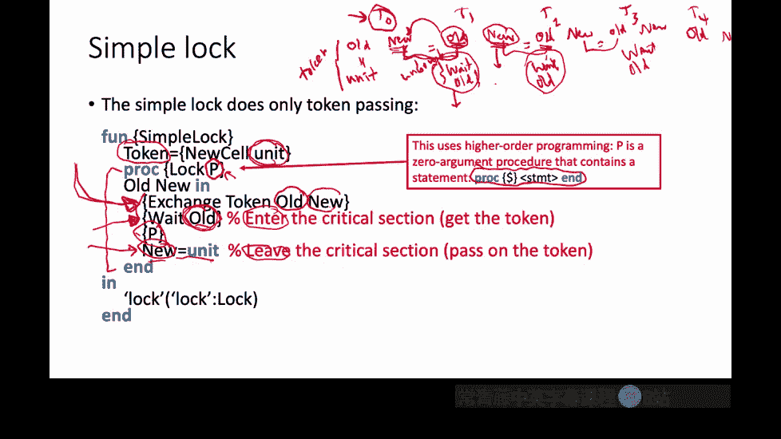

You see， it's a little bit subtler。It's because it's a concurrent program now， we're handling。

We're handling many threads， and it's the exchange that is like the arbiter。

 The first thread calling the exchange is the lucky one。

And they will enter in the order that they call exchange。So there's a question。By content。

 the question is。Threads will enter in the lock at the same order。

 they call the token or order can be different。 No。

 they will enter in the order in which they call the exchange。So when you call exchange。

 you get your hands on a variable and you wait until the variable is bound。

 And that means you have the token。 So if you have 10 threads calling exchange。

 they will get 10 variables。 The first one will get in immediately。

 The second one will wait for the first。 The third will wait for the second and so on。

 So they will go in in the order in which they call the exchange。 Okay， You see that。

See how it works there。Okay。So， let me。Go back to the slide。

So I can actually write the code for that。So let me write the code for that。Okay。

 so here let me write a simple look。Implementation。Of。Simple luck。Okay， let me call it simple lock。

Because it's still not reentered， okay， we'll say so the token is a new cell。Well。

 the first one immediately has the token。 Now we have a procedure。So this is the luck。

Procedure with a zero argument statement in it。Okay。Let me first write the skeleton of this code。

And then we have。A record。With let me call it lock with a field called lock。

I have to put it in quotes because lock is a keyword， otherwise doesn't work。

So that's the lock procedure。 Let me now write the lock procedure。

 I will do an exchange here of the token old new。Of course， I have to declare old a new here。

And now I wait for the token that's waiting for old。And now then I do P。

And then I pass the token to the next guy when I'm done news unit。Okay。

 so this is the simple lock and it will behave。Like a lock。But。

 but it has a problem that it's not reenttrant。 Okay， so let me go back to the slides。

 Let me explain that。So let me go back now to the。

Side here。So the simple lock here。Purely does tookken passing。So but it's not reenttrant。

 And the reason why， well， let's say that inside P。Let's say that inside P。I tried to go in again。

 the lock。 I could。 maybe inside， I'm also calling。I'm calling luck in here。In P。

 I can do that like for insert 2。 Well， what will happen here？ It's very naive。 The。

 the new the new second call will also do an exchange。And it will wait。But since it's in。

It will never get out so we have a deadlock so in the simple lock。

 if you try to get in to a lock that you're already in。

 you're actually going to pick a ticket naively and wait for the token again。

 even though you already have it so the system will deadlock and it's a lock okay so the simple lock does not let you stay in the lock when you're already in。

So how do we fix it？Okay， we will fix it first， let me do a small extension to simple lock。

 Let me add exception handling。So we want to make our locks completely good， realistic。 Okay。

 I'm not showing you toy code。 I'm showing you real code that you can use in a real system。

 which means that we have exception handling。It can mess things up。

 What happens if P raises an exception， Why we have to handle that。Luckily。

 the try instruction can help us。 Remember， when we saw exceptions， we can do try。 Finally。

 this means that this operation is done。Also， when we raise exception。

 it's done in the normal case and in the exception case。 So we will leave。The critical section。Also。

 when we raise an exception， okay？So this fixes the exception handling， but still it's not reentrant。

Okay， so how do we make it reentrant？We have to be a little bit smarter。A little bit， not a lot。

 We need a new concept。 We need to know the identity of a thread。

 If I have each thread coming in many threads， I have to know whether it's the same thread or a different thread。

 I have to know that。So in order to implement a reenttrant lock。

 I need to know the identity of the thread。 So different languages do in different ways。 In usz。

 I have an operation called thread dot this。 So thread is a module and thread dot this is a zero argument function。

 it returns。The identity， a constant， which is kind of the name of the thread。

 It returns to the identity。 And then we can compare and see if it's the same thread。 Okay。

 so with this， we can make it reentrant。 We need a second cell。Which。Here I call it current thread。

 current thread， current thread， which tells me which thread is in there right now。And in lock。

 I have to put in an extra thing here， I will compare。When I enter the lock。

When I'm trying to get in， I will start by comparing the current thread with the identity of the thread that's trying to get in if it's the same one。

 if the equal equal returns true， then I don't have to worry about tokens and whatever I'm already in okay。

 I only have to worry about tokens the first time I get in， if I'm in I'm in， okay。

 so I immediately execute P and I don't worry about tokens。However。

 if the thread identity is is false， if the equality is false， so a new thread is trying to get in。

 then I go to the else， and I will。Run the coat， as before。There is small changes。

 I have to assign this current threat。So， so when I get in here， wait old， I'm in。

 I assign current thread to thread this and when and before I get out。

 I have to assign current thread back to unit。 So while I'm executing P。

 the current thread will be equal to the thread。That's in there。 Okay。

 so this is a correct implementation of reenttrant locks。 You see， it's still kind of subtle。

And notice this， the order of the statements is extremely important。

If I switch these two statements around， it's buggy。

And you can invent a scheduler choice that will cause a system to do very weird things。 Okay。

 so let me。Talk a little bit about。Debugging such a subtle implementation。 So I have a question here。

 what can go wrong。If the weight old and the curve thread assignment are switched。

 So going to the previous slide， it's this part， it's the coming in。And a second question。

 what can go wrong if these two instructions are switched， In fact。

 you are not allowed to switch them。 If you switch them， it's a bug。So an exercise for you。

Is to find a scenario。That means assume you have two threads and assume you have a scheduler that's trying to break the system and you try to make the threads wake or sleep to make the bug appear。

So the hint is that the weight must come before this current thread and the new equal unit must come after because the weight old means enter the critical section。

 and the new equal unit means exit the critical section and the current thread assignments must happen inside the critical section。

 it must happen in a controlled environment when you guarantee only one thread can be there。

 So these assignments have to be done in the nice area， which means inside the critical section okay。

So that's the theory of why they have to be inside。But。A very good exercise for you。

Imagine what could happen。If these two instructions or these two are switched。

 what happens if cur thread is changed outside of the critical section？Of course。

 if you assign curve thread and then you do weight old。

 you can assume that as the curve thread and the scheduler sleeps right there。

 it wakes up the other thread so the value of the curve thread may be wrong Okay。

 so exercise for you。Work it out。Figure out exactly how it can go wrong。

And in order to motivate you even more， I can say that I could ask that on the exam。 Okay。

 I could ask you to give me a scenario where it goes wrong if the instructions are switched。

 So this is a great exercise for you， doing this exercise means you really understand how the scheduler has a power and how the program has to defend itself against the schedulerss。

😊。

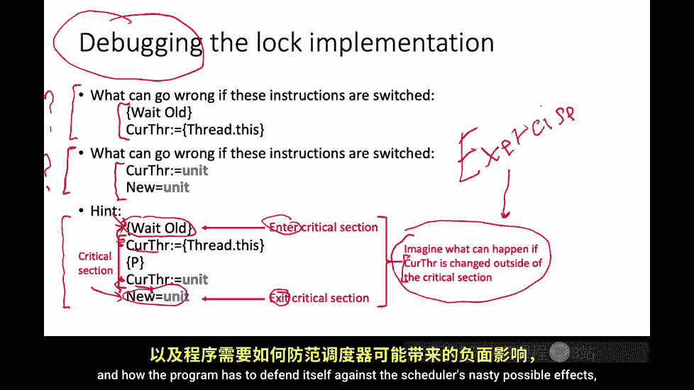

Nasty possible effects， okay。Is that reasonable？So now you have seen the reenttrant lock implementation。

 This is actually a quite subtle concurrent program。 Okay， it uses token passing。

It works correctly when an exception is raised inside the lock。And it is reentrant。

So realistic locks are doing all this， this is a actually realistic implementation。Okay。

 for the reentrant lock。You see that？Okay。So， so that has given us already an understanding of locks。

Let me show you now another concept。Called a tuple space。

 which is another way of managing concurrent programs。 So let me go back to the slides now。

So， now， we have seen。Reenttrant locks。 And we have seen how to use them。

Let me now show you to finish the course today a new another concept called the tuple space。

 which is kind of halfway in between shared state and message passing。

 So the tuple space is not It's not a lock。 It's a different thing。

 but we will implement it using locks。 So I will show you the implementation of tuple spaces using reenttrant locks。

 So tuple space is a very interesting concept by itself。😊，Okay， so let me now show you what it is。

 so a Tu of space is actually a data abstraction。A very kind of sophisticated data abstraction。

 which you can use for concurrent programming。 So it's a multi set。Of tuples。 So basically。

 if I have a tuple space here。I can put tuples in there。嗯。And it can be stuff in there。

 So it's a multi set of topples。 So a multi set means that the same tuple can be in there more than one time。

 So it's not a set。In a set， each element can be in there only once in a multi set。

 you can have many elements in there， and the same element can be more than once。

 It's just that the order of the elements is not important。

 So the notion of set means that the order is not important， okay。So we have。3 operations。

We have right。Read。And a non blocking rate。 So let me explain the right。 right is very simple。

 You put in the tuple。 the new tuple T goes in the tuple space。Read is also simple。

You wait until the top of space。Has a tuple with label L， and then you remove it and bind it to T。

 So basically you bring the tuple out。But you will wait。Until something is there。

So the read is actually going to do a。Await until the tuple is there。

 So if you want to remove a tuple， a 3，4， for example。

Then you will wait first until there's a tuple with label A， and then you remove the tuple。

So the the reed is actually waiting。 So the right never waits。 You can put tupleles in there。

 It's like a big bag。And then the read， you can say， I want a topple of this kind。

And it will wait until somebody else puts the tuple in， and then it will take it out。Okay。

There's also a non blocking version of read， which does not wait。So read nonblock。

 so it has an extra argument to be。It's the same as read， but it returns immediately。

 so B will be false if there is no tuple with label L。

 otherwise B is true and it removes one such tuple。So the tuples are like unique things。

 then each one I put in it adds an extra element and I can take them out one by one。

 so I really have a bag of things in a tuple space。So this concept。

 we will implement this concept using locks。So this is another example of how we implement something using locks。

But we will also use it for building distributed concurrent programs。So just a little bit of history。

 the original concept of Tuple Space was invented by a computer scientist called David Gillerter。

A long time ago in 1985， he called it Linda， not sure why。So for him。

 Linda is the notion of a topple space。But in general。

 this way of programming is called coordination model， why is it called coordination because？

You can have threads putting tus in， threads taking tuples out and the threads taking tus out。

 they will wait。And the tuple goes in。 And so this is， they're like coordinating with each other。

 The thread taking out has to wait until the other one puts a tuple in。 So their coordinating。

 So this approach of using tuple space is called coordination model and a language that gives you access to a tuple space is called a coordination language。

 So this is actually an interesting concept that's sometimes used in real systems。 Okay。

It's interesting because it's actually combination。Of shared state and message passing。 Now， again。

 I'm introducing something subtle。So the tuple space is like shared state because the tuple space is shared by many threads。

It's not cells， but it's a set， a multi set of tuples。And it's easier than shared state because。

A tuple is a big thing。So adding a tuple is like a large atomic action。

 you can add a huge amount of information。When you write and when you read。

 you take out a topple which can be very big。So it's much easier actually to program than shared state because tuples correspond to large atomic actions。

So that's how it's like shared state， but how is it like message passing？Well。

 it's actually like send and receive。Writiding a tuple is like a scent。

And reading a tuple is a receive。 So a thread writing a tuple is doing a send。

 and a thread reading a tuple is receiving that tuple。 So the tuple is like the message。

What's the difference with message passing？Is that the sender does not know who is the receiver。

 This is very interesting In a regular message sending， I send to a destination。

 a message I send to an active object or port object。But here I put in， I sent。

 but I don't know who is the receiver。 The receiver is unknown to the sender。

 So the difference with message。Passing is that the sender does not know。The receiver。 Okay。

 so that's the difference。 So it's a very interesting kind of message passing。

You send messages somebody will receive， but you don't know who you don't know the receiver。

So you can see tuple space is actually similar。To message passing。And similar to shared state。

 So it's a very interesting combined concept。 Okay， let me actually just to finish for today。

 Let me show you example of topple space。 Let me show you。

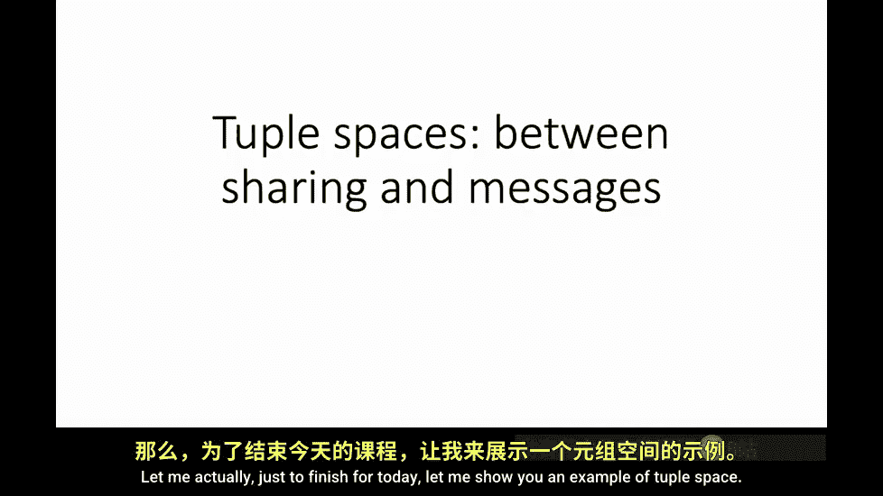

An example code。So there's a question， is the tuple space equivalent to the mailbox of airline？呃。No。

 not really。 the mailbox of airlinel is read by one process。

 whereas a tuple space can be read by many threads。 That's one difference。

 So the tuple space is really shared data， whereas the airlineline mailbox is not shared。

 It's in each process has its own mailbox。Okay， so it's really inside the process。

 whereas the topple space is shared by many， many threads。 So that's one difference。

 The other difference is that。The， the。Mailbox has an ordered。Set of messages。

Ordered set of messages。 and you read them in the order that they are sent in。

But you read them with pattern matching。 So that's the same。 So tuple space in general。

 the read operation does a pattern match， whereas the mailbox in Erl also does pattern match。

 but it's read in order。So there's two big differences then。

Tuple spaces shared by many threads whereas mailboxes inside one process。And。

The second difference is that the order。A tuple space is unordered， whereas the mailbox is ordered。

 Okay， that answers the the question。 Let me show you just an example of writing Tple space。

For finishing for today。 So I have here very conveniently。To the left。

A piece of code that implements tuple spaces， So the tuple space needs a Q。

 So I have here a Q and I have here a class tuple space。 So let me do very a very simple thing。

 Let me copy and paste this code here into the Oz window。So here we have。

 I have a special cu that is the cu that I've defined for the tu space。

And then I have the actual tuple space itself， so let me compile this。

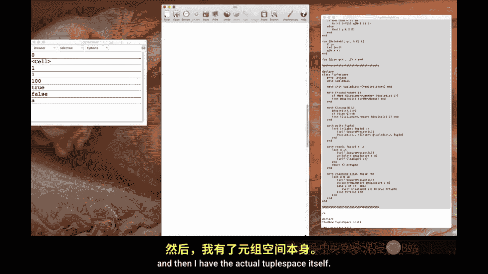

Let me compile the queue first。And now I will double space。

 so the double space is defined as a class。Okay。So this has been compiled。

So now me let me show you how the tuple space works。 Let me just show you some。

Possible operation and tuple spaces。So I can declare a new tuple space here。So let me run that。

I can write things in tuple spaces， so here I will put of one， of1，2 and bar of two。

 those are three tuples in the tuple space。And now I will read， okay。

 I'm using a funny notation here， but let me change that Local X in browse read F X。Sorry， browse X。

Let me write it in a way that does not use any syntactic shortcuts。So here。

I am going to read a coupleple whose label is full。And I will browse it。Okay。This shows Fu1。

If I run it again， it will run fu1，2。 Now， if I run it a third time。The read will block。

 It will wait。 Okay， if I run this now a third time。What's going to happen？

What will be displayed if I run this a third time？While I answer that immediately。

 nothing will be displayed because the read will block。So it will block。

 you see nothing is displayed here。And now if I write。Another tuple， car 5。

Nothing is displayed if I writeF of one。Then the full of one is displayed。

 If I write full of wine again， nothing is displayed。 So you see each time I do a read。

 it waits okay。Let me go back now to the slide。To finish for today。

Okay， so tuple space。So。Let me just conclude， I will say a little bit more about Tple Space and other things next week。

 but let me conclude for today。

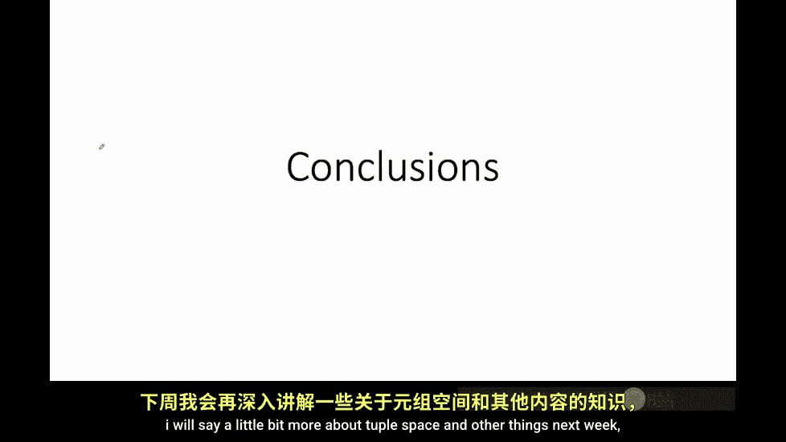

So to summarize， shared state and currency combines threads and cells。

And we have to manage the interleavings exponential and the way to do it is to build large atomic actions。

And the main concept is a lock。And then monitors and transactions are refining that。

 we'll see that later， and we have also a very interesting way of doing shared state。

 which is called tuple spaces。So I showed you how to program with locks so some examples and also how locks are implemented using token passing。

And in the next lecture， we focus on monitors and transactions。

So that's the end of the course for today。Thank you for attending the course and so now you are free to leave。

 but I will stick around for a few minutes。To answer questions， if you have any questions。

Thank you very much for coming here so early in the morning。

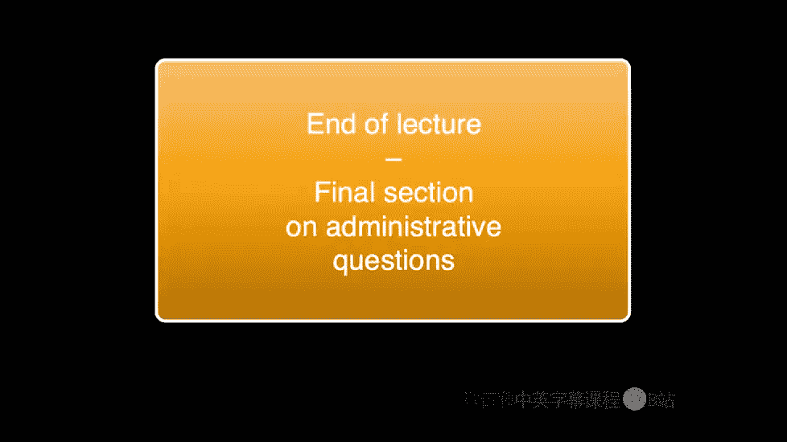

Do I have there's the question， do I have information on how the exam will be organized？Yes。Yes。

 but I will give you the information。 So the university， as you know。

 is completely reorganizing all the exams to be distance exams。

 So the exam for this course will very likely be a distance exam using a special software that will let you do the exam at home。

 and the software will basically check that you were not cheating。😊，Okay。

 so this is still being worked out， but legally by the end of April。

All the students will get official notification of exactly how the exam will be organized。

 so because of the coronavirus lockeddown， we will not have in-person exams except in very special circumstance。

 so it's very hard in the auditoriums the students have to be spread out and we need to disinfect the desks and there's one entrance and one exit。

 so only a small number of courses will be in person and almost surely this course。

 1131 will be distance exam except for a few people so the PEps students will still have in person because there are small number and there may be a few other special exceptions but for most people it will be at a distance。

 but you will get official information of this by the end of April。

So what I'm telling you now is it's still a part of the discussion。

 so the university is still working out the details， it's a huge amount of work as you can imagine。

 so the university is being very proactive and working it all out。So by the end of the month。

 you will have the precise。Information。So there's a question。

 but I don't see the question because it's。呃。It's an image， but it's not， it's。

There's a question by Emma debuovvan， but can you type in the question because I can't see it actually for how many points will the project be worth？

The project will be worth five points。And in the midterm will also will not be worth anything yet the midterm is unfortunately not counting。

 but the project will be worth five points， so the exam will be worth 15 points so please do your best on the project and you will already have five points on your final grade okay so the project is mandatory and will be worth five points of your final grade。

And the exam will be worth 15 points， okay？Is that clear。 So I don't know everything yet。

For the exam， I'm telling you what's known right now。

 but you will get the final information by the end of the month of April。 that's a legal requirement。

 so the the French community has made this requirement on the exams so you will be informed well in advance and we will also organize a test。

A test exam so that you can install the software and make sure everything is working fine before the actual exam。

 Okay， so don't worry about the software and making it work。

 We will make sure everything is working before the final exam。

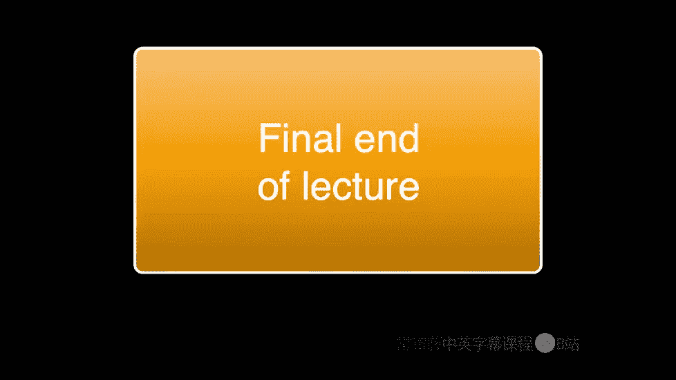