# 高级编程语言概念：10：并发队列、锁与元组空间

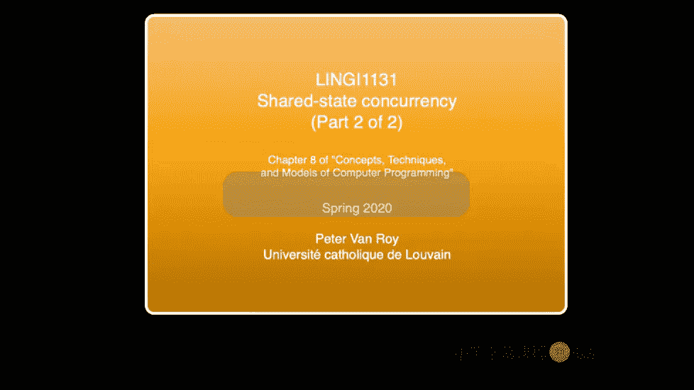


在本节课中，我们将学习并发编程中的三个核心概念：并发队列的实现、锁的内部机制，以及一种结合了共享状态和消息传递的协调模型——元组空间。我们将通过具体的代码示例来理解这些概念。

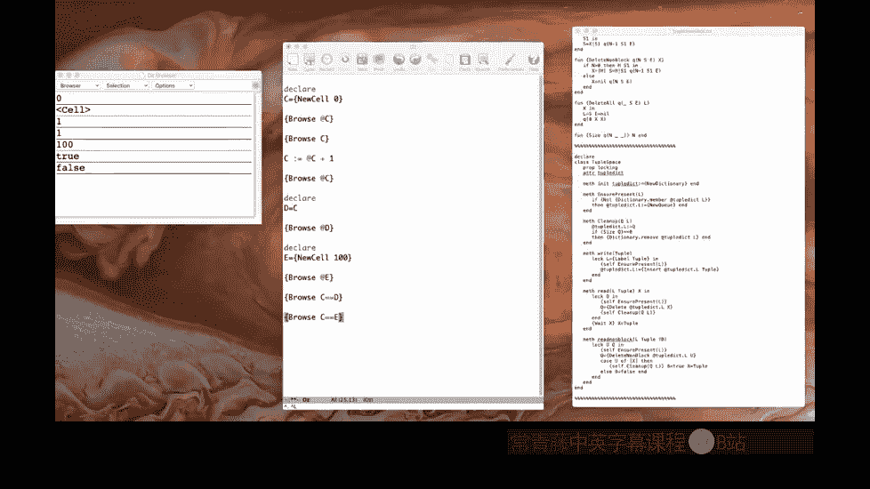


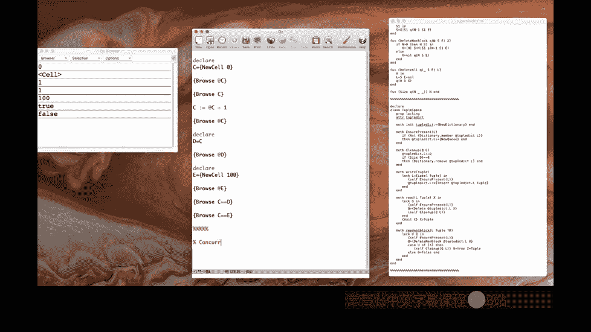

## 队列的插入与删除操作

上一节我们介绍了并发编程的基础，本节中我们来看看一个具体的并发数据结构——队列的实现。首先，我们需要理解队列的插入和删除操作是如何工作的。

以下是插入操作的逻辑描述：
1.  绑定队列的“后端”到一个新的变量 `X|B2`。
2.  更新队列，将新的后端 `B2` 放入，并将元素 `X` 添加到队列中。
3.  队列大小 `N` 增加 1。


以下是删除操作的逻辑描述：
1.  将队列的“前端”绑定到模式 `X|F2`，从而获取第一个元素 `X` 和剩余部分 `F2`。
2.  更新队列，使用 `F2` 作为新的前端。
3.  队列大小 `N` 减少 1。

这两个操作都涉及对共享状态（队列）的读取和更新，因此它们必须被放在一个锁保护的临界区内，以确保原子性。

## 并发队列的实现

理解了基本操作后，我们现在来实现一个具体的并发队列。这个实现将使用一个存储队列状态的 Cell 和一个用于同步的锁。

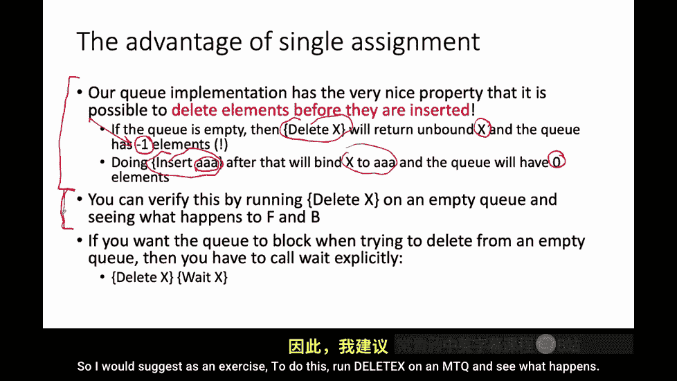

以下是并发队列的代码实现：

```oz
fun {NewQueue}
   C = {NewCell q(0 X X)} % 初始队列：大小0，前端X，后端X
   L = {NewLock}
   proc {Insert X}
      {Lock L
       proc {$}
          q(N F B) = {Access C}
          B = X|B2 % 绑定后端，添加新元素
       in
          {Assign C q(N+1 F B2)} % 更新队列状态
       end}
   end
   proc {Delete ?X}
      {Lock L
       proc {$}
          q(N F B) = {Access C}
          X|F2 = F % 绑定前端，获取第一个元素
       in
          {Assign C q(N-1 F2 B)} % 更新队列状态
       end}
   end
in
   queue(insert:Insert delete:Delete)
end
```


这个 `NewQueue` 函数返回一个记录，包含 `insert` 和 `delete` 两个过程。它们内部都使用同一个锁 `L` 来保护对 Cell `C` 的访问，确保了操作的线程安全。

## 关于空队列删除和可重入锁

现在，我们来探讨两个重要问题。首先，如果对空队列调用 `Delete` 操作会发生什么？其次，为什么我们需要可重入锁？

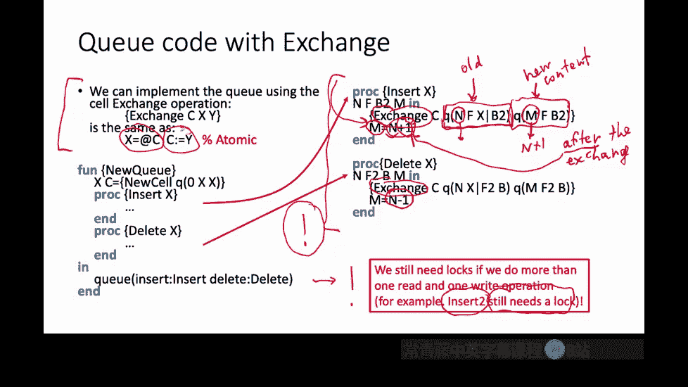

**对空队列执行删除**
在我们的实现中，如果队列为空时调用 `Delete`，队列大小 `N` 会变为 -1。这实际上创建了一个“承诺”：变量 `X` 会被绑定，但要等到未来某个 `Insert` 操作执行时才会实现。这是单次赋值特性带来的一个有趣优势，它允许某些操作非阻塞地进行。


**可重入锁的必要性**
考虑一个场景：我们需要原子性地插入两个元素 `X` 和 `Y`，确保它们中间不会被其他线程的操作打断。我们可能会创建一个 `Insert2` 过程：

```oz
proc {Insert2 X Y}
   {Lock L}
   {Insert X}
   {Insert Y}
   {Unlock L}
end
```

如果锁 `L` 不是可重入的，那么当线程在 `Insert2` 中已经持有锁 `L`，再调用 `Insert`（其内部也试图获取锁 `L`）时，线程会等待自己释放锁，导致死锁。可重入锁允许同一个线程多次获取它已持有的锁，从而安全地构建这种复合操作。所有实际系统中的锁（如 Java 的 `synchronized`）都是可重入的。

## 使用 Exchange 操作实现高效队列

我们之前的队列实现使用了锁。然而，由于插入和删除都只包含一次 Cell 的读和写，我们可以利用更底层的原子 `Exchange` 操作来实现一个无需显式锁的高效队列。

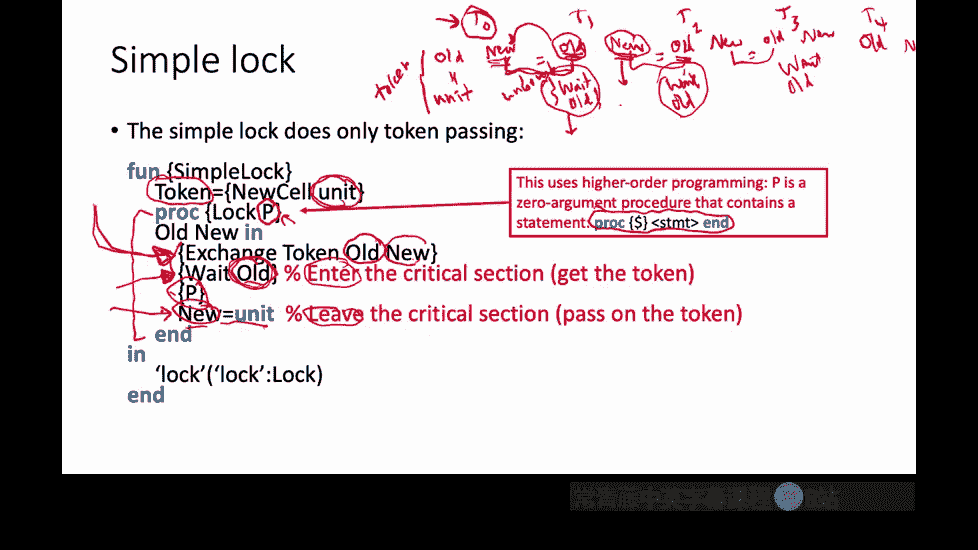

以下是使用 `Exchange` 实现的队列：

```oz
fun {NewQueueExch}
   C = {NewCell q(0 X X)}
   proc {Insert X}
      Old New
   in
      {Exchange C Old New}
      q(N F B) = Old
      B = X|B2
      New = q(N+1 F B2) % 注意：N+1 的计算在 Exchange 之后
   end
   proc {Delete ?X}
      Old New
   in
      {Exchange C Old New}
      q(N F B) = Old
      X|F2 = F
      New = q(N-1 F2 B) % 注意：N-1 的计算在 Exchange 之后
   end
in
   queue(insert:Insert delete:Delete)
end
```

这个实现的关键在于，`Exchange` 原子性地读取旧值并准备一个新值（初始未绑定）。在 `Exchange` 之后，我们根据读出的旧值计算新值并绑定它。这种实现非常高效，并且依然保留了“可提前删除”的特性。当然，如果需要像 `Insert2` 这样的复合原子操作，仍然需要额外的锁。


## 锁的实现：令牌传递

我们已经多次使用了锁，现在来看看锁本身是如何实现的。我们将使用**令牌传递**技术和 `Exchange` 操作来实现一个锁。

锁的核心是保证只有一个线程能进入临界区。我们可以用一个唯一的**令牌**来代表这个进入权限。线程必须持有令牌才能进入，离开时则将令牌传递给下一个等待的线程。

以下是简单锁（非可重入）的实现代码：

```oz
fun {NewSimpleLock}
   Token = {NewCell unit} % 初始令牌可用（unit）
   proc {LockProc P}
      Old New
   in
      {Exchange Token Old New} % 获取一个位置/令牌
      {Wait Old}              % 等待令牌变为绑定状态（即获得权限）
      try {P} finally New=unit end % 执行操作，最后传递令牌
   end
in
   lock(lock:LockProc)
end
```

它的工作原理如下：
1.  每个试图获取锁的线程调用 `Exchange`，得到一个“旧令牌” `Old` 和一个“新令牌” `New`。
2.  第一个线程的 `Old` 是初始值 `unit`（已绑定），因此它无需等待，直接执行过程 `P`。
3.  后续线程的 `Old` 是前一个线程的 `New`（初始未绑定），因此会在 `{Wait Old}` 处阻塞。
4.  当持有锁的线程执行完 `P` 后，在 `finally` 子句中将自己的 `New` 绑定为 `unit`，这相当于释放了令牌，唤醒下一个正在等待这个 `New`（即它的 `Old`）的线程。

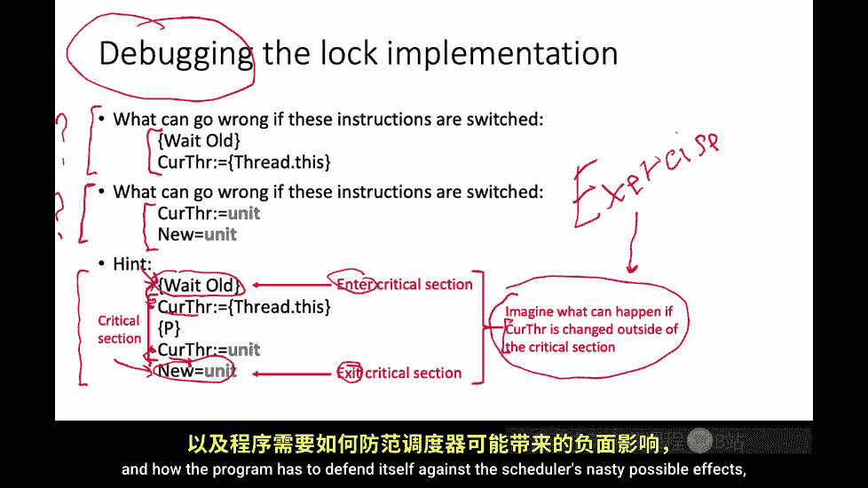


## 实现可重入锁

简单锁的问题在于，如果同一个线程在已持有锁的情况下再次尝试获取锁，它会再次调用 `Exchange` 并等待自己的令牌，导致死锁。为了实现可重入，我们需要知道当前是哪个线程持有锁。

以下是可重入锁的实现：

```oz
fun {NewReentrantLock}
   Token = {NewCell unit}
   CurThread = {NewCell unit} % 记录当前持有锁的线程
   proc {LockProc P}
      if {Thread.this} == {Access CurThread} then
         {P} % 同一线程重入，直接执行
      else
         Old New
      in
         {Exchange Token Old New}
         {Wait Old}                       % 进入临界区
         {Assign CurThread {Thread.this}} % 记录当前线程
         try {P}
         finally
            {Assign CurThread unit} % 清除记录
            New=unit                % 传递令牌
         end
      end
   end
in
   lock(lock:LockProc)
end
```

这个实现增加了一个 Cell `CurThread` 来记录当前锁的持有者。当线程尝试获取锁时：
*   如果当前线程 ID 等于 `CurThread` 中的记录，说明是重入，直接执行操作 `P`。
*   否则，执行标准的令牌获取、等待流程。在获得令牌后，立即将 `CurThread` 设为自己，在执行完操作后再将其清空。

**注意**：语句顺序至关重要。`{Wait Old}`（进入）必须在 `{Assign CurThread ...}` 之前；`{Assign CurThread unit}`（清除）必须在 `New=unit`（退出）之前。这样才能保证对 `CurThread` 的修改发生在受保护的临界区内。


## 元组空间：一种协调模型


最后，我们介绍一种介于共享状态和消息传递之间的并发编程模型——**元组空间**。它是一个由多个元组组成的多重集合（袋子）。

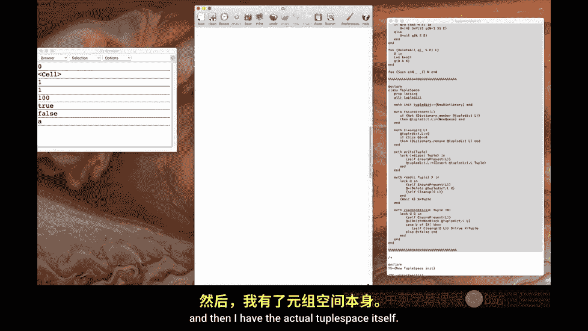

元组空间提供三种基本操作：
*   **`Write(T)`**：将元组 `T` 放入空间。永不阻塞。
*   **`Read(L ?T)`**：从空间中取出一个标签为 `L` 的元组，并绑定到 `T`。如果不存在，则阻塞等待。
*   **`ReadNonblock(L ?T ?B)`**：尝试取出一个标签为 `L` 的元组。如果成功，`B` 为 `true` 且 `T` 被绑定；否则 `B` 为 `false`。


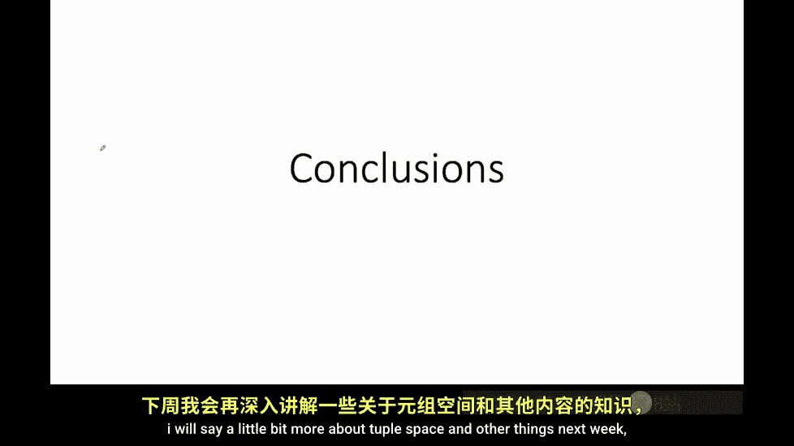

元组空间像**共享状态**，因为所有线程共享同一个数据空间。它也像**消息传递**，因为 `Write` 类似发送消息，`Read` 类似接收消息。关键区别在于，发送者（`Write`）不知道接收者（`Read`）是谁，实现了完全的解耦。


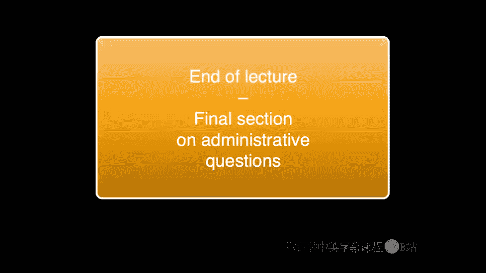

元组空间可以用我们已学的并发原语（如锁和队列）来实现，为构建分布式并发程序提供了一个高级抽象。

## 总结

本节课中我们一起学习了并发编程中的几个核心实践：
1.  **并发队列的实现**：我们使用锁和 Cell 实现了一个线程安全的队列，并探讨了使用原子 `Exchange` 操作的高效无锁实现。
2.  **锁的内部机制**：我们深入了解了锁如何通过**令牌传递**技术来实现互斥，并实现了支持同一线程重入和异常安全的**可重入锁**。
3.  **元组空间**：我们介绍了一种结合共享状态和消息传递的**协调模型**，它通过 `Write` 和 `Read` 操作在不知道通信对方的情况下协调线程间的合作。


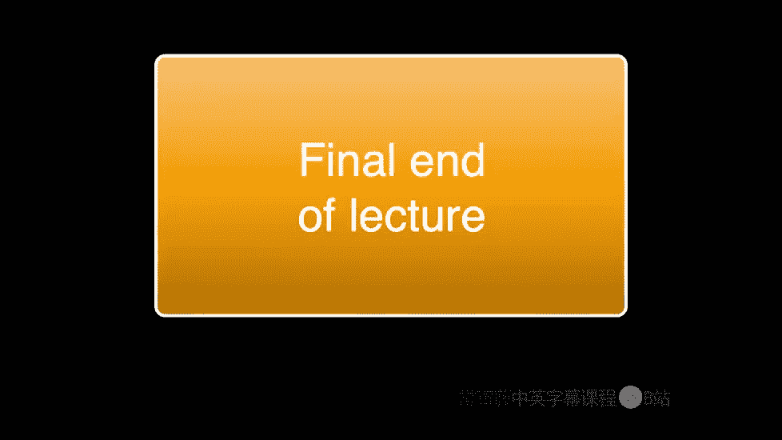

这些概念是构建正确、高效并发系统的基础。下一讲，我们将继续深入，探讨监控器和事务内存等更高级的并发控制概念。